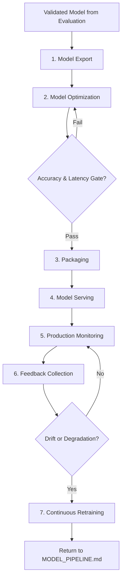

# AI Deployment Pipeline

## Overview

This document defines the complete Model Deployment Pipeline used after a candidate model passes evaluation in [`MODEL_PIPELINE.md`](MODEL_PIPELINE.md).

Its objective is to ship a validated model into a reliable, fast, observable, and maintainable production service without silently breaking accuracy or tensor contracts.

The pipeline emphasizes:

- Parity between training/evaluation and inference preprocessing
- Measurable latency, throughput, VRAM, and accuracy trade-offs
- Reproducible packaging and artifact versioning
- Safe rollout with rollback criteria
- Closed-loop monitoring and retraining triggers

---

# Architecture

---

# Pipeline Layers

## 1. Model Export

### Objective

Convert the trained checkpoint into a portable, inference-ready format decoupled from training code.

### Activities

- Export checkpoint (e.g. PyTorch → ONNX / TorchScript)
- Define explicit input/output names, dtypes, and dynamic shapes (e.g. dynamic batch size)
- Verify numerical parity between exported model and reference PyTorch model (e.g. `max_abs_diff` within tolerance)
- Pin model metadata (version, commit hash, preprocessing config, label map)

### Module Mapping

- `src/optimization/`

### Output

- Verified exported model artifact + parity report

---

## 2. Model Optimization

### Objective

Meet production Latency, Throughput, and VRAM targets while staying within acceptable accuracy degradation bounds.

### Activities

- Runtime selection (ONNX Runtime, TensorRT, OpenVINO, Torch compile)
- Precision optimization (FP16 / BF16 / INT8 PTQ or QAT)
- Structural optimization when needed (Pruning, Distillation)
- Benchmark on target hardware (warmup runs, p50/p95/p99 latency, throughput, peak VRAM)
- Re-evaluate metrics on validation set after every optimization step

### Gate

- Accuracy drop stays within acceptance threshold defined in `TASK.md`
- Latency and memory satisfy deployment constraints

### Module Mapping

- `src/optimization/`

### Output

- Optimized model artifact + hardware benchmark report

---

## 3. Packaging

### Objective

Bundle the model, inference logic, and runtime environment into a reproducible, portable deployable unit.

### Activities

- Separate model artifacts and configs from application code (never hardcode paths or secrets)
- Pin exact runtime and dependency versions (CUDA, cuDNN, ORT/TRT, Python packages)
- Build minimal container image (e.g. multi-stage `Dockerfile`)
- Add startup sanity check (model load + dummy forward pass) and `/health` / `/ready` endpoints
- Tag image and model artifact with immutable version identifiers

### Output

- Reproducible deployment package (container image + versioned config)

---

## 4. Model Serving

### Objective

Expose the packaged model safely to downstream clients with strict input/output contracts.

### Activities

- Implement serving API (e.g. FastAPI, gRPC, or Triton Inference Server)
- Enforce strict request/response schemas and input validation (image format, max payload size, timeout)
- Guarantee preprocessing and postprocessing parity with `src/inference/`
- Configure worker count, batching strategy (dynamic batching if applicable), and graceful shutdown
- Run load / stress test before exposing to production traffic

### Module Mapping

- `src/inference/` (preprocess, predict, postprocess — must NOT update model parameters)
- `src/serving/` (API schemas, routes, runtime integration)

### Output

- Running inference service + load test benchmark

---

## 5. Production Monitoring

### Objective

Detect system failures, latency spikes, or silent model degradation early in production.

### Metrics to Monitor

- **System & Serving:** latency (p50/p95/p99), throughput (QPS/FPS), HTTP/runtime error rate, GPU/CPU/VRAM utilization
- **Data Quality:** invalid inputs, resolution/aspect ratio anomalies, missing fields
- **Model Behavior:** prediction confidence distribution, class distribution shift (input/output drift)

### Alerting & Rollback

- Define explicit alert thresholds and rollback criteria to revert to the previous stable model version if SLOs are breached.

### Output

- Monitoring dashboard + alert rules

---

## 6. Feedback Collection

### Objective

Turn real production traffic into high-value data for error analysis and future model iterations.

### Activities

- Sample and store hard cases, low-confidence predictions, and failure cases (respecting privacy/PII rules)
- Collect user corrections or delayed ground-truth labels
- Track real-world failure modes not present in offline test sets

### Output

- Curated production feedback dataset

---

## 7. Continuous Retraining

### Objective

Close the loop safely when performance degrades or domain data shifts.

### Trigger Conditions

- Scheduled cadence, significant data/prediction drift, or metric drop below threshold on newly labeled feedback data

### Activities

- Merge verified feedback samples into versioned dataset (never overwrite raw data)
- Hand off to [`MODEL_PIPELINE.md`](MODEL_PIPELINE.md) for training and offline evaluation
- Promote new model only if it beats the current production baseline on both offline metrics and deployment gates
- Roll out progressively (shadow → canary → full traffic) with rollback ready

### Output

- Newly validated production model candidate

---

# Documentation Output

Write project-specific deployment pipeline documentation under `docs/pipelines/` (e.g. `docs/pipelines/deploy.md`).

---

# Relationship with Other Workflows

- Receives a validated candidate model from [`MODEL_PIPELINE.md`](MODEL_PIPELINE.md).
- Respects module boundaries (`src/inference/`, `src/optimization/`, `src/serving/`) and config/dependency rules in [`PROJECT_RULE.md`](PROJECT_RULE.md).
- Every concrete deployment task still executes through the delegation loop: [`TASK.md`](TASK.md) → [`PLAN.md`](PLAN.md) → [`EXECUTION.md`](EXECUTION.md) → [`TESTING.md`](TESTING.md) → [`LOGGING.md`](LOGGING.md) → [`KNOWLEDGE_EXTRACTION.md`](KNOWLEDGE_EXTRACTION.md).
