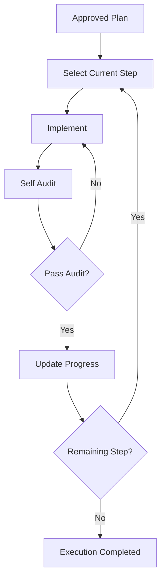

# Implement & Audit

AGENT tracks execution progress against the approved plan in `.agents/tasks/<task_name>/plan.md`.

## Overview

This document defines how the AI Agent executes an approved plan.

The objective of this phase is **not simply to implement code**, but to execute every approved task safely, incrementally, and verifiably.

Every execution step must be auditable before moving to the next one.

---

# Architecture



---

# Workflow

Each plan is executed one step at a time.

The agent must never execute the whole plan blindly.

For every step:

1. Implement
2. Self Audit
3. Update Progress
4. Continue

---

# 1. Select Current Step

## Objective

Identify the next approved step in the execution plan.

The agent must:

- understand the objective
- identify affected modules
- identify expected output

Do not execute multiple unrelated steps simultaneously.

---

# 2. Implement

## Objective

Complete the current step exactly as described in the approved plan.

Typical activities include

- Write code
- Modify existing code
- Refactor implementation
- Update configuration
- Create documentation
- Generate reports

Implementation must remain inside the approved scope.

---

# 3. Self Audit

## Objective

Verify the implementation before continuing.

Self Audit is mandatory after every completed step.

---

## Audit Checklist

### Requirement Alignment

- Does the implementation satisfy the approved step?

---

### Scope Validation

- Did I modify files outside the approved scope?

---

### Coding Standard

- Follow project conventions
- Naming consistency
- Documentation style
- Code formatting

---

### Contract Validation

Verify all project contracts remain valid.

Examples

- Tensor Shape
- API Contract
- Configuration Structure
- Directory Convention

---

### Constraint Validation

Ensure no project constraint has been violated.

Examples

- No hardcoded path
- No new dependency
- No unnecessary refactor
- No API breaking change

---

### Side Effect Analysis

Check whether this implementation unintentionally affects

- other modules
- training pipeline
- inference pipeline
- deployment pipeline

---

# 4. Update Progress

After passing the audit, update execution status.

Example

```
Plan Progress

✓ Step 1

✓ Step 2

Running Step 3

Waiting Step 4
```

Progress should always represent the current execution state.

---

# 5. Execution Rules

The agent must

- execute one step at a time
- audit every completed step
- never skip audit
- never silently change plan
- never modify unrelated modules
- stop immediately when encountering ambiguity

---

# Failure Handling

Execution must stop when

- task requirements become ambiguous
- required information is missing
- project constraints conflict
- implementation would violate the approved plan

The agent should report the issue and request clarification instead of making assumptions.

---

# Deliverables

When execution is complete, the agent should provide

## Summary

Brief description of completed work.

---

## Modified Files

List all modified files.

---

## Validation

Explain how the implementation was validated.

Examples

- Forward pass success
- Unit test passed
- Smoke test passed

---

## Remaining Risks

Report known limitations or unresolved issues.

---

# Relationship with Other Workflows

Implement & Audit only executes an approved plan.

It does not

- define business requirements
- redesign the project
- create a new implementation strategy

Those responsibilities belong to

- Task Definition
- Planning
- AI Development Pipeline

Implement & Audit begins only after the execution plan has been approved by the engineer.