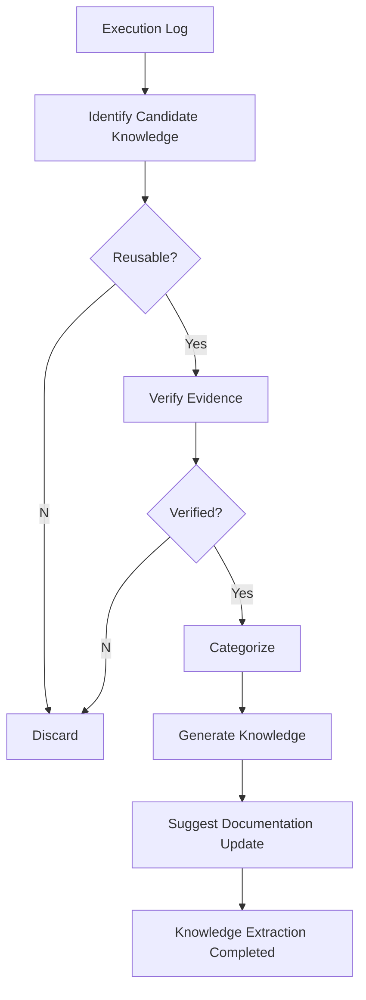

# Knowledge Extraction

EGINEER and AGENT read, write at .agents/knowledge_extracture/

## Overview

This document defines how the AI Agent extracts reusable engineering knowledge after a completed task.

Unlike Logging, which records execution history, Knowledge Extraction identifies information that may benefit future tasks.

Only reusable and verified knowledge should be extracted.

---

# Architecture

---

# Objective

The objective of Knowledge Extraction is to transform execution experience into reusable engineering knowledge.

Knowledge should

- reduce repeated mistakes
- improve future engineering decisions
- preserve practical experience
- keep project documentation up to date

---

# Workflow

Knowledge Extraction consists of

1. Identify candidate knowledge
2. Verify evidence
3. Categorize knowledge
4. Generate knowledge summary
5. Suggest documentation updates

---

# 1. Identify Candidate Knowledge

Review the completed execution log.

Look for

- repeated problems
- useful debugging techniques
- architecture decisions
- implementation patterns
- optimization techniques
- project conventions
- engineering best practices

Do not extract task-specific information.

---

# 2. Verify Evidence

Knowledge must be supported by evidence.

Evidence may include

- successful implementation
- passed testing
- benchmark results
- evaluation metrics
- repeated observations

Unverified assumptions must not become knowledge.

---

# 3. Categorize Knowledge

Each knowledge item should belong to one category.

Examples

- Architecture
- Data Engineering
- Model Engineering
- Deployment
- Performance
- Debugging
- Coding Standard
- Project Convention
- Best Practice

---

# 4. Generate Knowledge

Each extracted knowledge should include

## Title

A concise description.

---

## Category

Knowledge category.

---

## Description

Explain the engineering knowledge.

---

## Evidence

Reference where the knowledge came from.

---

## Recommendation

Explain how future tasks should apply this knowledge.

---

# 5. Documentation Update

If the extracted knowledge affects the project permanently,

suggest updating documentation such as

- README.md
- PROJECT_CONTEXT.md
- MODEL_PIPELINE.md
- DEPLOY_MODEL.md
- CODING_STANDARD.md
- Module README

Do not modify documentation automatically unless instructed.

---

# Extraction Rules

Extract only knowledge that is

- reusable
- verified
- generalizable
- valuable for future tasks

Do not extract

- temporary debugging notes
- unfinished ideas
- assumptions
- one-time implementation details
- execution history

---

# Example

Execution Log

- ConvNeXt implementation completed.
- Smoke Test passed.
- Tensor shape mismatch occurred because image size was not divisible by 32.

↓

Extracted Knowledge

Title

ConvNeXt Input Size Requirement

Category

Model Engineering

Description

ConvNeXt works more reliably when input image dimensions are divisible by 32.

Evidence

Validated during implementation and testing.

Recommendation

Validate input image size before training or inference.

---

# Relationship with Other Workflows

Knowledge Extraction begins after Logging.

Workflow

Task
↓
Planning
↓
Execution
↓
Testing
↓
Logging
↓
Knowledge Extraction

Logging records history.

Knowledge Extraction builds long-term engineering knowledge.
