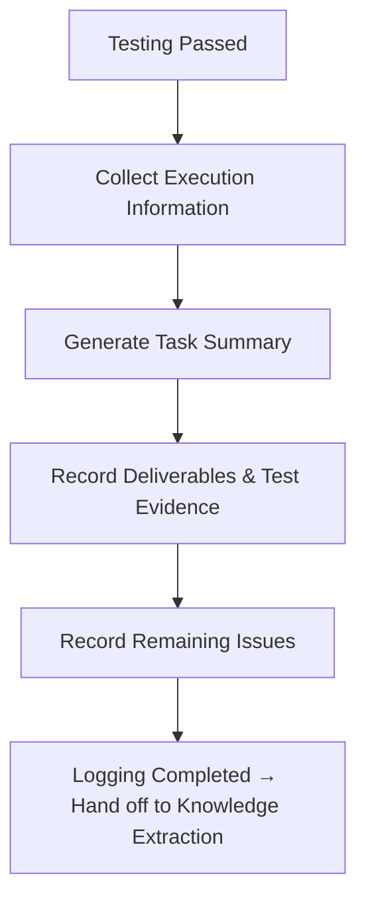

# Logging

ENGINEER and AGENT read, write at `.agents/logs/`.

## Overview

This document defines how the AI Agent records the factual outcome of a completed task.

Logging is Phase 7 of the delegation loop (after [`TESTING.md`](TESTING.md) passes and before [`KNOWLEDGE_EXTRACTION.md`](KNOWLEDGE_EXTRACTION.md)).

Its objective is to preserve verified execution history — **what was done, why it was done, what files changed, and what test results were observed**.

---

# Architecture

---

# Workflow

After all required tests have passed, the agent records the execution.

The logging process consists of:

1. Collect Execution Information
2. Generate Task Summary
3. Record Deliverables & Test Evidence
4. Record Remaining Issues

---

# 1. Collect Execution Information

## Objective

Collect all verified information generated during execution.

Examples:

- Executed plan
- Modified files
- Test results
- Metrics
- Reports

---

# 2. Generate Task Summary

## Objective

Summarize the completed work.

The summary should answer:

- What was changed?
- Why was it changed?
- What was the final outcome?

The summary should remain concise and factual.

---

# 3. Record Deliverables & Test Evidence

## Objective

List all generated artifacts and link or summarize the verification results from [`TESTING.md`](TESTING.md).

Examples:

- Source code
- Configuration
- Documentation
- Reports / Test logs
- Figures
- Trained models

---

# 4. Record Remaining Issues

## Objective

Document known limitations, edge cases, or deferred follow-ups observed during execution or testing so future tasks start with accurate context.

---

# Log Structure

Each completed task log should contain:

## Task

Task name (and link to `.agents/tasks/<task_name>/task.md` and `plan.md`).

## Objective

Task objective.

## Summary

Brief factual description of completed work.

## Modified Files

List of modified files.

## Deliverables

Generated artifacts.

## Test Result

Testing outcome and evidence (Smoke Test & Normal Test).

## Remaining Issues

Known limitations or future improvements.

---

# Logging Rules

The agent should:

- record only verified information
- avoid duplicate logs
- keep summaries concise
- separate facts from assumptions
- avoid recording temporary thoughts

---

# Relationship with Other Workflows

Logging is Phase 7 of the delegation loop.

It does not:

- modify implementation
- rerun tests
- redesign the solution
- extract generalizable long-term knowledge or modify project documentation

Once the execution log is complete, hand off to [`KNOWLEDGE_EXTRACTION.md`](KNOWLEDGE_EXTRACTION.md) (Phase 8) to distill reusable knowledge and propose any permanent documentation updates.
