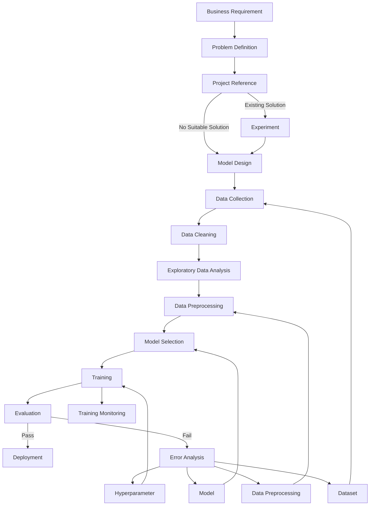

# AI Development Pipeline

## Overview

This document describes the complete AI Development Pipeline used in the project.

The objective of this workflow is not only to train a model, but to guide the entire engineering lifecycle from business requirements to a deployable AI system.

The pipeline emphasizes:

- Requirement-driven development
- Evidence-based engineering
- Reuse of existing research and open-source projects
- Continuous experimentation
- Root-cause analysis
- Iterative model improvement

---

# Architecture

---

# Pipeline Layers

---

# 1. Business Requirement Layer

## Objective

Understand the business problem before considering any AI solution.

## Input

- Customer requirements
- Business objectives
- User pain points
- Constraints
- Success criteria

## Output

- Business Requirement Document (BRD)

---

# 2. Problem Definition Layer

## Objective

Transform business requirements into a measurable AI problem.

## Define

- Task
- Input
- Output
- Target
- Scope
- Constraints
- Evaluation Metric
- Acceptance Criteria

## Output

Technical problem specification.

---

# 3. Project Reference Layer

## Objective

Investigate existing solutions before designing a new one.

## Activities

- Literature review
- Open-source repositories
- Research papers
- Existing models
- Similar products

## Decision

### Existing solution

↓

Experiment

### No suitable solution

↓

Model Design

---

# 4. Experiment Layer

## Objective

Validate existing solutions through reproduction.

## Activities

- Reproduce repository
- Benchmark performance
- Compare with project requirements
- Identify research gaps

## Output

Experiment report.

---

# 5. Model Design Layer

## Objective

Design the AI architecture if no suitable solution exists.

## Activities

- Architecture design
- Pipeline design
- Loss function
- Optimizer
- Data flow
- Model components

## Output

Model architecture specification.

---

# 6. Data Engineering Layer

This layer prepares high-quality data for training.

## 6.1 Data Collection

Collect datasets from

- Public datasets
- Internal datasets
- Crawling
- Sensors

Output

Raw Dataset

---

## 6.2 Data Cleaning

Remove

- Corrupted data
- Duplicate samples
- Incorrect labels
- Missing values

Output

Clean Dataset

---

## 6.3 Exploratory Data Analysis (EDA)

Analyze

- Distribution
- Class imbalance
- Bias
- Outliers
- Dataset statistics

Output

EDA Report

---

## 6.4 Data Preprocessing

Prepare data for training.

Examples

- Resize
- Normalize
- Tokenization
- Augmentation
- Feature Engineering

Output

Training-ready Dataset

---

# 7. Model Engineering Layer

## Model Selection

Choose

- Baseline
- Backbone
- Loss
- Optimizer
- Scheduler

Output

Training Configuration

---

## Training

Train the model.

Monitor

- Loss
- Accuracy
- GPU utilization
- Learning rate

Output

Candidate Model

---

## Training Monitoring

Monitor

- Train Loss
- Validation Loss
- Learning Rate
- GPU Memory
- Throughput

Purpose

Detect training issues early.

---

# 8. Evaluation Layer

Evaluate model performance.

Metrics may include

- Accuracy
- Precision
- Recall
- F1-score
- mAP
- IoU

Decision

Pass

↓

Deployment

Fail

↓

Error Analysis

---

# 9. Continuous Improvement Layer

When evaluation fails, the goal is **not simply retraining**.

Instead, identify the root cause and return to the correct stage.

## Error Analysis

Determine why the model failed.

Possible causes

- Dataset quality
- Data preprocessing
- Model architecture
- Hyperparameters
- Wrong problem formulation

### Hyperparameter Issue

Return to

Training

Examples

- Learning Rate
- Batch Size
- Epoch
- Scheduler

---

### Model Issue

Return to

Model Selection

Examples

- Backbone
- Architecture
- Loss Function

---

### Data Issue

Return to

Data Collection

or

Data Preprocessing

Examples

- Missing data
- Class imbalance
- Label errors
- Weak augmentation

---

# 10. Deployment Layer

Deploy the validated model into production.

Deployment itself belongs to another engineering workflow.

Typical deployment includes

- Model Export
- Model Optimization
- Packaging
- Model Serving
- Production Monitoring
- Feedback Collection
- Continuous Retraining

Deployment is intentionally separated from the Development Pipeline. See [`DEPLOY_MODEL.md`](DEPLOY_MODEL.md).

---

# Documentation Output

Write project-specific modeling pipeline documentation under `docs/pipelines/` (e.g. `docs/pipelines/modeling.md`).
