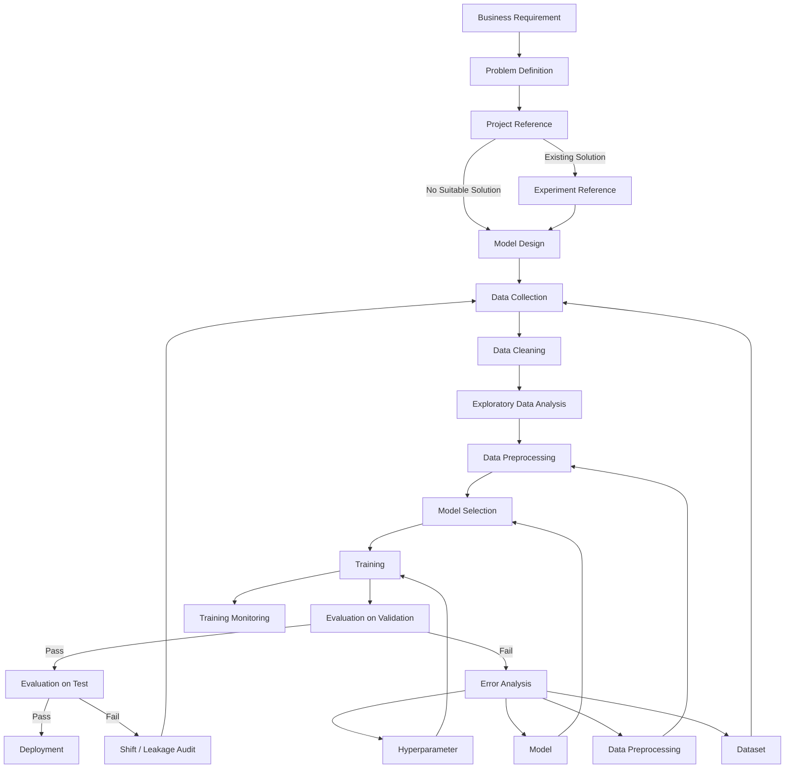

# AI Development Pipeline

## Overview

This document describes the complete AI Development Pipeline used in the project.

The objective of this workflow is not only to train a model, but to guide the entire engineering lifecycle from business requirements to a deployable AI system.

The pipeline emphasizes:

- Requirement-driven development
- Evidence-based engineering
- Reuse of existing research and open-source projects
- Continuous experimentation
- Root-cause analysis
- Iterative model improvement

## Global Constraints

- **No fabricated numbers:** Agent không được nói con số metric/benchmark cứng khi chưa chạy training hoặc evaluation thực tế.
- **Training ownership:** **Training chính (full training)** do **Kỹ sư chạy** (Agent chuẩn bị script, config và progress bar log, không tự chạy full training). Agent **được phép** chạy **Smoke Test** hoặc **Normal Test training ngắn** (1–2 batch / 1 epoch kiểm tra pipeline) theo [`TESTING.md`](TESTING.md).
- **No Test Set Leakage:** Mọi vòng lặp Error Analysis → chỉnh Hyperparameter / Model / Data Preprocessing **chỉ được làm trên tập Validation**. Tập **Test** chỉ chấm 1 lần cuối sau khi Validation đạt; không dùng Test set để tune.

---

# Architecture



---

# Pipeline Layers

## 1. Business Requirement Layer

### Objective

Understand the business problem before considering any AI solution.

### Abstract

Tóm tắt ngắn gọn bài toán và mục tiêu nghiệp vụ.

### Input

Ghi rõ input là những file gì, tài liệu gì, nguồn nào:

- Customer requirements
- Business objectives
- User pain points
- Constraints
- Success criteria

### Output

- Business Requirement Document (BRD)

### Description

Agent ghi ngắn gọn phân tích yêu cầu nghiệp vụ.

---

## 2. Problem Definition Layer

### Objective

Transform business requirements into a measurable AI problem.

### Define

- Task
- Input
- Output
- Target
- Scope
- Constraints
- Evaluation Metric
- Acceptance Criteria

### Input

Ghi rõ input là những file gì, tài liệu gì (ví dụ BRD từ Layer 1).

### Output

- Technical problem specification (ghi trong `docs/pipelines/pipeline_overall.md`).

### Description

Agent ghi ngắn gọn cách chuyển bài toán nghiệp vụ sang bài toán AI đo lường được.

---

## 3. Project Reference Layer

### Objective

Investigate existing solutions before designing a new one.

### Activities

- Literature review
- Open-source repositories
- Research papers
- Existing models
- Similar products

### Decision

- **Existing solution** → Layer 4 (Experiment Reference)
- **No suitable solution** → Layer 5 (Model Design)

### Input

Ghi rõ các tài liệu, paper, repo tham khảo.

### Output

- Bản báo cáo tổng hợp giải pháp tham khảo.

### Description

Agent ghi ngắn gọn các hướng tiếp cận sẵn có và lý do chọn/loại.

---

## 4. Experiment Reference Layer

### Objective

Validate existing solutions through reproduction.

### Activities

- Reproduce repository
- Benchmark performance
- Compare with project requirements
- Identify research gaps

### Input

Ghi rõ repo, checkpoint, dataset và cấu hình dùng để tái lập.

### Output

- Experiment report (ghi trong `docs/pipelines/experiment.md`).

### Description

Agent ghi ngắn gọn kết quả tái lập và khoảng trống so với yêu cầu dự án.

---

## 5. Model Design Layer

### Objective

Design the AI architecture if no suitable solution exists (or adapt from reference experiments).

### Activities

- Architecture design
- Pipeline design
- Loss function
- Optimizer
- Data flow
- Model components

### Input

Ghi rõ đặc tả bài toán, kết quả tham khảo và ràng buộc phần cứng/latency.

### Output

1. Model architecture specification tại `docs/pipelines/models/` (có `n` model thì tạo `n` file mô tả tương ứng).

### Description

Agent ghi ngắn gọn thiết kế kiến trúc và lý do lựa chọn.

---

## 6. Data Engineering Layer

This layer prepares high-quality data for training.

### 6.1 Data Collection

Collect datasets from:

- Public datasets
- Internal datasets
- Crawling
- Sensors

- **Input:** Ghi rõ nguồn dữ liệu, URL, đường dẫn, script thu thập.
- **Output:** Raw Dataset (`data/raw/`).
- **Description:** Tóm tắt nguồn, giấy phép và quy mô dữ liệu thô.

---

### 6.2 Data Cleaning

Remove:

- Corrupted data
- Duplicate samples
- Incorrect labels
- Missing values

- **Input:** Raw Dataset (`data/raw/`).
- **Output:** Clean / Interim Dataset (`data/interim/`).
- **Description:** Tóm tắt số mẫu bị loại và tiêu chí làm sạch.

---

### 6.3 Exploratory Data Analysis (EDA)

Analyze:

- Distribution
- Class imbalance
- Bias
- Outliers
- Dataset statistics

- **Input:** Clean / Interim Dataset (`data/interim/`).
- **Output:** EDA Report.
- **Description:** Tóm tắt phát hiện chính từ phân tích dữ liệu.

---

### 6.4 Data Preprocessing

Prepare data for training (e.g., Resize, Normalize, Tokenization, Augmentation, Feature Engineering, Train/Val/Test split chống data leakage).

- **Input:** Clean / Interim Dataset + EDA findings.
- **Output:** Training-ready Dataset (`data/processed/`).
- **Description:** Tóm tắt pipeline tiền xử lý và chiến lược chia tập.

---

## 7. Model Engineering Layer

### 7.1 Model Selection

Choose Baseline, Backbone, Loss, Optimizer, Scheduler.

- **Input:** Training-ready Dataset, model specs (`docs/pipelines/models/`), constraints.
- **Output:** Training Configuration (`configs/`).
- **Description:** Lý do chọn baseline và cấu hình huấn luyện ban đầu.

---

### 7.2 Training

> **Constraint:** Training chính (full training) do **Kỹ sư chạy** (có progress bar log và hỗ trợ resume). Agent chỉ chạy Smoke Test hoặc Normal Test training ngắn để verify pipeline theo [`TESTING.md`](TESTING.md).

Train the model and monitor:

- Loss
- Accuracy / task metrics
- GPU utilization
- Learning rate

- **Input:** Training Configuration (`configs/`) + Training-ready Dataset (`data/processed/`).
- **Output:** Candidate Model (`experiments/runs/<run_name>/weights/`).
- **Description:** Tóm tắt lệnh chạy, phần cứng và cấu hình đã dùng.

---

### 7.3 Training Monitoring

Monitor Train Loss, Validation Loss, Learning Rate, GPU Memory, Throughput to detect training issues early.

- **Input:** Training logs / curves (`experiments/runs/<run_name>/monitor/`).
- **Output:** Monitoring summary / plots.
- **Description:** Ghi nhận xu hướng hội tụ hoặc dấu hiệu bất thường (overfit, NaN, bottleneck).

---

### 7.4 Experiments Management

Thử nghiệm các cấu hình tham số cải tiến so với baseline hoặc hướng tới mục tiêu mong muốn. Mỗi run lưu tách biệt tại `experiments/runs/<run_name>/`:

```text
experiments/runs/<run_name>/
├── monitor/      # Log loss, metric, biểu đồ quan sát quá trình train
├── val_eval/     # Kết quả evaluate trên tập validation với best weight
└── weights/      # Checkpoint best và last (hỗ trợ resume)
```

- Tổng hợp so sánh các run tại `docs/pipelines/experiment.md`.

---

## 8. Evaluation Layer

### 8.1 Evaluation on Validation

Evaluate candidate model performance on the **validation dataset** to compare runs and guide improvements.

Metrics may include: Accuracy, Precision, Recall, F1-score, mAP, IoU.

- **Input:** Validation dataset (`data/processed/`) + `best` checkpoint (`experiments/runs/<run_name>/weights/`).
- **Output:**
  - Per-class Precision / Recall / F1
  - Confusion matrix
  - Validation monitoring & metrics (`experiments/runs/<run_name>/val_eval/`, tổng hợp tại `docs/pipelines/evaluation.md`)
- **Tiêu chí đánh giá:** Đối chiếu với Acceptance Criteria đã chốt ở Layer 2 (`Problem Definition`) và `TASK.md`.
- **Decision:**
  - **Pass** → 8.2 Evaluation on Test
  - **Fail** → Layer 9 (Error Analysis & Continuous Improvement)

---

### 8.2 Evaluation on Test

Final unbiased evaluation on the **held-out test dataset** (chỉ chạy **sau khi Validation đã Pass**).

Metrics may include: Accuracy, Precision, Recall, F1-score, mAP, IoU.

- **Input:** Held-out test dataset (`data/processed/`) + validated `best` checkpoint.
- **Output:**
  - Per-class Precision / Recall / F1
  - Confusion matrix
  - Final evaluation report (`docs/pipelines/evaluation.md`)
- **Tiêu chí đánh giá:** Đạt Acceptance Criteria và không sụt giảm bất thường so với kết quả trên Validation.
- **Decision:**
  - **Pass** → Promote best checkpoint vào `models/` → Layer 10 (Deployment)
  - **Fail** → **Shift / Leakage Audit** (kiểm tra lệch phân bố hoặc data leakage giữa Train/Val/Test và quay lại Data Collection/Split — **không** lặp lại tune hyperparameter trực tiếp theo Test set)

---

## 9. Continuous Improvement Layer

When **Validation evaluation** fails, the goal is **not simply retraining**. Identify the root cause on Validation and return to the correct stage.

### Error Analysis

Determine why the model failed. Possible causes:

- Dataset quality
- Data preprocessing
- Model architecture
- Hyperparameters
- Wrong problem formulation

#### Hyperparameter Issue → Return to Training

Examples: Learning Rate, Batch Size, Epoch, Scheduler.

- **Input:** Validation metrics, training curves (`monitor/`), current config (`configs/`).
- **Output:** Updated hyperparameter config + hypothesis for next run.

#### Model Issue → Return to Model Selection

Examples: Backbone, Architecture, Loss Function.

- **Input:** Validation error patterns, baseline vs candidate comparison.
- **Output:** Updated model/loss choice + updated spec (`docs/pipelines/models/`).

#### Data Issue → Return to Data Collection or Data Preprocessing

Examples: Missing data, Class imbalance, Label errors, Weak augmentation.

- **Input:** Validation error gallery, confusion matrix, EDA report.
- **Output:** Data cleaning / augmentation / collection action plan.

### Error Analysis Template — Classification

| Bước | Làm gì | Câu hỏi trả lời |
| :--- | :--- | :--- |
| 1 | Per-class metrics + confusion matrix | Lỗi ở đâu? |
| 2 | Error gallery (chia theo confidence) | Lỗi trông như thế nào? |
| 3 | Gán nhãn nguyên nhân và đếm tỷ lệ | Nguyên nhân nào chiếm bao nhiêu %? |
| 4 | Slice analysis (tùy chọn) | Lỗi có tăng theo thuộc tính nào không (ảnh tối, vật nhỏ, nền phức tạp, nguồn dữ liệu)? |
| 5 | Giả thuyết → sửa → đo lại trên Validation | Sửa đúng nguyên nhân thì lỗi có giảm không? |

---

## 10. Deployment Layer

Deploy the validated model into production.

Deployment itself belongs to a separate engineering workflow: [`DEPLOY_MODEL.md`](DEPLOY_MODEL.md).

Typical deployment includes: Model Export, Model Optimization, Packaging, Model Serving, Production Monitoring, Feedback Collection, Continuous Retraining.

- **Input:** Promoted `best` checkpoint (`models/`), preprocessing config, final test report (`docs/pipelines/evaluation.md`).
- **Output:** Deployed inference service + deployment doc (`docs/pipelines/deploy.md`).

---

# Documentation Output

Write project-specific modeling pipeline documentation under `docs/pipelines/`:

- `docs/pipelines/pipeline_overall.md` — tổng quan pipeline & đặc tả bài toán
- `docs/pipelines/models/` — đặc tả kiến trúc từng model
- `docs/pipelines/experiment.md` — tổng hợp các thí nghiệm & so sánh runs
- `docs/pipelines/evaluation.md` — báo cáo đánh giá Validation & Test
- `docs/pipelines/deploy.md` — tài liệu triển khai (theo [`DEPLOY_MODEL.md`](DEPLOY_MODEL.md))
