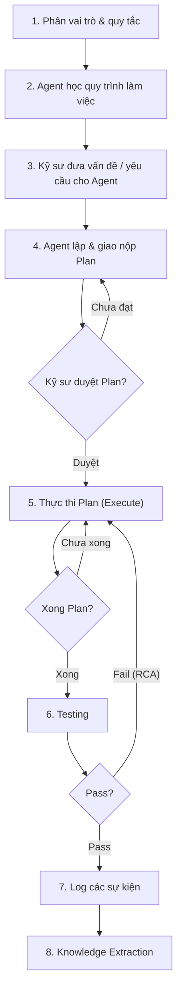
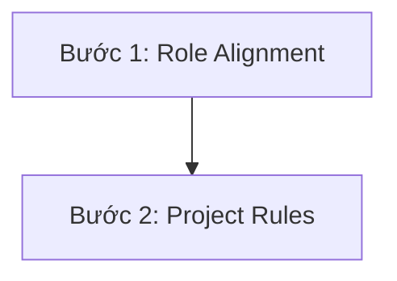

# Deeplearning single agent delegation loop

A single agent delegation loop for any agent helping an engineer solve problems through the "single agent delegation loop" norm.

---

# Flow

Quy trình phối hợp tổng quát giữa Kỹ sư và AI Agent:

## 1. Phân vai trò & Quy tắc dự án

Target:
1. AI đang đóng vai trò gì?
2. AI đang làm việc trong project nào, kiến trúc ra sao?
3. AI phải tuân thủ những quy ước kỹ thuật nào?

### Bước 1: Role Alignment
- Đọc vai trò tại [`ROLE_ALIGNMENT.md`](ROLE_ALIGNMENT.md).

### Bước 2: Project Rules
- Quét cấu trúc repository, ranh giới module và quy ước kỹ thuật tại [`PROJECT_RULE.md`](PROJECT_RULE.md).

## 2. Agent học quy trình làm việc

### Modeling pipeline
Learning the way the engineer often works.
- Đọc tại: [`MODEL_PIPELINE.md`](MODEL_PIPELINE.md)

### Deploying pipeline
Helping the engineer deploy the model.
- Đọc tại: [`DEPLOY_MODEL.md`](DEPLOY_MODEL.md)

## 3. Kỹ sư đưa vấn đề / yêu cầu cho Agent

Tài liệu gợi ý Kỹ sư mô tả vấn đề rõ ràng; Agent đọc để hiểu đúng yêu cầu và cảnh báo lỗi sai, thiếu thông tin hoặc sự mơ hồ trước khi lập kế hoạch.
- Kỹ sư và Agent đọc tại: [`TASK.md`](TASK.md)

## 4. Agent lập & giao nộp Plan

Agent phân tích yêu cầu, lập kế hoạch thực thi và **dừng chờ Kỹ sư duyệt** trước khi viết code.
- Agent đọc tại: [`PLAN.md`](PLAN.md)

## 5. Thực thi Plan (Execute)

Chỉ bắt đầu sau khi Kỹ sư đã duyệt Plan; thực thi từng bước kết hợp tự kiểm toán (Self Audit).
- Agent đọc tại: [`EXECUTION.md`](EXECUTION.md)

## 6. Testing

Kiểm thử 2 tầng (Smoke Test → Normal Test); nếu lỗi thì phân tích nguyên nhân gốc (RCA) và quay lại Bước 5.
- Agent đọc tại: [`TESTING.md`](TESTING.md)

## 7. Logging

Ghi nhận lịch sử thực thi, file thay đổi và kết quả đã xác minh.
- Agent đọc tại: [`LOGGING.md`](LOGGING.md)

## 8. Knowledge Extraction

Trích xuất tri thức kỹ thuật có thể tái sử dụng cho các task sau.
- Agent đọc tại: [`KNOWLEDGE_EXTRACTION.md`](KNOWLEDGE_EXTRACTION.md)
