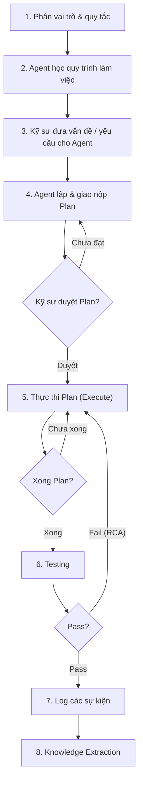
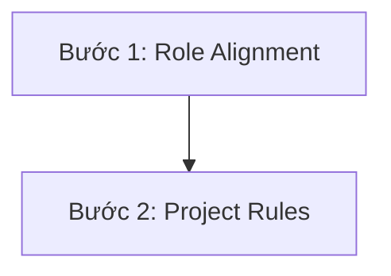

# Deeplearning single agent delegation loop

> **Version:** `v1.4.0` · **Source:** `notworLe/worskill/rules/DL_RULE`

A single agent delegation loop for any agent helping an engineer solve problems through the "single agent delegation loop" norm.

---

# Flow

Quy trình phối hợp tổng quát giữa Kỹ sư và AI Agent:

## 1. Phân vai trò & Quy tắc dự án

Target:
1. AI đang đóng vai trò gì?
2. AI đang làm việc trong project nào, kiến trúc ra sao?
3. AI phải tuân thủ những quy ước kỹ thuật nào?

### Bước 1: Role Alignment
- Đọc vai trò tại [`ROLE_ALIGNMENT.md`](ROLE_ALIGNMENT.md).

### Bước 2: Project Rules
- Quét cấu trúc repository, ranh giới module và quy ước kỹ thuật tại [`PROJECT_RULE.md`](PROJECT_RULE.md).

## 2. Agent học quy trình làm việc

### Modeling pipeline
Learning the way the engineer often works.
- Đọc tại: [`MODEL_PIPELINE.md`](MODEL_PIPELINE.md)

### Deploying pipeline
Helping the engineer deploy the model.
- Đọc tại: [`DEPLOY_MODEL.md`](DEPLOY_MODEL.md)

## 3. Kỹ sư đưa vấn đề / yêu cầu cho Agent

Tài liệu gợi ý Kỹ sư mô tả vấn đề rõ ràng; Agent đọc để hiểu đúng yêu cầu và cảnh báo lỗi sai, thiếu thông tin hoặc sự mơ hồ trước khi lập kế hoạch.
- Kỹ sư và Agent đọc tại: [`TASK.md`](TASK.md)

## 4. Agent lập & giao nộp Plan

Agent phân tích yêu cầu, lập kế hoạch thực thi và **dừng chờ Kỹ sư duyệt** trước khi viết code.
- Agent đọc tại: [`PLAN.md`](PLAN.md)

## 5. Thực thi Plan (Execute)

Chỉ bắt đầu sau khi Kỹ sư đã duyệt Plan; thực thi từng bước kết hợp tự kiểm toán (Self Audit).
- Agent đọc tại: [`EXECUTION.md`](EXECUTION.md)

## 6. Testing

Kiểm thử 2 tầng (Smoke Test → Normal Test); nếu lỗi thì phân tích nguyên nhân gốc (RCA) và quay lại Bước 5.
- Agent đọc tại: [`TESTING.md`](TESTING.md)

## 7. Logging

Ghi nhận lịch sử thực thi, file thay đổi và kết quả đã xác minh.
- Agent đọc tại: [`LOGGING.md`](LOGGING.md)

## 8. Knowledge Extraction

Trích xuất tri thức kỹ thuật có thể tái sử dụng cho các task sau.
- Agent đọc tại: [`KNOWLEDGE_EXTRACTION.md`](KNOWLEDGE_EXTRACTION.md)

---

## Lịch sử thay đổi

| Version | Ngày | Mô tả thay đổi |
| :--- | :--- | :--- |
| `v1.4.0` | 2026-11-26 | Tách `Evaluation on Validation` vs `Test` (chống Test Set Leakage), làm rõ ranh giới full training vs test training, chuẩn hóa `experiments/runs/<run_name>/` vs `models/`, thống nhất `.agents/tasks/<task_name>/{task,plan}.md` và bảng Error Analysis trong `MODEL_PIPELINE.md` |
| `v1.3.1` | 2026-11-25 | Đồng bộ version header và bổ sung bảng lịch sử thay đổi trực tiếp trong `rules/DL_RULE/README.md` |
| `v1.3.0` | 2026-11-24 | Thêm `# MODELING MINDSET` và *Project Reference* vào `ROLE_ALIGNMENT.md`; bổ sung cây thư mục `ROOT/` và ranh giới `configs/` vs `experiments/`, `scripts/`, `data/`, `models/` trong `PROJECT_RULE.md` |
| `v1.2.0` | 2026-11-23 | Hoàn thiện 7 bước `DEPLOY_MODEL.md`, chuẩn hóa vai Senior ML Engineer, tách rõ Bước 4 (`PLAN.md` + Approval Gate) & Bước 5 (`EXECUTION.md`), tách Phase 7 (`LOGGING.md`) vs Phase 8 (`KNOWLEDGE_EXTRACTION.md`), thống nhất `.agents/`, sửa Mermaid & frontmatter |
| `v1.1.0` | 2026-11-23 | Tái cấu trúc `DL_RULE` sang mô hình 8-stage single-agent delegation workflow (`ROLE_ALIGNMENT` → `KNOWLEDGE_EXTRACTURE`) |
| `v1.0.0` | 2026-11-21 | Khởi tạo bộ `DL_RULE` ban đầu trong `rules/DL_RULE/` |
