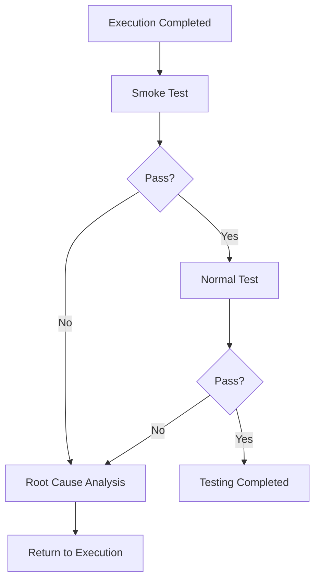

# Testing

AGENT writes test evidence and reports at `.agents/tests/` (or links them from the task log in `.agents/logs/`).

## Overview

This document defines how the AI Agent validates completed execution before considering the task finished.

Testing is **not** part of implementation.

Implementation answers:

> "Did I build it?"

Testing answers:

> "Does it actually work?"

The agent must verify the implemented result using appropriate tests before moving to the Logging phase.

---

# Architecture

---

# Workflow

Testing consists of two stages.

1. Smoke Test
2. Normal Test

Smoke Test must always run first.

Normal Test begins only after Smoke Test passes.

---

# 1. Smoke Test

## Objective

Verify that the implementation works at the most basic level.

Smoke Test should be fast and lightweight.

Examples

- Project compiles
- Import succeeds
- Model forward pass
- API starts successfully
- Configuration loads correctly
- Tensor shape is valid
- No runtime exception

If Smoke Test fails,

Stop testing immediately.

Return to Execution.

---

# 2. Normal Test

## Objective

Verify that the implementation satisfies the task requirements.

Depending on the project, this may include

- Functional Test
- Unit Test
- Integration Test
- Model Evaluation
- Benchmark
- Inference Validation

Examples

Deep Learning

- Train one epoch (short verification run on mini-subset or 1 epoch to verify training loop, loss decrease, checkpointing)
- Evaluate validation dataset (verification check)
- Verify metrics
- Compare baseline

> **Training Boundary (khớp [`MODEL_PIPELINE.md`](MODEL_PIPELINE.md)):** Agent **được phép** chạy Smoke Test và Normal Test training ngắn (ví dụ 1–2 batch hoặc 1 epoch để xác minh pipeline không lỗi). **Full / production training** nhiều epoch trên tập dữ liệu đầy đủ do **Kỹ sư tự chạy** (Agent chuẩn bị script, lệnh chạy và progress bar log).

Backend

- API response
- CRUD operations
- Database consistency

Computer Vision

- Visualization
- Prediction quality
- Latency benchmark

---

# Test Result

Each test should produce

## Test Name

Example

Smoke Test

---

## Purpose

What is being verified.

---

## Result

PASS

or

FAIL

---

## Evidence

Examples

- Screenshot
- Log
- Metrics
- Console Output

---

# Failure Handling

If any test fails,

The agent must

1. Stop further testing.
2. Identify the failed test.
3. Analyze the root cause.
4. Return to Execution.

The agent must never ignore a failed test.

---

# Root Cause Analysis

When testing fails, determine the most likely cause.

Possible causes

- Implementation bug
- Configuration error
- Environment issue
- Dataset issue
- Wrong assumptions
- Requirement misunderstanding

Report findings before returning to Execution.

---

# Exit Criteria

Testing is complete only when

- All required Smoke Tests pass.
- All required Normal Tests pass.
- Acceptance Criteria are satisfied.
- No known blocking issues remain.

---

# Deliverables

After testing, provide

## Summary

Overall testing result.

---

## Executed Tests

List all completed tests.

---

## Failed Tests

If any.

---

## Evidence

Relevant logs, metrics, screenshots or reports.

---

## Recommendation

Ready for Logging

or

Return to Execution

---

# Relationship with Other Workflows

Testing validates the result of Execution.

It does not

- redesign the solution
- change implementation strategy
- modify project requirements

When testing fails, control returns to the Execution phase for correction.

Only after all required tests pass may the workflow continue to the Logging phase.