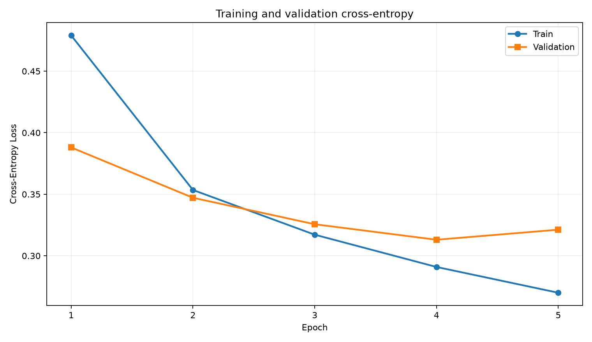
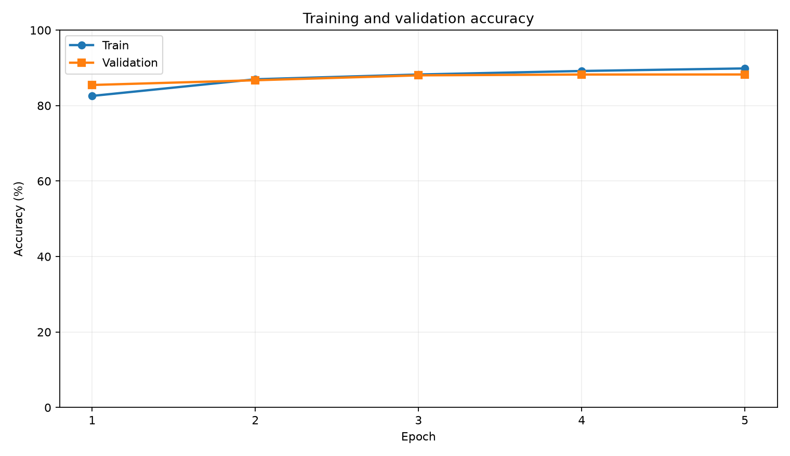
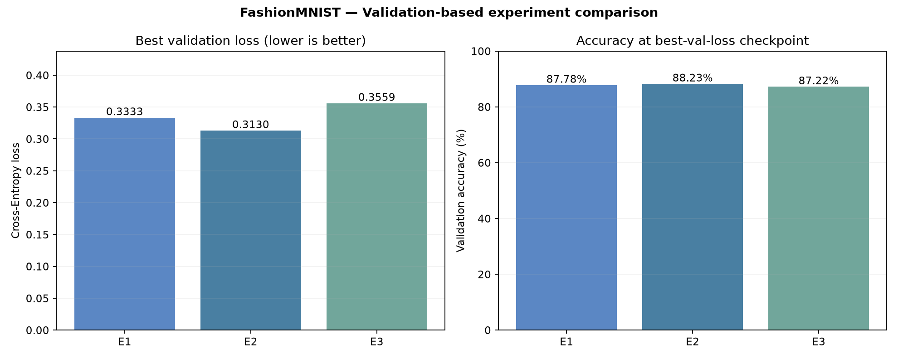
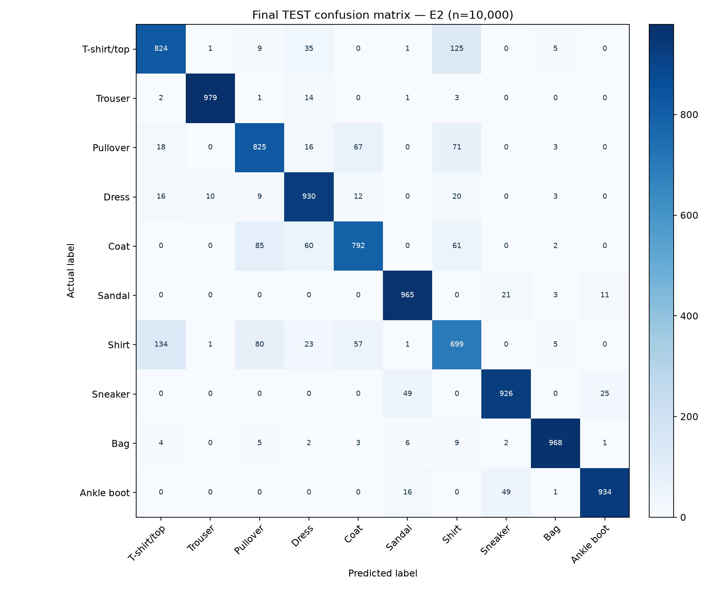

# Practice 1 — PyTorch FashionMNIST Classification

> **Trạng thái dự án (2026-10-11): HOÀN THÀNH CẢ 6/6 GIAI ĐOẠN.**  
> **Kết quả của ZIP hiện tại:** E2 được chọn bằng validation loss (checkpoint tốt nhất ở epoch 4); **test accuracy 88,42% = 8.842/10.000 ảnh đúng**. Giai đoạn 6 đã có hình dự đoán và báo cáo cuối.  
> **Dữ liệu đầu vào:** **một** file `data/fashion_mnist_full.csv` từ bộ FashionMNIST trên Kaggle.

## 1. WHAT / WHY — Bài toán và mục tiêu

Bài toán học có giám sát: phân loại ảnh xám **28×28** vào một trong **10 lớp trang phục** sử dụng PyTorch. Kết quả cần nộp: mã Python, báo cáo ngắn, loss graph, ảnh dự đoán/nhãn thật, lưu và tải mô hình. Dự án được triển khai theo nguyên tắc **phát biểu bài toán bằng Markdown → xây module Python → kiểm thử → ghi kết quả thực**, không sử dụng số liệu giả định để báo cáo.

## 2. Dữ liệu và ngăn rò rỉ (Data Leakage)

- Nguồn: Zalando Research FashionMNIST trên Kaggle: <https://www.kaggle.com/datasets/zalando-research/fashionmnist>.
- CSV gộp: 70.000 hàng; **786 cột** (`label`, `pixel1`…`pixel784`, `split`). CSV nguồn giữ nguyên.
- Theo `split` cố định: **54.000 train / 6.000 validation / 10.000 test**. Module Giai đoạn 2 loại **19** hàng train có ảnh trùng pixel hoàn toàn với validation/test, trong bộ nhớ; **train thực tế = 53.981**.
- `mean=0.2861469680`, `std=0.3527678240` trên pixel chia 255 được tính **chỉ từ train sau lọc**; cùng phép chuẩn hóa áp dụng cho validation/test.
- **Không cập nhật trọng số bằng validation/test**; checkpoint chọn theo **validation loss**, không sử dụng test để chọn hyperparameters hoặc mô hình. Tập test chỉ dành cho đánh giá cuối Giai đoạn 5. Việc đọc split test để kiểm toán trùng ảnh là thao tác bảo vệ dữ liệu, không phải đánh giá mô hình.

## 3. Cấu trúc project

```text
Practice_1_FashionMNIST/
├── data/
│   └── fashion_mnist_full.csv         
├── src/
│   ├── __init__.py
│   ├── data_loader.py                 
│   ├── model.py                       
│   ├── train.py                       
│   ├── evaluate.py                    
│   └── visualize.py                   
├── markdown/
│   ├── 01_problem_formulation.md      
│   ├── 02_methodology.md              
│   ├── 03_experiments.md              
│   └── 04_results_conclusion.md       
├── outputs/
│   ├── data_audit.json
│   ├── model_summary.json
│   ├── training_summary.json         
│   ├── best_model.pth                  
│   ├── metrics.csv                    
│   ├── experiments/                 
│   ├── visualization_summary.json     
│   ├── Practice1_Brief_Report.md      
│   └── figures/
│       ├── dataset_samples.png
│       ├── label_distribution.png
│       ├── pixel_histogram.png
│       ├── model_architecture.png
│       ├── loss_curve.png             
│       ├── accuracy_curve.png         
│       ├── predictions.png             
│       ├── misclassified_examples.png 
│       └── per_class_recall.png       
├── config.py                          
├── main.py                            
├── run_experiments.py                  
├── requirements.txt
└── README.md
```

## 4. WHEN / WHERE / WHICH / HOW — Cách thực hiện

**Mở terminal tại thư mục gốc `Practice_1_FashionMNIST/`**, không phải thư mục cha `DEEP Learning/` hoặc `LAB 1/`. Python 3.13 trên Windows có thể sử dụng nếu các dependency đã cài thành công.

```powershell
python -m pip install -r requirements.txt
```

**GĐ2 — Load/preprocess/EDA:**

```powershell
python -m src.data_loader --csv data/fashion_mnist_full.csv --out-dir outputs
```

**GĐ3 — Kiểm tra kiến trúc và forward trên batch train:**

```powershell
python -m src.model --csv data/fashion_mnist_full.csv --out-dir outputs
```

**GĐ4 — Train và validation thực tế (mặc định 5 epochs, Adam, lr=0.001):**

```powershell
python main.py --csv data/fashion_mnist_full.csv --out-dir outputs --epochs 5 --batch-size 64 --lr 0.001 --hidden 256 128 --seed 42
```

Có thể dùng ngắn gọn `python main.py` khi terminal đã ở project root và dữ liệu đã đặt đúng chỗ. `--device auto` ưu tiên CUDA khi có GPU được hỗ trợ; nếu không, dùng CPU. Nếu cần bắt buộc CPU: `--device cpu`.

**Khi chạy thử độc lập `main.py` để đổi siêu tham số, phải dùng `--out-dir` riêng.** Riêng `run_experiments.py` của Giai đoạn 5 **đã tự quản lý** `outputs/experiments/E1`, `E2`, `E3` và không ghi đè checkpoint Giai đoạn 4.

**GĐ5 — Chạy 3 experiments và đánh giá test một lần sau khi chọn mô hình:**

```powershell
python run_experiments.py
```

- E1: 784→128→10, lr=0.001; E2: 784→256→128→10, lr=0.001; E3: 784→256→128→10, lr=0.0001.
- Cả ba dùng seed 42, 5 epochs, batch 64; E2 tái dùng checkpoint GĐ4 nếu cấu hình khớp; nếu không sẽ train lại.
- Tự chọn best checkpoint bằng **minimum validation loss**, sau đó tính test metric cho mô hình được chọn.
- Outputs mới: `outputs/experiments/`. Không ghi đè `outputs/best_model.pth` hoặc `outputs/metrics.csv` Giai đoạn 4.

### Chạy Giai đoạn 4 / 5 bằng VS Code F5

**Cách A — VS Code mở trực tiếp thư mục `Practice_1_FashionMNIST`:** tạo `.vscode/launch.json` trong project và đặt cấu hình:

```json
{
  "version": "0.2.0",
  "configurations": [
    {
      "name": "Practice 1 - Stage 4 Training",
      "type": "debugpy", "request": "launch",
      "program": "${workspaceFolder}/main.py",
      "cwd": "${workspaceFolder}",
      "console": "integratedTerminal",
      "args": ["--csv", "data/fashion_mnist_full.csv", "--out-dir", "outputs"]
    },
    {
      "name": "Practice 1 - Stage 5 Experiments",
      "type": "debugpy", "request": "launch",
      "program": "${workspaceFolder}/run_experiments.py",
      "cwd": "${workspaceFolder}",
      "console": "integratedTerminal",
      "args": ["--csv", "data/fashion_mnist_full.csv", "--out-dir", "outputs"]
    }
  ]
}
```

**Cách B — VS Code vẫn đang mở workspace cha `E:\QuanBip\DEEP Learning`:** sửa **hai** giá trị trong cấu hình Stage 5 thuộc `.vscode/launch.json` của workspace cha:

```json
"program": "${workspaceFolder}/LAB 1/Practice_1_FashionMNIST/run_experiments.py",
"cwd": "${workspaceFolder}/LAB 1/Practice_1_FashionMNIST"
```

Chọn `Practice 1 - Stage 5 Experiments` tại **Run and Debug → F5**. Với bản code trong ZIP này, `src/train.py` và `src/evaluate.py` **đã hỗ trợ chạy riêng** bằng Run Python File; `src/evaluate.py` mặc định chỉ kiểm tra validation. Không cần chạy lại test nếu chỉ muốn xem báo cáo và hình Giai đoạn 6.

**GĐ6 — Visualization và báo cáo:** sau khi GĐ5 đã có `outputs/experiments/test_predictions.csv`, chạy `python src/visualize.py` hoặc bấm Run Python File trên `src/visualize.py`. Mở `markdown/04_results_conclusion.md` và `outputs/Practice1_Brief_Report.md` trong Markdown Preview. Lệnh GĐ6 **không train lại hay đánh giá lại test**.

## 5. Kết quả **Giai đoạn 4 đã chạy thật** (cấu hình mặc định, CPU)

| Epoch | Train loss | Train acc | Val loss | Val acc |
|---:|---:|---:|---:|---:|
| 1 | 0.4790 | 82.57% | 0.3880 | 85.47% |
| 2 | 0.3534 | 86.98% | 0.3471 | 86.72% |
| 3 | 0.3171 | 88.24% | 0.3256 | 88.02% |
| 4 | 0.2909 | 89.18% | **0.3130** | **88.23%** |
| 5 | 0.2699 | 89.85% | 0.3212 | 88.25% |

Checkpoint tốt nhất theo **validation loss**: epoch **4** (val loss **0.3130**, val accuracy **88.23%** tại checkpoint). Epoch 5 có val accuracy **88.25%** hơi cao hơn, nhưng val loss **0.3212** tăng, vì vậy **không chọn epoch 5**. Đã xác minh việc tải lại checkpoint. Validation accuracy không phải test accuracy.





File `metrics.csv` ghi accuracy dưới dạng **tỷ lệ 0–1**, nên `0.88233333` tương ứng khoảng `88.23%` tại checkpoint tốt nhất.

## 6. Kết quả đã chạy Giai đoạn 5

| Experiment | Hidden layers | LR | Best val loss | Val accuracy |
|---|---|---:|---:|---:|
| E1 | 128 | 0.001 | 0.3333 | 87.78% |
| **E2** | **256→128** | **0.001** | **0.3130** | **88.23%** |
| E3 | 256→128 | 0.0001 | 0.3559 | 87.22% |

**Chọn E2 theo validation loss**, đánh giá test sau khi chọn: **8.842/10.000 ảnh đúng, test accuracy = 88.42%, test loss = 0.3089, macro-F1 = 0.8839**. Không sử dụng test để chọn cấu hình. Chi tiết và công thức: [`markdown/03_experiments.md`](markdown/03_experiments.md).





## 7. Tiến độ hoàn thành và file minh chứng

| Giai đoạn | Trạng thái | Bằng chứng |
|---|---|---|
| 1. Problem Formulation | ✅ | `01_problem_formulation.md` |
| 2. Data Pipeline | ✅ | `data_loader.py`, EDA, `data_audit.json` |
| 3. Build Neural Network | ✅ | `model.py`, `model_summary.json`, sơ đồ mạng |
| 4. Training Loop | ✅ | `train.py`, `main.py`, checkpoint, metrics, curves |
| 5. Experiments & Evaluation | ✅ | `evaluate.py`, `03_experiments.md`, E1/E2/E3, test metrics, confusion matrix |
| 6. Visualization & Report | ✅ | `src/visualize.py`, `04_results_conclusion.md`, `outputs/Practice1_Brief_Report.md`, `outputs/figures/predictions.png` |

> **Trạng thái: 6/6 giai đoạn đã hoàn thành.** Báo cáo và mọi chỉ số trong tài liệu đã được đồng bộ với các file CSV/JSON **của ZIP này**. Nếu huấn luyện lại, cần cập nhật lại kết quả và hình ảnh để tránh trộn nhiều lần chạy.

