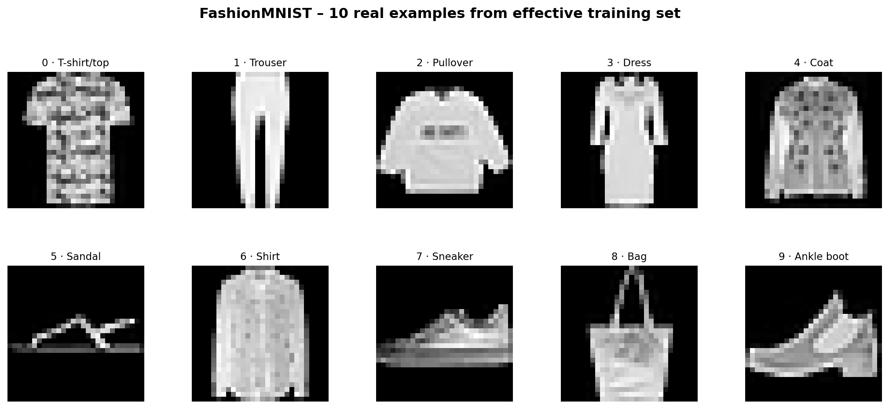
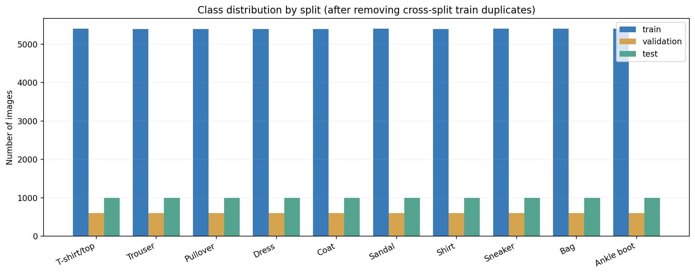
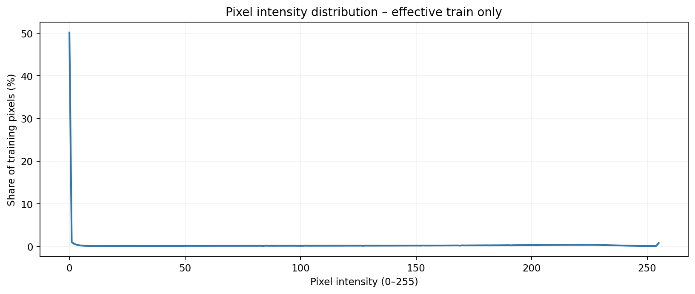
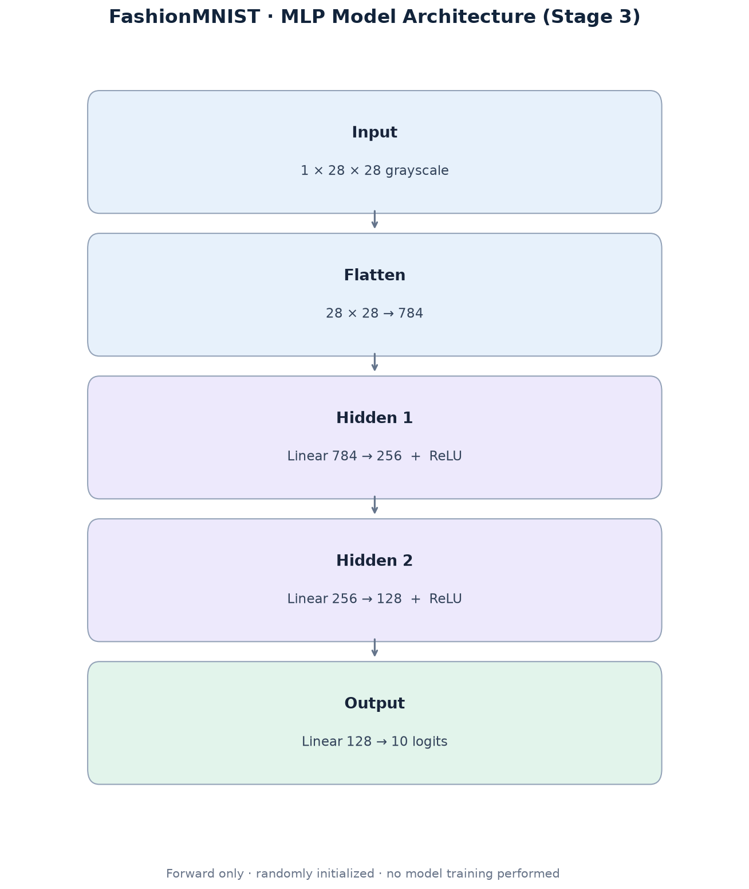
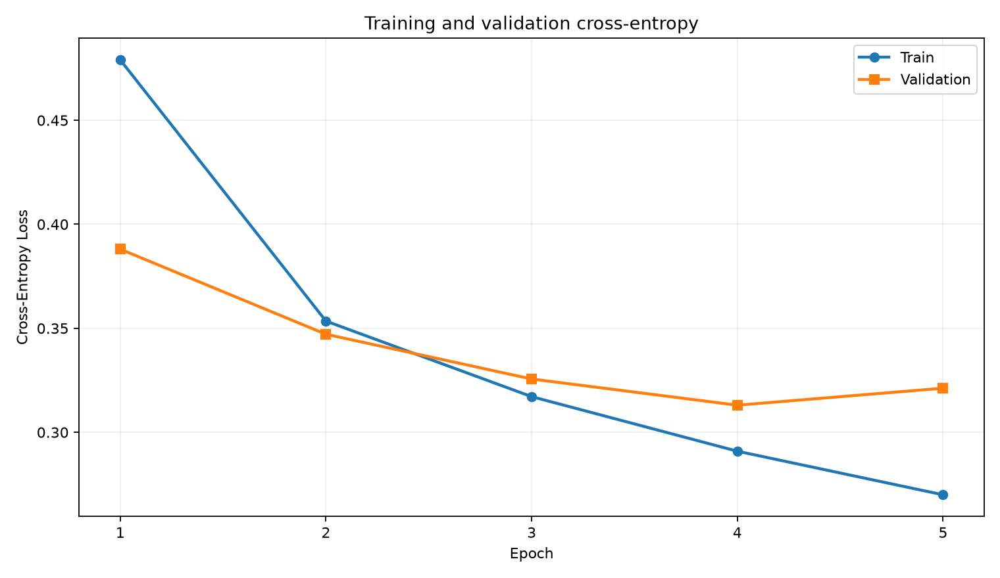
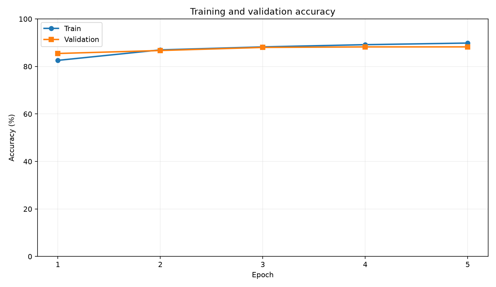

# 02 — Methodology: Data Pipeline, Model & Training (Stages 2–4)

> **Project:** Practice 1 — PyTorch FashionMNIST Classification  
> **Trạng thái:** Đã triển khai **Bước 1: Load Dataset**, **Bước 2: Preprocessing**, **Bước 3: Build Neural Network**, **Bước 4: Training Loop**, và phần validation/checkpoint trong Bước 5.  
> **Phạm vi:** Đã chạy **5 epochs huấn luyện train + validation** bằng PyTorch và tạo checkpoint, metrics cùng biểu đồ thật. **Chưa đánh giá test** (Giai đoạn 5).

## 2.1. Tổng quan phương pháp: WHEN / WHERE / WHICH / HOW

- **WHEN (Khi nào?):** Phải xác định split và kiểm tra tính toàn vẹn dữ liệu trước khi fit normalization và trước training. Train chỉ được dùng để học; validation để chọn cấu hình và theo dõi; test để đánh giá cuối.
- **WHERE (Ở đâu?):** Dữ liệu nguồn duy nhất nằm ở `data/fashion_mnist_full.csv`; xử lý bằng `src/data_loader.py`; huấn luyện trong `src/train.py`, điều phối bởi `main.py`, tham số ở `config.py`; kết quả lưu trong `outputs/`.
- **WHICH (Chọn cách nào?):** Dùng `pandas`/`numpy` và PyTorch Dataset/DataLoader; chọn MLP hidden `(256,128)` với ReLU, **CrossEntropyLoss + Adam**, batch size **64**, learning rate **0.001**, **5 epochs**. Lựa chọn checkpoint dựa trên validation loss.
- **HOW (Triển khai?):** CSV → kiểm tra/split → chống trùng → chuẩn hóa train-only → DataLoader → xây MLP → `zero_grad → forward → loss → backward → optimizer.step` trên train → validation `eval()/inference_mode()` sau epoch → lưu checkpoint tốt nhất → tải lại xác minh → xuất metrics/đồ thị.

## 2.2. Load Dataset — WHAT & WHY

### 2.2.1. Cấu trúc file dữ liệu

Dữ liệu FashionMNIST do Zalando Research phát triển, được cung cấp ở Kaggle: <https://www.kaggle.com/datasets/zalando-research/fashionmnist>. Hai CSV gốc đã được gộp trước Giai đoạn 2, cho nên project chỉ sử dụng **một CSV** với 70.000 dòng dữ liệu và 786 cột:

| Cột | Ý nghĩa | Miền giá trị |
|---|---|---|
| `label` | Nhãn thật của ảnh | Số nguyên `0`–`9` |
| `pixel1`…`pixel784` | 784 điểm ảnh xám (theo thứ tự) | Số nguyên `0`–`255` |
| `split` | Vai trò của mẫu trong thí nghiệm | `train`, `validation`, `test` |

Một ảnh được tái dựng từ 784 pixel thành ma trận `28×28`. **Không sử dụng cột `label` và `split` làm đặc trưng đầu vào mô hình.**

### 2.2.2. Xác nhận tập dữ liệu, không chia lại

Dữ liệu nguồn đã có cột `split`, nên chương trình **lọc theo split đã chốt** (không chạy `train_test_split` lần nữa, không xáo trộn lại ranh giới các tập mỗi lần chạy):

| Split | Số lượng trong CSV nguồn | Số lượng sau kiểm tra trùng ảnh | Công dụng |
|---|---:|---:|---|
| Train | 54.000 | **53.981** | Cập nhật trọng số model ở các giai đoạn sau |
| Validation | 6.000 | 6.000 | Chọn hyperparameters và checkpoint |
| Test | 10.000 | 10.000 | Đánh giá cuối cùng, không dùng để chọn mô hình |
| **Tổng** | **70.000** | **69.981** | 19 bản ghi train bị loại *trong bộ nạp dữ liệu* |

Cột split và dữ liệu nguồn **không bị sửa**: vẫn 70.000 bản ghi trong một CSV duy nhất. Việc loại 19 bản ghi chỉ diễn ra **trong bộ nhớ khi tạo Dataset để train**; vì vậy số lượng mẫu được mô hình sử dụng thực tế khác số dòng nguồn. Với cùng file đầu vào, kết quả này có thể tái lập.

### 2.2.3. Kiểm tra chất lượng dữ liệu — Kết quả đo thật

Code Giai đoạn 2 đã chạy trực tiếp trên `fashion_mnist_full.csv`:

| Tiêu chí | Kết quả |
|---|---|
| Tổng số ảnh nguồn | 70.000 |
| Số cột | 786 |
| Số class | 10 |
| Pixel min/max | `0` / `255` |
| Số giá trị thiếu | `0` |
| Kiểm tra batch | `images: [64,1,28,28]`, `labels: [64]` |
| Kiểu dữ liệu đưa vào model | `torch.float32` (image), `torch.int64` (label) |

Ảnh ví dụ lấy từ **tập train thực tế** (mỗi class một ảnh):



Phân bố 10 nhãn theo train/validation/test (sau khi bảo vệ chống trùng ảnh):



Phân bố độ sáng pixel của train thực tế:



## 2.3. Ngăn Data Leakage — Phân chia trước, fit preprocessing sau

### 2.3.1. Hai loại leakage cần tránh

**Rò rỉ thống kê:** Dùng mean/std tính trên toàn bộ dữ liệu gồm validation/test để chuẩn hóa. Biện pháp: **tính mean/std chỉ trên train** và dùng lại chúng cho validation/test.

**Rò rỉ ảnh trùng giữa các tập:** Những ảnh có cùng 784 giá trị pixel xuất hiện ở cả train và validation/test. Chương trình tạo dấu vân tay Blake2b cho từng hàng pixel, tìm giao giữa các tập **không sử dụng label để bỏ sót ảnh trùng khác nhãn**. Kiểm tra từ CSV thật:

| Kiểm tra trùng ảnh pixel tuyệt đối | Kết quả trước xử lý |
|---|---:|
| Train ↔ Validation | **9 nhóm** |
| Train ↔ Test | **10 nhóm** |
| Validation ↔ Test | **0 nhóm** |
| **Tổng nhóm trùng xuyên tập** | **19 nhóm** |

**Chính sách đã triển khai:** Loại 19 bản ghi train có ảnh trùng với validation hoặc test. Không động đến 6.000 ảnh validation, 10.000 ảnh test, cũng không chỉnh sửa file CSV gốc. Sau xử lý, **không còn trùng pixel tuyệt đối giữa các tập**.

Có thêm 33 bản ghi ảnh trùng trong riêng train, 1 trong validation, 1 trong test (đếm các lần lặp vượt quá ảnh đầu tiên). Những ảnh lặp **trong cùng một tập** không tạo ra leakage xuyên tập, nên giai đoạn này giữ nguyên và ghi lại để minh bạch.

> **Phạm vi bảo vệ:** Đây là kiểm tra **ảnh trùng pixel hoàn toàn**, không phải bộ phát hiện ảnh gần giống hay mọi loại data leakage. Việc so sánh với test ở bước kiểm toán dữ liệu là để ngăn bản sao test xuất hiện trong train, **không được phép dùng test để điều chỉnh mô hình**.

### 2.3.2. Thứ tự chống leakage

```text
Single CSV (70,000 raw samples)
    |
    v
Validate columns, pixels, labels, split markers
    |
    v
Respect predefined split (54,000 / 6,000 / 10,000)
    |
    v
Audit exact cross-split duplicates
    |
    v
Exclude 19 overlapping TRAIN records only
    |
    v
Fit pixel mean/std on cleaned TRAIN (53,981) only
    |
    v
Apply identical normalization to train / validation / test
    |
    v
Create three independent PyTorch DataLoaders
```

## 2.4. Preprocessing — Công thức và giải thích

### 2.4.1. Reshape hình ảnh

Mỗi hàng có 784 điểm ảnh được biến thành Tensor ảnh:

\[
\mathbf{x}_{i} \in \{0,1,\ldots,255\}^{784}
\quad\longrightarrow\quad
\mathbf{X}_i \in \mathbb{R}^{1\times28\times28}
\]

Đây là input thuận tiện cho PyTorch. MLP ở Giai đoạn 3 sẽ dùng `Flatten` để chuyển ngược thành vector dài 784 phần tử trước `Linear`.

### 2.4.2. Pixel scaling

\[
 x'_{i,j} = \frac{x_{i,j}}{255}
\]

Biến đổi cố định giúp pixel từ `[0,255]` về `[0,1]`. Vì hệ số 255 là cố định, **không phải tham số fit từ validation/test**.

### 2.4.3. Chuẩn hóa z-score bằng train

\[
\mu_{train}=\frac{1}{N_{train}\cdot784}
\sum_{i\in\mathrm{train}}\sum_{j=1}^{784}x'_{i,j}
\]

\[
\sigma_{train} = \sqrt{\frac{1}{N_{train}\cdot784}
\sum_{i\in\mathrm{train}}\sum_{j=1}^{784}(x'_{i,j}-\mu_{train})^2}
\]

\[
 z_{i,j} = \frac{x'_{i,j}-\mu_{train}}{\sigma_{train}}
\]

**Giá trị đo được trên 53.981 ảnh train sau khi loại trùng (thang 0–1):**

- `mean_train ≈ 0.2861469680`
- `std_train ≈ 0.3527678240`

Áp dụng **đúng cặp số này** cho mọi tập, kể cả validation và test; không tính lại mean/std trên hai tập kia. Những giá trị trên khác rất nhỏ với thống kê của 54.000 ảnh train trước khi làm sạch và đây là điều bình thường.

### 2.4.4. PyTorch `Dataset` và `DataLoader`

`FashionMNISTCSVDataset` giữ ảnh gốc trong Tensor `uint8` để tiết kiệm bộ nhớ. Chỉ khi đọc từng ảnh, `__getitem__` mới chuyển về float32, chia 255 rồi chuẩn hóa. Label được trả về dưới dạng `int64` phù hợp `CrossEntropyLoss` ở Giai đoạn 4.

- Train loader: `shuffle=True`, batch size mặc định `64`.
- Validation/test loader: `shuffle=False`, không pha trộn các tập.
- Seed mặc định: `42`, dùng để tái lập thứ tự trộn tập train.
- Shape kiểm thử: `images [64,1,28,28]`, `labels [64]`.

Lưu ý: **DataLoader được phép shuffle trong phạm vi train**, vì việc shuffle **không làm thay đổi split**.

## 2.5. HOW — Chạy Giai đoạn 2

Từ thư mục gốc `Practice_1_FashionMNIST/`:

1. Đặt `fashion_mnist_full.csv` vào `data/`.
2. Cài thư viện: `pip install -r requirements.txt`.
3. Chạy: `python -m src.data_loader --csv data/fashion_mnist_full.csv --out-dir outputs`.
4. Kiểm tra log `[OK]` cùng số lượng split, mean/std, kích thước batch.
5. Xem `outputs/data_audit.json` và 3 hình trong `outputs/figures/`.

Module tái sử dụng ở Giai đoạn 3–4:

```python
from src.data_loader import create_dataloaders

loaders, audit = create_dataloaders(
    "data/fashion_mnist_full.csv", batch_size=64, seed=42
)
train_loader = loaders["train"]
val_loader = loaders["validation"]
test_loader = loaders["test"]

# Training sẽ chỉ dùng train_loader để cập nhật trọng số.
# test_loader dành cho kiểm tra cuối sau chọn mô hình.
```

## 2.6. Đầu ra và kiểm chứng

| File được tạo | Nội dung | Cách dùng trong báo cáo |
|---|---|---|
| `src/data_loader.py` | Pipeline dữ liệu có kiểm toán chống trùng | Minh chứng triển khai |
| `outputs/data_audit.json` | Số mẫu, nhãn, thống kê, batch, kiểm tra trùng | Bảng thống kê có thể tái lập |
| `outputs/figures/dataset_samples.png` | 10 ảnh thực tế, đủ 10 nhãn | Data Understanding |
| `outputs/figures/label_distribution.png` | So sánh phân bố label theo split | EDA và Data Splitting |
| `outputs/figures/pixel_histogram.png` | Phân bố độ sáng pixel tập train | Cơ sở lựa chọn preprocessing |

**Trạng thái giai đoạn:** Đọc CSV, kiểm tra schema, ngăn trùng xuyên tập, tính mean/std train-only, tạo DataLoader và xuất EDA đã chạy thành công trên dữ liệu thật. Không có training loss, model accuracy, checkpoint hoặc dự đoán mô hình ở giai đoạn này.

## 2.7. Model Architecture — Giai đoạn 3: Build Neural Network

### 2.7.1. WHAT & WHY — Mô hình cần làm gì, vì sao chọn MLP?

Giai đoạn 3 định nghĩa hàm **ánh xạ một ảnh xám sang 10 điểm số lớp**; không train và chưa đo accuracy. Mục tiêu là chứng minh kiến trúc nhận được đúng dữ liệu Giai đoạn 2 và trả về đầu ra hợp lệ. MLP (Multilayer Perceptron) là lựa chọn dễ kiểm tra `Flatten`, `Linear`, `ReLU`, forward pass và số lượng tham số trước khi học CNN ở bài khác.

**Đầu vào:** một batch ảnh đã chuẩn hóa có shape `[B, 1, 28, 28]`, `dtype=torch.float32`.  
**Đầu ra:** ma trận **logits** có shape `[B, 10]` — mỗi dòng chứa 10 điểm số *chưa chuẩn hóa thành xác suất*.

Không sử dụng `label` hoặc `split` làm input cho mô hình. Các nhãn chỉ được dùng ở Giai đoạn 4 để tính loss.

### 2.7.2. WHICH — Kiến trúc được chọn

```text
Input:    [B, 1, 28, 28]
    ↓
Flatten:  [B, 784]
    ↓
Linear:   784 → 256
    ↓
ReLU
    ↓
Linear:   256 → 128
    ↓
ReLU
    ↓
Linear:   128 → 10
    ↓
Output:   [B, 10] raw logits
```



- **Flatten:** đưa ma trận pixel về vector 784 phần tử, không thay đổi giá trị.
- **Linear (fully connected):** biến đổi tuyến tính `z = Wx + b`, với mỗi nơ-ron kết nối đến tất cả đầu vào tầng trước.
- **ReLU:** `ReLU(z) = max(0, z)`, tạo tính phi tuyến để mô hình biểu diễn các quan hệ phức tạp hơn.
- **Output layer:** trả về **10 logits** tương ứng nhãn `0..9`, chưa dùng Softmax trong `forward`.

**Không thêm `Softmax` vào model:** vì `torch.nn.CrossEntropyLoss` ở Giai đoạn 4 nhận logits và tự kết hợp phép chuẩn hóa log-softmax với negative log-likelihood theo cách ổn định về số học. Nếu cần xác suất để hiển thị sau này, ta có thể sử dụng `torch.softmax(logits, dim=1)` khi inference.

### 2.7.3. HOW — Công thức forward pass

Gọi ảnh đã Flatten là vector \(x\in\mathbb{R}^{784}\); với \(W_1\in\mathbb{R}^{256\times784}\), \(W_2\in\mathbb{R}^{128\times256}\), \(W_3\in\mathbb{R}^{10\times128}\):

\[
 h_1 = \mathrm{ReLU}(W_1x+b_1), \quad h_1\in\mathbb{R}^{256}
\]
\[
 h_2 = \mathrm{ReLU}(W_2h_1+b_2), \quad h_2\in\mathbb{R}^{128}
\]
\[
 z = W_3h_2+b_3, \quad z\in\mathbb{R}^{10}
\]

Với 64 ảnh, ghép các vector kết quả thành tensor \(Z\in\mathbb{R}^{64\times10}\). Một lớp Linear với \(n_{in}\) đặc trưng đầu vào và \(n_{out}\) nơ-ron đầu ra có:

\[
P_{linear} = n_{in}\times n_{out}+n_{out}
\]

Trong đó hạng thứ nhất là **weights**, hạng thứ hai là **bias**. Flatten và ReLU **không chứa tham số có thể học**.

| Layer | Weights | Bias | Trainable parameters |
|---|---:|---:|---:|
| Linear `784 → 256` | `784 × 256 = 200.704` | 256 | **200.960** |
| Linear `256 → 128` | `256 × 128 = 32.768` | 128 | **32.896** |
| Linear `128 → 10` | `128 × 10 = 1.280` | 10 | **1.290** |
| **Tổng** | | | **235.146** |

**Phương án baseline để thực nghiệm ở Giai đoạn 5:** đổi `hidden_dims=(128,)` tạo kiến trúc `784 → 128 → 10`, gồm \(784\cdot128+128+128\cdot10+10=101.770\) tham số. Giai đoạn 3 chỉ kiểm thử tính đúng của cấu hình, **không so sánh accuracy**.

### 2.7.4. WHEN / WHERE — Kết nối trực tiếp với dữ liệu Stage 2

1. `src.data_loader.create_dataloaders` luôn lọc theo `split`, xử lý ảnh trùng và fit thống kê chuẩn hóa chỉ trên train như Giai đoạn 2.
2. `src.model.FashionMLP` xây mạng MLP và khởi tạo trọng số theo seed 42.
3. Lấy **một batch từ `train_loader`**, kiểm tra shape `[64,1,28,28]` và label `[64]`.
4. Chạy `model.eval()` + `torch.inference_mode()` để kiểm tra forward **không tính gradient, không train**.
5. Xác nhận output có shape `[64,10]`, là `float32` và không có `NaN`/`Inf`.
6. Xuất `outputs/model_summary.json` và `outputs/figures/model_architecture.png` làm minh chứng; không tạo model checkpoint ngẫu nhiên.

Chạy trong terminal, **đứng ở thư mục gốc `Practice_1_FashionMNIST/`** (nếu bấm Run Python File từ thư mục cha sẽ dễ lỗi đường dẫn):

```powershell
python -m src.model --csv data/fashion_mnist_full.csv --out-dir outputs
```

Code chính trong `src/model.py`:

```python
class FashionMLP(nn.Module):
    def __init__(self, hidden_dims=(256, 128), num_classes=10):
        super().__init__()
        # Tạo Flatten và các Linear/ReLU theo hidden_dims.
        # Xem model.py để có code thực thi đầy đủ.

    def forward(self, images):
        return self.network(images)  # logits, không phải probabilities
```

> **Phân biệt quan trọng:** Forward của mô hình có trọng số khởi tạo ngẫu nhiên *không chứng minh* AI đã nhận diện đúng quần áo. Mạng phải được học bằng loss/backprop/optimizer ở Giai đoạn 4, trước khi kết luận về accuracy ở Giai đoạn 5.

### 2.7.5. Kiểm chứng Giai đoạn 3

| Hạng mục | Kết quả mong đợi |
|---|---|
| Batch ảnh sau preprocessing | `[64, 1, 28, 28]` |
| Batch nhãn (không đưa vào model) | `[64]` |
| Forward logits | `[64, 10]`, `float32`, hữu hạn |
| Số tham số trainable (256→128) | **235.146** |
| Thay hidden size `--hidden 128` | **101.770** tham số, output vẫn `[64,10]` |
| Có train/backward/optimizer? | **Không** |
| Có test accuracy? | **Không** |

Kết quả kiểm thử được ghi trong `outputs/model_summary.json` để người đọc có thể đối chiếu số liệu với code, thay vì suy đoán từ kiến trúc.

### 2.7.6. Kết nối với các bước tiếp theo

- **Giai đoạn 4 – Training Loop:** đã triển khai và kiểm thử với dữ liệu thật; chi tiết trong mục 2.10 dưới đây.
- **Giai đoạn 5 – Experiments & Evaluation:** đã thử E1/E2/E3, chọn E2 theo validation loss và chỉ đánh giá test sau khi lựa chọn.
- **Giai đoạn 6 – Visualization & Report:** đã tạo ảnh Predicted vs Actual, phân tích lớp khó và hoàn thiện báo cáo trong `04_results_conclusion.md`.

## 2.8. Checklist Giai đoạn 2

- [x] Chỉ đọc **một** file CSV nguồn.
- [x] Kiểm tra schema, labels, pixels và giá trị thiếu.
- [x] Lọc split trước khi fit normalization.
- [x] Phát hiện và xử lý ảnh trùng pixel xuyên tập, lưu rõ chính sách.
- [x] Chuẩn hóa bằng train-only mean/std.
- [x] Tạo `Dataset` và ba `DataLoader`.
- [x] Kiểm tra shape/dtype của batch.
- [x] Xuất số liệu kiểm toán và ảnh EDA thật.
- [x] Người thực hiện xác nhận Giai đoạn 2 và yêu cầu triển khai Giai đoạn 3.

## 2.9. Checklist Giai đoạn 3

- [x] Viết `src/model.py` với `nn.Module`, `Flatten`, `Linear`, `ReLU`.
- [x] Không đưa Softmax vào đầu ra logits.
- [x] Kiểm tra forward pass bằng batch ảnh train thực (không cập nhật trọng số).
- [x] Đếm số tham số từng tầng và tổng.
- [x] Tạo `model_summary.json` và `model_architecture.png`.
- [x] Người thực hiện kiểm tra kết quả trên máy và duyệt triển khai Giai đoạn 4.


## 2.10. Training Loop — Giai đoạn 4 (WHAT / WHY / WHEN / WHERE / WHICH / HOW)

### 2.10.1. WHAT — Nhiệm vụ và tiêu chí hoàn thành

Sau khi xác nhận forward pass đúng ở Giai đoạn 3, Giai đoạn 4 cần **học các tham số của MLP** từ 53.981 ảnh train và kiểm tra khả năng tổng quát hóa bằng 6.000 ảnh validation. Chúng ta thực hiện 5 epochs, lưu loss/accuracy của từng epoch, chọn mô hình tốt nhất **chỉ theo validation loss**, lưu trọng số và kiểm thử việc tải lại. **Tập test 10.000 ảnh không dùng để train, lựa chọn mô hình hoặc báo cáo accuracy tại giai đoạn này.**

### 2.10.2. WHY — Tại sao phải dùng Backpropagation và Loss?

- Forward với trọng số ban đầu chưa tạo nên khả năng phân loại ổn định; mô hình phải có hàm mục tiêu để đo sai số.
- Với nhãn thật \(y\in\{0,\ldots,9\}\) và logits \(z\in\mathbb{R}^{10}\), Cross-Entropy cho một ảnh là:

\[
\mathcal{L}_{CE}(z,y)=-\log\left(\frac{e^{z_y}}{\sum_{k=0}^{9}e^{z_k}}\right)
\]

- PyTorch `nn.CrossEntropyLoss` nhận **raw logits**, không thêm Softmax trong `model.forward()`.
- `loss.backward()` dùng Autograd tính \(\nabla_\theta \mathcal L\). `Adam` cập nhật tham số theo gradient, tốc độ học ban đầu \(\eta=0.001\).
- Validation sau epoch giúp theo dõi dấu hiệu mô hình học quá khớp: train loss giảm nhưng validation loss có thể ngừng giảm hoặc tăng.

### 2.10.3. WHEN / WHERE — Đúng thứ tự và đúng module

| Thời điểm | Module / dữ liệu | Thao tác |
|---|---|---|
| Trước train | `src/data_loader.py` | Đọc **một CSV**, lọc `split`, ngăn trùng xuyên tập, fit mean/std chỉ trên train |
| Khởi tạo | `src/model.py`, `config.py`, `main.py` | Tạo `FashionMLP(256,128)`, cố định seed, tạo Adam và CrossEntropyLoss |
| Mỗi train batch | `src/train.py` + `train_loader` | `zero_grad → forward → loss → backward → step` |
| Sau một epoch | `src/train.py` + `validation_loader` | `model.eval()` + `torch.inference_mode()`, tính validation loss/accuracy **không cập nhật trọng số** |
| Khi validation loss giảm | `src/train.py` | Ghi đè checkpoint tốt nhất `best_model.pth` |
| Sau epoch cuối | `src/train.py` | Tải lại checkpoint, so sánh logits, xuất `metrics.csv` và 2 biểu đồ |
| Giai đoạn 5 | `src/evaluate.py`, `run_experiments.py` | Đã so sánh E1–E3 bằng validation trước khi đánh giá test |

**Phân biệt dữ liệu:** `create_dataloaders()` có kiểm tra trùng ảnh train–test để chống leakage, nhưng `fit()` **chỉ nhận train_loader và val_loader**, không nhận test_loader. Không có test accuracy ở Giai đoạn 4.

### 2.10.4. WHICH — Cấu hình và cơ sở lựa chọn

| Cấu hình | Giá trị Giai đoạn 4 | Giải thích |
|---|---|---|
| Kiến trúc MLP | `784 → 256 → 128 → 10` | Đã kiểm tra Forward Pass ở Giai đoạn 3 |
| Tham số trainable | `235.146` | Số tham số hai hidden layers và output |
| Batch size | `64` | Xử lý minibatch, batch cuối có thể ít hơn 64 ảnh |
| Epochs | `5` | Cấu hình khởi đầu, chưa khẳng định tối ưu |
| Loss function | `CrossEntropyLoss` | Phân loại nhiều lớp từ logits |
| Optimizer | `Adam` | Cập nhật trọng số bằng gradient |
| Learning rate | `0.001` | Mốc khởi đầu để thực nghiệm tiếp |
| Seed | `42` | Hỗ trợ tái lập; kết quả CPU/GPU có thể chênh nhẹ |
| Lựa chọn checkpoint | **val_loss thấp nhất** | Không lựa chọn mô hình bằng test |

**Cách tính loss theo epoch:** Nếu các batch có kích thước \(n_b\) không bằng nhau, trung bình loss đúng theo ảnh phải là:

\[
\mathcal L_{\mathrm{epoch}}=\frac{\sum_{b=1}^B n_b\mathcal L_b}{\sum_{b=1}^B n_b}
\]

Trong đó \(\mathcal L_b\) là mean Cross-Entropy của batch \(b\). `src/train.py` đã dùng trung bình có trọng số theo số ảnh, tránh sai lệch ở batch cuối có dưới 64 ảnh.

**Accuracy:**

\[
\mathrm{Accuracy}=\frac{N_{\mathrm{correct}}}{N_{\mathrm{samples}}}\times100\%
\]

### 2.10.5. HOW — Triển khai và cách chạy

Trong `src/train.py`, vòng lặp được tách thành hai chế độ:

```python
# Chế độ TRAIN (train_loader)
model.train()
optimizer.zero_grad(set_to_none=True)
logits = model(images)
loss = criterion(logits, targets)
loss.backward()
optimizer.step()

# Chế độ VALIDATION (validation_loader)
model.eval()
with torch.inference_mode():
    logits = model(images)
    loss = criterion(logits, targets)
```

Chạy từ **thư mục gốc dự án**:

```powershell
python main.py --csv data/fashion_mnist_full.csv --out-dir outputs --epochs 5 --batch-size 64 --lr 0.001 --hidden 256 128 --seed 42
```

`main.py` là entrypoint Giai đoạn 4, `config.py` kiểm tra lựa chọn tham số, `src/train.py` chứa training/validation loop, `src/model.py` xây MLP, còn `src/data_loader.py` xây DataLoader. File `outputs/best_model.pth` gồm trọng số, kiến trúc và cấu hình train; tải lại bằng `load_model_checkpoint()` trong `src/train.py`.

**Cảnh báo ghi đè:** Chạy lại với cùng `--out-dir outputs` sẽ ghi đè checkpoint/metrics/biểu đồ. Khi đến Giai đoạn 5, hãy dành thư mục riêng cho mỗi experiment, ví dụ `--out-dir outputs/exp_E1`.

### 2.10.6. Kết quả huấn luyện thực tế (5 epochs, CPU)

Bảng được lấy từ chương trình chạy đủ train và validation, không phải số liệu minh họa:

| Epoch | Train loss | Train accuracy | Val loss | Val accuracy |
|---:|---:|---:|---:|---:|
| 1 | 0.4790 | 82.57% | 0.3880 | 85.47% |
| 2 | 0.3534 | 86.98% | 0.3471 | 86.72% |
| 3 | 0.3171 | 88.24% | 0.3256 | 88.02% |
| 4 | 0.2909 | 89.18% | **0.3130** | **88.23%** |
| 5 | 0.2699 | 89.85% | 0.3212 | 88.25% |





**Diễn giải:** Train loss giảm từ 0.4790 xuống 0.2699. Validation loss giảm từ 0.3880 đến mức thấp nhất **0.3130 ở epoch 4**, sau đó tăng lên **0.3212 ở epoch 5** dù train loss tiếp tục giảm. Đây có thể là dấu hiệu sớm của overfitting/dao động tối ưu, nhưng chưa đủ căn cứ kết luận chắc chắn sau 5 epochs. Mô hình vẫn được chọn theo **minimum validation loss**, không dựa trên accuracy lớn nhất.

**Best checkpoint:** epoch **4**, `best_val_loss ≈ 0.3130`, `best_val_accuracy = 88.23%`. Checkpoint đã được tải lại và đối chiếu logits trên một batch validation; kết quả khớp. **Không tính test accuracy trong Giai đoạn 4**; test được đánh giá riêng sau khi E2 được chọn ở Giai đoạn 5.

### 2.10.7. Files, minh chứng và checklist

| File kết quả | Nội dung |
|---|---|
| `outputs/best_model.pth` | Trọng số checkpoint tốt nhất, có thông tin kiến trúc và chuẩn hóa train-only |
| `outputs/metrics.csv` | Loss và accuracy từng epoch; accuracy lưu tỷ lệ [0,1] |
| `outputs/training_summary.json` | Cấu hình và kết quả tốt nhất, cờ xác minh tải lại và test chưa đánh giá |
| `outputs/figures/loss_curve.png` | Learning curve Loss: train và validation |
| `outputs/figures/accuracy_curve.png` | Learning curve Accuracy: train và validation |

- [x] Có training thật trên 53.981 ảnh train, không chỉ forward.
- [x] `CrossEntropyLoss` dùng logits; `Adam` cập nhật trọng số từ train.
- [x] Validation không gradient, không optimizer step.
- [x] Lưu checkpoint theo min validation loss và tải lại thành công.
- [x] Xuất số liệu và 2 đồ thị đúng từ chương trình chạy thật.
- [x] Không train hoặc đánh giá bằng test ở Giai đoạn 4.
- [x] Đã kiểm tra và hoàn thành Giai đoạn 4; Giai đoạn 5–6 đã triển khai trong project hiện tại.

## Tham khảo

1. Fashion-MNIST dataset: <https://www.kaggle.com/datasets/zalando-research/fashionmnist>
2. Fashion-MNIST research repository: <https://github.com/zalandoresearch/fashion-mnist>
3. PyTorch DataLoader and Dataset: <https://docs.pytorch.org/docs/stable/data.html>
4. PyTorch tensors: <https://docs.pytorch.org/docs/stable/tensors.html>

5. PyTorch `nn.Linear`: <https://docs.pytorch.org/docs/stable/generated/torch.nn.Linear.html>
6. PyTorch `CrossEntropyLoss`: <https://docs.pytorch.org/docs/stable/generated/torch.nn.CrossEntropyLoss.html>
