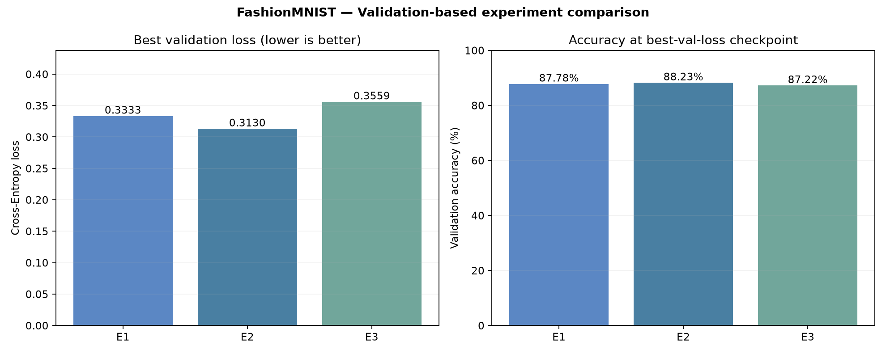
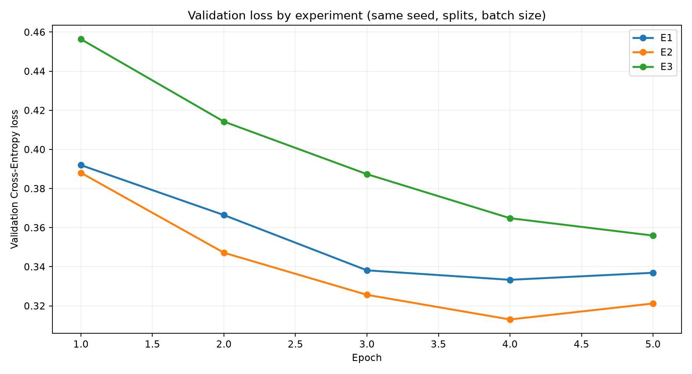
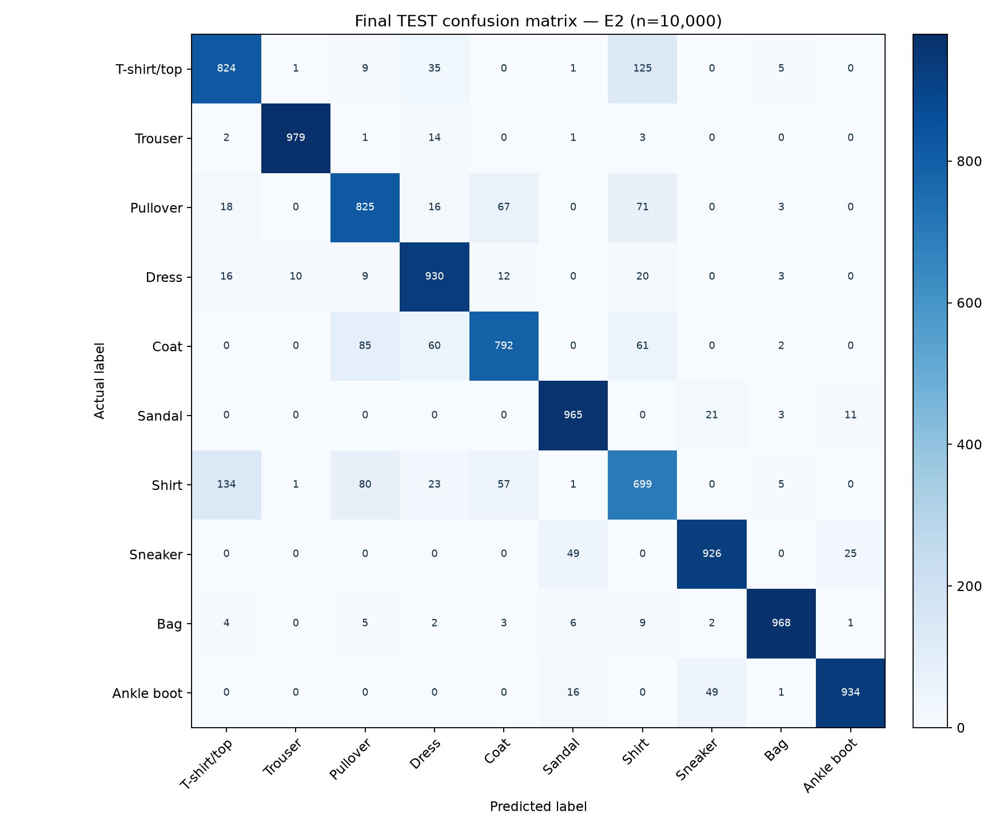

# Practice 1 — Stage 5: Experiments & Evaluation

> **Trạng thái:** ĐÃ chạy E1, E2, E3 trên FashionMNIST thật, lựa chọn E2 dựa trên **validation loss** và chỉ sau đó mới đánh giá test. Kết quả dưới đây được tạo từ `outputs/experiments/experiment_summary.json` và `test_metrics.json`, không phải số liệu ví dụ.

## 3.1. WHAT — Vấn đề nghiên cứu là gì?

Sau Giai đoạn 4, chúng ta có một MLP dự đoán nhãn trang phục, nhưng chưa biết kiến trúc/lr nào phù hợp hơn và mô hình tổng quát hóa ra sao trên dữ liệu chưa dùng để chọn mô hình. Giai đoạn 5 cần trả lời:

1. Thay đổi **số neuron** có cải thiện validation loss không?
2. Giảm **learning rate** có cải thiện quá trình tối ưu trong **5 epochs** không?
3. Cấu hình tốt nhất theo validation sẽ phân loại chính xác bao nhiêu trong **10.000 ảnh test**?
4. Những lớp trang phục nào dễ/khó nhận diện?

Mục tiêu là **so sánh có kiểm soát và đánh giá công bằng**; không chọn mô hình dựa trên kết quả test.

## 3.2. WHY — Tại sao cần thực nghiệm và test?

- MLP có nhiều lựa chọn siêu tham số (hidden layers, learning rate), nên kết quả của một cấu hình duy nhất không chứng minh rằng cấu hình đó phù hợp nhất.
- **Training loss** phản ánh khả năng khớp dữ liệu học; **validation loss** đánh giá lựa chọn trong giai đoạn phát triển; **test metric** ước lượng khả năng tổng quát hóa của cấu hình đã chọn.
- Khi thay đổi nhiều siêu tham số, việc dùng test để xếp hạng sẽ khiến test trở thành validation trá hình (**test leakage**).
- Accuracy tổng thể không chỉ ra những lớp dễ nhầm lẫn; vì vậy ta đo thêm precision, recall, F1 và confusion matrix.

## 3.3. WHEN / WHERE — Khi nào, ở đâu, trên tập nào?

| Thời điểm | Split | Việc được phép thực hiện |
|---|---|---|
| Trước huấn luyện | Train / Validation / Test | Đọc cột `split`, phát hiện ảnh trùng xuyên tập; loại bản ghi train trùng hoàn toàn |
| Trước khi huấn luyện | **Train** | Tính mean/std của pixel để chuẩn hóa cả ba tập |
| Trong huấn luyện | **Train** | Forward → CrossEntropy → Backward → Adam |
| Sau mỗi epoch | **Validation** | Tính loss/accuracy không gradient; chọn checkpoint nhỏ nhất theo val loss |
| Sau khi chạy E1/E2/E3 | **Validation** | So sánh ba cấu hình, chọn một checkpoint duy nhất |
| **Sau khi đã chọn E2** | **Test** | Đánh giá một lần, tính test accuracy/loss, precision/recall/F1 và confusion matrix |

**WHERE (project):** `run_experiments.py` điều phối; `src/train.py` xử lý train/validation; `src/evaluate.py` chỉ làm đánh giá cuối cùng; file nguồn luôn là `data/fashion_mnist_full.csv`.

## 3.4. WHICH — Lựa chọn cấu hình và quy tắc so sánh

**Dữ liệu:** 70.000 ảnh CSV gốc; 53.981 train thực dùng (loại 19 bản ghi train trùng ảnh xuyên split), 6.000 validation, 10.000 test. Ảnh xám 28×28, 10 lớp. Không thay đổi split giữa các experiments.

Cả ba cấu hình dùng Adam, CrossEntropyLoss, batch size **64**, **5 epochs**, seed **42**, preprocessing bằng thống kê **train-only**.

| Experiment | Kiến trúc (input → hidden → output) | LR | Trainable params | Mục đích |
|---|---|---:|---:|---|
| E1 — Baseline | 784 → 128 → 10 | 0.001 | 101.770 | Đánh giá MLP nhỏ |
| E2 — Larger MLP | 784 → 256 → 128 → 10 | 0.001 | 235.146 | Đánh giá tăng năng lực mô hình |
| E3 — Lower LR | 784 → 256 → 128 → 10 | 0.0001 | 235.146 | Tách ảnh hưởng của learning rate |

**Quy tắc lựa chọn cố định trước khi xem test:** chọn checkpoint có **validation loss nhỏ nhất** trong cả ba thử nghiệm. Nếu bằng nhau, ưu tiên mô hình ít tham số hơn, rồi đến mã experiment. Accuracy validation chỉ là chỉ số tham khảo, không thay thế selection rule.

Để tránh huấn luyện E2 lần hai không cần thiết, E2 sử dụng lại checkpoint **Giai đoạn 4** sau khi kiểm tra khớp seed, epochs, batch size, LR, kiến trúc và normalization. E1 và E3 được train mới trên cùng dữ liệu. Các thư mục output tách riêng, không ghi đè Giai đoạn 4.

## 3.5. HOW — Triển khai từng bước

1. Đọc một CSV, lọc train/validation/test và khử ảnh trùng train–validation/test theo chính sách Giai đoạn 2.
2. Chuẩn hóa với mean/std **chỉ từ train đã lọc**; tạo lại DataLoader train có seed giống nhau trước mỗi experiment.
3. Huấn luyện E1, sử dụng lại E2 khi cấu hình checkpoint khớp, huấn luyện E3; với mỗi experiment lưu `best_model.pth`, `metrics.csv`, `training_summary.json` và learning curves.
4. Đọc **best validation loss** của từng experiment rồi chọn cấu hình tốt nhất.
5. Chỉ tại bước này: tải mô hình được chọn, chạy `model.eval()` + `torch.inference_mode()` trên test, lưu metrics và confusion matrix.
6. Viết kết quả từ file JSON/CSV thực; không tạo số liệu giả định.

### Chạy từ thư mục gốc dự án

```powershell
python run_experiments.py
```

Tương đương:

```powershell
python run_experiments.py --csv data/fashion_mnist_full.csv --out-dir outputs --epochs 5 --batch-size 64 --seed 42 --device auto
```

Khi E2 Giai đoạn 4 đã có và đúng cấu hình, code sẽ in `Reused Stage-4 checkpoint`. Nếu thiếu hoặc cấu hình không khớp, E2 được train lại. Dùng `--no-reuse-stage4` để cố ý chạy lại E2.

> **Cẩn thận:** Mỗi lần chạy lại sẽ tạo lại kết quả E1/E3 và tính lại test metrics sau khi chọn. Không dùng test metrics của lần chạy trước để quyết định chỉnh siêu tham số tiếp theo nếu vẫn muốn coi test là holdout độc lập.

## 3.6. Công thức đánh giá

Với tổng số ảnh test là \(N\):

**Cross-Entropy trung bình:**

\[
\mathcal{L}_{\mathrm{test}}=-\frac{1}{N}\sum_{i=1}^N\log p_{i,y_i}
\]

Trong đó \(p_{i,y_i}\) là xác suất mà mô hình gán cho nhãn thực tế của ảnh thứ \(i\).

**Accuracy:**

\[
\mathrm{Accuracy}=\frac{N_{\mathrm{correct}}}{N}\times 100\%
\]

Với từng lớp \(k\):

\[
\mathrm{Precision}_k=\frac{TP_k}{TP_k+FP_k},\qquad
\mathrm{Recall}_k=\frac{TP_k}{TP_k+FN_k}
\]

\[
F1_k=\frac{2\,\mathrm{Precision}_k\,\mathrm{Recall}_k}{\mathrm{Precision}_k+\mathrm{Recall}_k},\qquad
\mathrm{Macro\!\!\text{-}\!F1}=\frac{1}{10}\sum_{k=0}^{9}F1_k
\]

**Confusion matrix:** ô \(C_{ij}\) đếm số ảnh có nhãn thực tế \(i\) nhưng được dự đoán thành \(j\). Các ô ngoài đường chéo cho biết kiểu nhầm lẫn.

## 3.7. Kết quả validation thực tế và lựa chọn mô hình

| Experiment | LR | Best epoch | Best val loss ↓ | Val accuracy tại best epoch ↑ |
|---|---:|---:|---:|---:|
| E1 | 0.001 | 4 | 0.3333 | 87.78% |
| **E2** | **0.001** | **4** | **0.3130** | **88.23%** |
| E3 | 0.0001 | 5 | 0.3559 | 87.22% |





**Nhận xét:** E2 có validation loss thấp nhất (0.3130), được chọn theo quy tắc đã định. Checkpoint E2 tốt nhất ở **epoch 4**, không phải epoch 5. E1 nhẹ hơn (101.770 so với 235.146 params) nhưng loss cao hơn; E3 có learning rate nhỏ hơn và sau 5 epochs chưa bắt kịp E2. **Không kết luận LR nhỏ luôn kém**: số epoch, lịch giảm LR và optimizer khác có thể thay đổi kết quả. Trong E1, best epoch là epoch 4 dù accuracy epoch 5 cao hơn một chút — vì tiêu chí chọn checkpoint là loss, không phải accuracy.

## 3.8. Final holdout TEST — chỉ đánh giá mô hình E2 đã chọn

Sau khi chốt E2 dựa trên validation, lần đánh giá cuối dùng toàn bộ **10.000 ảnh test**:

| Metric | Kết quả |
|---|---:|
| Đúng / tổng ảnh | **8.842 / 10.000** |
| **Test accuracy** | **88.42%** |
| Test Cross-Entropy loss | **0.3089** |
| Macro-F1 | **0.8839** |

**Tỷ lệ nhận diện đúng theo lớp (Recall; mỗi lớp có 1.000 ảnh):**

| Nhãn | Lớp | Recall |
|---:|---|---:|
| 0 | T-shirt/top | 82.4% |
| 1 | Trouser | 97.9% |
| 2 | Pullover | 82.5% |
| 3 | Dress | 93.0% |
| 4 | Coat | 79.2% |
| 5 | Sandal | 96.5% |
| 6 | **Shirt** | **69.9%** |
| 7 | Sneaker | 92.6% |
| 8 | Bag | 96.8% |
| 9 | Ankle boot | 93.4% |



**Diễn giải:** Nhóm **Shirt** có recall thấp nhất (69,9%), cho thấy nhiều ảnh Shirt bị nhầm sang các nhãn tương tự. Trouser (97,9%), Bag (96,8%) và Sandal (96,5%) có recall cao; không sử dụng các tỷ lệ lớp từ lần chạy trước. Ma trận nhầm lẫn cung cấp bằng chứng ở từng cặp nhãn, thay vì chỉ nhìn accuracy tổng thể.

## 3.9. Giới hạn và tính tái lập

- Đây là ba thử nghiệm với một seed và **5 epochs**, không phải khảo sát toàn bộ không gian siêu tham số.
- Kết quả trên CPU/GPU hoặc các phiên bản PyTorch khác có thể chênh nhẹ; vẫn phải kiểm tra logic chống leakage và nguyên tắc lựa chọn.
- Kiểm tra trùng ảnh hiện chỉ xử lý ảnh trùng **pixel giống hệt**, không bảo đảm phát hiện ảnh gần giống hoặc rò rỉ ngữ nghĩa.
- E2 đã đạt 88.42% test accuracy trong thực nghiệm này; không khẳng định tỷ lệ đó áp dụng cho mọi dữ liệu thời trang thực tế khác.
- Khi viết báo cáo, cần nêu rõ E2 tái sử dụng checkpoint Giai đoạn 4 để người đọc biết nguồn kết quả.

## 3.10. Files output và liên kết đến Giai đoạn 6

```text
outputs/experiments/
├── E1/                         # checkpoint, metrics, curves
├── E2/                         # checkpoint GĐ4 được xác minh và sao chép
├── E3/                         # checkpoint, metrics, curves
├── experiment_comparison.csv
├── experiment_summary.json
├── test_metrics.json
├── test_predictions.csv        # nhãn thật/dự đoán/confidence cho GĐ6
├── per_class_metrics.csv
├── confusion_matrix.csv
└── figures/
    ├── experiment_comparison.png
    ├── validation_loss_comparison.png
    └── test_confusion_matrix.png
```

**Đã hoàn thành Giai đoạn 5 và 6:** đã lựa chọn E2 theo validation, đánh giá test sau khi chốt, xuất biểu đồ so sánh và ma trận nhầm lẫn. Giai đoạn 6 đã dùng các dự đoán lưu sẵn để tạo `outputs/figures/predictions.png`, `misclassified_examples.png`, `per_class_recall.png` và hoàn thiện `markdown/04_results_conclusion.md` cùng báo cáo ngắn.

### Tài liệu tham khảo

- FashionMNIST: https://www.kaggle.com/datasets/zalando-research/fashionmnist
- PyTorch classification loss: https://docs.pytorch.org/docs/stable/generated/torch.nn.CrossEntropyLoss.html
- PyTorch model evaluation: https://docs.pytorch.org/docs/stable/generated/torch.inference_mode.html
