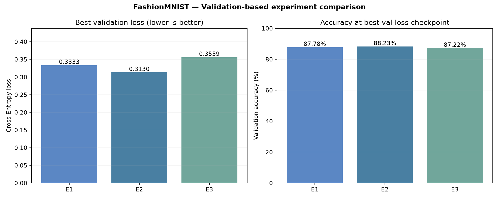
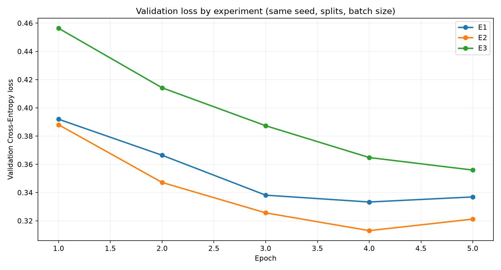
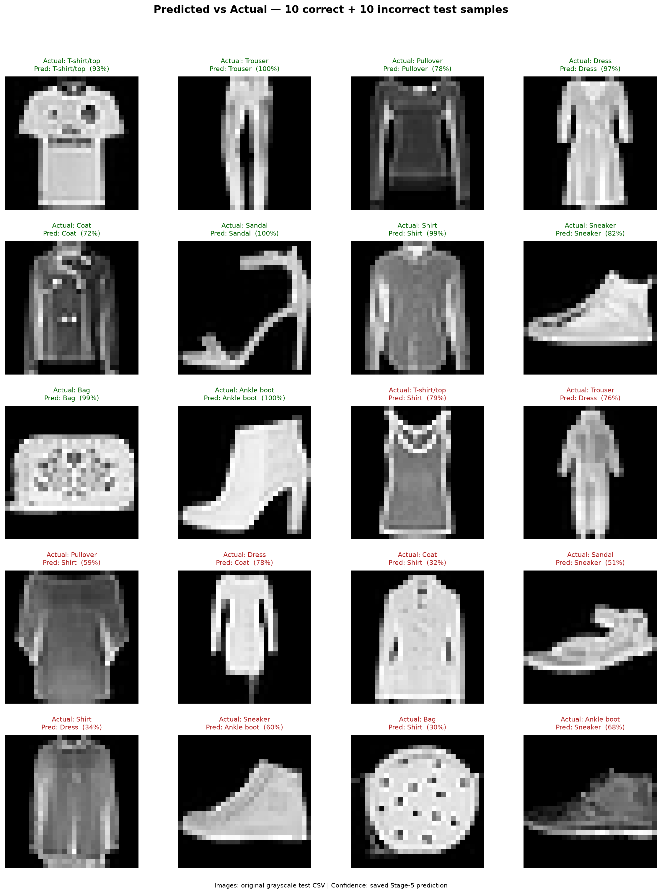
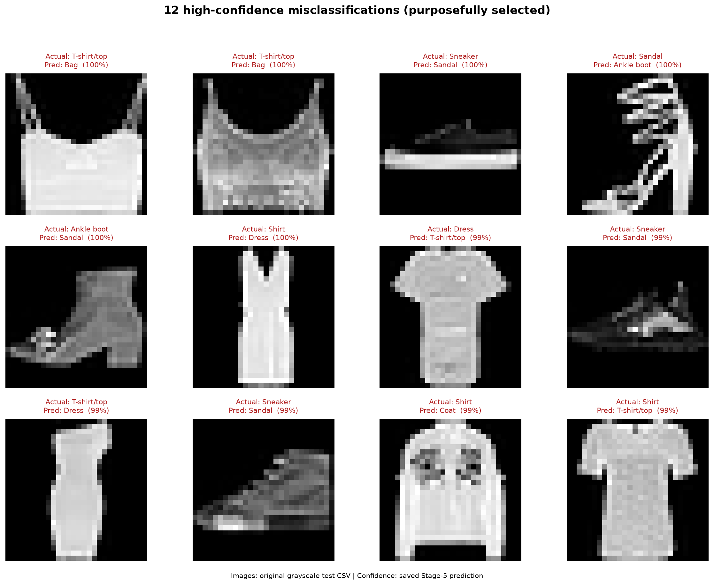
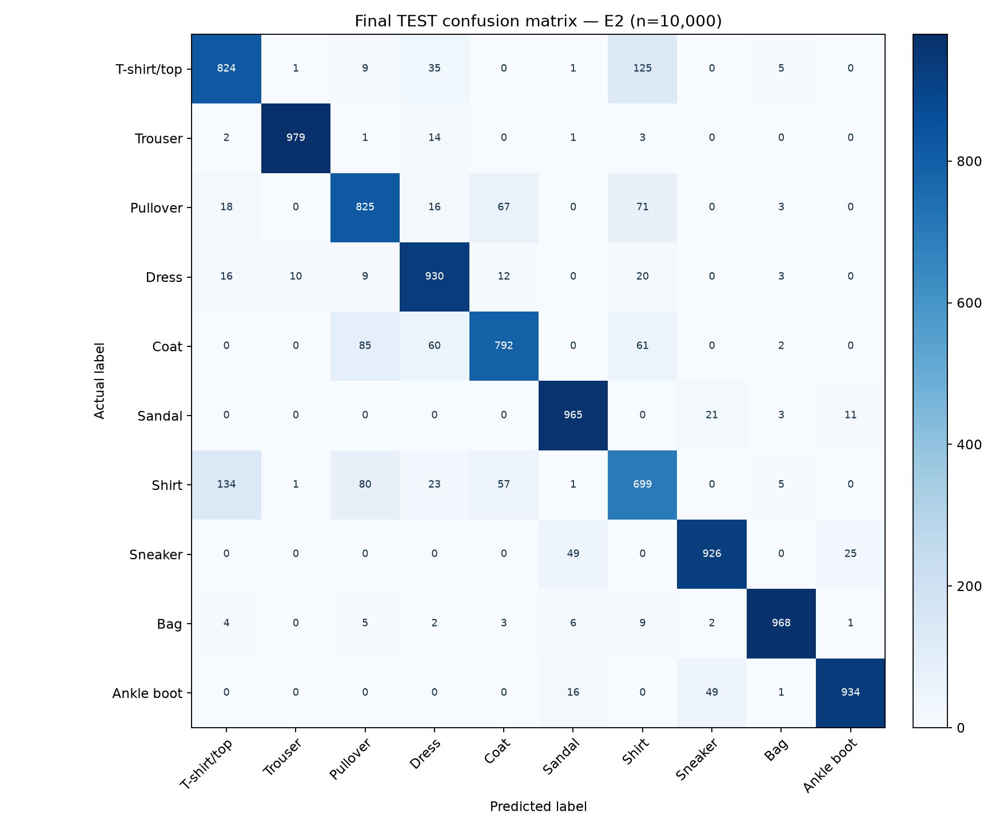
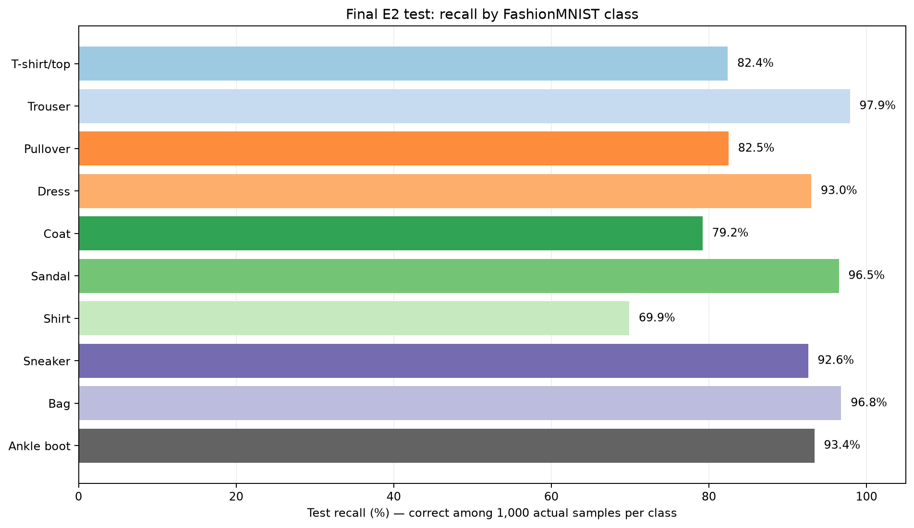
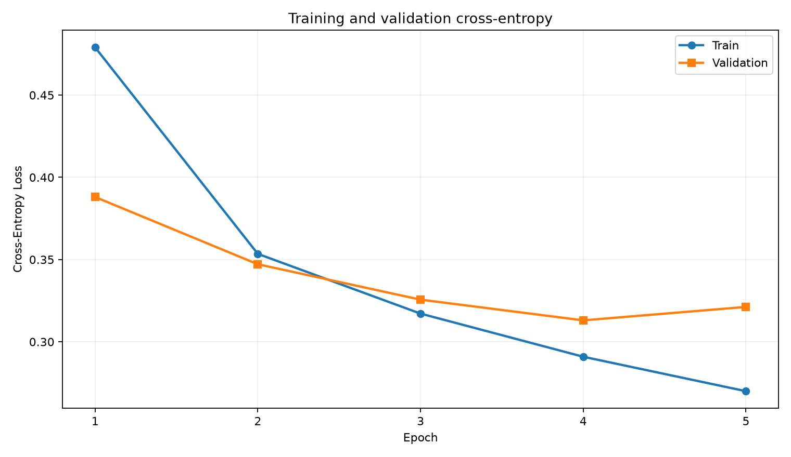
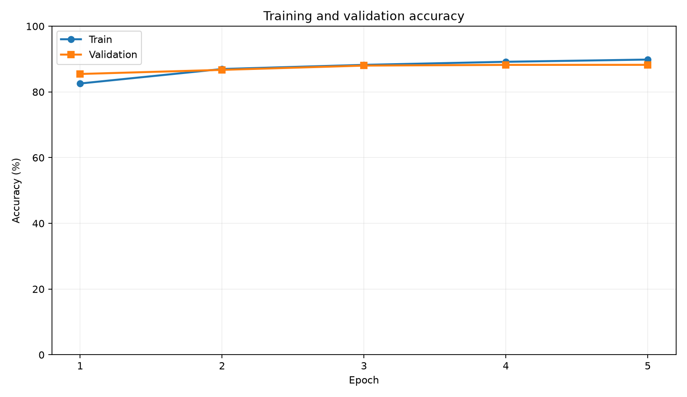

# Practice 1 — Stage 6: Visualization, Results & Conclusion

> **Trạng thái:** Đã hoàn thành trực quan hóa từ dữ liệu **test thực** và các dự đoán được lưu ở Giai đoạn 5. **Giai đoạn 6 không train lại, không điều chỉnh hyperparameters theo test, không gọi lại forward trên tập test.** Các hình ảnh được tái tạo từ một file CSV nguồn và kết quả đã lưu.

## 4.1. WHAT — Giai đoạn cuối giải quyết vấn đề gì?

Bài toán FashionMNIST yêu cầu không chỉ tạo mô hình phân loại mà còn **chứng minh kết quả**, thể hiện những trường hợp đúng/sai bằng hình ảnh và cung cấp báo cáo có thể kiểm tra lại. Ở Giai đoạn 5, chúng ta đã chọn E2 bằng validation loss và đánh giá test. Giai đoạn này tổng hợp bằng chứng để trả lời:

1. Mô hình có độ chính xác cuối cùng là bao nhiêu?
2. Những ví dụ dự đoán đúng và sai trông như thế nào?
3. Những lớp trang phục nào dễ nhầm, và cặp lớp nào gây nhầm lẫn nhiều nhất?
4. Mức độ kết quả có đáp ứng yêu cầu đề bài Practice 1 không?

**Đầu vào của Giai đoạn 6:** `data/fashion_mnist_full.csv` cùng `outputs/experiments/{test_predictions.csv,test_metrics.json,per_class_metrics.csv,confusion_matrix.csv}`. **Đầu ra:** biểu đồ/ảnh `.png`, bản tóm tắt `.json`, báo cáo cuối và các liên kết hình ảnh trong Markdown.

## 4.2. WHY — Tại sao cần trực quan hóa đầu ra?

Accuracy toàn cục chỉ cho biết tỷ lệ đúng; nó không giải thích **mô hình đúng ở đâu và sai ở đâu**. Hình ảnh có *Actual* và *Predicted* cho phép đối chiếu trực tiếp với sản phẩm thời trang. Confusion matrix và recall theo lớp làm rõ những nhóm có đặc trưng chồng lấn (chẳng hạn Shirt, T-shirt/top, Pullover, Coat). Trình bày cả lỗi điển hình giúp nhận xét khách quan, không chỉ chọn những ví dụ đẹp.

Các hình minh họa chỉ là **sản phẩm trực quan hóa**, không được dùng để chỉnh mô hình sau khi đã xem kết quả test.

## 4.3. WHEN / WHERE / WHICH — Quy tắc lựa chọn và bằng chứng

| Thời điểm | Tập dữ liệu | Hoạt động |
|---|---|---|
| Giai đoạn 2 | Train/Validation/Test | Xác định `split`, loại 19 ảnh train trùng pixel xuyên tập, normalize theo train-only |
| Giai đoạn 3 | Train | Xác nhận đầu vào `[64,1,28,28]`, đầu ra `[64,10]`, 235.146 parameters |
| Giai đoạn 4 | Train và validation | Huấn luyện E2 trong 5 epochs, lưu checkpoint theo minimum validation loss |
| Giai đoạn 5 | Train và validation | So sánh E1/E2/E3, chọn E2 trước khi tính test |
| Giai đoạn 5 (cuối) | **Test** | Tính kết quả E2 trên 10.000 ảnh test đã giữ riêng |
| **Giai đoạn 6** | **Dự đoán đã lưu** | Tạo hình và báo cáo, **không huấn luyện hay chọn lại mô hình** |

**WHICH — mô hình đã chọn:** E2, kiến trúc `784 → 256 → 128 → 10`, ReLU, Adam, learning rate `0.001`, batch size `64`, `5 epochs`, seed `42`. Tiêu chí chọn là **validation loss nhỏ nhất** (0,313020), không phải test accuracy.

## 4.4. HOW — Quy trình tạo hình có thể tái lập

1. Đọc `test_metrics.json` và `test_predictions.csv` của E2.
2. Kiểm tra dữ liệu có 10.000 dòng test, index liên tục 0–9.999, nhãn 0–9; xác nhận `correct` khớp `actual == predicted`, và số đúng khớp `test_metrics.json`.
3. Đọc **cùng một file CSV gốc** để lấy các pixel tương ứng với vị trí trong test split; kiểm tra nhãn `actual` trong CSV khớp nhãn của kết quả Giai đoạn 5.
4. Tạo `predictions.png`: chọn **một ví dụ đúng và một ví dụ sai cho mỗi lớp** (dùng hàng xuất hiện đầu tiên trong từng nhóm, mang tính minh họa).
5. Tạo `misclassified_examples.png`: chọn 12 lỗi có độ tin cậy dự đoán cao nhất. **Các lỗi này được chọn có chủ đích, không phải mẫu ngẫu nhiên hoặc tỷ lệ lỗi đại diện**.
6. Tạo `per_class_recall.png` từ `per_class_metrics.csv` có sẵn; ghi `visualization_summary.json` để có thể truy lại các index minh họa.

Chạy từ bất kỳ Terminal nào khi biết đúng project root, hoặc mở file `src/visualize.py` rồi bấm **Run Python File** trong VS Code:

```powershell
python src/visualize.py
```

> `src/visualize.py` tự suy ra đường dẫn tuyệt đối từ vị trí của script nên nút Run Python File hoạt động ngay cả khi workspace VS Code đang mở thư mục cha `DEEP Learning`. Trường hợp chọn đường dẫn bằng CLI: `python src/visualize.py --csv data/fashion_mnist_full.csv --predictions outputs/experiments/test_predictions.csv --out-dir outputs/figures`.

## 4.5. Kết quả định lượng cuối cùng

### 4.5.1. Lựa chọn mô hình bằng validation

| Experiment | Cấu hình | Best val loss ↓ | Val accuracy tại best checkpoint |
|---|---|---:|---:|
| E1 | MLP 784→128→10, lr=0.001 | 0.3333 | 87.78% |
| **E2** | **MLP 784→256→128→10, lr=0.001** | **0.3130** | **88.23%** |
| E3 | MLP 784→256→128→10, lr=0.0001 | 0.3559 | 87.22% |





### 4.5.2. Kết quả holdout test của E2

| Chỉ số | Giá trị thực tế |
|---|---:|
| Tập test | 10.000 ảnh |
| Số dự đoán đúng | **8.842** |
| Số dự đoán sai | **1.158** |
| Test accuracy | **88,42%** |
| Test cross-entropy loss | **0,3089** |
| Test macro-F1 | **0,8839** |
| Mô hình được đánh giá | E2 — checkpoint được chọn bằng validation |

**Accuracy:**

\[
\mathrm{Accuracy}=\frac{N_{\mathrm{correct}}}{N_{\mathrm{test}}}\times100\%=\frac{8842}{10000}\times100\%=88.42\%.
\]

**Macro-F1** lấy trung bình không trọng số của F1 của 10 lớp:

\[
\mathrm{MacroF1}=\frac{1}{10}\sum_{k=0}^{9}F1_k\approx0.8839.
\]

Như vậy Accuracy = 88,42% nghĩa là mô hình đúng 8.842/10.000 ảnh của bộ test chuẩn; không có nghĩa nhận diện đúng 88,42% ảnh thời trang ngoài thực tế trong mọi điều kiện.

## 4.6. Phân tích hình ảnh dự đoán đúng và sai

### 4.6.1. Predicted vs Actual



Hình gồm **10 trường hợp đúng và 10 trường hợp sai**, mỗi loại trang phục đều xuất hiện ở cả hai nhóm. Nhãn màu xanh biểu thị dự đoán đúng, nhãn màu đỏ biểu thị dự đoán sai. Phần trăm đi kèm là **confidence của lớp được dự đoán**, không phải accuracy của lớp đó.

Đây là tập hình **được chọn có chủ đích** để cho người đọc xem đủ hai tình huống; không lấy tỷ lệ đúng/sai trong hình 20 ảnh để suy ra độ chính xác chung.

### 4.6.2. Các lỗi tự tin cao



Hình nêu những trường hợp mô hình **dự đoán sai nhưng vẫn có confidence cao**. Đây là cách minh họa giới hạn của đầu ra phân loại, không phải bằng chứng riêng lẻ rằng mô hình đã được hiệu chuẩn xác suất tốt hay kém. Muốn đánh giá calibration phải thêm thí nghiệm khác.

### 4.6.3. Confusion matrix và Recall theo lớp





| Lớp | Recall | Số ảnh nhận diện đúng / 1.000 |
|---|---:|---:|
| T-shirt/top | 82.4% | 824 |
| Trouser | 97.9% | 979 |
| Pullover | 82.5% | 825 |
| Dress | 93.0% | 930 |
| Coat | 79.2% | 792 |
| Sandal | 96.5% | 965 |
| **Shirt** | **69.9%** | **699** |
| Sneaker | 92.6% | 926 |
| Bag | 96.8% | 968 |
| Ankle boot | 93.4% | 934 |
Từ confusion matrix, một số cặp nhầm lẫn đáng chú ý:

- T-shirt/top → Shirt: **125 ảnh**.
- Shirt → T-shirt/top: **134 ảnh**.
- Pullover → Coat: **67 ảnh**.
- Shirt → Pullover: **80 ảnh**.
- Coat → Pullover: **85 ảnh**.

**Shirt là lớp khó nhất** trong thực nghiệm này (recall 69,9%), cho thấy các kiểu áo có hình dáng gần nhau ở độ phân giải 28×28 còn dễ bị nhầm lẫn. Trouser có recall cao nhất (97,9%), tiếp theo là Bag (96,8%) và Sandal (96,5%).

## 4.7. Phân tích quá trình huấn luyện





Trong 5 epochs, train loss giảm từ **0.4790** xuống **0.2699**; validation loss đạt mức tốt nhất **0.3130 ở epoch 4**, sau đó tăng lên **0.3212 ở epoch 5**. Train accuracy cuối cùng đạt **89.85%**, còn validation accuracy tại checkpoint tốt nhất là **88.23%** (validation accuracy ở epoch 5 = 88.25%). Chỉ chọn checkpoint theo **validation loss nhỏ nhất**, không theo accuracy của epoch cuối. Sự tăng loss validation ở epoch 5 cần được theo dõi nếu train lâu hơn.

## 4.8. Đối chiếu với yêu cầu Practice 1

| Yêu cầu bài tập | Bằng chứng |
|---|---|
| Load FashionMNIST dataset | `data/fashion_mnist_full.csv`, `src/data_loader.py` |
| Apply transforms | Tensor, scale 0–1, mean/std train-only, DataLoader |
| Build neural network | `src/model.py`, kiến trúc 784→256→128→10 |
| Training loop | `src/train.py`, 5 epochs, loss/backward/Adam |
| Model accuracy | `src/evaluate.py`, test accuracy **88,42%** |
| Save and load model | `outputs/best_model.pth`, checkpoint reload verified |
| Experiments | E1/E2/E3 trong `markdown/03_experiments.md` |
| Visualize loss | `outputs/figures/loss_curve.png` |
| Predicted vs Actual images | `outputs/figures/predictions.png` |
| Python code + brief report | Source code và file Markdown này, bản ngắn tại `outputs/Practice1_Brief_Report.md` |

## 4.9. Hạn chế và hướng cải thiện

- **Giới hạn kiến trúc:** MLP làm phẳng ảnh nên không tận dụng cấu trúc không gian và các mẫu cục bộ như CNN.
- **Giới hạn dữ liệu:** FashionMNIST ảnh xám 28×28 và nhãn 10 lớp, đơn giản hơn ảnh trang phục thực tế có nền phức tạp.
- **Giới hạn nghiên cứu:** chỉ thử **ba cấu hình**, mỗi cấu hình 5 epochs với một seed; không đủ kết luận cấu hình này là tối ưu toàn cục.
- **Giới hạn chống leakage:** chỉ phát hiện và loại các ảnh **giống hệt pixel** xuyên split, không bảo đảm loại hết ảnh gần giống.
- **Giới hạn đánh giá:** không sử dụng tập test nhiều lần để tìm hyperparameter sau khi đã xem kết quả. Nếu mở rộng nghiên cứu tiếp, cần tách holdout mới hoặc chuyển sang quy trình đánh giá phù hợp.

Hướng mở rộng tham khảo (ngoài scope Practice 1): CNN, scheduler cho learning rate, dropout, nhiều random seeds và phân tích calibration.

## 4.10. Kết luận — WHAT / WHY / HOW đã được giải quyết đến đâu?

**WHAT:** Đã xây dựng được mô hình PyTorch phân loại ảnh FashionMNIST thành 10 loại trang phục.

**WHY:** Mô hình thể hiện quy trình Deep Learning có kiểm soát: dữ liệu tách trước huấn luyện, preprocessing fit chỉ từ train, chọn checkpoint bằng validation và kiểm tra khả năng tổng quát hóa bằng test.

**WHEN / WHERE / WHICH:** Dùng một CSV duy nhất, train hiệu lực **53.981** ảnh, validation **6.000** và test **10.000**; E2 tốt nhất trong ba cấu hình được thử theo tiêu chí validation loss.

**HOW:** Đọc CSV → tách split và audit trùng ảnh → Tensor/Normalize/DataLoader → MLP → Train/Validation → Model selection → Final Test → Visualization/Report.

**Kết quả:** Test accuracy **88,42%**, macro-F1 **0,8839**. Đề bài Practice 1 đã được đáp ứng về code, experiment, save/load, loss graphs, predicted-versus-actual images và báo cáo. Những trường hợp mô hình hay nhầm nhất là các loại áo có hình dạng tương tự nhau, cho thấy mô hình vẫn có thể cải thiện.

## 4.11. File minh chứng và tài liệu tham khảo

- `outputs/experiments/test_predictions.csv`: toàn bộ 10.000 nhãn test thật/dự đoán; nguồn của hình trực quan.
- `outputs/experiments/test_metrics.json`: accuracy, loss, macro-F1.
- `outputs/experiments/per_class_metrics.csv`, `confusion_matrix.csv`: chỉ số theo lớp, số lỗi theo cặp nhãn.
- `outputs/visualization_summary.json`: các test index được chọn đưa vào hình ảnh và kiểm tra nhất quán CSV.
- `outputs/figures/predictions.png`, `misclassified_examples.png`, `per_class_recall.png`: kết quả Giai đoạn 6.
- [FashionMNIST — Zalando Research, Kaggle](https://www.kaggle.com/datasets/zalando-research/fashionmnist)
- [PyTorch CrossEntropyLoss](https://docs.pytorch.org/docs/stable/generated/torch.nn.CrossEntropyLoss.html)
- [PyTorch DataLoader](https://docs.pytorch.org/docs/stable/data.html)
- [PyTorch model saving/loading](https://docs.pytorch.org/tutorials/beginner/saving_loading_models.html)

> **Tính trung thực của báo cáo:** tất cả các số liệu về training/validation/test và các hình ảnh dự đoán trong tài liệu đều xuất phát từ files đầu ra của các lần chạy thực tế đã lưu; không phải kết quả tự ước lượng.
