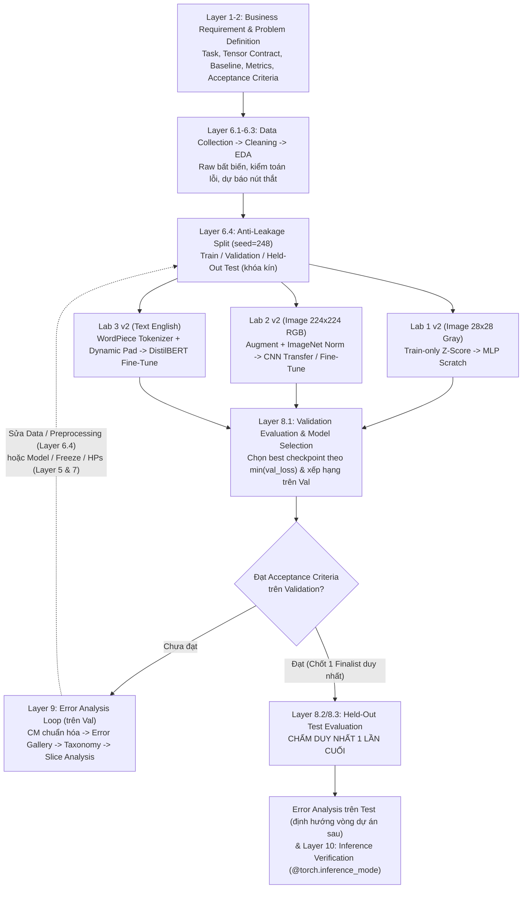
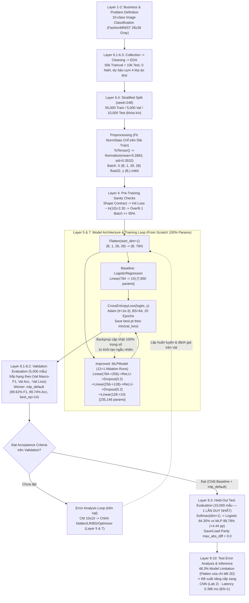
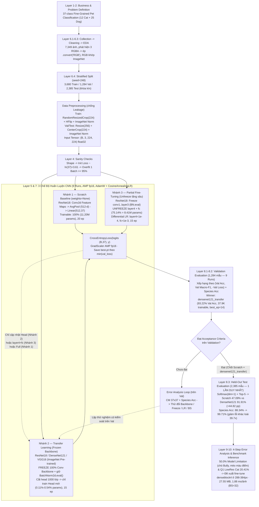

# So Sánh Training Pipeline Trên 3 Labs: MLP (`Lab 1 v2`) vs Pre-trained CNN (`Lab 2 v2`) vs Transformer (`Lab 3 v2`)

> **Mục tiêu tài liệu:** Hệ thống hóa **xương sống chung** từ Business Requirement đến Data Preprocessing & Error Analysis Loop, đồng thời giải phẫu **4 điểm khác biệt cốt lõi** giữa huấn luyện từ đầu bằng **MLP**, **Transfer Learning / Fine-Tuning CNN**, và **Fine-Tuning Transformer (Hugging Face)** — kèm **3 sơ đồ Mermaid chuyên biệt** và **100% số liệu thực nghiệm thật** đã kiểm chứng trên repo.

---

## 1. Điểm Chung Xuyên Suốt Cả 3 Labs (Shared Pipeline Backbone)

Dù chuyển dịch từ ảnh xám đơn giản (`FashionMNIST`), sang ảnh màu fine-grained (`Oxford-IIIT Pets`), rồi sang văn bản tiếng Anh (`IMDB`), cả 3 Labs đều tuân thủ cùng một kiến trúc quy trình chuẩn (`MODEL_PIPELINE.md`) ở hai đầu pipeline:

1. **Từ Business Requirement → Problem Definition (Layer 1–2):**
   - Chốt tường minh **Task**, **Input/Output Tensor Contract**, **Baseline đối chứng**, **Evaluation Metrics** và **Acceptance Criteria** trước khi viết mã huấn luyện.
   - Không dự đoán trước con số Accuracy mục tiêu theo cảm tính; luôn đo một **Baseline có kiểm soát** để chứng minh **gap cải thiện dương** (`ΔAccuracy`, `ΔF1`, `-ΔLoss`).
2. **Từ Data Collection → Cleaning → EDA → Anti-Leakage Split (Layer 6.1–6.4):**
   - **Dữ liệu gốc bất biến (Immutable Raw Data):** Không sửa trực tiếp dữ liệu thô trên đĩa.
   - **Data Cleaning & Audit:** Kiểm toán 100% mẫu để phát hiện dữ liệu lỗi trước khi đưa vào model (Lab 1: xác thực `60k+10k` IDX & 0 NaN; Lab 2: phát hiện `3` ảnh `RGBA` và ép `.convert("RGB")`; Lab 3: kiểm tra thẻ HTML ` ` và xác nhận `0` trùng lặp `Train ∩ Test`).
   - **EDA dẫn đường cho thiết kế & Error Analysis:** Mọi giả thuyết về nút thắt hiệu năng đều được phát hiện từ EDA (Lab 1: cụm 4 lớp áo có độ tương đồng prototype `0.95–0.99`; Lab 2: phân giải ảnh gốc dao động mạnh `17.4k–3.11M px`; Lab 3: `~40%` review IMDB vượt ngưỡng `max_length = 256` tokens).
   - **Kỷ luật chống Data Leakage (`seed = 248`):** Khóa cứng `split_indices.json` (`Train ∩ Val = ∅`, `Train ∩ Test = ∅`); mọi thống kê chuẩn hóa hoặc Data Augmentation chỉ tính/áp dụng trên `Train`; **tập Held-Out Test khóa kín cho đến bước Evaluation cuối cùng**.
3. **Pre-Training Sanity & Automated Dual Tests (Layer 4):**
   - Kiểm tra **Tensor Shape Contract**, **Initial Loss** ($\approx \ln C$: Lab 1 $\approx 2.30$, Lab 2 $\approx 3.61$, Lab 3 $\approx 0.69$), **Overfit 1 Batch / Tiny Subset** và **Save/Load Parity** (`max_abs_diff < 1e-6`) trước khi chạy huấn luyện chính thức.
4. **Validation Gate & Vòng Lặp Error Analysis (Layer 8–9):**
   - **Mọi vòng lặp cải tiến** (điều chỉnh preprocessing, đổi kiến trúc, chỉnh `LR` / `Batch Size` / chiến lược freeze) **chỉ được đánh giá và lặp trên tập Validation** cho đến khi thỏa mãn Acceptance Criteria.
   - Chỉ sau khi **Validation Gate PASS** và chốt duy nhất mô hình thắng cuộc, **Held-Out Test mới được mở đúng 1 lần cuối cùng** để báo cáo hiệu năng tổng quát không thiên lệch.

---

## 2. Bảng So Sánh Trực Diện Training Pipeline Across 3 Labs

| Tiêu chí kỹ thuật | Lab 1 v2 (`0005_lab1v2`) — **MLP Scratch** | Lab 2 v2 (`0006_lab2_v2`) — **CNN Transfer & Fine-Tune** | Lab 3 v2 (`0007_lab3_v2`) — **Transformer Fine-Tune** |
| :--- | :--- | :--- | :--- |
| **Bài toán & Dữ liệu** | 10-class Image Classification (`FashionMNIST`, ảnh xám `28×28`) | 37-class Fine-Grained Image Classification (`Oxford-IIIT Pets`, `12` Mèo + `25` Chó, RGB) | 2-class Binary Text Classification (`stanfordnlp/imdb`, review phim tiếng Anh) |
| **Tách tập (`seed = 248`)** | `55,000` Train / `5,000` Val / `10,000` Test | `3,680` Train / `1,284` Val / `2,385` Test | `4,000` Train / `1,000` Val / `1,000` Test |
| **Data Preprocessing** *(ngoài Model)* | `ToTensor()` + Z-score chỉ fit trên Train (`mean=0.2863, std=0.3532`); không spatial aug | `.convert("RGB")` → Train: `RandomResizedCrop(224) + HFlip`; Val/Test: `Resize(256) + CenterCrop(224)` → ImageNet Norm | **WordPiece Tokenizer** (`truncation=True, max_length=256`, thêm `[CLS]/[SEP]`) + **`DataCollatorWithPadding`** (dynamic padding) |
| **Input Tensor vào Model** | `(B, 1, 28, 28)` `float32` | `(B, 3, 224, 224)` `float32` | `input_ids` & `attention_mask`: `(B, L)` `int64` ($1 \le L \le 256$) |
| **Lớp đầu tiên của Model** | `Flatten(start_dim=1)` → `(B, 784)` *(phá cấu trúc 2D)* | `Conv2d` (`7×7` hoặc `3×3`) trượt trên ảnh 2D | **Word Embedding (`30,522×768`) + Positional Embedding (`512×768`)** → `(B, L, 768)` `float` |
| **Feature Extractor** | Chuỗi `Linear → ReLU → Dropout(0.2)` (`784→256→128`) | Pre-trained CNN Backbone (`ResNet18`, `DenseNet121`, `VGG16`): `Conv2d → BN → ReLU → Pool` → Feature Maps `(B, C, 7, 7)` → `AdaptiveAvgPool2d` (`512 / 1024 / 4096-d`) | **`DistilBERT` Encoder-only**: `6×` Bidirectional Multi-Head Self-Attention (`12` heads) + FFN (`3,072`, `GELU`) → trích vector **`[CLS]`** `(B, 768)` |
| **Classification Head** | `Linear(128, 10)` → logits `(B, 10)` | `Linear(512/1024/4096, 37)` → logits `(B, 37)` *(cắt head 1000 lớp ImageNet)* | `pre_classifier: Linear(768, 768) → ReLU → Dropout(0.2)` + `classifier: Linear(768, 2)` → logits `(B, 2)` *(bỏ head MLM 30,522 từ)* |
| **Chế độ học trọng số** | **From Scratch (`100%`)**: Logistic `7,850`, MLP `235,146` | • **Scratch (`100%`)**: `ResNet18` `11.20M` • **Transfer/Frozen (`0.11%–0.54%`)**: `ResNet18` `19.0K`, `DenseNet121` `37.9K`, `VGG16` `151.6K` *(BN đóng băng `.eval()`)* • **Partial Fine-Tune (`75.14%`)**: `ResNet18 layer4+fc` `8.41M` | **Full Fine-Tuning (`100%`)**: toàn bộ `66,955,010` params (`~66.36M` backbone pre-train + `~592K` head khởi tạo mới) |
| **Loss & Output Activation** | `CrossEntropyLoss` (Train) · **`Softmax(dim=1)`** `(B, 10)` (Inference) | `CrossEntropyLoss` (Train) · **`Softmax(dim=1)`** `(B, 37)` (Inference) | `CrossEntropyLoss` (Train) · **`Softmax(dim=-1)`** `(B, 2)` (Inference) |
| **Training Engine & HPs** | Custom PyTorch loop · `Adam(1e-3)` · `BS=64` · **`20 ep`** · FP32 | Custom PyTorch loop + AMP `fp16` · `AdamW(1e-3)` *(diff LR `1e-4/1e-3` khi finetune)* + `CosineAnnealingLR` · `BS=32` · **`15–20 ep`** | Hugging Face `Trainer` + `fp16` · `AdamW(2e-5, wd=0.01)` + Linear Decay + Grad Clip `1.0` · `BS=16` · **`3 ep`** |
| **Tiêu chí chọn Best Model** | Nội bộ: `min(val_loss)` · Giữa runs: `(Val Macro-F1, Val Acc, -Val Loss)` | Nội bộ: `min(val_loss)` · Giữa runs: `(Val Acc, Val Macro-F1, -Val Loss)` | `load_best_model_at_end=True` theo `min(eval_loss)` trên Val (`checkpoint-250`, `ep 1.0`) |
| **Kết quả thực nghiệm (Baseline → Best)** | **Test `10k`:** Logistic `84.35%` Acc (`84.21%` F1) → **`mlp_default` `88.79%` Acc (`88.68%` F1, `+4.44 pp`)** | **Test `2,385`:** `resnet18_scratch` `47.09%` Acc (`46.26%` F1, `88.34%` Species) → **`densenet121_transfer` `91.91%` Acc (`91.76%` F1, `99.71%` Species, `+44.82 pp`)** | **Val `1k`:** Random head `49.70%` Acc (`0.00%` F1) → **`87.80%` (`+38.10 pp`)** **Test `1k`:** **`89.10%` Acc (`89.26%` Binary F1, `89.10%` Macro-F1, Loss `0.2518`)** |
| **Phát hiện số 1 từ Error Analysis** | **`48.3%` Model Limitation** do `Flatten` xóa chi tiết 2D cụm 4 lớp áo; vật thể nhỏ `fg_ratio` Q1–Q2 lỗi `33.8%–38.0%` | **`50.0%` Model Limitation** trên chó Bully & mèo màu điểm; ảnh mèo `Q1 LowRes` lỗi nhảy **`20.41%` (`2.5×`)** | Review bị cắt ở **`> 256` tokens** lỗi **`14.46%` vs `8.45%` (`1.71×`)**, làm mất câu kết luận ở `6/10` lỗi tự tin cao |

---

## 3. Giải Phẫu 4 Điểm Khác Biệt Cốt Lõi (Đính Chính Thuật Ngữ & Bản Chất Kỹ Thuật)

### 3.1 Feature Extraction: MLP (`Flatten`) vs CNN (`Conv2d` Feature Maps) vs Transformer (`Encoder-only Self-Attention`)

1. **MLP vs CNN — Vì sao `Conv2d` vượt trội trên dữ liệu ảnh?**
   - **MLP (`Lab 1 v2`):** Duỗi phẳng `(1, 28, 28) → (784)`. Hai pixel nằm sát nhau theo chiều dọc (ví dụ hàng khuy áo trên `Shirt`) bị tách xa nhau `28` vị trí trong vector 1D. Do không chia sẻ trọng số cục bộ (*translation equivariance*), MLP không giữ được cấu trúc hình học 2D.
   - **CNN (`Lab 2 v2`):** Dùng các **kernel tích chập (`Conv2d`)** trượt trên lưới 2D để tạo ra **ma trận đặc trưng (Feature Maps) dạng `(C, H', W')`**:
     - Các tầng đầu học đặc trưng cục bộ bậc thấp (biên cạnh, góc, màu lông, vân sọc).
     - Các tầng sâu gom thông tin cục bộ thành đặc trưng ngữ nghĩa bậc cao (tai nhọn/cụp, hình khối mõm, tỷ lệ hộp sọ) tại lưới `(C, 7, 7)`.
     - Đặc biệt trong **`DenseNet121`**, phép ghép nối kênh dày đặc (*Dense Concatenation*) giúp vector cuối `1,024-d` giữ được **cả chi tiết lông tầm thấp lẫn hình khối tầm cao** — lý do `densenet121_transfer` đạt `93.22%` Val Acc (`91.91%` Test Acc), cao hơn cả `ResNet18` lẫn `VGG16`.
2. **CNN vs Transformer — Vị trí của `Tokenizer`, `Embedding`, `Positional Encoding` và kiến trúc `Encoder-only`:**
   - **Phân tách rạch ròi Data Preprocessing vs Model Input Layer:**
     - **Ở Data Preprocessing (ngoài Model):** **WordPiece Tokenizer** tách chuỗi văn bản thành subword tokens rồi ánh xạ sang dãy số nguyên `input_ids: (B, L)` cùng mặt nạ `attention_mask: (B, L)`.
     - **Ở lớp đầu tiên bên trong Model:** **`Token Embedding`** (bảng tra cứu `30,522 × 768` khả học) cộng với **`Positional Embedding`** (bảng vị trí `512 × 768` để model biết thứ tự từ vì Self-Attention vốn bất biến hoán vị) biến tensor số nguyên `(B, L)` thành ma trận biểu diễn liên tục `(B, L, 768)`.
   - **Đính chính kỹ thuật quan trọng về `Encoder` vs `Encoder + Decoder`:**
     - Kiến trúc Transformer gốc (*Vaswani et al., 2017*) có đủ cả **Encoder + Decoder**, dùng cho bài toán **Sequence-to-Sequence** (như dịch máy, tóm tắt: `T5`, `BART`).
     - **`DistilBERT` ở Lab 3 v2 là kiến trúc Encoder-only** (`6` tầng Transformer Encoder dùng *Bidirectional Multi-Head Self-Attention*, **không có Decoder**). Nhờ cơ chế chú ý 2 chiều, mỗi từ nhìn thấy cả ngữ cảnh bên trái lẫn bên phải (vd. ghép `"not"` với `"bad"`, hay đối chiếu 2 vế câu chứa `"though"`).
     - Sau 6 tầng Encoder, ta không lấy hết `L` vector mà trích vector đại diện toàn câu tại token đặc biệt **`[CLS]`** (`(B, 768)`) rồi đưa qua **Classification Head** (`Linear 768→768→2`) — **từ nút cổ chai vector đặc trưng đến Classification Head, luồng của MLP, CNN và Transformer hội tụ hoàn toàn giống nhau!**

---

### 3.2 Cơ Chế Học Trọng Số: Đính Chính Chính Xác `Transfer Learning` vs `Fine-Tuning` (và thuật ngữ `Backbone`)

> [!IMPORTANT]
> **Hai điểm đính chính thuật ngữ quan trọng để tránh nhầm lẫn khi làm việc với Pre-trained Models:**
> 1. **Không gọi khối tích chập của CNN phân loại là "Decoder":** Khối `Conv2d` rút trích đặc trưng từ ảnh thành vector (trước lớp phân loại) gọi là **`Backbone` / `Feature Extractor`** (hoặc `Encoder`). Thuật ngữ `Decoder` chỉ dùng khi tái tạo ảnh/mask mật độ cao (Segmentation U-Net, Autoencoder) hoặc sinh chuỗi đầu ra (Seq2Seq, LLM).
> 2. **Quan hệ đúng giữa `Transfer Learning` và `Fine-Tuning`:** **`Transfer Learning`** là khái niệm tổng quát (tái sử dụng trọng số pre-train, **cắt bỏ lớp Classification cũ và thay bằng lớp Classification mới** cho bài toán đích). Bên trong Transfer Learning chia thành **3 mức độ mở khóa trọng số** dưới đây:

| Chế độ học trọng số | Đại diện trong 3 Labs | Backbone / Feature Extractor | Lớp `BatchNorm` / `LayerNorm` | Classification Head mới | Tỷ lệ tham số học | Khi nào tối ưu? |
| :--- | :--- | :--- | :--- | :--- | :---: | :--- |
| **1. Training From Scratch** | Lab 1 `mlp_default` Lab 2 `resnet18_scratch` | Khởi tạo ngẫu nhiên, học `100%` | Học mới hoàn toàn (`.train()`) | Học mới (`100%`) | `100%` | Dữ liệu rất lớn hoặc phân bố khác xa dữ liệu pre-train (vd. `FashionMNIST` `28×28` xám) |
| **2. Transfer Learning — Frozen Backbone (Feature Extraction)** | Lab 2 `resnet18_transfer`, `densenet121_transfer`, `vgg16_transfer` | **Đóng băng 100%** (`requires_grad=False`) — **không cập nhật trọng số** | **Bắt buộc giữ `BatchNorm2d` ở `.eval()`** để không làm hỏng running mean/var của ImageNet | **Thứ duy nhất được học** (`Linear → 37`) | **`0.11% – 0.54%`** (`19K–152K`) | Tập train nhỏ/vừa (`3,680` ảnh) nhưng gần domain ImageNet → ít overfit nhất (`DenseNet121`: `91.91%` Test) |
| **3. Partial Fine-Tuning (Unfreeze tầng sâu)** | Lab 2 `resnet18_finetune` | Đóng băng tầng nông (`conv1..layer3`), **mở khóa tầng sâu (`layer4`)** với LR nhỏ (`1e-4`) | Tầng đóng băng `.eval()`; tầng mở khóa `.train()` | Học với LR lớn hơn (`1e-3`, Differential LR) | **`75.14%`** (`8.41M`) | Cần thích nghi đặc trưng cấp cao cho bài toán fine-grained khi có đủ dữ liệu & regularization |
| **4. Full Fine-Tuning (Unfreeze toàn mạng)** | Lab 3 `distilbert_imdb` | **Mở khóa 100%** Embeddings + `6` tầng Encoder với **LR cực nhỏ (`2e-5`)** + Linear Decay + Grad Clip `1.0` | `LayerNorm` cập nhật theo từng mẫu (không bị lỗi batch stats như `BatchNorm`) | Học cùng mạng (`pre_classifier + classifier`, `~592K`) | **`100%`** (`66.96M`) | NLP Transformer (`DistilBERT/BERT/RoBERTa`): `[CLS]` MLM gốc chưa tách sẵn cảm xúc nên mở khóa toàn mạng với LR nhỏ cho bước nhảy mạnh nhất (`+38.10 pp` sau chỉ `1–3 ep`) |

---

### 3.3 Trả Lời Câu Hỏi Cốt Lõi: "MLP & CNN dùng `Softmax`, vậy Transformer dùng cái gì và cách Đánh Giá khác nhau ra sao?"

#### A. Hàm đầu ra (`Output Activation`) & Hàm mất mát (`Loss Function`)

Câu trả lời trực tiếp: **Trong Lab 3 v2, `DistilBERT` VẪN DÙNG `CrossEntropyLoss` (khi train) và `Softmax` (khi suy luận) — HOÀN TOÀN GIỐNG MLP và CNN!**

Lý do cốt lõi: **Việc chọn `Softmax`, `Sigmoid` hay `MSE` phụ thuộc vào ĐỊNH NGHĨA BÀI TOÁN (Task Formulation) ở lớp đầu ra, KHÔNG phụ thuộc vào việc kiến trúc bên trong là MLP, CNN hay Transformer.**

| Bài toán (Task) | Kiến trúc áp dụng | Shape Logits đầu ra | Loss khi Train | Activation khi Inference | Ví dụ trong Repo / Thực tế |
| :--- | :--- | :---: | :--- | :--- | :--- |
| **Multi-class / Binary Classification ($C \ge 2$ lớp loại trừ nhau)** | **MLP (Lab 1) · CNN (Lab 2) · Transformer Encoder (Lab 3)** | `(B, C)` *(Lab 1: `10`, Lab 2: `37`, Lab 3: `2`)* | **`nn.CrossEntropyLoss`** *(tích hợp sẵn `LogSoftmax + NLLLoss`)* | **`Softmax(dim=-1)`** *(tổng xác suất `= 1.0`, chọn `argmax`)* | **Cả 3 Labs hiện tại** (`FashionMNIST`, `Oxford-IIIT Pets`, `IMDB`) |
| **Binary 1-logit hoặc Multi-Label** *(1 mẫu có nhiều nhãn đồng thời)* | MLP / CNN / Transformer | `(B, 1)` hoặc `(B, K)` | `nn.BCEWithLogitsLoss` | **`Sigmoid`** *(xác suất độc lập từng nhãn trong `[0, 1]`)* | Gắn nhiều thể loại phim cùng lúc (`Action + Comedy`) |
| **Regression** *(dự đoán số thực)* | MLP / CNN / Transformer | `(B, 1)` | `nn.MSELoss` / `SmoothL1Loss` | Không có (giá trị tuyến tính trực tiếp) | Dự đoán điểm review `1.0 – 10.0` |
| **Token Classification (NER / POS)** | Transformer Encoder (`BERT/DistilBERT`) | `(B, L, num_tags)` | `CrossEntropyLoss` trên **từng token** | `Softmax(dim=-1)` trên **từng token** | Gắn nhãn `PER / ORG / LOC` cho từng từ |
| **Text Generation (LLM)** | Transformer Decoder / Enc-Dec (`GPT`, `Llama`, `T5`) | `(B, L, V)` *($V \approx 30K\text{–}128K$ từ điển)* | `CrossEntropyLoss` *(Next-Token Prediction)* | **`Softmax(dim=-1)` trên toàn từ điển $V$** (+ Temperature / Top-p sampling) | Chatbot, tóm tắt, dịch máy |

> [!TIP]
> **Chi tiết cài đặt nhất quán trên cả 3 Labs:** Không bao giờ đặt `Softmax` bên trong hàm `forward()` của mô hình, vì `nn.CrossEntropyLoss` (và bên trong `DistilBertForSequenceClassification`) tự tính `LogSoftmax` theo thuật toán *Log-Sum-Exp* để tránh tràn số (`NaN/Inf`) và tính gradient chính xác hơn. Chỉ gọi `torch.softmax(logits, dim=-1)` tại bước đánh giá/suy luận (`@torch.inference_mode()`).

#### B. Cách Đánh Giá (Evaluation Metrics & Chẩn Đoán) Khác Nhau Giữa 3 Labs

Dù cùng chia sẻ nền tảng `Loss`, `Accuracy`, `F1-score` và `Confusion Matrix`, **bộ chỉ số đánh giá chuyên sâu phải được thiết kế theo cấu trúc nhãn và bản chất dữ liệu của từng Lab**:

1. **Lab 1 v2 (10 lớp cân bằng, ảnh xám `28×28`):**
   - **Xếp hạng Validation:** Ưu tiên **`Macro-F1`** trước `Accuracy` để đảm bảo không chọn mô hình ăn điểm trên giày/túi (`95–98%`) mà bỏ rơi lớp khó `Shirt` (`69.28%` F1).
   - **Chẩn đoán đặc thù:** Ma trận nhầm lẫn chuẩn hóa hàng `10×10` cho cụm 4 lớp áo + **Slice Analysis theo `fg_ratio` (tỷ lệ diện tích vật thể)** và độ sáng.
2. **Lab 2 v2 (37 lớp phân cấp 2 loài, ảnh tự nhiên RGB):**
   - **Xếp hạng Validation:** Ưu tiên **`Accuracy` → `Macro-F1` → `-Val Loss`** trên tập gần cân bằng (`imbalance_ratio = 1.075`).
   - **Metric phân cấp đặc thù:** **`Species Accuracy (Cat vs Dog)`** (`99.71%` cho `DenseNet121` vs `88.34%` cho `Scratch`) để tách bạch **lỗi nội loài** (`96.4%` lỗi của `DenseNet121` là mèo nhầm mèo / chó nhầm chó) khỏi **lỗi khác loài** (`Cat ↔ Dog` giảm `39.7×`, chỉ còn `7/2,385` mẫu).
   - **Chẩn đoán & Triển khai:** Slice Analysis theo **độ phân giải gốc (`orig_area`)** và **tỷ lệ khung hình (`aspect_ratio`)** theo từng loài; đo thêm **Peak VRAM**, **Checkpoint Size** và **Latency `BS=1` vs `BS=32`**.
3. **Lab 3 v2 (2 lớp cân bằng, văn bản độ dài biến thiên, Transformer Fine-Tuning):**
   - **Đối chứng Baseline đặc biệt:** So sánh **`DistilBERT` trước fine-tune** (`49.70%` Acc, **`0.00%` Binary F1**, `Val Loss = 0.6957 ≈ ln 2`) vs **sau fine-tune** (`87.80%` Val Acc, `88.11%` Binary F1). Theo dõi đồng thời **`Binary F1` và `Macro-F1`** cực kỳ quan trọng vì khi head ngẫu nhiên sụp về đoán 100% lớp `Negative`, `Accuracy` vẫn "giả tạo" ở mức `~50%`, nhưng `Binary F1` lập tức tụt về **`0.00%`** để cảnh báo!
   - **Chẩn đoán đặc thù NLP:** **Truncation Slice Analysis** so sánh trực tiếp review bị cắt (`orig_token_len > 256`: lỗi **`14.46%`**) vs review nguyên vẹn (`≤ 256`: lỗi **`8.45%`**) và phân tích định tính cấu trúc ngôn ngữ (phủ định, mỉa mai, cảm xúc pha trộn, nhiễu nhãn gốc).
   - *(Ghi chú mở rộng cho các bài toán Transformer khác ngoài phân loại: khi chuyển sang Transformer sinh văn bản như tóm tắt/dịch/LLM, metric chuyển sang **Perplexity**, **BLEU / ROUGE / BERTScore**, **Exact Match** hoặc **LLM-as-a-Judge**.)*

---

### 3.4 Động Học Huấn Luyện & Cơ Chế Vòng Lặp Error Analysis

- **Vì sao số Epochs và Learning Rate chênh lệch mạnh giữa 3 Labs?**
  - **Lab 1 (`20 ep`, `lr = 1e-3`):** Học từ đầu `235K` tham số trên `55,000` mẫu (`~4.3` tham số/mẫu) → cần nhiều epoch để tìm biên quyết định phi tuyến, `best_ep = 14`.
  - **Lab 2 (`15–20 ep`, `lr = 1e-3` / diff LR `1e-4 & 1e-3`):** `resnet18_scratch` học `11.20M` tham số từ đầu chỉ trên `3,680` ảnh (`~3,040` tham số/ảnh) nên dù chạy `20 ep` vẫn dừng ở `47.09%`. Ngược lại, `densenet121_transfer` chỉ học `37.9K` tham số head (`~10` tham số/ảnh) nên hội tụ ổn định đến `ep 14` (`gap = +5.58 pp`), còn `resnet18_finetune` mở `8.41M` tham số (`~2,286` tham số/ảnh) nên chạm đáy sớm ở `ep 10` rồi overfit (`gap = +9.01 pp`).
  - **Lab 3 (`3 ep`, `lr = 2e-5`):** Mở khóa toàn bộ `66.96M` tham số đã pre-train trên `4,000` review (`~16,700` tham số/mẫu). Nhờ tri thức ngôn ngữ có sẵn, mô hình **hội tụ ngay tại Epoch 1 (`checkpoint-250`, `Val Loss = 0.2764`)**; sang Epoch 2–3 `Train Loss` tụt sâu xuống `0.090` nhưng `Val Loss` tăng ngược (`0.3176 → 0.3452`) do overconfidence. Đó là lý do chuẩn mực fine-tune BERT/DistilBERT luôn chỉ chạy **`2–4 epochs`** với `lr` rất nhỏ (`2e-5 – 5e-5`).
- **Kỷ luật của Vòng Lặp Error Analysis (Error Analysis Loop):**
  - Mục đích của Error Analysis không phải để đoán mò *"chạy thêm epoch"* hay *"tăng kích thước mạng"*, mà để **khoanh vùng đúng tầng gây lỗi**:
    - Nếu lỗi do **`Model Limitation`** (vd. Lab 1 `48.3%` do `Flatten`, Lab 2 `50.0%` do backbone đóng băng) → quay về **Layer 5 / 7.1** (đổi kiến trúc sang CNN, hoặc unfreeze chọn lọc `denseblock4`).
    - Nếu lỗi do **`Data / Preprocessing Bottleneck`** (vd. Lab 2 `Q1 LowRes Cat` `20.41%`, Lab 3 `Truncation > 256` gấp `1.71×`) → quay về **Layer 6.4** (nâng `img_size 288/384`, tăng `max_length → 512` hoặc cắt `Head + Tail`).
    - Nếu lỗi do **`Label Noise / Ambiguity`** (vd. Lab 1 `38.3% + 13.3%`, Lab 2 `8.3%`) → **dừng ép mô hình** để tránh overfit vào nhiễu, bổ sung `Label Smoothing`.
  - **Ranh giới chống Leakage:** Vòng lặp cải tiến luôn khép kín trên **Validation** cho tới khi đạt Acceptance Criteria; tập **Held-Out Test** chỉ đánh giá 1 lần cuối cùng sau khi chốt mô hình.

---

## 4. Sơ Đồ Mermaid Training Pipeline Chi Tiết Cho Từng Lab

### 4.1 Lab 1 v2 — MLP Training Pipeline (`FashionMNIST`, From Scratch)

---

### 4.2 Lab 2 v2 — Pre-trained CNN Transfer Learning & Fine-Tuning Pipeline (`Oxford-IIIT Pets`)

---

### 4.3 Lab 3 v2 — Hugging Face Transformer Fine-Tuning Pipeline (`DistilBERT` trên `IMDB`)

```mermaid
flowchart TD
    A["Layer 1-2: Business & Problem Definition\nBinary Text Classification (IMDB Movie Reviews: 0=Neg, 1=Pos)"]
    B["Layer 6.1-6.3: Collection -> Cleaning -> EDA\nstanfordnlp/imdb (25k+25k), 0 trùng Train-Test, ~40% review > 256 tokens"]
    C["Layer 6.4: Stratified Split (seed=248)\n4,000 Train / 1,000 Val / 1,000 Test (khóa kín)"]
    D1["Text Preprocessing (ngoài Model)\nWordPiece Tokenizer: lowercase, subword '##', [CLS]=101, [SEP]=102\ntruncation=True, max_length=256"]
    D2["Dynamic Batching (DataCollatorWithPadding)\nPad động theo câu dài nhất mỗi batch\ninput_ids & attention_mask: (B, L) int64 (L <= 256)"]
    S["Layer 4: Offline Dual Tests & Baseline Before Fine-Tune\nTiny DistilBERT pytest (6/6 PASS) + Chấm Val trước fine-tune:\nRandom Head Baseline = 49.70% Val Acc, 0.00% Binary F1, Loss 0.6957"]

    A --> B --> C --> D1 --> D2 --> S

    subgraph M3 ["Layer 5 & 7: DistilBERT Encoder-only Full Fine-Tuning (HF Trainer, 66.96M Params)"]
        E1["Model Input Layer (nằm TRONG Model)\nToken Embedding (30,522x768) + Positional Embedding (512x768)\n-> Tensor liên tục (B, L, 768) float"]
        E2["6x Transformer Encoder Blocks (Bidirectional Self-Attention, 12 heads)\nattention_mask=0 -> cộng -inf trước Attention Softmax (bỏ qua PAD)\n-> Contextual Hidden States (B, L, 768)"]
        E3["Sequence Pooling + Head Replacement\nBỏ đầu MLM cũ (30,522 từ) -> Trích vector [CLS] index 0: (B, 768)\npre_classifier: Linear(768->768)->ReLU->Dropout(0.2)\nclassifier: Linear(768->2) -> Raw Logits (B, 2)"]
        L["CrossEntropyLoss(logits (B,2), y)\nAdamW (lr=2e-5, wd=0.01) + Linear Decay + Grad Clip 1.0\nBS=16, 3 Epochs, fp16 · Best checkpoint theo min(eval_loss)"]
        E1 --> E2 --> E3 --> L
        L -. "Full Fine-Tune Backprop (100% = 66.96M params)\nTầng thấp đổi nhẹ, tầng 5-6 & Head đổi mạnh" .-> E1
    end

    S --> E1
    L --> V["Layer 8.1: Validation Evaluation (1,000 mẫu — Before vs After)\nBest Checkpoint: checkpoint-250 (ep 1.0, Val Loss 0.2764)\nVal Acc: 49.70% -> 87.80% (+38.10 pp) | Val F1: 0.00% -> 88.11%"]

    V --> G{"Val sau fine-tune vượt rõ\nVal trước fine-tune?"}
    G -- "Chưa đạt" --> EA3["Error Analysis Loop (trên Val)\nKiểm tra truncation / lr / warmup / label smoothing (Layer 6.4 & 7.1)"]
    EA3 -. "Điều chỉnh & chạy lại trên Val" .-> D1

    G -- "Đạt (Chốt weights/best_model)" --> T["Layer 8.2: Held-Out Test Evaluation (1,000 mẫu — 1 LẦN DUY NHẤT)\nSoftmax(dim=-1) -> 89.10% Acc, 89.26% Binary F1, 89.10% Macro-F1, Loss 0.2518"]
    T --> P["Layer 9-10: Error Analysis & Live Inference (@torch.inference_mode)\nTruncation Slice > 256 tokens lỗi 14.46% vs 8.45% (1.71x — 6/10 top errors)\n-> Đề xuất nâng max_length=512 hoặc Head+Tail Truncation"]
```

---

## 5. Tóm Tắt Nhanh Quy Tắc Chọn Chiến Lược Cho Dự Án Mới

| Nếu bài toán mới của bạn có đặc điểm... | Chiến lược Pipeline nên chọn | Điểm cần kiểm soát chặt nhất |
| :--- | :--- | :--- |
| Dữ liệu bảng / ảnh cực nhỏ, phân bố đơn giản, tập train lớn | **MLP / Tabular Model (From Scratch)** như Lab 1 | Chuẩn hóa fit **chỉ trên Train**; theo dõi xem cấu trúc không gian có bị mất bởi `Flatten` không |
| Ảnh tự nhiên, tập train nhỏ–vừa (`1K–20K` ảnh), gần domain ImageNet | **Pre-trained CNN Transfer Learning (Frozen Backbone → sau đó thử Partial Fine-Tune)** như Lab 2 | Bắt buộc khóa `BatchNorm2d.eval()` ở các tầng đóng băng; dùng Differential LR khi mở khóa tầng sâu (`layer4` / `denseblock4`) |
| Văn bản phân loại / trích xuất ngữ nghĩa (`Sentiment`, `Intent`, `Topic`) | **Pre-trained Transformer Encoder (`DistilBERT / RoBERTa / PhoBERT`) Full Fine-Tuning** như Lab 3 | Dùng `DataCollatorWithPadding`; `lr` rất nhỏ (`1e-5 – 5e-5`), ít epoch (`2–4 ep`); kiểm tra **Truncation Rate** ngay từ EDA để không cắt mất phần kết luận |

---

## 6. Tài Liệu Tham Chiếu Nội Bộ (Cross-References)

- **Lab 1 v2 (`FashionMNIST` — MLP):** [`modeling.md`](../labs/lab1_v2/docs/pipelines/modeling.md) · [`mlp.md`](../labs/lab1_v2/docs/models/mlp.md) · [`experiment_report.md`](../labs/lab1_v2/docs/experiment_report.md) · [`evaluation_report.md`](../labs/lab1_v2/docs/evaluation_report.md)
- **Lab 2 v2 (`Oxford-IIIT Pets` — Pre-trained CNNs):** [`modeling.md`](../labs/lab2_v2/docs/pipelines/modeling.md) · [`resnet18.md`](../labs/lab2_v2/docs/models/resnet18.md) · [`densenet121.md`](../labs/lab2_v2/docs/models/densenet121.md) · [`vgg16.md`](../labs/lab2_v2/docs/models/vgg16.md) · [`experiment_report.md`](../labs/lab2_v2/docs/experiment_report.md) · [`evaluation_report.md`](../labs/lab2_v2/docs/evaluation_report.md)
- **Lab 3 v2 (`IMDB` — Hugging Face `DistilBERT`):** [`modeling.md`](../labs/lab3_v2/docs/pipelines/modeling.md) · [`distilbert.md`](../labs/lab3_v2/docs/models/distilbert.md) · [`experiment_report.md`](../labs/lab3_v2/docs/experiment_report.md) · [`evaluation_report.md`](../labs/lab3_v2/docs/evaluation_report.md)
- **Chuẩn Pipeline & Kiến thức nền trong repo:** [`DL_PIPELINE.md`](references/DL_PIPELINE.md) · [`WORK_WITH_PRETRAINED.md`](knowledge/WORK_WITH_PRETRAINED.md) · [`SANITY.md`](knowledge/SANITY.md)

---

## Lịch Sử Thay Đổi

| Version | Ngày | Người sửa | Agent | Mô tả thay đổi |
| :--- | :--- | :--- | :--- | :--- |
| `1.0.0` | 2026-11-28 | notworLe | Antigravity | Khởi tạo tài liệu so sánh toàn diện Training Pipeline 3 Labs (`MLP` vs `CNN Transfer/Fine-Tune` vs `Transformer Fine-Tune`), đính chính thuật ngữ kỹ thuật (`Backbone`, `Transfer vs Fine-Tune`, `Encoder-only`), giải đáp `Softmax` & Evaluation trên Transformer, kèm 4 sơ đồ Mermaid (1 tổng quan + 3 chuyên biệt từng Lab) với 100% số liệu thật |
