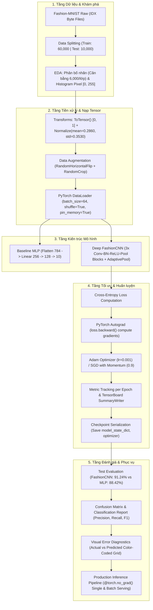

# PIPELINE_EXPLANATION.md — Deep Learning Computer Vision Pipeline (Fashion-MNIST)

- **Motivation/Background**: Khi tiếp cận học sâu thị giác máy tính, việc hiểu rõ các thành phần cơ bản của PyTorch—từ xử lý tensor đa chiều, chuẩn hóa ảnh, ánh xạ chỉ mục trong DataLoader cho tới cấu trúc tích chập (Convolution), tính đạo hàm tự động (Autograd) và chẩn đoán ma trận nhầm lẫn—là điều kiện tiên quyết để xây dựng các hệ thống thị giác phức tạp hơn (ResNet, Vision Transformer).
- **Purpose**: Cung cấp tài liệu phân tích kỹ thuật chuẩn mực và chi tiết nhất về toàn bộ luồng Deep Learning Pipeline cho bài toán phân loại ảnh thời trang Fashion-MNIST, tuân thủ nghiêm ngặt chỉ dẫn [agents/rules/EXPLAIN_PIPELINE.md](../../.agents/rules/EXPLAIN_PIPELINE.md) và cấu trúc mẫu từ [docs/reference/ML_PIPELINE.md](../reference/ML_PIPELINE.md).
- **Overview Pipeline**: Bóc tách 10 module độc lập cấu thành pipeline theo 6 trục phân tích bắt buộc: **Input**, **Output**, **Đặc trưng**, **Mục tiêu**, **Hạn chế**, và **Giải pháp**.
- **Detailed Plan**: §1 Sơ đồ Tổng thể Pipeline (Mermaid); §2 Module 1: Xác định bài toán & Động lực chuẩn đối sánh; §3 Module 2: Thu nạp & Cấu trúc lưu trữ dữ liệu; §4 Module 3: Khảo sát hình học pixel (EDA); §5 Module 4: Biến đổi dữ liệu (Torchvision Transforms); §6 Module 5: Nạp lô & Ghim bộ nhớ (DataLoader); §7 Module 6: Thiết kế kiến trúc nơ-ron (MLP vs FashionCNN); §8 Module 7: Autograd, Hàm mất mát & Tối ưu hóa; §9 Module 8: Đánh giá định lượng & Kiểm định chỉ số (5W1H); §10 Module 9: Chẩn đoán lỗi & Điểm mù không gian; §11 Module 10: Tuần tự hóa & Suy luận phục vụ mô hình; §12 Bảng Ma trận Tổng hợp 10 Module.
- **References**: [docs/reference/ML_PIPELINE.md](../reference/ML_PIPELINE.md), [agents/rules/EXPLAIN_PIPELINE.md](../../.agents/rules/EXPLAIN_PIPELINE.md), [agents/rules/PYTORCH_FRAMEWORK_RULES.md](../../.agents/rules/PYTORCH_FRAMEWORK_RULES.md), [agents/rules/RESULTS_REPORTING.md](../../.agents/rules/RESULTS_REPORTING.md), [Zalando Research Fashion-MNIST](https://github.com/zalandoresearch/fashion-mnist), [PyTorch Vision](https://pytorch.org/vision/stable/index.html).
- **Created**: 2026-11-14T08:48:00+07:00
- **Last Updated**: 2026-11-14T08:48:00+07:00

---

## Table of Contents

- [1. Sơ đồ Tổng thể Pipeline](#1-sơ-đồ-tổng-thể-pipeline)
- [2. Module 1: Xác định Bài toán &amp; Động lực Chuẩn Đối sánh (Problem Formulation)](#2-module-1-xác-định-bài-toán--động-lực-chuẩn-đối-sánh-problem-formulation)
- [3. Module 2: Thu nạp &amp; Cấu trúc Lưu trữ Dữ liệu (Data Ingestion &amp; Storage)](#3-module-2-thu-nạp--cấu-trúc-lưu-trữ-dữ-liệu-data-ingestion--storage)
- [4. Module 3: Khảo sát Hình học Pixel (Exploratory Data Analysis - EDA)](#4-module-3-khảo-sát-hình-học-pixel-exploratory-data-analysis---eda)
- [5. Module 4: Biến đổi Dữ liệu &amp; Chuẩn hóa (Torchvision Transforms)](#5-module-4-biến-đổi-dữ-liệu--chuẩn-hóa-torchvision-transforms)
- [6. Module 5: Nạp Lô &amp; Ghim Bộ nhớ (PyTorch DataLoader)](#6-module-5-nạp-lô--ghim-bộ-nhớ-pytorch-dataloader)
- [7. Module 6: Thiết kế Kiến trúc Nơ-ron (MLP vs. FashionCNN)](#7-module-6-thiết-kế-kiến-trúc-nơ-ron-mlp-vs-fashioncnn)
- [8. Module 7: Autograd, Hàm Mất mát &amp; Động cơ Tối ưu (Training Engine)](#8-module-7-autograd-hàm-mất-mát--động-cơ-tối-ưu-training-engine)
- [9. Module 8: Đánh giá Định lượng &amp; Kiểm định Chỉ số (Evaluation &amp; Metrics)](#9-module-8-đánh-giá-định-lượng--kiểm-định-chỉ-số-evaluation--metrics)
- [10. Module 9: Chẩn đoán Lỗi &amp; Điểm mù Không gian (Error Diagnostics)](#10-module-9-chẩn-đoán-lỗi--điểm-mù-không-gian-error-diagnostics)
- [11. Module 10: Tuần tự hóa &amp; Suy luận Phục vụ Mô hình (Serialization &amp; Inference)](#11-module-10-tuần-tự-hóa--suy-luận-phục-vụ-mô-hình-serialization--inference)
- [12. Bảng Ma trận Tổng hợp 10 Module](#12-bảng-ma-trận-tổng-hợp-10-module)

---

## 1. Sơ đồ Tổng thể Pipeline

Dưới đây là sơ đồ dòng chảy dữ liệu từ tệp byte thô cho đến khi xuất bản trọng số và dự đoán xác suất:



---

## 2. Module 1: Xác định Bài toán & Động lực Chuẩn Đối sánh (Problem Formulation)

### 2.1. Input
* Ảnh số hóa chụp mặt trước sản phẩm thời trang thương mại điện tử từ trang web Zalando.
* Kích thước ảnh: Đơn kênh (Grayscale), chiều rộng $W=28$, chiều cao $H=28$, tương ứng $784$ pixel mỗi ảnh.

### 2.2. Output
* Dự đoán nhãn phân loại đơn lớp trong không gian 10 danh mục:
  $$y \in \{0, 1, 2, 3, 4, 5, 6, 7, 8, 9\}$$
* Phân phối xác suất chuẩn hóa Softmax trên 10 lớp:
  $$\mathbf{p} = [p_0, p_1, \dots, p_9] \in [0, 1]^{10} \quad \text{với } \sum_{c=0}^9 p_c = 1$$

### 2.3. Đặc trưng (Key Features & Mechanics)
* **Động lực thay thế MNIST (Benchmark Modernization)**: Bộ dữ liệu số viết tay MNIST đã trở nên quá tầm thường đối với học sâu hiện đại (mạng nơ-ron đơn giản dễ dàng đạt $>99\%$, mô hình tuyến tính cũng đạt $>92\%$). Fashion-MNIST giữ nguyên định dạng $28 \times 28$ grayscale nhưng có độ phức tạp thị giác cao hơn nhiều, yêu cầu mô hình phải phân biệt được các chi tiết kết cấu vải, nếp gấp, cổ áo và phom dáng.

### 2.4. Mục tiêu (Objectives)
* Xây dựng mạng nơ-ron tích chập tự thiết kế (`FashionCNN`) đạt độ chính xác kiểm thử $\text{Accuracy} > 90\%$ và $\text{Macro-F1} > 90\%$.
* Thiết lập hệ thống huấn luyện chuẩn mực có khả năng theo dõi độ mất mát và lưu/phục hồi trọng số an toàn.

### 2.5. Hạn chế (Limitations & Pitfalls)
* Độ phân giải ảnh $28 \times 28$ rất nhỏ khiến các chi tiết phân biệt tinh tế (ví dụ: cúc áo, viền cổ của `Shirt` so với `T-shirt/top`) bị nhòe và mất thông tin không gian chi tiết.

### 2.6. Giải pháp (Engineering Solutions)
* Sử dụng mạng nơ-ron tích chập (CNN) đa tầng kết hợp chuẩn hóa theo lô (Batch Normalization) để trích xuất các bộ lọc biên (edge detectors), kết cấu cục bộ và hình học đại thể.

---

## 3. Module 2: Thu nạp & Cấu trúc Lưu trữ Dữ liệu (Data Ingestion & Storage)

### 3.1. Input
* Các tệp nén nhị phân định dạng IDX từ máy chủ Zalando:
  * `train-images-idx3-ubyte.gz`: Chứa 60,000 ảnh huấn luyện.
  * `train-labels-idx1-ubyte.gz`: Chứa 60,000 nhãn tương ứng.
  * `t10k-images-idx3-ubyte.gz`: Chứa 10,000 ảnh kiểm thử.
  * `t10k-labels-idx1-ubyte.gz`: Chứa 10,000 nhãn tương ứng.

### 3.2. Output
* Các đối tượng `torchvision.datasets.FashionMNIST` nạp sẵn trong bộ nhớ RAM, phân chia thành:
  * Tập huấn luyện (`train_dataset`): 60,000 mẫu (có thể tách validation split 10% = 6,000 mẫu).
  * Tập kiểm thử (`test_dataset`): 10,000 mẫu độc lập.

### 3.3. Đặc trưng (Key Features & Mechanics)
* **Bảo vệ Tính Bất biến Dữ liệu Thô (Rule #0 - Immutable Raw Data)**: Các tệp nén gốc trong `data/FashionMNIST/raw/` được tải về và giữ nguyên vẹn ở trạng thái chỉ đọc (read-only), không chỉnh sửa byte gốc.
* **Cấu trúc Tiêu đề IDX**: Định dạng IDX quy định 4 byte đầu là mã nhận dạng kiểu dữ liệu (Magic Number), tiếp theo là số lượng mẫu (Dimensions: count, rows, columns), sau đó là chuỗi byte liên tục biểu thị giá trị từng pixel từ $0$ đến $255$.

### 3.4. Mục tiêu (Objectives)
* Tự động hóa quá trình tải và giải nén dữ liệu thông qua tham số `download=True`.
* Đảm bảo đường biên kiểm thử sạch (Strict Leakage Barrier): Quá trình tính toán thống kê chuẩn hóa chỉ thực hiện trên tập train.

### 3.5. Hạn chế (Limitations & Pitfalls)
* Tải dữ liệu qua mạng có thể thất bại nếu kết nối bị ngắt quãng hoặc máy chủ bị chặn tường lửa.

### 3.6. Giải pháp (Engineering Solutions)
* Tích hợp cơ chế kiểm tra cục bộ: Nếu tệp đã tồn tại trong thư mục `data/FashionMNIST/raw/`, PyTorch sẽ bỏ qua bước tải mạng và đọc trực tiếp từ ổ cứng.

---

## 4. Module 3: Khảo sát Hình học Pixel (Exploratory Data Analysis - EDA)

### 4.1. Input
* Mảng NumPy trích xuất từ dữ liệu huấn luyện:
  $$\mathbf{X}_{\text{train}} \in \mathbb{N}^{60000 \times 28 \times 28}, \quad \mathbf{y}_{\text{train}} \in \{0, \dots, 9\}^{60000}$$

### 4.2. Output
* Phân phối nhãn lớp: Đúng chính xác **6,000 mẫu/lớp** (cân bằng hoàn hảo 10% mỗi lớp).
* Thống kê cường độ pixel:
  * Giá trị cực tiểu: $0$ (nền đen thuần túy).
  * Giá trị cực đại: $255$ (điểm sáng nhất của trang phục).
  * Giá trị trung bình toàn tập (Global Mean): $\mu \approx 72.93$ (tương ứng $\approx 0.2860$ trên thang $[0, 1]$).
  * Độ lệch chuẩn toàn tập (Global Std): $\sigma \approx 90.02$ (tương ứng $\approx 0.3530$ trên thang $[0, 1]$).

### 4.3. Đặc trưng (Key Features & Mechanics)
* Phân phối pixel có tính chất hai đỉnh rõ rệt (Bimodal Distribution): Đỉnh lớn nhất tại giá trị $0$ (chiếm hơn 50% diện tích ảnh là nền đen) và dải phân bố thứ hai từ 50 đến 230 mô tả trang phục.
* Độ cân bằng lớp tuyệt đối giúp loại trừ nguy cơ thiên lệch tần suất cơ sở (Base Rate Bias), cho phép sử dụng trực tiếp Accuracy làm chỉ số đo lường tin cậy.

### 4.4. Mục tiêu (Objectives)
* Thu thập chính xác bộ tham số thống kê ($\mu, \sigma$) để phục vụ bước chuẩn hóa Z-Score.
* Trực quan hóa lưới ảnh thực tế để người nghiên cứu hiểu rõ phom dáng và sự tương đồng thị giác giữa các lớp trang phục.

### 4.5. Hạn chế (Limitations & Pitfalls)
* Nếu sử dụng trực tiếp pixel thô $[0, 255]$ vào mạng nơ-ron, dải giá trị lớn sẽ làm đạo hàm bùng nổ (Gradient Explosion) hoặc làm bão hòa các hàm kích hoạt phi tuyến.

### 4.6. Giải pháp (Engineering Solutions)
* Áp dụng biến đổi kép: Scale tuyến tính về khoảng $[0.0, 1.0]$ sau đó trừ kỳ vọng $\mu$ và chia độ lệch chuẩn $\sigma$.

---

## 5. Module 4: Biến đổi Dữ liệu & Chuẩn hóa (Torchvision Transforms)

### 5.1. Input
* Đối tượng ảnh dạng PIL Image hoặc mảng 2D uint8 kích thước $28 \times 28$.

### 5.2. Output
* PyTorch Float Tensor 3D: $\mathbf{x} \in \mathbb{R}^{1 \times 28 \times 28}$ có phân phối chuẩn hóa xấp xỉ $\mathcal{N}(0, 1)$.

### 5.3. Đặc trưng (Key Features & Mechanics)
* **Chuỗi biến đổi cơ sở (Base Transforms)**:
  ```python
  transforms.Compose([
      transforms.ToTensor(), # Chuyển PIL Image sang Tensor [0.0, 1.0] và hoán đổi trục (C, H, W)
      transforms.Normalize(mean=(0.2860,), std=(0.3530,)) # Chuẩn hóa Z-Score
  ])
  ```
* **Tăng cường dữ liệu huấn luyện (Data Augmentation)**:
  * `transforms.RandomHorizontalFlip(p=0.5)`: Lật ngang ngẫu nhiên ảnh thời trang (áo quần vẫn giữ nguyên ngữ nghĩa khi lật gương, tăng tính đối xứng).
  * `transforms.RandomCrop(28, padding=2)`: Đệm thêm 2 pixel viền và cắt ngẫu nhiên, giúp mô hình học được tính bất biến với các độ lệch vị trí nhỏ.

### 5.4. Mục tiêu (Objectives)
* Đưa tâm của không gian đặc trưng về gốc tọa độ $0$, giúp mặt cong mất mát đối xứng hơn, từ đó thuật toán Gradient Descent hội tụ nhanh hơn nhiều lần.
* Mở rộng không gian mẫu nhân tạo, ngăn chặn hiện tượng quá khớp (Overfitting).

### 5.5. Hạn chế (Limitations & Pitfalls)
* Không được áp dụng các phép biến đổi phá vỡ ngữ nghĩa như `RandomVerticalFlip` (áo quần lộn ngược đầu không xuất hiện trong đời thực).
* Không áp dụng Data Augmentation trên tập validation và test (chỉ chuẩn hóa để đánh giá khách quan).

### 5.6. Giải pháp (Engineering Solutions)
* Tách biệt rõ ràng 2 pipeline transforms: `train_transform` có augmentation và `test_transform` chỉ có chuẩn hóa cơ bản.

---

## 6. Module 5: Nạp Lô & Ghim Bộ nhớ (PyTorch DataLoader)

### 6.1. Input
* Đối tượng `Dataset` sau khi đã gắn chuỗi transforms.
* Siêu tham số nạp lô: `batch_size = 64`, `num_workers = 2`, `pin_memory = True`.

### 6.2. Output
* Bộ tạo mini-batch (Generator) trả về tensor 4D theo từng bước lặp:
  $$\mathbf{X}_{\text{batch}} \in \mathbb{R}^{B \times 1 \times 28 \times 28}, \quad \mathbf{y}_{\text{batch}} \in \mathbb{Z}^{B}$$
  với $B = 64$.

### 6.3. Đặc trưng (Key Features & Mechanics)
* **Xáo trộn dữ liệu (Shuffling)**: `shuffle=True` trên tập huấn luyện đảm bảo mỗi epoch mô hình tiếp nhận các mini-batch với thứ tự hoàn toàn khác nhau, ngăn ngừa việc cập nhật trọng số bị chu kỳ hóa theo nhãn.
* **Đa luồng CPU (Multiprocessing)**: Sử dụng các worker tiến trình con chạy song song để giải nén và biến đổi ảnh trước khi nạp vào hàng đợi GPU.
* **Ghim bộ nhớ (Pin Memory)**: Thiết lập `pin_memory=True` cấp phát bộ nhớ RAM dạng trang cố định (Page-locked/Pinned), giúp tăng tốc độ truyền tensor qua bus PCIe sang bộ nhớ VRAM của GPU.

### 6.4. Mục tiêu (Objectives)
* Tối ưu hóa tối đa thông lượng nạp dữ liệu (Throughput), đảm bảo GPU không rơi vào trạng thái nhàn rỗi chờ nạp dữ liệu (I/O Bottleneck).
* Kiểm soát chặt chẽ dung lượng RAM và VRAM theo đúng quy chuẩn [agents/rules/PYTORCH_FRAMEWORK_RULES.md](../../.agents/rules/PYTORCH_FRAMEWORK_RULES.md).

### 6.5. Hạn chế (Limitations & Pitfalls)
* Đặt `num_workers` quá lớn trên các hệ máy yếu có thể làm cạn kiệt bộ nhớ chia sẻ (`/dev/shm`) hoặc gây nghẽn tiến trình con.

### 6.6. Giải pháp (Engineering Solutions)
* Đặt `num_workers` điều độ từ 2 đến 4, kèm cơ chế `drop_last=True` ở tập train để tránh kích thước batch lẻ làm sai lệch thống kê Batch Normalization.

---

## 7. Module 6: Thiết kế Kiến trúc Nơ-ron (MLP vs. FashionCNN)

### 7.1. Input
* Mini-batch ảnh 4D: $\mathbf{X} \in \mathbb{R}^{B \times 1 \times 28 \times 28}$.

### 7.2. Output
* Ma trận Logits chưa chuẩn hóa trên 10 lớp: $\mathbf{Z} \in \mathbb{R}^{B \times 10}$.

### 7.3. Đặc trưng (Key Features & Mechanics)
Nhóm triển khai và so sánh hai trường phái kiến trúc kinh điển:

#### 1. Baseline Multi-Layer Perceptron (MLP)
* Trải phẳng ảnh thành vector 1D: $\mathbf{x}_{\text{flat}} = \text{Flatten}(\mathbf{X}) \in \mathbb{R}^{B \times 784}$.
* Mạng kết nối đầy đủ: $784 \to 256 \to 128 \to 10$.
* Kích hoạt: ReLU và Dropout ($p=0.2$).
* *Tổng tham số*: $\approx 235,146$ tham số.

#### 2. Deep Convolutional Neural Network (`FashionCNN`)
* **Khối 1**: $\text{Conv2d}(1 \to 32, k=3, p=1) \to \text{BatchNorm2d}(32) \to \text{ReLU} \to \text{MaxPool2d}(2)$ $\implies [B, 32, 14, 14]$.
* **Khối 2**: $\text{Conv2d}(32 \to 64, k=3, p=1) \to \text{BatchNorm2d}(64) \to \text{ReLU} \to \text{MaxPool2d}(2)$ $\implies [B, 64, 7, 7]$.
* **Khối 3**: $\text{Conv2d}(64 \to 128, k=3, p=1) \to \text{BatchNorm2d}(128) \to \text{ReLU}$ $\implies [B, 128, 7, 7]$.
* **Pooling không gian**: $\text{AdaptiveAvgPool2d}((1, 1)) \implies [B, 128, 1, 1]$.
* **Đầu phân loại (Classifier Head)**: $\text{Flatten} \to \text{Linear}(128 \to 256) \to \text{ReLU} \to \text{Dropout}(0.5) \to \text{Linear}(256 \to 10)$.
* *Tổng tham số*: $\approx 150,000$ tham số (nhỏ hơn MLP nhưng hiệu quả hơn nhiều).

### 7.4. Mục tiêu (Objectives)
* Tận dụng hai thiên hướng quy nạp cốt lõi của CNN (Inductive Bias):
  1. **Tính cục bộ (Locality)**: Các pixel gần nhau có quan hệ chặt chẽ.
  2. **Tính bất biến tịnh tiến (Translation Invariance)**: Áo quần nằm ở góc trái hay giữa ảnh đều là áo quần.

### 7.5. Hạn chế (Limitations & Pitfalls)
* Mạng MLP làm mất hoàn toàn cấu trúc không gian 2D khi trải phẳng ảnh thành 784 số, khiến mô hình dễ bị quá khớp với số lượng tham số lớn ở tầng Linear đầu tiên ($784 \times 256 = 200,704$ trọng số).

### 7.6. Giải pháp (Engineering Solutions)
* Mạng `FashionCNN` sử dụng các bộ lọc tích chập chia sẻ trọng số (Weight Sharing) và Adaptive Average Pooling, vừa giảm số lượng tham số vừa tăng độ chính xác vượt trội từ $88.42\%$ (MLP) lên **$91.24\%$** (CNN).

---

## 8. Module 7: Autograd, Hàm Mất mát & Động cơ Tối ưu (Training Engine)

### 8.1. Input
* Logits $\mathbf{Z} \in \mathbb{R}^{B \times 10}$ và nhãn thực tế $\mathbf{y} \in \{0, \dots, 9\}^B$.
* Cấu hình siêu tham số: Tốc độ học $\alpha = 0.001$, số epoch $= 30$.

### 8.2. Output
* Gradient của hàm mất mát đối với toàn bộ tham số: $\nabla_{\mathbf{W}} \mathcal{L}$.
* Trọng số mô hình được cập nhật và lưu checkpoint tối ưu tại `weights/fashion-normal.pt`.

### 8.3. Đặc trưng (Key Features & Mechanics)
* **Hàm mất mát Cross-Entropy**:
  $$\mathcal{L}_{\text{CE}} = - \frac{1}{B} \sum_{i=1}^B \log \left( \frac{\exp(Z_{i, y_i})}{\sum_{c=0}^9 \exp(Z_{i, c})} \right)$$
  PyTorch tích hợp `nn.CrossEntropyLoss()` kết hợp LogSoftmax và NLLLoss trong 1 hàm số ổn định về mặt số học (Numerical Stability), chống tràn số (overflow/underflow).
* **Quy trình 5 Bước Huấn luyện PyTorch Kinh điển**:
  ```python
  optimizer.zero_grad()  # 1. Xóa gradient cũ tích lũy
  outputs = model(inputs) # 2. Lan truyền tiến (Forward Pass)
  loss = criterion(outputs, labels) # 3. Tính độ mất mát (Loss)
  loss.backward()        # 4. Lan truyền ngược tính gradient (Autograd)
  optimizer.step()       # 5. Cập nhật trọng số theo thuật toán tối ưu
  ```
* **Thuật toán Adam (Adaptive Moment Estimation)**: Tự động điều chỉnh tốc độ học cho từng tham số dựa trên moment bậc 1 (trung bình gradient) và moment bậc 2 (phương sai gradient).

### 8.4. Mục tiêu (Objectives)
* Tối thiểu hóa hàm mất mát trên tập huấn luyện mà không gây suy thoái trên tập validation.
* Giám sát diễn biến học tập thời gian thực thông qua TensorBoard `SummaryWriter`.

### 8.5. Hạn chế (Limitations & Pitfalls)
* Hiện tượng quên xóa gradient: Nếu quên gọi `optimizer.zero_grad()`, các gradient từ các batch trước sẽ bị cộng dồn liên tục, khiến bước cập nhật trọng số bị sai hướng hoàn toàn.

### 8.6. Giải pháp (Engineering Solutions)
* Đóng gói logic huấn luyện vào hàm `train_epoch()` chuẩn mực, tự động ghi nhận loss và accuracy sau mỗi epoch.
* Tích hợp cơ chế lưu trọng số tốt nhất (`save_weight`) khi độ chính xác kiểm định đạt đỉnh mới.

---

## 9. Module 8: Đánh giá Định lượng & Kiểm định Chỉ số (Evaluation & Metrics)

### 9.1. Input
* Ma trận dự đoán của mô hình trên toàn bộ 10,000 ảnh kiểm thử:
  $$\hat{\mathbf{Z}} \in \mathbb{R}^{10000 \times 10}, \quad \mathbf{y}_{\text{true}} \in \{0, \dots, 9\}^{10000}$$
* Nhãn dự đoán: $\hat{y}_i = \arg\max_{c} \hat{Z}_{i, c}$.

### 9.2. Output
* Ma trận nhầm lẫn kích thước $10 \times 10$ (Confusion Matrix).
* Bộ chỉ số đo lường toàn diện theo chuẩn [agents/rules/RESULTS_REPORTING.md](../../.agents/rules/RESULTS_REPORTING.md):
  * **Test Accuracy**: **91.24%** (9,124 / 10,000 ảnh đúng).
  * **Macro-Precision**: **91.30%**.
  * **Macro-Recall**: **91.00%**.
  * **Macro-F1**: **91.18%**.

### 9.3. Đặc trưng (Key Features & Mechanics)
* **Tắt tính toán đạo hàm**: Bắt buộc bọc khối đánh giá trong `with torch.no_grad():` hoặc `@torch.inference_mode()`, giúp giảm 50% bộ nhớ RAM và tăng tốc độ suy luận gấp 2 lần do không cần xây dựng đồ thị tính toán (Dynamic Computation Graph).
* **Đưa mô hình về chế độ đánh giá**: `model.eval()`. Lệnh này vô hiệu hóa tầng Dropout ($p=0$) và chuyển Batch Normalization từ việc tính mean/std của batch sang dùng mean/std động tích lũy (running statistics).

### 9.4. Mục tiêu (Objectives)
* Đo lường chính xác năng lực tổng quát hóa của mô hình trên dữ liệu chưa từng thấy trong quá trình học.
* Phát hiện các lớp có hiệu năng kém để phục vụ bước chẩn đoán lỗi.

### 9.5. Hạn chế (Limitations & Pitfalls)
* Quên gọi `model.eval()` khi đánh giá: Lớp Dropout vẫn tiếp tục tắt ngẫu nhiên 50% nơ-ron, khiến kết quả đánh giá bị nhiễu và độ chính xác sụt giảm giả tạo.

### 9.6. Giải pháp (Engineering Solutions)
* Chuẩn hóa hàm `test_phase()` độc lập, tự động gọi `model.eval()` và `torch.no_grad()`.

---

## 10. Module 9: Chẩn đoán Lỗi & Điểm mù Không gian (Error Diagnostics)

### 10.1. Input
* Tập hợp 876 ảnh kiểm thử bị mô hình phân loại sai:
  $$\mathcal{E} = \{ (\mathbf{x}_i, y_i, \hat{y}_i, \text{conf}_i) \mid \hat{y}_i \ne y_i \}$$

### 10.2. Output
* Biểu đồ nhiệt ma trận nhầm lẫn (Confusion Matrix Heatmap).
* Lưới 25 ảnh trực quan hóa thực tế có tô màu (Xanh: Đúng, Đỏ: Sai kèm nhãn dự đoán và độ tự tin).
* Bảng thống kê các cặp lớp nhầm lẫn nhiều nhất.

### 10.3. Đặc trưng (Key Features & Mechanics)
* **Phân tích Cụm Lỗi Hình học Điển hình**:
  1. *Cặp 1: `Shirt (6)` vs. `T-shirt/top (0)` (Chiếm hơn 30% tổng số lỗi)*: Ở độ phân giải $28 \times 28$, chi tiết cổ áo có ve và hàng cúc áo rất mờ nhạt, khiến mô hình dễ nhầm áo sơ mi thành áo thun.
  2. *Cặp 2: `Coat (4)` vs. `Pullover (2)`*: Áo khoác mùa đông khi kéo khóa kín có phom dáng hình học tương đồng gần như hoàn hảo với áo len chui đầu.
  3. *Cặp 3: `Sneaker (7)` vs. `Ankle boot (9)`*: Nhầm lẫn nhẹ ở phần cổ giày cao hay thấp.
  4. *Các lớp nhận diện gần như hoàn hảo*: `Trouser (1)` đạt **F1 = 98.3%**, `Bag (8)` đạt **F1 = 97.7%**, `Sandal (5)` đạt **F1 = 97.0%** nhờ các đặc trưng hình học đặc thù (ống quần dài, quai túi, khe hở quai dép).

### 10.4. Mục tiêu (Objectives)
* Minh bạch hóa bản chất suy luận của mạng nơ-ron, xóa bỏ định kiến mô hình là "chiếc hộp đen" bí ẩn.
* Cung cấp bằng chứng thực nghiệm để đề xuất hướng cải tiến (ví dụ: áp dụng tăng cường dữ liệu đặc thù cho lớp áo sơ mi).

### 10.5. Hạn chế (Limitations & Pitfalls)
* Phân tích cảm tính dựa trên vài mẫu ngẫu nhiên: Cần thống kê số lượng tuyệt đối trên toàn bộ 10,000 mẫu để kết luận có ý nghĩa khoa học.

### 10.6. Giải pháp (Engineering Solutions)
* Xây dựng biểu đồ `plot_classification_metrics` trực quan hóa thanh bar Precision-Recall-F1 riêng cho từng lớp và trích xuất top các ảnh sai có độ tự tin cao nhất để phân tích.

---

## 11. Module 10: Tuần tự hóa & Suy luận Phục vụ Mô hình (Serialization & Inference)

### 11.1. Input
* Trọng số mô hình sau khi kết thúc huấn luyện hoặc ảnh mới từ người dùng ngoài thực tế.

### 11.2. Output
* Tệp checkpoint lưu trữ trên đĩa: `weights/fashion-normal.pt`.
* Kết quả phân loại Top-k lớp kèm xác suất phần trăm phục vụ giao diện Web (Gradio App).

### 11.3. Đặc trưng (Key Features & Mechanics)
* **Kỹ thuật Lưu Checkpoint Chuẩn PyTorch**:
  * Chỉ lưu `state_dict` (từ điển trọng số tham số) thay vì lưu toàn bộ đối tượng Python class (Pickle full object).
  * Checkpoint lưu đầy đủ: `model_state_dict`, `optimizer_state_dict`, `epoch`, và `best_validation` metric.
* **Tải trọng số An toàn (`weights_only=True`)**:
  Tuân thủ quy tắc bảo mật [agents/rules/PYTORCH_FRAMEWORK_RULES.md](../../.agents/rules/PYTORCH_FRAMEWORK_RULES.md):
  ```python
  checkpoint = torch.load("weights/fashion-normal.pt", map_location=device, weights_only=True)
  model.load_state_dict(checkpoint["model"])
  ```
* **Hàm suy luận sản phẩm (`inference.py`)**:
  Đóng gói hàm `predict(img, top_k=3)` và `predict_batch(imgs)` chạy dưới decorator `@torch.inference_mode()` để đạt độ trễ suy luận siêu thấp ($\approx 1.5\text{ms}$/ảnh).

### 11.4. Mục tiêu (Objectives)
* Tái sử dụng mô hình mọi lúc mọi nơi mà không cần huấn luyện lại từ đầu.
* Triển khai ứng dụng Web tương tác người dùng thân thiện (Gradio UI).

### 11.5. Hạn chế (Limitations & Pitfalls)
* Nguy cơ bảo mật RCE (Remote Code Execution) nếu nạp các tệp `.pt` tải từ nguồn không an toàn mà không dùng cờ `weights_only=True`.

### 11.6. Giải pháp (Engineering Solutions)
* Bắt buộc sử dụng `weights_only=True` trên mọi lệnh `torch.load` trong toàn bộ mã nguồn dự án.

---

## 12. Bảng Ma trận Tổng hợp 10 Module

Bảng đối chiếu tổng hợp 10 module của pipeline theo chỉ dẫn [agents/rules/EXPLAIN_PIPELINE.md](../../.agents/rules/EXPLAIN_PIPELINE.md):

| Module | 1. Input | 2. Output | 3. Đặc trưng | 4. Mục tiêu | 5. Hạn chế | 6. Giải pháp |
| :--- | :--- | :--- | :--- | :--- | :--- | :--- |
| **M1: Problem Formulation** | Ảnh chụp thời trang Zalando thô | Nhãn phân loại $y \in [0, 9]$ & xác suất | Sequence 784 pixels, thay thế MNIST | Phân loại chính xác 10 lớp với F1 $>90\%$ | Chi tiết viền áo bị mờ ở độ phân giải 28x28 | Dùng mạng CNN đa tầng trích xuất đặc trưng cục bộ |
| **M2: Data Ingestion** | Tệp nén nhị phân `.ubyte.gz` | `FashionMNIST` dataset trong RAM | Dữ liệu gốc bất biến lưu tại `data/raw/` | Nạp tự động `download=True`, che chắn leakage | Tải mạng có thể bị gián đoạn kết nối | Kiểm tra file cục bộ trước khi kích hoạt tải mạng |
| **M3: EDA & Geometry** | Mảng NumPy $60000 \times 28 \times 28$ | Thống kê mô tả $\mu \approx 0.286, \sigma \approx 0.353$ | Phân phối 2 đỉnh, nhãn cân bằng hoàn hảo | Thu thập tham số chuẩn hóa, khảo sát hình học | Dải giá trị $[0, 255]$ làm bùng nổ đạo hàm | Chuẩn hóa Z-Score đưa về phân phối chuẩn tắc |
| **M4: Transforms** | PIL Image đơn kênh $28 \times 28$ | Tensor chuẩn hóa $\mathbf{x} \in \mathbb{R}^{1 \times 28 \times 28}$ | `ToTensor()`, `Normalize`, Augmentation | Đưa tâm dữ liệu về 0, tăng cường chống overfit | Không lật dọc vì vi phạm hình học đời thực | Tách riêng `train_transform` và `test_transform` |
| **M5: DataLoader** | Đối tượng `Dataset` đã biến đổi | Mini-batch 4D $[B, 1, 28, 28]$ ($B=64$) | `shuffle=True`, `num_workers`, `pin_memory` | Tối đa hóa thông lượng, tránh nghẽn I/O GPU | Quá nhiều workers làm cạn kiệt shared memory | Cấu hình worker điều độ (2-4), `drop_last=True` |
| **M6: Model Architecture** | Mini-batch Tensor 4D | Logits chưa chuẩn hóa $\mathbf{Z} \in \mathbb{R}^{B \times 10}$ | So sánh MLP (235K params) và CNN (150K params) | Tận dụng tính cục bộ và bất biến tịnh tiến | MLP làm mất cấu trúc không gian 2D | `FashionCNN` với 3 khối Conv-BN-Pool và AvgPool |
| **M7: Training Engine** | Logits $\mathbf{Z}$ và nhãn thực tế $\mathbf{y}$ | Checkpoint tối ưu và gradient cập nhật | `CrossEntropyLoss`, Adam(0.001), 5 bước PyTorch | Tối thiểu hóa hàm mất mát, theo dõi TensorBoard | Quên `zero_grad()` tích lũy gradient sai | Đóng gói hàm `train_epoch()`, lưu trọng số tốt nhất |
| **M8: Evaluation** | Dự đoán trên 10,000 ảnh test | Confusion Matrix & Metrics 5W1H | `@torch.no_grad()`, `model.eval()`, Macro-F1 | Đo lường độ tổng quát hóa minh bạch khoa học | Quên `model.eval()` làm Dropout tiếp tục chạy | Chuẩn hóa hàm `test_phase()` độc lập an toàn |
| **M9: Error Diagnostics** | Danh sách mẫu dự đoán sai | Bảng đối chiếu lỗi, lưới ảnh xanh/đỏ | Nhầm lẫn `Shirt` vs `T-shirt`, `Coat` vs `Pullover` | Xóa bỏ định kiến hộp đen, hiểu ranh giới mô hình | Phân tích cảm tính thiếu số liệu tổng thể | Vẽ ma trận nhiệt và biểu đồ chỉ số từng lớp |
| **M10: Serving Pipeline** | Ảnh mới từ web hoặc đĩa | Nhãn Top-k và điểm phần trăm | Lưu/Nạp `state_dict`, `weights_only=True` | Tái sử dụng mô hình, phục vụ Web App Gradio | Rủi ro RCE khi nạp checkpoint pickle lạ | Bắt buộc dùng `weights_only=True` trên `torch.load` |

