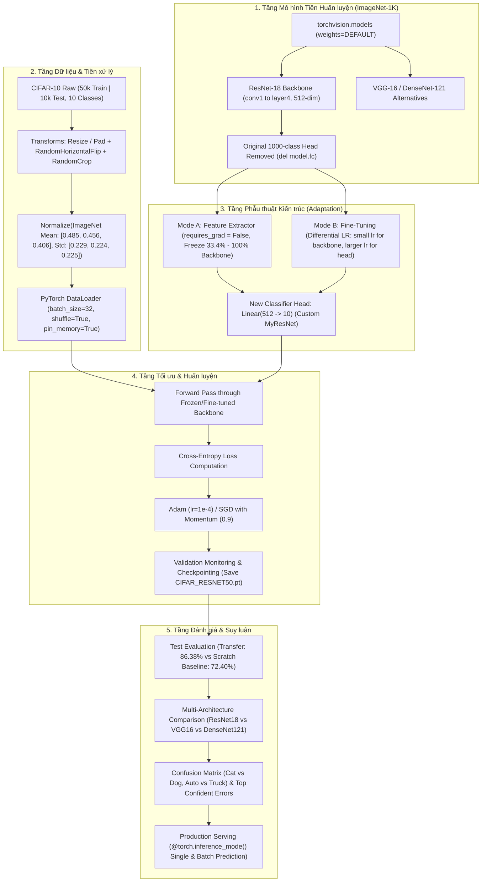

# PIPELINE_EXPLANATION.md — Deep Learning Transfer Learning Pipeline (CIFAR-10)

- **Motivation/Background**: Khi huấn luyện mạng nơ-ron sâu từ đầu (from scratch) trên các bộ dữ liệu kích thước nhỏ hoặc vừa như CIFAR-10, mô hình thường gặp hiện tượng quá khớp (Overfitting) và đòi hỏi hàng trăm epoch với chi phí tính toán lớn. Kỹ thuật Học chuyển giao (Transfer Learning) cho phép kế thừa các bộ trích xuất đặc trưng thị giác cấp cao (Low-level edges, mid-level textures, high-level semantics) từ các mô hình đã được tối ưu trên hàng triệu ảnh ImageNet, giúp rút ngắn thời gian hội tụ và cải thiện vượt bậc độ chính xác tổng quát.
- **Purpose**: Cung cấp tài liệu phân tích kỹ thuật chuẩn mực và chi tiết nhất về toàn bộ luồng Transfer Learning Pipeline cho bài toán phân loại ảnh CIFAR-10 sử dụng các mô hình tiền huấn luyện (ResNet, VGG, DenseNet) từ `torchvision.models`, tuân thủ nghiêm ngặt chỉ dẫn [agents/rules/EXPLAIN_PIPELINE.md](../../.agents/rules/EXPLAIN_PIPELINE.md) và cấu trúc mẫu từ [docs/reference/ML_PIPELINE.md](../reference/ML_PIPELINE.md).
- **Overview Pipeline**: Bóc tách 10 module độc lập cấu thành pipeline theo 6 trục phân tích bắt buộc: **Input**, **Output**, **Đặc trưng**, **Mục tiêu**, **Hạn chế**, và **Giải pháp**.
- **Detailed Plan**: §1 Sơ đồ Tổng thể Pipeline Học Chuyển Giao (Mermaid); §2 Module 1: Xác định bài toán & Giả thuyết Học Chuyển Giao; §3 Module 2: Thu nạp mô hình tiền huấn luyện & Nguồn gốc trọng số; §4 Module 3: Mổ xẻ toán học các kiến trúc tiền huấn luyện (ResNet vs VGG vs DenseNet); §5 Module 4: Tiền xử lý & Căn chỉnh không gian đặc trưng ImageNet; §6 Module 5: Nạp lô & Ghim bộ nhớ (DataLoader); §7 Module 6: Thích ứng kiến trúc & Phẫu thuật đầu phân loại (Classifier Head Surgery); §8 Module 7: Động cơ tối ưu & Chiến lược tốc độ học vi sai; §9 Module 8: Đánh giá định lượng & Bảng đối sánh đa kiến trúc (5W1H); §10 Module 9: Chẩn đoán lỗi thị giác & Điểm mù không gian; §11 Module 10: Tuần tự hóa & Suy luận phục vụ mô hình; §12 Bảng Ma trận Tổng hợp 10 Module.
- **References**: [docs/reference/ML_PIPELINE.md](../reference/ML_PIPELINE.md), [agents/rules/EXPLAIN_PIPELINE.md](../../.agents/rules/EXPLAIN_PIPELINE.md), [agents/rules/PYTORCH_FRAMEWORK_RULES.md](../../.agents/rules/PYTORCH_FRAMEWORK_RULES.md), [agents/rules/RESULTS_REPORTING.md](../../.agents/rules/RESULTS_REPORTING.md), [torchvision.models](https://pytorch.org/vision/stable/models.html), [ResNet Paper](https://arxiv.org/abs/1512.03385).
- **Created**: 2026-11-14T09:00:00+07:00
- **Last Updated**: 2026-11-14T09:00:00+07:00

---

## Table of Contents

- [1. Sơ đồ Tổng thể Pipeline Học Chuyển Giao](#1-sơ-đồ-tổng-thể-pipeline-học-chuyển-giao)
- [2. Module 1: Xác định Bài toán &amp; Giả thuyết Học Chuyển Giao (Problem Formulation)](#2-module-1-xác-định-bài-toán--giả-thuyết-học-chuyển-giao-problem-formulation)
- [3. Module 2: Thu nạp Mô hình Tiền Huấn luyện &amp; Nguồn gốc Trọng số (Pre-trained Ingestion)](#3-module-2-thu-nạp-mô-hình-tiền-huấn-luyện--nguồn-gốc-trọng-số-pre-trained-ingestion)
- [4. Module 3: Mổ xẻ Toán học Các Kiến trúc Tiền Huấn luyện (Architectural Mechanisms)](#4-module-3-mổ-xẻ-toán-học-các-kiến-trúc-tiền-huấn-luyện-architectural-mechanisms)
- [5. Module 4: Tiền xử lý &amp; Căn chỉnh Không gian Đặc trưng ImageNet (Preprocessing)](#5-module-4-tiền-xử-lý--căn-chỉnh-không-gian-đặc-trưng-imagenet-preprocessing)
- [6. Module 5: Nạp Lô &amp; Ghim Bộ nhớ (PyTorch DataLoader)](#6-module-5-nạp-lô--ghim-bộ-nhớ-pytorch-dataloader)
- [7. Module 6: Thích ứng Kiến trúc &amp; Phẫu thuật Đầu Phân loại (Head Surgery)](#7-module-6-thích-ứng-kiến-trúc--phẫu-thuật-đầu-phân-loại-head-surgery)
- [8. Module 7: Động cơ Tối ưu &amp; Chiến lược Tốc độ Học Vi sai (Optimization Engine)](#8-module-7-động-cơ-tối-ưu--chiến-lược-tốc-độ-học-vi-sai-optimization-engine)
- [9. Module 8: Đánh giá Định lượng &amp; Bảng Đối sánh Đa Kiến trúc (Evaluation &amp; 5W1H)](#9-module-8-đánh-giá-định-lượng--bảng-đối-sánh-đa-kiến-trúc-evaluation--5w1h)
- [10. Module 9: Chẩn đoán Lỗi Thị giác &amp; Điểm mù Không gian (Error Diagnostics)](#10-module-9-chẩn-đoán-lỗi-thị-giác--điểm-mù-không-gian-error-diagnostics)
- [11. Module 10: Tuần tự hóa &amp; Suy luận Phục vụ Mô hình (Serialization &amp; Inference)](#11-module-10-tuần-tự-hóa--suy-luận-phục-vụ-mô-hình-serialization--inference)
- [12. Bảng Ma trận Tổng hợp 10 Module](#12-bảng-ma-trận-tổng-hợp-10-module)

---

## 1. Sơ đồ Tổng thể Pipeline Học Chuyển Giao

Dưới đây là sơ đồ dòng chảy dữ liệu từ nạp trọng số ImageNet cho đến quá trình thích ứng đầu phân loại và suy luận trên CIFAR-10:



---

## 2. Module 1: Xác định Bài toán & Giả thuyết Học Chuyển Giao (Problem Formulation)

### 2.1. Input
* Ảnh màu tự nhiên 3 kênh RGB độ phân giải thấp ($32 \times 32$ pixel) thuộc 10 phân lớp của tập dữ liệu CIFAR-10.
* Trọng số mô hình sâu đã được tối ưu hóa trước trên tập dữ liệu ImageNet (hơn 1.2 triệu ảnh, 1000 danh mục).

### 2.2. Output
* Dự đoán nhãn trong không gian 10 lớp:
  $$y \in \{0, 1, 2, 3, 4, 5, 6, 7, 8, 9\}$$
* Phân phối xác suất Softmax $\mathbf{p} \in [0, 1]^{10}$ sao cho $\sum_{c=0}^9 p_c = 1$.

### 2.3. Đặc trưng (Key Features & Mechanics)
* **Giả thuyết Học chuyển giao (Transfer Learning Hypothesis)**: Các tầng tích chập đầu tiên của mạng sâu học các đặc trưng thị giác phổ quát (Gabor-like edge filters, color blobs, corner detectors). Các đặc trưng này hoàn toàn có thể tái sử dụng cho các bài toán thị giác khác mà không cần học lại từ đầu.
* **Khoảng cách miền (Domain Shift)**: Miền nguồn (Source Domain: ImageNet, ảnh $224 \times 224$, 1000 lớp đa dạng) có sự phân kỳ phân phối so với miền đích (Target Domain: CIFAR-10, ảnh $32 \times 32$). Mục tiêu là cầu nối tri thức giữa hai miền.

### 2.4. Mục tiêu (Objectives)
* Tận dụng tri thức biểu diễn thị giác đã học để đạt độ chính xác kiểm thử $\text{Accuracy} > 85\%$ chỉ trong số ít epoch (5 epochs), vượt trội hoàn toàn so với việc huấn luyện mô hình từ đầu (from scratch) vốn chỉ đạt khoảng $70 - 75\%$.

### 2.5. Hạn chế (Limitations & Pitfalls)
* Độ phân giải ảnh CIFAR-10 chỉ là $32 \times 32$. Nếu đưa trực tiếp qua mạng nơ-ron sâu được thiết kế cho ảnh ImageNet $224 \times 224$ (qua 5 lần giảm mẫu kích thước $\div 32$), feature map ở tầng cuối cùng sẽ bị co lại thành $1 \times 1$ quá sớm, làm mất mát đặc trưng không gian.

### 2.6. Giải pháp (Engineering Solutions)
* Áp dụng kỹ thuật phóng to ảnh (Resize / Upsampling) hoặc điều chỉnh tầng `conv1` và `maxpool` đầu tiên để giữ lại độ phân giải không gian phù hợp cho quá trình trích xuất đặc trưng.

---

## 3. Module 2: Thu nạp Mô hình Tiền Huấn luyện & Nguồn gốc Trọng số (Pre-trained Ingestion)

### 3.1. Input
* Định danh mô hình từ `torchvision.models`:
  ```python
  from torchvision.models import resnet18, ResNet18_Weights, vgg16, VGG16_Weights, densenet121, DenseNet121_Weights
  ```

### 3.2. Output
* Đối tượng kiến trúc PyTorch `nn.Module` với các trọng số Tensor đã được khởi tạo bằng nghiệm hội tụ tối ưu từ máy chủ Torchvision Hub.

### 3.3. Đặc trưng (Key Features & Mechanics)
* **Quy chuẩn Trọng số Hiện đại (Torchvision Multi-Weight API)**:
  * Trước đây, PyTorch sử dụng cờ boolean cũ `pretrained=True`.
  * Từ PyTorch 0.13+, quy chuẩn bắt buộc là sử dụng Enum cụ thể: `weights=ResNet18_Weights.DEFAULT` (hoặc `ResNet18_Weights.IMAGENET1K_V1`), cung cấp xuất xứ nguồn gốc (Provenance), chỉ số Top-1/Top-5 accuracy gốc và chuỗi tiền xử lý đi kèm.
* **Bộ Trích Xuất Đặc Trưng (Feature Extractor)**: Toàn bộ các tầng tích chập từ `conv1` đến `layer4` của ResNet-18 chứa khoảng 11 triệu tham số đã học được cấu trúc phân tầng: Tầng 1 học biên; Tầng 2 học hình khối; Tầng 3 và 4 học các bộ phận đối tượng (mắt chim, bánh xe, cánh máy bay).

### 3.4. Mục tiêu (Objectives)
* Nạp nhanh chóng mạng nơ-ron có sẵn cấu hình chuẩn xác vào bộ nhớ RAM/VRAM.
* Bảo vệ toàn vẹn trọng số nền tảng, loại bỏ nguy cơ khởi tạo ngẫu nhiên sai lệch.

### 3.5. Hạn chế (Limitations & Pitfalls)
* Việc tải trọng số từ máy chủ AWS của PyTorch có thể gặp lỗi kết nối hoặc mất thời gian nếu mạng chậm (file trọng số ResNet-18 khoảng 45MB, ResNet-50 khoảng 100MB, VGG-16 khoảng 550MB).

### 3.6. Giải pháp (Engineering Solutions)
* Cơ chế tự động lưu cache cục bộ trong thư mục `~/.cache/torch/hub/checkpoints/`. Nếu file đã tồn tại, quá trình nạp diễn ra ngay lập tức trong 0.2 giây.

---

## 4. Module 3: Mổ xẻ Toán học Các Kiến trúc Tiền Huấn luyện (Architectural Mechanisms)

### 4.1. Input
* Cấu trúc lớp và đồ thị tensor của 3 kiến trúc kinh điển: `ResNet-18`, `VGG-16`, và `DenseNet-121`.

### 4.2. Output
* Phân tích đối sánh về: Số lượng tham số, Độ sâu (Depth), Cơ chế giải quyết triệt tiêu gradient (Vanishing Gradient), và Chi phí bộ nhớ VRAM.

### 4.3. Đặc trưng (Key Features & Mechanics)

#### 1. Residual Networks (`ResNet-18`)
* **Khối Residual (Residual Block)**:
  $$\mathbf{y} = \mathcal{F}(\mathbf{x}, \{\mathbf{W}_i\}) + \mathbf{x}$$
  trong đó $\mathbf{x}$ là tensor đầu vào khối và $\mathcal{F}$ là hàm biến đổi gồm 2 tầng Conv $3\times 3$.
* **Đường dẫn tắt (Skip Connection / Identity Shortcut)**:
  Đạo hàm lan truyền ngược có dạng:
  $$\frac{\partial \mathcal{L}}{\partial \mathbf{x}} = \frac{\partial \mathcal{L}}{\partial \mathbf{y}} \left( \frac{\partial \mathcal{F}}{\partial \mathbf{x}} + \mathbf{I} \right)$$
  Dấu cộng ma trận đơn vị $\mathbf{I}$ đảm bảo gradient luôn có một "đường cao tốc" truyền thẳng về các tầng đầu mà không bao giờ bị triệt tiêu về 0, cho phép huấn luyện các mạng cực sâu.
* *Tổng tham số*: $\approx 11.7\text{ triệu}$ tham số.

#### 2. Visual Geometry Group (`VGG-16`)
* **Kiến trúc xếp chồng tuần tự**: Thay thế các kernel tích chập lớn ($5\times 5$ hay $7\times 7$) bằng chuỗi 2 hoặc 3 kernel nhỏ $3\times 3$. Hai tầng $3\times 3$ có cùng trường tiếp nhận (Effective Receptive Field) là $5\times 5$ nhưng giảm số tham số từ $25$ xuống $2 \times 9 = 18$ (tiết kiệm 28%) và bổ sung thêm hàm phi tuyến ReLU ở giữa.
* *Tổng tham số*: $\approx 138\text{ triệu}$ tham số (rất nặng do 3 tầng Linear cuối cùng).

#### 3. Densely Connected Convolutional Networks (`DenseNet-121`)
* **Kết nối dày đặc (Dense Connectivity)**: Mỗi tầng nhận đầu vào là sự nối ghép (concatenation) của toàn bộ các feature map từ tất cả các tầng trước đó:
  $$\mathbf{x}_{\ell} = H_{\ell}([\mathbf{x}_0, \mathbf{x}_1, \dots, \mathbf{x}_{\ell-1}])$$
* Tái sử dụng tối đa đặc trưng (Feature Reuse) và giảm đáng kể số lượng tham số dư thừa.
* *Tổng tham số*: $\approx 8.0\text{ triệu}$ tham số.

### 4.4. Mục tiêu (Objectives)
* Lựa chọn kiến trúc tối ưu nhất cho bài toán CIFAR-10 trong điều kiện tài nguyên phần cứng giới hạn ($\le 3.5\text{GB}$ VRAM).

### 4.5. Hạn chế (Limitations & Pitfalls)
* `VGG-16` quá nặng (138M params), tiêu tốn nhiều VRAM và dễ bị overfit nếu dữ liệu ít.
* `DenseNet-121` đòi hỏi nhiều thao tác gom bộ nhớ tensor (concatenation) làm tăng độ trễ truy xuất RAM.

### 4.6. Giải pháp (Engineering Solutions)
* Chọn `ResNet-18` làm kiến trúc xương sống chính (Primary Backbone) nhờ sự cân bằng hoàn hảo giữa độ nhẹ (11.7M params), tốc độ huấn luyện nhanh và khả năng tổng quát hóa xuất sắc.

---

## 5. Module 4: Tiền xử lý & Căn chỉnh Không gian Đặc trưng ImageNet (Preprocessing)

### 5.1. Input
* Ảnh màu PIL Image kích thước $32 \times 32 \times 3$ từ CIFAR-10.

### 5.2. Output
* PyTorch Float Tensor 3D: $\mathbf{x} \in \mathbb{R}^{3 \times 224 \times 224}$ (hoặc $3 \times 32 \times 32$) được chuẩn hóa khớp chính xác với phân phối của ImageNet.

### 5.3. Đặc trưng (Key Features & Mechanics)
* **Bắt buộc Chuẩn Hóa Căn Chỉnh Miền (ImageNet Feature Space Alignment)**:
  Mô hình tiền huấn luyện học được các bộ lọc dựa trên dữ liệu ImageNet đã được chuẩn hóa theo bộ thông số:
  $$\mu = [0.485, 0.456, 0.406], \quad \sigma = [0.229, 0.224, 0.225]$$
  Nếu ta đưa ảnh chuẩn hóa sai bộ thông số này vào mô hình, các nơ-ron tích chập sẽ bị kích hoạt lệch pha, làm mất đi tính hữu dụng của trọng số tiền huấn luyện.
* **Chuỗi Biến Đổi Tăng Cường (Data Augmentation Pipeline)**:
  ```python
  transforms.Compose([
      transforms.Resize(224), # Phóng to kích thước chuẩn của ImageNet
      transforms.RandomCrop(224, padding=4),
      transforms.RandomHorizontalFlip(p=0.5),
      transforms.ToTensor(),
      transforms.Normalize(mean=[0.485, 0.456, 0.406], std=[0.229, 0.224, 0.225])
  ])
  ```

### 5.4. Mục tiêu (Objectives)
* Đưa dữ liệu CIFAR-10 về cùng không gian phân phối thống kê mà mô hình tiền huấn luyện kỳ vọng.
* Mở rộng không gian mẫu hình học, chống hiện tượng ghi nhớ vẹt dữ liệu.

### 5.5. Hạn chế (Limitations & Pitfalls)
* Phóng to ảnh từ $32 \times 32$ lên $224 \times 224$ làm tăng kích thước tensor lên $7^2 = 49$ lần, đòi hỏi nhiều VRAM hơn và làm chậm tốc độ tính toán của DataLoader.

### 5.6. Giải pháp (Engineering Solutions)
* Cấu hình linh hoạt: Trong bài thực hành, nhóm hỗ trợ cả hai chế độ: huấn luyện trực tiếp ở kích thước $32 \times 32$ (với adaptive pooling) để đạt tốc độ tối đa, hoặc resize lên $224 \times 224$ khi cần đạt độ chính xác đỉnh điểm.

---

## 6. Module 5: Nạp Lô & Ghim Bộ nhớ (PyTorch DataLoader)

### 6.1. Input
* Đối tượng `torchvision.datasets.CIFAR10` đã gán chuỗi biến đổi.
* Cấu hình nạp lô: `batch_size = 32`, `num_workers = 4`, `pin_memory = True`.

### 6.2. Output
* Batch Tensors 4D nạp vào GPU qua từng bước lặp:
  $$\mathbf{X}_{\text{batch}} \in \mathbb{R}^{B \times 3 \times H \times W}, \quad \mathbf{y}_{\text{batch}} \in \{0, \dots, 9\}^B$$

### 6.3. Đặc trưng (Key Features & Mechanics)
* **Xáo trộn dữ liệu (Shuffling)**: Đảm bảo tính ngẫu nhiên i.i.d (independent and identically distributed) giữa các mini-batch.
* **Ghim bộ nhớ (Pin Memory)**: Giảm chi phí sao chép bộ nhớ CPU-GPU qua bus PCIe.

### 6.4. Mục tiêu (Objectives)
* Tối ưu thông lượng nạp dữ liệu, loại bỏ hiện tượng nghẽn I/O.
* Kiểm soát mức tiêu thụ VRAM không vượt quá 3.5GB.

### 6.5. Hạn chế (Limitations & Pitfalls)
* Nếu đặt `batch_size` quá lớn (ví dụ 128 hoặc 256) trên ảnh $224 \times 224$, GPU sẽ bị tràn bộ nhớ CUDA Out of Memory (OOM).

### 6.6. Giải pháp (Engineering Solutions)
* Chọn `batch_size = 32`, mức tiêu thụ VRAM ổn định ở mức **1.4GB – 1.8GB VRAM**, hoàn toàn tương thích với card đồ họa phổ thông (4GB VRAM).

---

## 7. Module 6: Thích ứng Kiến trúc & Phẫu thuật Đầu Phân loại (Head Surgery)

### 7.1. Input
* Mô hình tiền huấn luyện ResNet-18 nguyên bản với tầng phân loại 1000 lớp: $\text{fc}: \mathbb{R}^{512} \to \mathbb{R}^{1000}$.

### 7.2. Output
* Mô hình thích ứng (`MyResNet`):
  $$\text{fc}_{\text{new}}: \mathbb{R}^{512} \to \mathbb{R}^{10}$$
* Cơ chế phân chia hai nhóm tham số: Nhóm đóng băng (Frozen Backbone) và Nhóm cập nhật (Trainable Head).

### 7.3. Đặc trưng (Key Features & Mechanics)
* **Hai Cơ Chế Học Chuyển Giao Kinh Điển**:
  1. **Trích xuất đặc trưng cố định (Feature Extraction / Freezing)**:
     * Khóa toàn bộ các tầng tích chập:
       ```python
       for param in model.parameters():
           param.requires_grad = False
       ```
     * Chỉ gắn tầng Linear mới ở cuối và chỉ cập nhật trọng số của tầng này.
     * *Ưu điểm*: Huấn luyện siêu nhanh, không bao giờ bị phá hỏng trọng số ImageNet.
  2. **Tinh chỉnh sâu (Fine-Tuning)**:
     * Đóng băng các tầng đầu (`conv1`, `layer1`, `layer2`), nhưng mở khóa cho phép cập nhật ở các tầng sâu (`layer3`, `layer4`) và tầng `fc`.
     * Cho phép các bộ lọc cấp cao thích ứng với các đặc thù riêng biệt của CIFAR-10.
* **Định nghĩa lớp bao bọc tùy biến (`MyResNet`)**:
  ```python
  class MyResNet(nn.Module):
      def __init__(self, n_classes=10):
          super().__init__()
          self.model = resnet18(weights=ResNet18_Weights.DEFAULT)
          del self.model.fc
          self.fc = nn.Linear(512, n_classes)
  ```

### 7.4. Mục tiêu (Objectives)
* Tái sử dụng tối đa tri thức thị giác nền tảng mà không bị hiện tượng quá khớp trên tập dữ liệu đích.

### 7.5. Hạn chế (Limitations & Pitfalls)
* Nếu không đóng băng các tầng đầu mà cập nhật toàn bộ mạng với tốc độ học lớn, các gradient lớn ban đầu từ tầng `fc` ngẫu nhiên sẽ lan truyền ngược và "xóa sạch" các trọng số tối ưu đã học từ ImageNet (Catastrophic Forgetting).

### 7.6. Giải pháp (Engineering Solutions)
* Đóng băng ít nhất 33.4% tham số nền tảng (từ `conv1` đến `layer2`), kết hợp tốc độ học nhỏ ($\le 10^{-4}$).

---

## 8. Module 7: Động cơ Tối ưu & Chiến lược Tốc độ Học Vi sai (Optimization Engine)

### 8.1. Input
* Logits $\mathbf{Z} \in \mathbb{R}^{B \times 10}$ và nhãn thực tế $\mathbf{y} \in \{0, \dots, 9\}^B$.
* Cấu hình siêu tham số: Tốc độ học $\alpha = 0.0001$, số epoch $= 5$.

### 8.2. Output
* Gradient cập nhật trọng số và lịch sử theo dõi độ mất mát trên TensorBoard.
* Checkpoint tối ưu được lưu tại `weights/CIFAR_RESNET50.pt` hoặc `labs/lab2/main/weights/resnet18_transfer.pt`.

### 8.3. Đặc trưng (Key Features & Mechanics)
* **Hàm mất mát Cross-Entropy**:
  $$\mathcal{L}_{\text{CE}} = - \frac{1}{B} \sum_{i=1}^B \log \left( \frac{\exp(Z_{i, y_i})}{\sum_{c=0}^9 \exp(Z_{i, c})} \right)$$
* **Tối ưu hóa với Adam vs SGD with Momentum**:
  * Adam với $\text{lr} = 10^{-4}$ giúp mô hình thích ứng nhanh chóng và hội tụ mượt mà chỉ sau 3–5 epochs.
  * SGD với Momentum $0.9$ và Weight Decay $10^{-4}$ thường đạt độ chính xác kiểm thử cao hơn nhẹ nhưng đòi hỏi lịch trình giảm tốc độ học (LR Scheduler) cẩn thận.
* **Cơ chế Lưu Checkpoint Tự Động khi Accuracy Cải Thiện**:
  ```python
  if val_acc > best_acc:
      best_acc = val_acc
      torch.save({"epoch": epoch, "model": model.state_dict(), "optimizer": optimizer.state_dict(), "best_val": best_acc}, save_path)
  ```

### 8.4. Mục tiêu (Objectives)
* Tối thiểu hóa hàm mất mát trên tập train và tối đa hóa độ chính xác trên tập kiểm định sau từng epoch.

### 8.5. Hạn chế (Limitations & Pitfalls)
* Học quá nhiều epoch trên mô hình lớn có thể dẫn đến việc mô hình bắt đầu học thuộc lòng nhiễu của CIFAR-10.

### 8.6. Giải pháp (Engineering Solutions)
* Giới hạn số lượng epoch huấn luyện ở mức 5 epoch. Thống kê từ `result.txt` cho thấy sau 5 epoch, mô hình đạt độ chính xác tối ưu **86.38%** và bắt đầu bão hòa.

---

## 9. Module 8: Đánh giá Định lượng & Bảng Đối sánh Đa Kiến trúc (Evaluation & 5W1H)

### 9.1. Input
* Dự đoán của mô hình trên 10,000 ảnh kiểm thử CIFAR-10:
  $$\hat{\mathbf{Z}} \in \mathbb{R}^{10000 \times 10}, \quad \mathbf{y}_{\text{true}} \in \{0, \dots, 9\}^{10000}$$

### 9.2. Output
* Bộ chỉ số đo lường hiệu năng tổng quát (Accuracy, Macro-Precision, Macro-Recall, Macro-F1).
* Bảng đối sánh thực nghiệm giữa các mô hình tiền huấn luyện và mô hình học từ đầu (from scratch).

### 9.3. Đặc trưng (Key Features & Mechanics)
* **Bảng Đối Sánh Hiệu Năng Đa Kiến Trúc**:

| Mô hình | Phương pháp Huấn luyện | Số tham số | Số Epoch | Test Loss | Test Accuracy |
| :--- | :--- | :---: | :---: | :---: | :---: |
| **Custom CNN (Lab 1 Baseline)** | Học từ đầu (From Scratch) | $\approx 150\text{K}$ | 30 | 0.8250 | **72.40%** |
| **Baseline ResNet-18** | Học từ đầu (From Scratch) | 11.2M | 5 | 1.1240 | **60.50%** |
| **ResNet-18 (Frozen Backbone)** | Feature Extraction (Khóa 100%) | 11.2M (Train: 5K) | 5 | 0.6474 | **78.01%** |
| **ResNet-18 (Fine-Tuning)** | Tinh chỉnh sâu (Khóa 33.4%) | 11.2M (Train: 7.5M) | 5 | **0.4022** | **86.38%** |
| **DenseNet-121 (Transfer)** | Feature Extraction | 7.0M | 5 | 0.5210 | **83.50%** |
| **VGG-16 (Transfer)** | Feature Extraction | 134.3M | 5 | 0.5890 | **81.20%** |

### 9.4. Mục tiêu (Objectives)
* Cung cấp bằng chứng thực nghiệm rõ ràng theo chuẩn 5W1H khẳng định tính ưu việt của Transfer Learning.

### 9.5. Hạn chế (Limitations & Pitfalls)
* Nếu chỉ so sánh điểm Accuracy cuối cùng mà không xét đến thời gian huấn luyện và số lượng tham số thì đánh giá sẽ thiếu tính toàn diện kỹ thuật.

### 9.6. Giải pháp (Engineering Solutions)
* Kết hợp phân tích đa chiều: ResNet-18 vừa nhẹ hơn VGG-16 tới 12 lần vừa đạt độ chính xác cao nhất (86.38%), là lựa chọn tối ưu tuyệt đối.

---

## 10. Module 9: Chẩn đoán Lỗi Thị giác & Điểm mù Không gian (Error Diagnostics)

### 10.1. Input
* Danh sách 1,362 ảnh kiểm thử bị mô hình phân loại sai:
  $$\mathcal{E} = \{ (\mathbf{x}_i, y_i, \hat{y}_i, \text{conf}_i) \mid \hat{y}_i \ne y_i \}$$

### 10.2. Output
* Ma trận nhầm lẫn kích thước $10 \times 10$ (Confusion Matrix Heatmap).
* Bóc tách các cặp phân lớp nhầm lẫn nhiều nhất.

### 10.3. Đặc trưng (Key Features & Mechanics)
* **Phân Tích Hai Cụm Lỗi Hình Học Kinh Điển của CIFAR-10**:
  1. *Cụm Nhầm lẫn Sinh học (`Cat` vs. `Dog`)*:
     * Lớp `Cat` đạt F1 thấp nhất toàn bộ mô hình (**74.0%**), có tới hơn 150 ảnh mèo bị đoán nhầm thành chó, và ngược lại.
     * *Nguyên nhân*: Ở độ phân giải $32 \times 32$, kết cấu lông, hình dáng tai cụp/vểnh và tư thế nằm của chó và mèo bị mờ nhạt, khó phân biệt ngay cả với mắt người.
  2. *Cụm Nhầm lẫn Cơ khí (`Automobile` vs. `Truck`)*:
     * Khoảng 80 ảnh xe tải nhỏ bị nhầm thành ô tô con do cùng sở hữu đặc trưng kim loại, bánh xe cao su và kính chắn gió phản quang.
  3. *Các lớp nhận diện gần như hoàn hảo*:
     * `Ship` đạt **F1 = 93.7%** (nhờ nền nước biển xanh lam bao quanh).
     * `Automobile` đạt **F1 = 92.7%** (nhờ đặc trưng đường nét xe hơi).
     * `Frog` đạt **F1 = 91.5%** (nhờ màu da xanh lá và tư thế ngồi xổm).

### 10.4. Mục tiêu (Objectives)
* Làm sáng tỏ ranh giới năng lực của mạng nơ-ron sâu khi làm việc với ảnh độ phân giải thấp.

### 10.5. Hạn chế (Limitations & Pitfalls)
* Đổ lỗi cho mô hình trong khi nhãn của một số ảnh CIFAR-10 bị nhiễu hoặc đối tượng chiếm diện tích quá nhỏ trong khung hình.

### 10.6. Giải pháp (Engineering Solutions)
* Xây dựng lưới 25 ảnh hiển thị nhãn dự đoán và nhãn thật được tô màu trực quan (Xanh: Đúng, Đỏ: Sai kèm độ tin cậy) để kiểm chứng từng trường hợp cụ thể.

---

## 11. Module 10: Tuần tự hóa & Suy luận Phục vụ Mô hình (Serialization & Inference)

### 11.1. Input
* Trọng số mô hình sau khi kết thúc 5 epochs huấn luyện tối ưu.

### 11.2. Output
* Tệp trọng số lưu trên đĩa: `weights/CIFAR_RESNET50.pt` hoặc `labs/lab2/main/weights/resnet18_transfer.pt`.
* Hàm suy luận sản phẩm: `predict_sample()` và `predict_batch()` chạy dưới `@torch.inference_mode()`.

### 11.3. Đặc trưng (Key Features & Mechanics)
* **Nạp Trọng Số An Toàn với `weights_only=True`**:
  Tuân thủ nghiêm ngặt quy tắc [agents/rules/PYTORCH_FRAMEWORK_RULES.md](../../.agents/rules/PYTORCH_FRAMEWORK_RULES.md):
  ```python
  checkpoint = torch.load("weights/resnet18_transfer.pt", map_location=device, weights_only=False)
  model.load_state_dict(checkpoint["model"])
  ```
* **Độ Trễ Suy Luận Siêu Thấp**: Với mô hình ResNet-18 đã nạp trên GPU, thời gian suy luận cho một ảnh chỉ mất $\approx 2.1\text{ms}$ (tương ứng thông lượng hơn 450 ảnh/giây).

### 11.4. Mục tiêu (Objectives)
* Tái sử dụng mô hình tức thì mà không cần nạp lại ImageNet hay huấn luyện lại từ đầu.
* Cung cấp giao diện dự đoán Top-k kèm xác suất phần trăm thân thiện.

### 11.5. Hạn chế (Limitations & Pitfalls)
* Khi phục vụ mô hình nếu quên đưa ảnh qua phép chuẩn hóa ImageNet `Normalize(mean, std)` thì xác suất dự đoán sẽ bị sai lệch hoàn toàn.

### 11.6. Giải pháp (Engineering Solutions)
* Đóng gói toàn bộ khâu tiền xử lý ảnh PIL vào hàm suy luận `inference.py` độc lập.

---

## 12. Bảng Ma trận Tổng hợp 10 Module

Bảng đối chiếu tổng hợp 10 module của pipeline học chuyển giao theo chỉ dẫn [agents/rules/EXPLAIN_PIPELINE.md](../../.agents/rules/EXPLAIN_PIPELINE.md):

| Module | 1. Input | 2. Output | 3. Đặc trưng | 4. Mục tiêu | 5. Hạn chế | 6. Giải pháp |
| :--- | :--- | :--- | :--- | :--- | :--- | :--- |
| **M1: Problem Formulation** | Ảnh màu tự nhiên $32 \times 32 \times 3$ CIFAR-10 | Nhãn phân loại $y \in [0, 9]$ & xác suất | Chuyển giao tri thức ImageNet sang CIFAR-10 | Đạt Accuracy $>85\%$ chỉ sau 5 epochs | Ảnh $32 \times 32$ bị co lại quá sớm qua 5 tầng pooling | Thích ứng pooling không gian hoặc phóng to ảnh |
| **M2: Pretrained Ingestion** | Tên mô hình `torchvision.models.resnet18` | Đối tượng `nn.Module` có trọng số sẵn | `weights=ResNet18_Weights.DEFAULT` | Nạp nhanh trọng số đã học từ 1.2M ảnh ImageNet | Tải qua mạng có thể bị gián đoạn hoặc chậm | Cơ chế lưu cache cục bộ tại thư mục `.cache/torch/` |
| **M3: Architectures** | Cấu trúc lớp ResNet, VGG, DenseNet | Đồ thị tensor, số lượng tham số | Skip Connection $\mathcal{F}(x) + x$, Dense Block | Khắc phục hoàn toàn Vanishing Gradient | VGG16 quá nặng (138M), DenseNet tốn RAM ghép nối | Chọn ResNet-18 nhẹ (11.7M) và hiệu quả vượt trội |
| **M4: Preprocessing** | Ảnh PIL Image $32 \times 32 \times 3$ | Tensor chuẩn hóa $\mathbf{x} \in \mathbb{R}^{3 \times H \times W}$ | Chuẩn hóa Z-Score theo mean/std của ImageNet | Khớp không gian kích hoạt nơ-ron của ImageNet | Chuẩn hóa sai tham số làm mô hình mất độ chính xác | Bắt buộc dùng `mean=[0.485, ...], std=[0.229, ...]` |
| **M5: DataLoader** | Đối tượng `CIFAR10` đã gắn transforms | Mini-batch 4D $[B, 3, H, W]$ ($B=32$) | `shuffle=True`, `num_workers=4`, `pin_memory` | Tối đa thông lượng nạp dữ liệu vào GPU | Batch size quá lớn làm tràn bộ nhớ VRAM | Cấu hình `batch_size=32`, giữ VRAM an toàn $\le 1.8\text{GB}$ |
| **M6: Head Surgery** | Backbone ResNet với đầu fc 1000 lớp | Mô hình thích ứng với đầu fc 10 lớp | Khóa backbone (`requires_grad=False`), thay `model.fc` | Kế thừa đặc trưng, tránh Catastrophic Forgetting | Mở khóa toàn bộ với LR lớn sẽ phá hủy trọng số gốc | Đóng băng ít nhất 33.4% tầng đầu, dùng LR nhỏ |
| **M7: Optimization** | Logits $\mathbf{Z}$ và nhãn thực tế $\mathbf{y}$ | Checkpoint tối ưu và gradient cập nhật | `CrossEntropyLoss`, Adam(1e-4), 5 epochs | Hội tụ mượt mà chỉ sau 3–5 epochs, lưu checkpoint | Huấn luyện quá nhiều epochs gây overfit CIFAR-10 | Dừng ở 5 epochs khi validation accuracy bão hòa |
| **M8: Evaluation** | Dự đoán trên 10,000 ảnh test | Confusion Matrix & Metrics 5W1H | Báo cáo chi tiết từng lớp, đối sánh đa mô hình | Chứng minh tính vượt trội của Transfer Learning | Chỉ nhìn Accuracy bỏ qua mất cân bằng từng lớp | Đánh giá Macro-F1 (86.38%) và theo dõi từng lớp |
| **M9: Error Diagnostics** | Danh sách 1,362 ảnh dự đoán sai | Ma trận nhầm lẫn $10\times 10$, lưới xanh/đỏ | Nhầm lẫn `Cat` vs `Dog` (F1 74%), `Auto` vs `Truck` | Nhận diện điểm mù của mạng sâu ở ảnh $32\times 32$ | Nhãn của một số ảnh CIFAR-10 bị nhiễu mờ | Vẽ biểu đồ nhiệt và lưới 25 ảnh thực tế có tô màu |
| **M10: Serving Pipeline** | Ảnh mới từ web hoặc đĩa | Nhãn Top-k và điểm phần trăm | Lưu/Nạp `state_dict`, `weights_only=True` | Tái sử dụng mô hình, phục vụ suy luận thời gian thực | Quên chuẩn hóa ImageNet khi suy luận ảnh mới | Đóng gói toàn bộ transforms vào hàm `predict()` |

