# PIPELINE_EXPLANATION.md — Deep Learning NLP Transformer Pipeline (DistilBERT SST-2)

- **Motivation/Background**: Khi chuyển dịch từ các mô hình học máy truyền thống hoặc mạng hồi quy (RNN/LSTM) sang kiến trúc Transformer trong xử lý ngôn ngữ tự nhiên (NLP), luồng xử lý dữ liệu và tính toán tensor có sự thay đổi căn bản. Việc không nắm rõ cơ chế biến đổi biểu diễn (representation transformation) từ câu thô, subword tokens, attention matrices cho tới phân phối xác suất đầu ra dẫn đến lỗi tràn bộ nhớ (OOM), rò rỉ dữ liệu (data leakage) và hiểu sai bản chất mô hình.
- **Purpose**: Cung cấp tài liệu phân tích kỹ thuật chuẩn mực và chi tiết nhất về toàn bộ luồng Deep Learning Pipeline cho bài toán Phân loại cảm xúc (Sentiment Analysis) sử dụng DistilBERT trên tập dữ liệu SST-2, tuân thủ nghiêm ngặt chỉ dẫn [agents/rules/EXPLAIN_PIPELINE.md](../../.agents/rules/EXPLAIN_PIPELINE.md) và cấu trúc mẫu từ [docs/reference/ML_PIPELINE.md](../reference/ML_PIPELINE.md).
- **Overview Pipeline**: Bóc tách toàn diện 10 module độc lập cấu thành pipeline theo 6 trục phân tích bắt buộc: **Input**, **Output**, **Đặc trưng**, **Mục tiêu**, **Hạn chế**, và **Giải pháp**.
- **Detailed Plan**: §1 Sơ đồ tổng thể toàn bộ luồng Pipeline (Mermaid); §2 Module 1: Xác định bài toán & Khung đo lường; §3 Module 2: Thu nạp dữ liệu & Phân chia tập huấn luyện; §4 Module 3: Khảo sát hình học văn bản (EDA); §5 Module 4: Tiền xử lý & Subword Tokenization (WordPiece); §6 Module 5: Dynamic Batch Collation & Tối ưu Tensor; §7 Module 6: Kiến trúc mô hình Transformer (DistilBERT); §8 Module 7: Động cơ tối ưu & Chiến lược Fine-Tuning; §9 Module 8: Đánh giá định lượng & Kiểm định chỉ số (5W1H); §10 Module 9: Chẩn đoán lỗi & Biên độ ngôn ngữ (Error Analysis); §11 Module 10: Suy luận & Phục vụ mô hình (Inference & Serving); §12 Bảng ma trận tổng hợp 10 Module.
- **References**: [docs/reference/ML_PIPELINE.md](../reference/ML_PIPELINE.md), [agents/rules/EXPLAIN_PIPELINE.md](../../.agents/rules/EXPLAIN_PIPELINE.md), [agents/rules/PYTORCH_FRAMEWORK_RULES.md](../../.agents/rules/PYTORCH_FRAMEWORK_RULES.md), [agents/rules/RESULTS_REPORTING.md](../../.agents/rules/RESULTS_REPORTING.md), [Hugging Face Transformers](https://huggingface.co/docs/transformers), [nyu-mll/glue](https://huggingface.co/datasets/nyu-mll/glue), [distilbert-base-uncased](https://huggingface.co/distilbert-base-uncased).
- **Created**: 2026-11-14T08:35:00+07:00
- **Last Updated**: 2026-11-14T08:35:00+07:00

---

## Table of Contents

- [1. Sơ đồ Tổng thể Toàn bộ Luồng Pipeline](#1-sơ-đồ-tổng-thể-toàn-bộ-luồng-pipeline)
- [2. Module 1: Xác định Bài toán &amp; Khung Đo lường (Problem Formulation)](#2-module-1-xác-định-bài-toán--khung-đo-lường-problem-formulation)
- [3. Module 2: Thu nạp Dữ liệu &amp; Phân chia Tập (Data Ingestion &amp; Split Lineage)](#3-module-2-thu-nạp-dữ-liệu--phân-chia-tập-data-ingestion--split-lineage)
- [4. Module 3: Khảo sát Hình học Văn bản (Exploratory Data Analysis - EDA)](#4-module-3-khảo-sát-hình-học-văn-bản-exploratory-data-analysis---eda)
- [5. Module 4: Tiền xử lý &amp; Subword Tokenization (WordPiece)](#5-module-4-tiền-xử-lý--subword-tokenization-wordpiece)
- [6. Module 5: Dynamic Batch Collation &amp; Tối ưu Tensor](#6-module-5-dynamic-batch-collation--tối-ưu-tensor)
- [7. Module 6: Kiến trúc Mô hình Transformer (DistilBERT Backbone &amp; Classifier Head)](#7-module-6-kiến-trúc-mô-hình-transformer-distilbert-backbone--classifier-head)
- [8. Module 7: Động cơ Tối ưu &amp; Chiến lược Fine-Tuning](#8-module-7-động-cơ-tối-ưu--chiến-lược-fine-tuning)
- [9. Module 8: Đánh giá Định lượng &amp; Kiểm định Chỉ số (Evaluation &amp; Metrics)](#9-module-8-đánh-giá-định-lượng--kiểm-định-chỉ-số-evaluation--metrics)
- [10. Module 9: Chẩn đoán Lỗi &amp; Biên độ Ngôn ngữ (Error Diagnostics)](#10-module-9-chẩn-đoán-lỗi--biên-độ-ngôn-ngữ-error-diagnostics)
- [11. Module 10: Suy luận &amp; Phục vụ Mô hình (Inference &amp; Serving)](#11-module-10-suy-luận--phục-vụ-mô-hình-inference--serving)
- [12. Bảng Ma trận Tổng hợp 10 Module](#12-bảng-ma-trận-tổng-hợp-10-module)

---

## 1. Sơ đồ Tổng thể Toàn bộ Luồng Pipeline

Dưới đây là sơ đồ dòng chảy dữ liệu và quá trình chuyển đổi biểu diễn trong bài toán phân loại cảm xúc nhị phân với Transformer:

```mermaid
flowchart TD
    subgraph Data_Layer ["1. Tầng Dữ liệu & Khám phá"]
        A["GLUE Benchmark (SST-2 Raw Sentences)"] --> B["Data Lineage & Splitting (Train: 67,349 | Val: 872)"]
        B --> C["EDA: Phân phối nhãn & Chiều dài câu"]
    end

    subgraph Tokenization_Layer ["2. Tầng Mã hóa & Biểu diễn Subword"]
        C --> D["AutoTokenizer (WordPiece, max_length=64, truncation=True)"]
        D --> E["Token ID Sequences + Attention Masks"]
        E --> F["DataCollatorWithPadding (Dynamic Batch Padding)"]
    end

    subgraph Model_Layer ["3. Tầng Kiến trúc Mô hình (DistilBERT)"]
        F --> G["Embeddings (Word + Position + LayerNorm)"]
        G --> H["6x Transformer Encoder Layers (Multi-Head Self-Attention + FFN)"]
        H --> I["[CLS] Token Representation (Hidden State, dim=768)"]
        I --> J["Pre-Classifier (Dense 768) + ReLU + Dropout (0.2)"]
        J --> K["Classifier Head (Linear 768 -> 2 Logits)"]
    end

    subgraph Optimization_Layer ["4. Tầng Tối ưu & Huấn luyện"]
        K --> L["Cross-Entropy Loss Computation"]
        L --> M["AdamW Optimizer (lr=2e-5, weight_decay=0.01) + FP16 AMP"]
        M --> N["Hugging Face Trainer (Eval per Epoch, Best Model Selection via F1)"]
    end

    subgraph Evaluation_Layer ["5. Tầng Đánh giá & Suy luận"]
        N --> O["Validation Prediction & Metrics (Acc: 90.37%, F1: 90.41%)"]
        O --> P["Error Diagnostics: False Positives, False Negatives, Negation Test"]
        P --> Q["Inference Pipeline (Batch & Single Sentence Serving)"]
    end
```



---

## 2. Module 1: Xác định Bài toán & Khung Đo lường (Problem Formulation)

### 2.1. Input
* Các đoạn văn bản nhận xét ngắn từ phim (movie reviews) bằng tiếng Anh trích xuất từ Stanford Sentiment Treebank.
* Ngữ cảnh bài toán nghiệp vụ: Tự động phân loại luồng ý kiến phản hồi của người dùng mà không cần chuyên viên đọc thủ công từng câu.

### 2.2. Output
* Phân loại nhị phân (Binary Classification):
  $$y \in \{0, 1\} \quad \text{với } 0 \equiv \text{NEGATIVE}, \; 1 \equiv \text{POSITIVE}$$
* Phân phối xác suất hậu nghiệm:
  $$P(y = c \mid x) \in [0, 1] \quad \text{sao cho } \sum_{c \in \{0, 1\}} P(y = c \mid x) = 1$$

### 2.3. Đặc trưng (Key Features & Mechanics)
* Bài toán thuộc nhóm **Sequence Classification** cấp độ câu (Sentence-level Classification).
* Khác với bài toán phân tích cảm xúc đa mức (Fine-grained 5-class), SST-2 gom nhóm nhị phân loại bỏ các câu trung lập (Neutral), tập trung vào phân cực rõ rệt.

### 2.4. Mục tiêu (Objectives)
* Tối đa hóa khả năng tổng quát hóa (Generalization) trên các cấu trúc câu tiếng Anh đa dạng.
* Đạt độ chính xác $\text{Accuracy} \ge 90\%$ và $\text{Macro-F1} \ge 90\%$ trên tập chuẩn GLUE SST-2 validation.

### 2.5. Hạn chế (Limitations & Pitfalls)
* Hiện tượng bất đối xứng chi phí lỗi (Error Cost Asymmetry): Báo nhầm một câu khen thành chê (False Negative) hoặc một câu chê thành khen (False Positive) có tác động khác nhau tùy ngữ cảnh kinh doanh.
* Các câu mang sắc thái mỉa mai (sarcasm) hoặc cấu trúc ngữ pháp phức hợp (chứa cả vế khen và chê) thường gây nhầm lẫn nếu chỉ dựa vào sự xuất hiện của từ ngữ rời rạc.

### 2.6. Giải pháp (Engineering Solutions)
* Sử dụng mô hình biểu diễn theo ngữ cảnh sâu (Deep Contextualized Embeddings) thông qua kiến trúc Transformer thay vì túi từ (Bag-of-Words) hay TF-IDF.
* Thiết lập hệ thống đánh giá đa chiều: bên cạnh Accuracy, bắt buộc theo dõi Precision, Recall, Macro-F1 và Confusion Matrix theo đúng chuẩn [agents/rules/RESULTS_REPORTING.md](../../.agents/rules/RESULTS_REPORTING.md).

---

## 3. Module 2: Thu nạp Dữ liệu & Phân chia Tập (Data Ingestion & Split Lineage)

### 3.1. Input
* Dataset Identifier: [`nyu-mll/glue`](https://huggingface.co/datasets/nyu-mll/glue) với cấu hình `sst2`.
* Tải tự động qua thư viện Hugging Face `datasets.load_dataset("nyu-mll/glue", "sst2")`.

### 3.2. Output
* Đối tượng `DatasetDict` chứa các tập phân chia:
  * `train`: 67,349 dòng (gồm cả các cụm từ con trích từ cây cú pháp parse-tree).
  * `validation`: 872 dòng (toàn bộ là câu hoàn chỉnh được gắn nhãn độc lập).
  * `test`: 1,821 dòng (tập test của GLUE Benchmark quốc tế, nhãn bị ẩn $-1$).

### 3.3. Đặc trưng (Key Features & Mechanics)
* **Tính bất biến của dữ liệu gốc (Rule #0 - Immutable Raw Ingestion)**: Dữ liệu tải về từ Hub được lưu cache cục bộ dạng Apache Arrow (`.arrow`), không ghi đè trực tiếp vào file raw.
* **Cấu trúc trường dữ liệu (Schema)**:
  * `sentence` (`string`): Chuỗi ký tự văn bản thô.
  * `label` (`ClassLabel(num_classes=2, names=['negative', 'positive'])`): Nhãn số nguyên $0$ hoặc $1$.
  * `idx` (`int32`): Chỉ số định danh duy nhất của từng mẫu.

### 3.4. Mục tiêu (Objectives)
* Thiết lập đường biên kiểm thử sạch (Strict Leakage Boundary): Tuyệt đối không cho phép dữ liệu từ tập `validation` can thiệp vào quá trình học của `train`.
* Loại bỏ tập `test` chứa nhãn ẩn $-1$ khỏi pipeline huấn luyện để tránh làm sai lệch tính toán ma trận nhầm lẫn.

### 3.5. Hạn chế (Limitations & Pitfalls)
* Tập `train` của SST-2 chứa rất nhiều phân đoạn câu ngắn (phrases từ 1 đến 3 từ) do được trích xuất từ các node con của cây cú pháp, trong khi tập `validation` chỉ toàn các câu đầy đủ. Sự khác biệt về phân phối độ dài có thể tạo ra phân kỳ phân phối nhẹ (covariate shift).

### 3.6. Giải pháp (Engineering Solutions)
* Xóa phân vùng `test` ngay sau khi nạp: `del ds["test"]`.
* Sử dụng tập `validation` (872 câu hoàn chỉnh) làm chốt chặn nghiệm thu chất lượng sau mỗi epoch (`eval_strategy="epoch"`), đảm bảo mô hình có khả năng khái quát hóa tốt trên câu văn thực tế.

---

## 4. Module 3: Khảo sát Hình học Văn bản (Exploratory Data Analysis - EDA)

### 4.1. Input
* DataFrames trích xuất từ tập `train` và `validation`:
  ```python
  train_df = ds["train"].to_pandas()
  val_df = ds["validation"].to_pandas()
  ```

### 4.2. Output
* Bảng thống kê mô tả 5 số (Five-number summary) về độ dài từ:
  * `mean`: 9.4 từ/câu.
  * `50%` (median): 7.0 từ/câu.
  * `75%`: 14.0 từ/câu.
  * `max`: 52.0 từ/câu.
* Tỷ lệ phân bố lớp:
  * Tập `train`: 55.8% POSITIVE (37,569 mẫu) vs 44.2% NEGATIVE (29,780 mẫu).
  * Tập `validation`: 50.9% POSITIVE (444 mẫu) vs 49.1% NEGATIVE (428 mẫu).

### 4.3. Đặc trưng (Key Features & Mechanics)
* Phân phối chiều dài câu bị lệch phải (right-skewed): Đại đa số các câu có độ dài dưới 25 từ, chỉ một số rất ít đạt tới 52 từ.
* Độ cân bằng lớp tương đối lý tưởng: Tỷ lệ giữa hai lớp xấp xỉ $1.26:1$ ở tập train và $1.04:1$ ở tập validation, không đòi hỏi các kỹ thuật tái lấy mẫu cực đoan như SMOTE hay undersampling.

### 4.4. Mục tiêu (Objectives)
* Xác định chiều dài cắt chuỗi tối ưu ($L_{\max}$) nhằm bảo toàn ngữ nghĩa của 99.9% số câu mà không lãng phí tài nguyên tính toán ma trận Attention.
* Đánh giá nguy cơ lệch nhãn nền tảng (Base Rate Bias).

### 4.5. Hạn chế (Limitations & Pitfalls)
* Nếu chọn $L_{\max} = 512$ (chiều dài tối đa mặc định của BERT), chi phí tính toán Self-Attention tỷ lệ thuận với $O(L^2)$ sẽ khiến bộ nhớ VRAM bùng nổ, dễ gây OOM trên card đồ họa phổ thông (4GB VRAM).

### 4.6. Giải pháp (Engineering Solutions)
* Cấu hình ngưỡng cắt chuỗi an toàn: `max_length = 64`. Với câu dài nhất là 52 từ, ngưỡng 64 token hoàn toàn bao phủ 100% các câu trong SST-2 mà không làm mất mát thông tin (zero truncation loss).

---

## 5. Module 4: Tiền xử lý & Subword Tokenization (WordPiece)

### 5.1. Input
* Các chuỗi văn bản thô dạng chuỗi Unicode: `"Just have trying, don't end up like me"`.
* Tokenizer tiền huấn luyện: [`distilbert-base-uncased`](https://huggingface.co/distilbert-base-uncased) từ Hugging Face.

### 5.2. Output
* Dictionary các PyTorch Tensors hoặc danh sách số nguyên:
  * `input_ids`: Danh sách ID chỉ mục tương ứng trong từ điển WordPiece (kích thước từ điển: 30,522 tokens).
  * `attention_mask`: Mặt nạ nhị phân ($1$ cho token thật, $0$ cho token đệm `[PAD]`).
* Cấu trúc mẫu khi token hóa:
  ```text
  Raw Text: "don't end up like me"
  Tokens:   ['[CLS]', 'don', "'", 't', 'end', 'up', 'like', 'me', '[SEP]']
  IDs:      [101, 2123, 1005, 1056, 2203, 2039, 2066, 2033, 102]
  Mask:     [1, 1, 1, 1, 1, 1, 1, 1, 1]
  ```

### 5.3. Đặc trưng (Key Features & Mechanics)
* **Thuật toán WordPiece**: Tách từ thành các đơn vị con (subwords) dựa trên điểm tối đa hóa độ hợp lý (likelihood gain). Các subword đứng sau bắt đầu bằng tiền tố `##` (ví dụ: `playing` $\rightarrow$ `play`, `##ing`). Giúp loại bỏ hoàn toàn vấn đề Out-Of-Vocabulary (OOV).
* **Token đặc biệt (Special Tokens)**:
  * `[CLS]` (ID 101): Token phân loại đặt ở vị trí đầu câu ($index=0$). Trạng thái ẩn của nó tại tầng cuối cùng được dùng làm đại diện tổng hợp cho toàn bộ ngữ nghĩa câu.
  * `[SEP]` (ID 102): Token phân cách đặt ở cuối câu.
  * `[PAD]` (ID 0): Token đệm dùng để đồng nhất chiều dài tensor.

### 5.4. Mục tiêu (Objectives)
* Chuyển đổi ngôn ngữ tự nhiên phi cấu trúc thành các vector chỉ số rời rạc phù hợp với tầng nhúng ma trận toán học.
* Cung cấp `attention_mask` để tầng Multi-Head Attention không tính điểm tương quan lên các vị trí đệm vô nghĩa.

### 5.5. Hạn chế (Limitations & Pitfalls)
* Mô hình `distilbert-base-uncased` loại bỏ toàn bộ dấu hoa thường (`uncased`), làm mất đi một phần sắc thái cảm xúc từ việc viết hoa toàn bộ (ví dụ: *"AWESOME"* vs *"awesome"*).
* Tokenizer chạy đơn luồng trên Python có thể trở thành điểm nghẽn cổ chai (bottleneck) nạp dữ liệu cho GPU nếu không xử lý theo lô (batched).

### 5.6. Giải pháp (Engineering Solutions)
* Sử dụng Rust-backed Fast Tokenizer qua `AutoTokenizer.from_pretrained()`.
* Sử dụng phương thức `ds.map(tokenize, batched=True, remove_columns=["sentence", "idx"])` để mã hóa song song đa tiến trình với thông lượng cực đại.

---

## 6. Module 5: Dynamic Batch Collation & Tối ưu Tensor

### 6.1. Input
* Danh sách các mẫu dữ liệu sau khi token hóa có độ dài không đồng đều ($L_i \le 64$).
* Đối tượng đệm động: `DataCollatorWithPadding(tokenizer=tokenizer)`.

### 6.2. Output
* Batch Tensors đồng nhất chiều dài nạp vào GPU qua `DataLoader`:
  $$\text{input\_ids} \in \mathbb{R}^{B \times L_{\text{batch}}}, \quad \text{attention\_mask} \in \mathbb{R}^{B \times L_{\text{batch}}}$$
  trong đó $L_{\text{batch}} = \max(\{L_i \mid i \in \text{Batch}\}) \le 64$.

### 6.3. Đặc trưng (Key Features & Mechanics)
* **Static Padding vs. Dynamic Padding**:
  * *Static Padding*: Đệm mọi câu trong toàn bộ dataset lên độ dài cố định $64$ tokens. Lãng phí phép tính nhân ma trận Attention trên hàng nghìn số 0.
  * *Dynamic Padding*: Trong mỗi mini-batch kích thước $B$, chỉ đệm các câu lên bằng độ dài của câu dài nhất trong chính batch đó ($L_{\text{batch}}$).

### 6.4. Mục tiêu (Objectives)
* Tối ưu hóa tối đa tốc độ truyền dữ liệu qua bus PCIe và tính toán nhân chéo ma trận trên các nhân Tensor Cores của GPU.
* Kiểm soát và giảm thiểu lượng bộ nhớ VRAM chiếm dụng theo đúng quy chuẩn [agents/rules/PYTORCH_FRAMEWORK_RULES.md](../../.agents/rules/PYTORCH_FRAMEWORK_RULES.md).

### 6.5. Hạn chế (Limitations & Pitfalls)
* Kích thước tensor thay đổi theo từng bước (step) có thể làm giảm hiệu quả của cơ chế cấp phát bộ nhớ cố định nếu không có bộ quản lý cache bộ nhớ CUDA tối ưu.

### 6.6. Giải pháp (Engineering Solutions)
* Triển khai `DataCollatorWithPadding` kết hợp với PyTorch Memory Allocator.
* Do chiều dài trung bình của SST-2 chỉ là 9 từ, dynamic padding giúp giảm kích thước tính toán trung bình từ $64 \times 64 = 4096$ điểm attention xuống còn khoảng $12 \times 12 = 144$ điểm attention, tăng tốc độ huấn luyện hơn 200%.

---

## 7. Module 6: Kiến trúc Mô hình Transformer (DistilBERT Backbone & Classifier Head)

### 7.1. Input
* Tensors từ collator: $\mathbf{X}_{\text{ids}} \in \mathbb{R}^{B \times L}$, $\mathbf{M} \in \mathbb{R}^{B \times L}$.

### 7.2. Output
* Không gian vector ẩn (Hidden States) tại tầng cuối cùng: $\mathbf{H} \in \mathbb{R}^{B \times L \times 768}$.
* Đầu ra phân loại (Unnormalized Logits): $\mathbf{Z} \in \mathbb{R}^{B \times 2}$.

### 7.3. Đặc trưng (Key Features & Mechanics)
* **Distillation Paradigm (Knowledge Distillation)**:
  * DistilBERT được chưng cất từ `bert-base-uncased` thông qua hàm mất mát ba thành phần (Distillation Loss, Cosine Embedding Loss, Masked Language Modeling Loss).
  * Giảm từ 12 tầng Transformer của BERT xuống còn **6 tầng**, giữ nguyên hidden dimension ($d = 768$) và số head ($h = 12$).
  * Loại bỏ cơ chế Token Type Embeddings (Segment Embeddings) và tầng dự đoán câu kế tiếp (Next Sentence Prediction - NSP).
* **Cơ chế Phân loại (Classification Head)**:
  * Trích xuất vector đại diện tại vị trí token `[CLS]`: $\mathbf{h}_{[\text{CLS}]} = \mathbf{H}[:, 0, :] \in \mathbb{R}^{B \times 768}$.
  * Chiếu qua tầng tiền phân loại (Pre-classifier):
    $$\mathbf{h}_{\text{proj}} = \text{ReLU}(\mathbf{W}_{\text{pre}} \mathbf{h}_{[\text{CLS}]} + \mathbf{b}_{\text{pre}}) \in \mathbb{R}^{B \times 768}$$
  * Dropout với xác suất $p = 0.2$ để chống quá khớp (regularization).
  * Chiếu tuyến tính ra không gian nhãn:
    $$\mathbf{Z} = \mathbf{W}_{\text{cls}} \mathbf{h}_{\text{proj}} + \mathbf{b}_{\text{cls}} \in \mathbb{R}^{B \times 2}$$

### 7.4. Mục tiêu (Objectives)
* Tận dụng kho tri thức biểu diễn ngôn ngữ tổng quát đã học từ hàng tỷ từ ngữ trên Wikipedia và BookCorpus.
* Học cách ánh xạ đặc trưng ngữ cảnh phức tạp thành 2 giá trị logit phân tách rõ rệt giữa hai miền cảm xúc.

### 7.5. Hạn chế (Limitations & Pitfalls)
* Khi khởi tạo mô hình mới bằng `AutoModelForSequenceClassification.from_pretrained("distilbert-base-uncased")`, thư viện sẽ in cảnh báo:
  `Some weights of DistilBertForSequenceClassification were not initialized from the model checkpoint...`
  Đây là hiện tượng hoàn toàn bình thường vì mô hình gốc chưa có đầu phân loại cho 2 lớp; các trọng số này được khởi tạo ngẫu nhiên và bắt buộc phải qua bước Fine-tuning.

### 7.6. Giải pháp (Engineering Solutions)
* Giữ nguyên toàn bộ trọng số Transformer đã nạp sẵn, khởi tạo đầu phân loại mới (`num_labels=2`, `id2label`, `label2id`).
* Áp dụng kỹ thuật chuyển giao tri thức toàn phần (Full Fine-tuning) với tốc độ học nhỏ ($2\times 10^{-5}$) cho phép điều chỉnh nhẹ nhàng cả backbone và classifier head.

---

## 8. Module 7: Động cơ Tối ưu & Chiến lược Fine-Tuning

### 8.1. Input
* Logits $\mathbf{Z} \in \mathbb{R}^{B \times 2}$ và nhãn thực tế $\mathbf{y} \in \{0, 1\}^B$.
* Cấu hình siêu tham số từ `TrainingArguments`.

### 8.2. Output
* Gradient cập nhật trọng số và lịch sử theo dõi độ mất mát (Loss history) qua từng bước (steps) và từng epoch.
* Checkpoints mô hình được lưu tự động tại `sst2-distilbert/checkpoint-<step>/`.

### 8.3. Đặc trưng (Key Features & Mechanics)
* **Hàm mất mát Cross-Entropy Loss**:
  $$\mathcal{L}_{\text{CE}} = - \frac{1}{B} \sum_{i=1}^B \log \left( \frac{\exp(Z_{i, y_i})}{\sum_{c=0}^1 \exp(Z_{i, c})} \right)$$
* **Thuật toán AdamW (Decoupled Weight Decay)**:
  * Tách biệt cơ chế suy giảm trọng số $L_2$ ($weight\_decay = 0.01$) ra khỏi các bước tính moment bậc 1 và bậc 2 của gradient, khắc phục hiện tượng suy giảm trọng số bị sai lệch của Adam truyền thống.
* **Lịch trình Tốc độ học (Linear Learning Rate Warmup & Decay)**:
  * Bắt đầu từ $0$, tăng tuyến tính trong giai đoạn khởi động (warmup), sau đó giảm dần về $0$ theo số bước.
* **Độ chính xác hỗn hợp FP16 (Automatic Mixed Precision - AMP)**:
  * Chuyển các phép nhân ma trận trọng số sang kiểu số thực 16-bit (`torch.float16`), nhân đôi tốc độ tính toán trên Tensor Cores và giảm một nửa dung lượng VRAM lưu tensor kích hoạt.

### 8.4. Mục tiêu (Objectives)
* Đạt trạng thái hội tụ ổn định, tránh hiện tượng phá hủy các trọng số biểu diễn đã học (Catastrophic Forgetting).
* Tự động lưu và phục hồi checkpoint có chỉ số F1 tốt nhất trên tập kiểm định (`load_best_model_at_end=True`, `metric_for_best_model="f1"`).

### 8.5. Hạn chế (Limitations & Pitfalls)
* Hiện tượng quá khớp (Overfitting): Dữ liệu SST-2 tương đối nhỏ so với năng lực 66M tham số của DistilBERT. Sau epoch 1, loss trên tập kiểm định có xu hướng tăng từ $0.2658$ lên $0.3740$ dù loss tập huấn luyện tiếp tục giảm từ $0.18$ xuống $0.08$.

### 8.6. Giải pháp (Engineering Solutions)
* Giới hạn số lượng epoch ở mức nhỏ: `num_train_epochs = 3`.
* Kiểm định định kỳ sau mỗi epoch (`eval_strategy="epoch"`).
* Cơ chế lưu mô hình tốt nhất (`load_best_model_at_end=True`) tự động chọn checkpoint tại epoch 1.0 (step 2105, F1 = 90.41%) để làm mô hình xuất xưởng cuối cùng, vô hiệu hóa hoàn toàn ảnh hưởng tiêu cực của hiện tượng quá khớp ở các epoch sau.

---

## 9. Module 8: Đánh giá Định lượng & Kiểm định Chỉ số (Evaluation & Metrics)

### 9.1. Input
* Dự đoán của mô hình trên tập validation (872 mẫu):
  $$\hat{\mathbf{Z}} \in \mathbb{R}^{872 \times 2}, \quad \mathbf{y}_{\text{true}} \in \{0, 1\}^{872}$$
* Hàm dự đoán nhãn: $\hat{y}_i = \arg\max_{c \in \{0, 1\}} \hat{Z}_{i, c}$.

### 9.2. Output
* Ma trận nhầm lẫn (Confusion Matrix):
  * True Negatives (TN): $387$ câu
  * False Positives (FP): $41$ câu
  * False Negatives (FN): $39$ câu
  * True Positives (TP): $405$ câu
* Bộ chỉ số đo lường hiệu năng tổng quát (Accuracy, Macro-Precision, Macro-Recall, Macro-F1).

### 9.3. Đặc trưng (Key Features & Mechanics)
* **Báo cáo phân loại (Classification Report)**:
  * Precision phản ánh độ tin cậy khi mô hình khẳng định nhãn:
    $$\text{Precision} = \frac{\text{TP}}{\text{TP} + \text{FP}}$$
  * Recall phản ánh năng lực bao phủ, không bỏ sót mẫu:
    $$\text{Recall} = \frac{\text{TP}}{\text{TP} + \text{FN}}$$
  * F1-score là trung bình điều hòa cân bằng giữa Precision và Recall:
    $$\text{F1} = 2 \times \frac{\text{Precision} \times \text{Recall}}{\text{Precision} + \text{Recall}}$$

### 9.4. Mục tiêu (Objectives)
* Đảm bảo tính minh bạch, khách quan của kết quả nghiên cứu khoa học theo nguyên tắc 5W1H.
* Chứng minh mô hình hoạt động đồng đều trên cả hai phân lớp, không bị thiên lệch (bias) về lớp đa số.

### 9.5. Hạn chế (Limitations & Pitfalls)
* Nếu chỉ nhìn vào chỉ số Accuracy đơn thuần ($90.37\%$), kỹ sư có thể bỏ qua các điểm mù nghiêm trọng nếu mô hình hy sinh Recall của lớp thiểu số để đổi lấy Accuracy tổng thể.

### 9.6. Giải pháp (Engineering Solutions)
* Đánh giá chi tiết từng lớp và theo dõi Macro Average: Cả hai lớp NEGATIVE và POSITIVE đều đạt F1 trên **90.5%** ($\text{F1}_{\text{NEG}} = 0.906$, $\text{F1}_{\text{POS}} = 0.910$), chứng minh tính ổn định xuất sắc của mô hình fine-tune.

---

## 10. Module 9: Chẩn đoán Lỗi & Biên độ Ngôn ngữ (Error Diagnostics)

### 10.1. Input
* Tập hợp các mẫu đoán sai trong tập validation:
  $$\mathcal{E} = \{ (x_i, y_i, \hat{y}_i, \text{conf}_i) \mid \hat{y}_i \ne y_i \}$$
* Độ tin cậy dự đoán: $\text{conf}_i = \max_{c} \text{Softmax}(\hat{Z}_i)_c$.

### 10.2. Output
* Danh sách 10 mẫu lỗi có độ tự tin cao nhất (High-Confidence Errors).
* Biểu đồ tỷ lệ lỗi phân bổ theo độ dài câu (Length Buckets).
* Kết quả kiểm thử các cấu trúc ngôn ngữ đặc thù (Linguistic Stress-Testing).

### 10.3. Đặc trưng (Key Features & Mechanics)
* **Phân rã các dạng lỗi ngôn ngữ điển hình**:
  1. *Phủ định phức hợp (Complex Negation)*: Các câu chứa từ mang nghĩa tiêu cực về mặt từ vựng nhưng tổng thể lại mang nghĩa tích cực, ví dụ: *"It's not bad at all"*, *"hardly a disappointment"*.
  2. *Mỉa mai & Châm biếm (Sarcasm/Irony)*: Sử dụng các tính từ hào nhoáng trong cấu trúc chế giễu, ví dụ: *"A masterpiece of sheer boredom"*.
  3. *Câu đa mệnh đề tương phản (Mixed Sentiment)*: Câu chứa đồng thời khen và chê, ví dụ: *"Great performances by the actors, but the plot is totally nonsensical"*. Trọng tâm cảm xúc phụ thuộc vào mệnh đề chính sau liên từ *"but"*.
  4. *Nhiễu gán nhãn gốc (Annotation Noise)*: Các câu quá ngắn hoặc trung lập bị gán nhãn chủ quan trong quá trình thu thập dataset gốc.

### 10.4. Mục tiêu (Objectives)
* Xác định ranh giới năng lực (capabilities and failure modes) của mô hình.
* Cung cấp thông tin phản hồi có giá trị để cải tiến tiền xử lý hoặc thu thập thêm dữ liệu đối kháng (adversarial data).

### 10.5. Hạn chế (Limitations & Pitfalls)
* Đổ lỗi toàn bộ cho mô hình: Nhiều trường hợp nhãn gốc trong SST-2 gây tranh cãi ngay cả với người đọc con người.

### 10.6. Giải pháp (Engineering Solutions)
* Thiết kế bài kiểm thử riêng biệt cho câu *"not bad at all"*:
  * Kết quả từ pipeline cho thấy mô hình dự đoán chính xác nhãn `POSITIVE` với độ tự tin $> 99\%$, chứng minh cơ chế Self-Attention đa đầu đã học được mối tương quan giữa `"not"` và `"bad"` để đảo ngược phân cực thành công.

---

## 11. Module 10: Suy luận & Phục vụ Mô hình (Inference & Serving)

### 11.1. Input
* Chuỗi văn bản tùy ý từ người dùng cuối:
  ```python
  sentences = [
      "I love this movie, the plot is brilliant and moving!",
      "A total waste of time and money."
  ]
  ```

### 11.2. Output
* Kết quả nhãn dự đoán và điểm xác suất (Confidence Score):
  ```json
  [
    {"label": "POSITIVE", "score": 0.9998},
    {"label": "NEGATIVE", "score": 0.9994}
  ]
  ```

### 11.3. Đặc trưng (Key Features & Mechanics)
* Hai phương thức triển khai suy luận:
  1. **High-level Abstraction**: Sử dụng `transformers.pipeline("sentiment-analysis", model=model, tokenizer=tokenizer)`. Đóng gói toàn bộ các bước tokenize, forward pass, softmax và map nhãn trong 1 dòng lệnh.
  2. **Low-level PyTorch Native**: Thực hiện thủ công với `@torch.no_grad()`, trích xuất logits và tính toán Softmax tường minh:
     ```python
     with torch.no_grad():
         logits = model(**inputs).logits
         probs = torch.nn.functional.softmax(logits, dim=-1)
     ```

### 11.4. Mục tiêu (Objectives)
* Tối thiểu hóa độ trễ suy luận (Inference Latency $\le 10\text{ms}$ trên GPU, $\le 30\text{ms}$ trên CPU).
* Đảm bảo tính an toàn bộ nhớ: Tắt hoàn toàn đồ thị tính đạo hàm (`torch.no_grad()`) khi phục vụ thực tế.

### 11.5. Hạn chế (Limitations & Pitfalls)
* Chạy suy luận tuần tự từng câu đơn lẻ làm giảm thông lượng (Throughput) của hệ thống phục vụ trực tuyến.

### 11.6. Giải pháp (Engineering Solutions)
* Hỗ trợ Batch Inference: Cho phép truyền danh sách câu vào pipeline để tận dụng năng lực tính toán song song của phần cứng.
* Xuất khẩu mô hình sang định dạng chuẩn Hugging Face lưu tại `labs/lab3/main/sst2-distilbert/checkpoint-2105/` với đầy đủ `config.json`, `tokenizer.json`, và `model.safetensors` (định dạng an toàn chống thực thi mã độc thay thế cho pickle).

---

## 12. Bảng Ma trận Tổng hợp 10 Module

Bảng đối chiếu tổng hợp 10 module của pipeline theo chỉ dẫn [agents/rules/EXPLAIN_PIPELINE.md](../../.agents/rules/EXPLAIN_PIPELINE.md):

| Module | 1. Input | 2. Output | 3. Đặc trưng | 4. Mục tiêu | 5. Hạn chế | 6. Giải pháp |
| :--- | :--- | :--- | :--- | :--- | :--- | :--- |
| **M1: Problem Formulation** | Câu nhận xét phim thô từ người dùng | Nhãn nhị phân $y \in \{0, 1\}$ & xác suất | Sequence classification cấp độ câu | Phân loại tự động cảm xúc với độ chính xác $\ge 90\%$ | Bất đối xứng chi phí lỗi, mỉa mai, ngữ cảnh phức tạp | Biểu diễn ngữ cảnh sâu Transformer, đánh giá 5W1H đa chiều |
| **M2: Data Ingestion** | Tên dataset `nyu-mll/glue` (sst2) | `DatasetDict` (Train: 67,349, Val: 872) | Dữ liệu gốc bất biến lưu dạng Apache Arrow | Thiết lập đường biên kiểm định sạch, che nhãn test | Tập train chứa nhiều cụm từ con ngắn | Xóa split test ẩn nhãn, dùng validation chuẩn để nghiệm thu |
| **M3: EDA & Text Geometry** | DataFrames trích xuất từ dataset | Thống kê mô tả số từ, biểu đồ nhãn | Độ dài lệch phải (mean 9.4 từ), tỷ lệ nhãn cân bằng (~1:1) | Xác định chiều dài cắt chuỗi tối ưu $L_{\max} = 64$ | Cắt chuỗi quá dài gây OOM bộ nhớ Self-Attention | Chọn $L_{\max} = 64$ bao phủ 100% câu, không mất thông tin |
| **M4: Tokenization** | Chuỗi văn bản thô Unicode | `input_ids`, `attention_mask` | Thuật toán WordPiece, tokens `[CLS]`, `[SEP]`, `[PAD]` | Mã hóa ngôn ngữ tự nhiên thành tensor số nguyên | Tokenizer uncased làm mất sắc thái chữ hoa | Dùng Fast Tokenizer chạy đa tiến trình song song |
| **M5: Dynamic Collation** | Danh sách câu có chiều dài biến thiên | Batch tensors đệm theo câu dài nhất batch | Đệm động theo từng batch thay vì cố định cả tập | Tiết kiệm VRAM, tăng thông lượng truyền qua PCIe | Kích thước tensor thay đổi giữa các bước | `DataCollatorWithPadding` giảm tới 70% kích thước ma trận attention |
| **M6: Model Architecture** | Batch Tensors $\mathbf{X}_{\text{ids}}, \mathbf{M}$ | Logits chưa chuẩn hóa $\mathbf{Z} \in \mathbb{R}^{B \times 2}$ | DistilBERT 6 tầng, $d=768$, 66M tham số, `[CLS]` head | Kế thừa tri thức ngôn ngữ từ pre-training tổng quát | Đầu phân loại mới khởi tạo ngẫu nhiên, chưa học | Full Fine-tuning với learning rate nhỏ $2\times 10^{-5}$ |
| **M7: Optimization** | Logits $\mathbf{Z}$ và nhãn thực tế $\mathbf{y}$ | Checkpoint mô hình tối ưu theo Macro-F1 | AdamW, Cross-Entropy, FP16 AMP, linear decay | Hội tụ nhanh, tránh quên tri thức nền tảng | Quá khớp sau epoch 1 trên tập dữ liệu SST-2 | Giới hạn 3 epochs, tự động lưu và chọn checkpoint tốt nhất |
| **M8: Evaluation** | Dự đoán trên 872 mẫu validation | Báo cáo phân loại, Confusion Matrix | Đánh giá độc lập 2 lớp, theo dõi Macro-F1 | Chứng minh năng lực thực nghiệm minh bạch chuẩn 5W1H | Chỉ nhìn Accuracy dễ bỏ qua mất cân bằng lớp | Báo cáo chi tiết Precision, Recall, Macro-F1 (90.41%) |
| **M9: Error Diagnostics** | Mẫu đoán sai và điểm tự tin | Top 10 lỗi tự tin cao, test câu phủ định | Phân tích phủ định, mỉa mai, tương phản đa mệnh đề | Nhận diện biên độ năng lực và điểm mù mô hình | Phán xét phiến diện do nhãn gốc có thể bị nhiễu | Kiểm thử chuyên sâu câu phủ định *"not bad at all"* |
| **M10: Serving Pipeline** | Câu văn bản mới từ người dùng | Nhãn cảm xúc kèm điểm tin cậy | Pipeline trừu tượng hóa cao & native PyTorch | Độ trễ thấp $\le 10\text{ms}$, suy luận an toàn | Suy luận từng câu đơn lẻ làm giảm thông lượng | Hỗ trợ Batch Serving, tắt gradient với `torch.no_grad()` |

