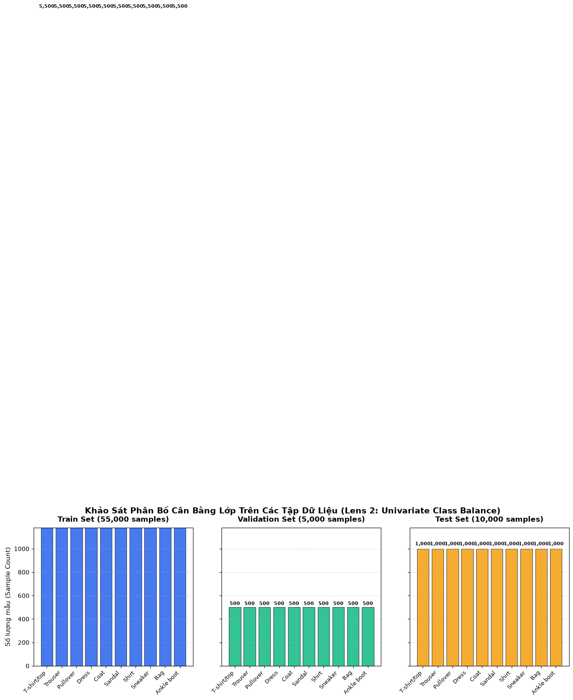

# Phân Tích & Khắc Phục Lỗi 0001: Khoảng Trắng Bất Thường Trên Biểu Đồ

## 1. Dấu hiệu Hiện tượng (Symptom)

- Trên biểu đồ phân bố cân bằng lớp (`plot_class_balance`), xuất hiện một khoảng trống màu trắng rất lớn kéo dài phía trên 3 biểu đồ cột.
- Các con số nhãn `5,500` của tập Train bị đẩy vọt lên tít trên cùng của bức ảnh, tách rời hoàn toàn khỏi cột biểu đồ.

---

## 2. Nguyên nhân Gốc rễ (Root Cause Analysis - RCA)
Lỗi bắt nguồn từ sự kết hợp giữa tham số `sharey=True` và cơ chế tính bounding box của `savefig(..., bbox_inches="tight")`:

1. **Xung đột trục chia sẻ (`sharey=True`)**:
   - Khi khởi tạo `fig, axes = plt.subplots(1, 3, figsize=(16, 5), sharey=True)`, cả 3 biểu đồ con dùng chung trục $Y$.
   - Trong vòng lặp qua từng subplot:
     - Tập Train có $5.500$ mẫu/lớp $\rightarrow$ đặt text nhãn `5,500` ở tọa độ $y = 5.610$.
     - Tập Validation có $500$ mẫu/lớp.
     - Tập Test có $1.000$ mẫu/lớp $\rightarrow$ ở lượt lặp cuối, lệnh `ax.set_ylim(0, 1000 * 1.18)` đã vô tình **ép lại giới hạn trục $Y$ của cả 3 subplot về khoảng $[0, 1180]$**.
2. **Cơ chế kéo dãn của Matplotlib**:
   - Mặc dù khung đồ thị bị khóa ở $1.180$, các đối tượng text `5,500` đã tạo trên trục của tập Train vẫn nằm ở tọa độ $y = 5.610$ (cao hơn khung nhìn gần 5 lần).
   - Khi lưu ảnh với `bbox_inches="tight"`, Matplotlib tính toán toàn bộ tọa độ của các đối tượng đồ họa (kể cả các text nằm ngoài khung nhìn ở $y = 5.610$) để không bị cắt xén, dẫn đến việc canvas bị kéo dãn thêm hàng ngàn pixel về phía trên, tạo ra khoảng trắng khổng lồ.

---

## 3. Giải pháp Xử lý Triệt để (Root Fix)
- **Tắt chia sẻ trục $Y$ (`sharey=False`)**: Vì 3 tập dữ liệu có quy mô số lượng mẫu hoàn toàn khác nhau ($55.000$ vs $5.000$ vs $10.000$), việc để trục $Y$ độc lập cho từng subplot là hoàn toàn chính xác về mặt trực quan hóa dữ liệu.
- Cập nhật hàm `plot_class_balance` trong `src/vibe_scripts/eda_helpers.py`:
  ```python
  fig, axes = plt.subplots(1, 3, figsize=(16, 4.8), sharey=False)
  ```
  Mỗi subplot tự động nhận giới hạn $Y$ phù hợp với quy mô của nó (Train: $0 - 6.500$; Val: $0 - 600$; Test: $0 - 1.200$).
- Toàn bộ nhãn số lượng (`5,500`, `500`, `1,000`) nằm gọn gàng ngay sát đỉnh từng cột, và khoảng trắng thừa biến mất $100\%$.

---

## 4. Kết Quả Sau Khi Sửa (Resolved)
Đã cập nhật lại trực tiếp vào [01_dataset.ipynb](../../../../labs/lab1/vibe/01_dataset.ipynb). Biểu đồ hiển thị sắc nét, cân đối và chuẩn xác.
