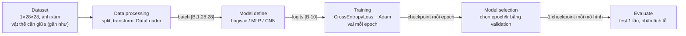

# Flow

## Tổng quan

# Flow

## Tổng quan

## Chi tiết từng bước

| Bước | Input | Xử lý chính | Output |
|---|---|---|---|
| 1. Dataset | FashionMNIST gốc (60k train, 10k test) | Split 55k/5k/10k (stratified, seed 248); EDA chỉ trên train; tính mean/std từ train | 3 tập chỉ số + mean/std |
| 2. Data processing | ảnh PIL 28×28 | Train: (augmentation tùy cấu hình) → ToTensor → Normalize. Val/test: ToTensor → Normalize. DataLoader batch 32 | batch `[B,1,28,28]` |
| 3. Model define | `[B,1,28,28]` | Logistic / MLP / CNN, cùng interface | logits `[B,10]` |
| 4. Training | train loader, val loader | CrossEntropyLoss + Adam; mỗi epoch đánh giá val; lưu checkpoint mỗi epoch | checkpoint, log loss/acc/thời gian |
| 5. Model selection | log validation | Chọn epoch/lr theo macro-F1 làm mượt (chỉ dùng validation) | 1 checkpoint cho mỗi mô hình |
| 6. Evaluate | checkpoint đã chọn, test loader | Chạy test đúng 1 lần; metric, confusion matrix, ảnh đúng/sai, kiểm tra save/load | bảng kết quả, phân tích, kết luận |

## Luồng dữ liệu (shape)

ảnh PIL 28×28 → tensor [1,28,28] → batch [B,1,28,28]
→ model → logits [B,10] → argmax → nhãn dự đoán [B]

## Thí nghiệm

3 mô hình × 2 cấu hình (không / có augmentation), mỗi cái đi qua bước 3-6.
Logistic là baseline và chạy qua đúng cùng pipeline.

## Quy tắc xuyên suốt

- Test chỉ xuất hiện ở bước 6.
- Mean/std, EDA, mọi quyết định chỉnh tham số: chỉ dựa trên train/validation.
- Cả 3 mô hình dùng chung transform, loss, optimizer, batch size, seed.
## Chi tiết từng bước

| Bước               | Input                                  | Xử lý chính                                                                                                    | Output                             |
| ------------------ | -------------------------------------- | -------------------------------------------------------------------------------------------------------------- | ---------------------------------- |
| 1. Dataset         | FashionMNIST gốc (60k train, 10k test) | Split 55k/5k/10k (stratified, seed 248); EDA chỉ trên train; tính mean/std từ train                            | 3 tập chỉ số + mean/std            |
| 2. Data processing | ảnh PIL 28×28                          | Train: (augmentation tùy cấu hình) → ToTensor → Normalize. Val/test: ToTensor → Normalize. DataLoader batch 32 | batch `[B,1,28,28]`                |
| 3. Model define    | `[B,1,28,28]`                          | Logistic / MLP / CNN, cùng interface                                                                           | logits `[B,10]`                    |
| 4. Training        | train loader, val loader               | CrossEntropyLoss + Adam; mỗi epoch đánh giá val; lưu checkpoint mỗi epoch                                      | checkpoint, log loss/acc/thời gian |
| 5. Model selection | log validation                         | Chọn epoch/lr theo macro-F1 làm mượt (chỉ dùng validation)                                                     | 1 checkpoint cho mỗi mô hình       |
| 6. Evaluate        | checkpoint đã chọn, test loader        | Chạy test đúng 1 lần; metric, confusion matrix, ảnh đúng/sai, kiểm tra save/load                               | bảng kết quả, phân tích, kết luận  |

## Luồng dữ liệu (shape)

ảnh PIL 28×28 → tensor [1,28,28] → batch [B,1,28,28]
→ model → logits [B,10] → argmax → nhãn dự đoán [B]

## Thí nghiệm

3 mô hình × 2 cấu hình (không / có augmentation), mỗi cái đi qua bước 3-6.
Logistic là baseline và chạy qua đúng cùng pipeline.

## Quy tắc xuyên suốt

- Test chỉ xuất hiện ở bước 6.
- Mean/std, EDA, mọi quyết định chỉnh tham số: chỉ dựa trên train/validation.
- Cả 3 mô hình dùng chung transform, loss, optimizer, batch size, seed.
