# Abstract

Báo cáo trình bày quy trình thiết kế, kiểm soát công bằng thí nghiệm và đánh giá 3 kiến trúc **Logistic Regression (7.850 tham số)**, **MLP (109.386 tham số)** và **CNN (105.866 tham số)** trên bài toán phân loại 10 lớp trang phục **Fashion-MNIST** bằng PyTorch. Toàn bộ cấu hình thí nghiệm kế thừa [`src/config.py`](../../../../src/config.py) và override tập trung tại [`labs/lab1/vibe/config.py`](../config.py) (`seed = 248`, `batch_size = 32`, `Adam`, `lr = 1e-3`, `20 epochs`).

- **Kết quả nổi bật**: `CNN (no_aug)` đạt Test Accuracy **91.13%** và Macro F1 **91.04%**, vượt `MLP` (+2.8 điểm %) và `Logistic` (+7.3 điểm %). `CNN` (105.866) và `MLP` (109.386) cùng bậc ~105k tham số, nhưng `CNN` vượt nhờ tích chập 2D; `Logistic` chỉ có 7.850 tham số làm baseline. Augmentation không cải thiện test metrics cho bất kỳ kiến trúc nào trong 20 epoch, và làm `Logistic` giảm 9.1 điểm % accuracy. `Shirt` là lớp khó nhất (F1 54.56–74.50% ở nhánh `no_aug`, xuống 44.08% ở `Logistic aug` theo `per_class_metrics.json`) do tương đồng hình học với `T-shirt/top` và `Pullover`.

---

# Define

## Define context

- **Name**: So sánh hiệu năng CNN, MLP, Logistic trên bài toán phân loại Fashion-MNIST bằng PyTorch.
- **Context**: Bài thực hành Deep Learning chuẩn hóa pipeline từ dữ liệu bất biến đến đánh giá và suy luận.
- **Target**:
  - **Main**: Làm chủ PyTorch qua quy trình huấn luyện deeplearning
  - **Extra**: Kiểm chứng định lượng tác động của kiến trúc không gian 2D (`CNN` vs `MLP` cùng bậc tham số) và kỹ thuật `Augmentation`.
- **Constraint**:
  - **Công bằng thí nghiệm**: Cả 3 mô hình dùng chung `CrossEntropyLoss`, `Adam`, `lr = 1e-3`, `batch_size = 32`, `epochs = 20`, tham số `Normalize(mean, std)` fit trên Train và `seed = 248`.
  - **Cùng bậc tham số**: `MLP` (`109.386`) và `CNN` (`105.866`) chênh nhau ~3,2% để cô lập ảnh hưởng của cấu trúc tích chập 2D.

## Define problem

- **Input**: Ảnh xám kích thước $28 \times 28$ (1 kênh màu), đối tượng thời trang căn giữa khung hình.
- **Output**: Dự đoán nhãn thuộc 10 lớp thời trang và báo cáo phân tích định lượng + phân tích lỗi.
- **Metrics**: Accuracy, Precision/Recall/F1 từng lớp, Confusion Matrix $10 \times 10$, số tham số, epoch hội tụ tốt nhất, kích thước checkpoint (KB) và độ trễ suy luận (ms).
- **Baseline**: `Logistic` (7.850 tham số).
- **Experiments**: Ma trận 6 lần chạy (`{Logistic, MLP, CNN} × {no_aug, aug}`) với cùng `seed = 248`.

## Hypotheses

**H1** được đặt từ giai đoạn EDA (cosine similarity nhóm áo > 0.85 → CNN nên tách tốt hơn). **H2** và **H3** được phát biểu định tính trước khi train, nhưng tiêu chí định lượng (ngưỡng cụ thể) được xác lập sau khi có kết quả — ghi nhận đây là **post-hoc quantification**.

Các tiêu chí đo trên Test set, dùng để **báo cáo cuối cùng**; Test không được dùng để chọn cấu hình hay điều chỉnh mô hình (xem [Nguyên tắc](#nguyên-tắc)).

| Giả thuyết | Dự đoán | Tiêu chí đúng / bác bỏ (đo trên Test, chỉ báo cáo) |
| :--- | :--- | :--- |
| **H1** — Kiến trúc 2D vượt trội *(pre-hoc)* | CNN > MLP > Logistic về Test Accuracy | Chênh lệch giữa mỗi cặp liền kề > 0.5 điểm % |
| **H2** — Augmentation cải thiện tổng quát hóa *(tiêu chí post-hoc)* | Cấu hình `aug` có Test Loss thấp hơn `no_aug` trên cùng kiến trúc | `test_loss(aug) < test_loss(no_aug)` cho ít nhất 2/3 kiến trúc |
| **H3** — Lỗi tập trung ở nhóm áo thân trên *(tiêu chí post-hoc)* | Các cặp nhầm lẫn lớn nhất thuộc nhóm `{T-shirt, Pullover, Coat, Shirt}` | ≥ 4 trong 5 cặp nhầm nhiều nhất nằm trong nhóm áo thân trên |

> Kiểm chứng bằng số liệu thực nghiệm tại [Kiểm tra giả thuyết](#kiểm-tra-giả-thuyết).

---

# Dataset

## Collection

- **Source**: Zalando Research Fashion-MNIST tải qua `torchvision.datasets.FashionMNIST`, lưu trữ chỉ đọc tại [`data/FashionMNIST/raw/`](../../../../data/FashionMNIST/raw/manifest.json).
- **Data Provenance**: Đã ghép cặp [`manifest.json`](../../../../data/FashionMNIST/raw/manifest.json) và `<file>.manifest.json`; xác thực SHA-256 đạt `[PASS]` 8/8 tệp nhị phân.
- **Metadata**: 70.000 ảnh gồm 60.000 train và 10.000 test, kích thước $28 \times 28$, thang giá trị pixel `0–255`.
- **Label names (10 lớp)**: `0 T-shirt/top`, `1 Trouser`, `2 Pullover`, `3 Dress`, `4 Coat`, `5 Sandal`, `6 Shirt`, `7 Sneaker`, `8 Bag`, `9 Ankle boot`.

## Cleaning

- Kiểm toán chất lượng 6 chiều trong [`lab1.ipynb`](../lab1.ipynb): 0 giá trị khuyết (`NaN`), toàn bộ pixel nằm đúng đoạn `[0, 255]`, nhãn lớp đầy đủ `{0..9}`, tensor đồng nhất `(28, 28)` → **bỏ qua bước Data Cleaning**.

## Splitting

| Tập dữ liệu    | Số lượng | Số mẫu / lớp | Ghi chú                                                                |
| :------------- | :------: | :----------: | :--------------------------------------------------------------------- |
| **Train**      | `55.000` |   `5.500`    | Tách phân tầng (`stratified split`) từ 60k gốc với `seed = 248`        |
| **Validation** | `5.000`  |    `500`     | Dùng theo dõi hội tụ và chọn `best.pt`, tách biệt hoàn toàn khỏi Train |
| **Test**       | `10.000` |   `1.000`    | Tập chuẩn Zalando cố định, chỉ đánh giá 1 lần cuối cùng                |

## EDA

Khảo sát theo mô hình 3 Thấu kính (Three Lenses) tại [`lab1.ipynb`](../lab1.ipynb):

```text
               ┌────────────────────────────────────────────────────────┐
               │              LENS 1: GLOBAL TOPOLOGY                   │
               │  Shape (60000, 28, 28) | 47.04 MB | 0 Null | 1 Channel │
               └──────────────────────────┬─────────────────────────────┘
                                          │
                                          ▼
               ┌────────────────────────────────────────────────────────┐
               │          LENS 2: UNIVARIATE DISTRIBUTIONS              │
               │  10 lớp cân bằng | Mean 0.2860 | Std 0.3530 | Zero 50.2%│
               └──────────────────────────┬─────────────────────────────┘
                                          │
                                          ▼
               ┌────────────────────────────────────────────────────────┐
               │         LENS 3: MULTIVARIATE INTERACTIONS              │
               │  Class Prototypes | Cosine Similarity | PCA 2D         │
               └────────────────────────────────────────────────────────┘
```

- **Lens 1 (Global structure)**: Tensor gốc đồng nhất $28 \times 28$, không có nhiễu kích thước hay thiếu dữ liệu.
- **Lens 2 (Distributions)**:
  - Cân bằng lớp tuyệt đối ở cả 3 tập (`5.500 / 500 / 1.000` mỗi lớp) → loại bỏ nguy cơ thiên vị lớp.
  - Pixel nền bằng `0` chiếm `50.21%`, phân bố lệch phải (`skewness = 0.695`, `kurtosis = -1.190`), giá trị trung bình $72.94 / 255 \approx 0.2860$ và độ lệch chuẩn $90.02 / 255 \approx 0.3530$.
- **Lens 3 (Visual & class separability)**:
  - Nhóm giày dép (`Sandal`, `Sneaker`, `Ankle boot`) và `Trouser` tách cụm rõ trên không gian PCA 2D.
  - Nhóm trang phục thân trên (`T-shirt/top`, `Pullover`, `Coat`, `Shirt`) có độ tương đồng cấu trúc cosine $> 0.85$, tạo vùng chồng lấn hình học mạnh.
- **Quyết định cho bước tiếp theo**:
  1. Chuẩn hóa Z-Score với `mean`, `std` tính duy nhất trên 55.000 mẫu Train.
  2. Thử nghiệm Augmentation bảo toàn hướng đứng thời trang (lật ngang, dịch/xoay nhỏ) chỉ trên Train.
  3. Cơ sở EDA cho [Hypotheses](#hypotheses): cosine similarity > 0.85 ở nhóm áo thân trên là căn cứ đặt giả thuyết lỗi sẽ tập trung ở nhóm này (**H3**) và cấu trúc lưới 2D của `CNN` sẽ tách tốt hơn `MLP` flatten (**H1**). (Riêng **H2** về augmentation xuất phát từ thiết kế thí nghiệm, không phải từ EDA.)

---

# Model selection

## Lý do chọn mô hình

- **`Logistic`**: Mô hình tuyến tính đơn giản nhất, làm mốc sàn (baseline) để đo mức cải thiện của mạng sâu.
- **`MLP`**: Bổ sung 2 tầng ẩn phi tuyến ReLU để vượt giới hạn siêu phẳng tuyến tính của `Logistic`; vẫn làm phẳng (flatten) ảnh thành vector 784 chiều nên đánh mất tương quan không gian 2D.
- **`CNN`**: Bắt buộc theo bài học; giữ nguyên cấu trúc lưới 2D qua tích chập $3 \times 3$ và `MaxPool2d`, khai thác biên, cổ áo, tay áo với số tham số cùng bậc `MLP`.

## Architecture

```text
Logistic:  [B,1,28,28] → Flatten [B,784] → Linear(784→10) [B,10]
           Tham số: 7.850

MLP:       [B,1,28,28] → Flatten [B,784]
           → Linear(784→128) → ReLU → Linear(128→64) → ReLU
           → Linear(64→10) [B,10]
           Tham số: 109.386

CNN:       [B,1,28,28]
           → Conv(1→16, 3×3, pad 1) → ReLU → MaxPool2   [B,16,14,14]
           → Conv(16→32, 3×3, pad 1) → ReLU → MaxPool2  [B,32,7,7]
           → Flatten [B,1568] → Linear(1568→64) → ReLU
           → Linear(64→10) [B,10]
           Tham số: 105.866
```

_(Chi tiết hợp đồng I/O và kiểm chứng toán học số tham số xem tại [`pipelines/02_MODEL_ARCHITECTURE.md`](./pipelines/02_MODEL_ARCHITECTURE.md).)_

---

# Data processing

Pipeline xử lý đặt tại `src/vibe_scripts/lab1/data.py` (đặc tả chi tiết tại [`pipelines/01_DATA_PREPARATION.md`](./pipelines/01_DATA_PREPARATION.md)):

## Scaling

- **Thứ tự bắt buộc**: `Augmentation → ToTensor → Normalize`.
- `ToTensor`: chuyển ảnh `0–255` về `[0.0, 1.0]`, shape `[1, 28, 28]`.
- `Normalize`: tính `mean`, `std` **duy nhất trên 55.000 mẫu Train** (`~0.2860`, `~0.3530`), áp dụng cố định cho Train, Validation và Test; dùng chung cho cả 3 mô hình.

## Augmentation

- Nhánh `no_aug`: chỉ `ToTensor → Normalize`.
- Nhánh `aug` (**chỉ áp dụng trên Train**; tách 2 đối tượng `FashionMNIST` độc lập cho Train và Val để tránh rò rỉ):
  - `RandomHorizontalFlip(p=0.5)`
  - `RandomAffine(degrees=10, translate=(0.08, 0.08))`
- Không dùng lật dọc vì ảnh quần áo/giày dép có hướng trọng lực cố định.

## DataLoader

- `batch_size = 32`, `num_workers = 8`, `shuffle = True` (chỉ Train), `pin_memory = True` (khi dùng GPU), `seed = 248` (`Generator` + `worker_init_fn`).

---

# Training

Pipeline huấn luyện đặt tại `src/vibe_scripts/lab1/train.py` (đặc tả chi tiết tại [`pipelines/03_TRAINING.md`](./pipelines/03_TRAINING.md)):

## Loss & Optimizer

- **Loss**: `CrossEntropyLoss` (nhận trực tiếp raw logits `[B, 10]`).
- **Optimizer**: `Adam(lr=1e-3)` (override từ `1e-5` ở `src/config.py` tại [`labs/lab1/vibe/config.py`](../config.py)).

## Cấu hình huấn luyện & Vòng lặp

- `batch_size = 32`, `epochs = 20`, `seed = 248`, `device = cuda` (tự động fallback `cpu`).
- Vòng lặp 5 bước: `forward → loss → zero_grad(set_to_none=True) → backward → step`.
- Sau mỗi epoch đánh giá trên Validation (`model.eval()` + `torch.no_grad()`).

## Theo dõi & Lưu Checkpoint

- Ghi log từng epoch (`train_loss`, `val_loss`, `train_acc`, `val_acc`, `epoch_time_sec`) ra `history.json` (không phụ thuộc `tensorboard` bị thiếu trong môi trường — xem [`logs/errors/0001.md`](../../../../logs/errors/0001.md)).
- Lưu nguyên tử (atomic write `.tmp → replace`): `best.pt` (theo `val_loss` thấp nhất) và `last.pt`, đính kèm `norm_stats`, `model_name`, `seed`, `hyperparams`.

---

# Baseline

## Purpose

- Tạo mốc sàn (mốc `0`) để lượng hóa chính xác phần hiệu năng tăng thêm đến từ tầng ẩn phi tuyến (`MLP`) và phép tích chập 2D (`CNN`).

## Architecture & Sanity Check

- `Flatten [B, 784] → Linear(784 → 10) [B, 10]` (`7.850` tham số, raw logits).
- **Sanity Check** (kiểm tra trước khi chạy full 6 thí nghiệm):
  - Initial loss khởi tạo trước huấn luyện $\approx \ln(10) \approx 2.3026$: ✅ Đạt (kiểm chứng qua `test_lab1_train.py`)
  - Khả năng overfit 1 batch (32 mẫu): ✅ Đạt (acc > 95% sau vài epoch trên 1 batch)
  - Kết quả Baseline `Logistic (no_aug)`: Test Acc **`83.82%`**, Test Loss **`0.4628`**

---

# Evaluate

Thực thi bằng `src/vibe_scripts/lab1/evaluate.py` và `infer.py` (đặc tả tại [`pipelines/04_EVALUATION_BENCHMARK.md`](./pipelines/04_EVALUATION_BENCHMARK.md) và [`pipelines/05_INFERENCE_SERVING.md`](./pipelines/05_INFERENCE_SERVING.md)). Tập Test `10.000` mẫu chỉ chạy **1 lần duy nhất** trên checkpoint `best.pt`.

## Nguyên tắc

- Tập Test chỉ được đánh giá **đúng 1 lần** trên `best.pt` (chọn theo `val_loss` thấp nhất) để tránh thông tin rò rỉ từ Test vào quá trình điều chỉnh mô hình.
- Toàn bộ suy luận dưới `model.eval()` + `torch.no_grad()`, warm-up 2 batch trước khi bấm giờ.
- Kiểm chứng Save/Load: sai số tối đa `|logits_before − logits_after| < 1e-6`.

## Metric tổng hợp (3 mô hình × 2 cấu hình)

| Mô hình    | Cấu hình |  Params   | Best Epoch | File Size (KB) | Test Loss | Test Acc (%) | Macro F1 (%) | Infer Latency (ms) |
| :--------- | :------: | :-------: | :--------: | :------------: | :-------: | :----------: | :----------: | :----------------: |
| `Logistic` | `no_aug` |  `7.850`  |    `4`     |    `95.89`     | `0.4628`  |   `83.82`    |   `83.47`    |      `1.087`       |
| `Logistic` |  `aug`   |  `7.850`  |    `17`    |    `95.89`     | `0.7212`  |   `74.68`    |   `74.77`    |      `0.813`       |
| `MLP`      | `no_aug` | `109.386` |    `7`     |   `1289.59`    | `0.3378`  |   `88.30`    |   `88.25`    |      `1.325`       |
| `MLP`      |  `aug`   | `109.386` |    `16`    |   `1289.59`    | `0.3986`  |   `85.62`    |   `85.53`    |      `1.641`       |
| `CNN`      | `no_aug` | `105.866` |    `8`     |   `1250.82`    | `0.2558`  | **`91.13`**  | **`91.04`**  |      `1.510`       |
| `CNN`      |  `aug`   | `105.866` |    `16`    |   `1250.82`    | `0.2653`  |   `90.74`    |   `90.72`    |      `2.211`       |

- **Kiểm chứng Save/Load**: Sai số tối đa `|logits_before - logits_after|` = **`0.0`** cho cả 6 cấu hình ✅ (yêu cầu `< 1e-6`).

## Đường cong học (Learning Curves)

### So sánh tổng thể

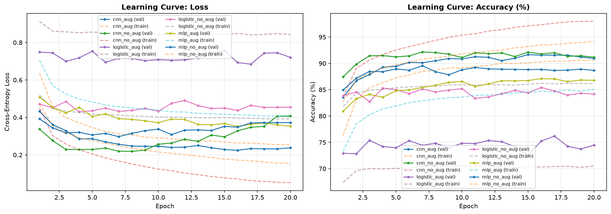

- **Nhận xét**: Best epoch nhánh `no_aug`: `Logistic` 4, `MLP` 7, `CNN` 8. Với `Logistic`, val loss dao động ±0.03 quanh 0.43–0.49 trong khi train loss vẫn giảm đến epoch 20 (0.427 → 0.392), nên best epoch 4 chỉ là điểm thấp nhất của một đường nhiễu, không phản ánh tốc độ hội tụ. `CNN (no_aug)` overfit nếu train tiếp — val loss tăng ngược từ epoch 8. Nhánh `aug` cho val loss < train loss ở cả 3 kiến trúc — đây là **artifact** do train loss đo trên ảnh augmented (khó hơn) còn val đo trên ảnh sạch, không phải bằng chứng hết overfit. `Logistic aug` giảm mạnh accuracy (−9.14 điểm %) dù đã hội tụ (train loss phẳng ~0.84 từ epoch 2); nguyên nhân chưa kiểm chứng, có thể do mô hình tuyến tính không tận dụng được augmentation, hoặc do distribution shift (ví dụ flip ngang) giữa train augmented và test sạch.

### Learning curve riêng từng thí nghiệm

Mỗi thí nghiệm có 1 biểu đồ riêng gồm 2 panel (Loss + Accuracy), đánh dấu:

- **Best Epoch** (đường dọc tím) — epoch có `val_loss` thấp nhất.
- **Overfit Gap** (vùng tô mờ đỏ) — khoảng cách `val_loss − train_loss`. Bảng dưới ghi gap **tại best epoch** (cùng checkpoint với test metrics) thay vì epoch cuối.

> **Lưu ý đọc gap**: Với nhánh `aug`, train loss đo trên ảnh augmented (khó hơn) còn val đo trên ảnh sạch, nên gap âm là **artifact** của augmentation, không phải bằng chứng hết overfit hay underfit.

#### Logistic

|                                                                                                 |                                                                                           |
| :---------------------------------------------------------------------------------------------: | :---------------------------------------------------------------------------------------: |
| 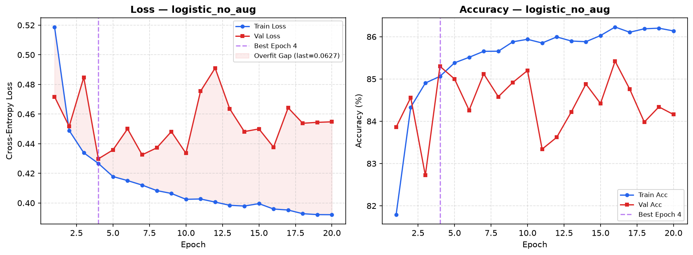 | 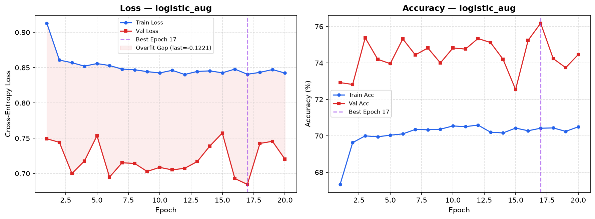 |

- **`no_aug`**: Best epoch 4: train_loss = 0.4267, val_loss = 0.4298, gap = +0.003 — gần như không overfit. Train loss vẫn giảm chậm đến epoch 20 (→ 0.392); val loss dao động ±0.03, nên best epoch 4 là điểm nhiễu thấp nhất chứ không phải dấu hiệu hội tụ sớm.
- **`aug`**: Train loss phẳng ~0.84 và train acc ~70% gần như không đổi từ epoch 2 → mô hình **đã hội tụ ở mức thấp**, không phải thiếu epoch. Best epoch 17 (val_loss = 0.6846) chỉ là điểm thấp nhất của val loss dao động mạnh (0.69–0.76). Test accuracy giảm 9.14 điểm % so với `no_aug`; nguyên nhân chưa kiểm chứng — có thể do mô hình tuyến tính không tận dụng được augmentation, hoặc do distribution shift (flip/affine) giữa train và test.

#### MLP

|                                                                                       |                                                                                 |
| :-----------------------------------------------------------------------------------: | :-----------------------------------------------------------------------------: |
| 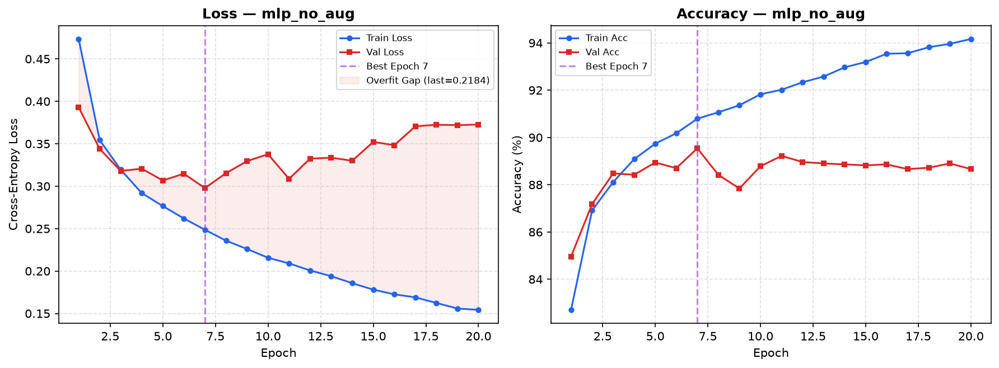 | 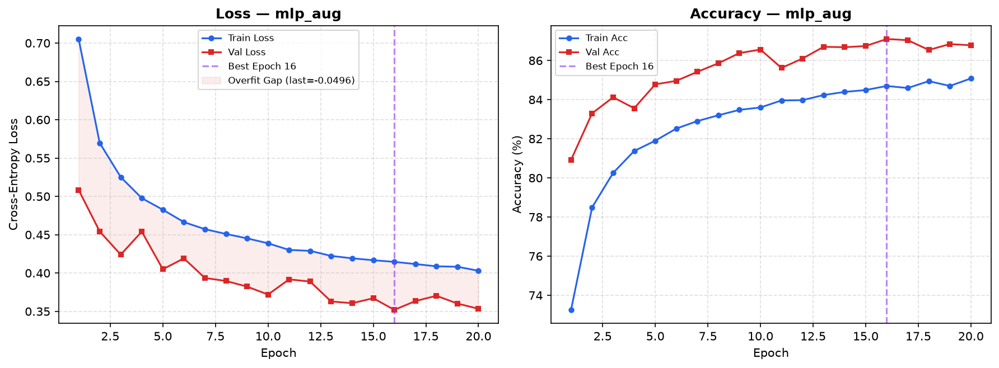 |

- **`no_aug`**: Tại best epoch 7: train_loss = 0.2487, val_loss = 0.2978, gap = +0.049 — overfit nhẹ. Từ epoch 7 trở đi val loss tăng ngược trong khi train loss tiếp tục giảm → overfit ngày càng nặng.
- **`aug`**: Tại best epoch 16: train_loss = 0.4146, val_loss = 0.3520, gap = −0.063 (artifact). Test accuracy giảm 2.68 điểm % so với `no_aug`. Train loss vẫn giảm chậm đến epoch 20, nên giả thuyết "chưa đủ epoch" còn hợp lý; ngoài ra có thể do MLP flatten ảnh nên biến đổi spatial không giúp nhiều.

#### CNN

|                                                                                       |                                                                                 |
| :-----------------------------------------------------------------------------------: | :-----------------------------------------------------------------------------: |
| 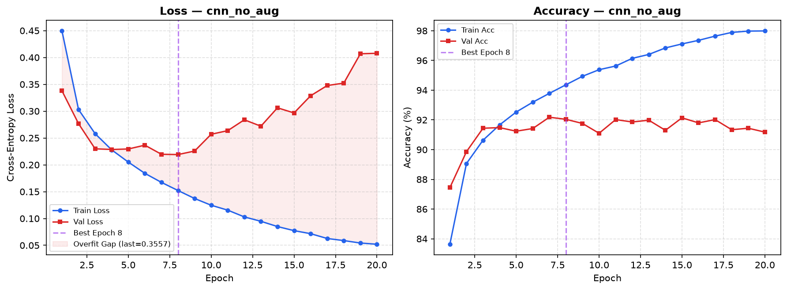 | 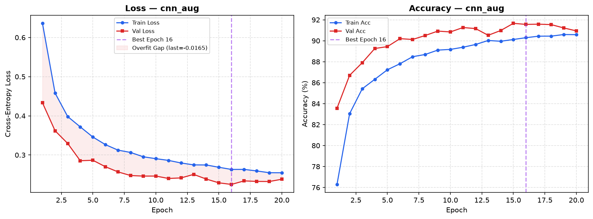 |

- **`no_aug`**: Tại best epoch 8: train_loss = 0.1521, val_loss = 0.2191, gap = +0.067. Overfit vừa phải tại thời điểm best, nhưng từ epoch 8 trở đi val loss tăng liên tục (0.408 ở epoch 20) → model ghi nhớ dữ liệu train nếu train tiếp.
- **`aug`**: Tại best epoch 16: train_loss = 0.2632, val_loss = 0.2248, gap = −0.038 (artifact). Train và val loss đều giảm song song đến epoch 16, không có val loss tăng ngược; train loss vẫn giảm chậm đến epoch 20 nên giả thuyết "chưa đủ epoch" còn hợp lý. Mất 0.39 điểm % accuracy (91.13 → 90.74).

| Thí nghiệm        | Best Epoch | Train Loss (@best) | Val Loss (@best) | Gap Loss (@best) | Nhận xét                                                    |
| :---------------- | :--------: | :----------------: | :--------------: | :--------------: | :---------------------------------------------------------- |
| `logistic_no_aug` |    `4`     |      `0.4267`      |     `0.4298`     |     `+0.003`     | Gần như không overfit tại best epoch                        |
| `logistic_aug`    |    `17`    |      `0.8406`      |     `0.6846`     |     `−0.156`     | Gap âm là artifact; train loss phẳng từ ep2, test acc −9.14 điểm % |
| `mlp_no_aug`      |    `7`     |      `0.2487`      |     `0.2978`     |     `+0.049`     | Overfit nhẹ tại best; sau epoch 7 val loss tăng ngược       |
| `mlp_aug`         |    `16`    |      `0.4146`      |     `0.3520`     |     `−0.063`     | Gap âm là artifact; test acc −2.68 điểm % so với no_aug |
| `cnn_no_aug`      |    `8`     |      `0.1521`      |     `0.2191`     |     `+0.067`     | Overfit vừa tại best; sau epoch 8 val loss tăng mạnh        |
| `cnn_aug`         |    `16`    |      `0.2632`      |     `0.2248`     |     `−0.038`     | Gap âm là artifact; val loss giảm đều, mất 0.39 điểm % acc |

## Phân tích theo lớp

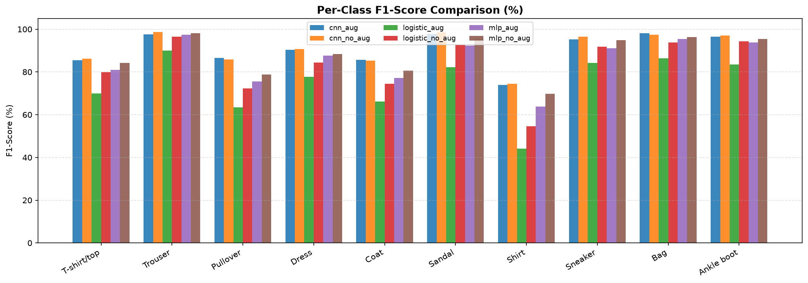

| Class ID | Nhãn lớp      | Logistic F1 (%) | MLP F1 (%)  | CNN F1 (%)  | Nhận xét                                                        |
| :------: | :------------ | :-------------: | :---------: | :---------: | :-------------------------------------------------------------- |
|   `0`    | `T-shirt/top` |     `79.91`     |   `84.14`   |   `86.12`   | CNN tốt nhất, có thể nhờ bắt biên cổ áo                         |
|   `1`    | `Trouser`     |     `96.44`     |   `98.07`   |   `98.59`   | Dễ nhất, hình dáng khác biệt rõ                                 |
|   `2`    | `Pullover`    |     `72.28`     |   `78.71`   |   `85.91`   | CNN vượt MLP +7.2 điểm %                                        |
|   `3`    | `Dress`       |     `84.43`     |   `88.37`   |   `90.63`   | CNN vượt MLP +2.3 điểm %, có thể nhờ nhận dạng viền váy qua 2D  |
|   `4`    | `Coat`        |     `74.51`     |   `80.66`   |   `85.29`   | Thường nhầm với Pullover và Shirt                               |
|   `5`    | `Sandal`      |     `92.69`     |   `96.04`   |   `98.40`   | Hình dáng riêng biệt, cả 3 mô hình đều cao                      |
|   `6`    | `Shirt`       |   **`54.56`**   | **`69.85`** | **`74.50`** | **Khó nhất** — nhầm Shirt ↔ T-shirt ↔ Coat                      |
|   `7`    | `Sneaker`     |     `91.87`     |   `94.85`   |   `96.46`   | Hình dáng rõ, cả 3 mô hình đều cao                              |
|   `8`    | `Bag`         |     `93.76`     |   `96.32`   |   `97.38`   | Hình chữ nhật đặc trưng, dễ phân biệt                           |
|   `9`    | `Ankle boot`  |     `94.27`     |   `95.50`   |   `97.09`   | Phân biệt tốt, có thể nhờ đặc trưng cổ cao                      |

> *Bảng trên là kết quả nhánh `no_aug`. Với nhánh `aug` (nguồn [`per_class_metrics.json`](../../../../experiments/lab1/evaluation/per_class_metrics.json)), `Shirt` vẫn là lớp thấp nhất: `Logistic aug` F1 `44.08%`, `MLP aug` F1 `63.78%`, `CNN aug` F1 `74.00%`.*

## Kiểm tra giả thuyết

Đối chiếu kết quả thực nghiệm với tiêu chí đã đặt tại [Hypotheses](#hypotheses):

| Giả thuyết | Tiêu chí                                                 | Kết quả thực nghiệm                                                                                                       | Kết luận  |
| :--------- | :------------------------------------------------------- | :------------------------------------------------------------------------------------------------------------------------ | :-------: |
| **H1**     | Chênh acc > 0.5% giữa mỗi cặp liền kề                    | CNN 91.13% (+2.83 điểm % so với MLP) > MLP 88.30% (+4.48 điểm % so với Logistic) > Logistic 83.82%. Mọi chênh lệch >> 0.5 điểm %                                       |  ✅ Đúng  |
| **H2**     | `test_loss(aug) < test_loss(no_aug)` cho ≥ 2/3 kiến trúc | CNN: 0.2653 > 0.2558 ❌ · MLP: 0.3986 > 0.3378 ❌ · Logistic: 0.7212 > 0.4628 ❌ → 0/3 kiến trúc đạt tiêu chí             | ❌ Bác bỏ |
| **H3**     | ≥ 4/5 cặp nhầm thuộc nhóm áo                             | Shirt→T-shirt (152), Coat→Pullover (92), Shirt→Pullover (67), Coat→Shirt (51), T-shirt→Shirt (49) → **5/5** thuộc nhóm áo |  ✅ Đúng  |

**Phân tích H2 (bác bỏ)**: Cả 3 kiến trúc đều có `test_loss(aug) > test_loss(no_aug)` (0/3 đạt tiêu chí). Overfit gap âm ở nhánh aug là **artifact** — train loss đo trên ảnh augmented (khó hơn ảnh gốc) nên val < train là hiển nhiên, không phải bằng chứng hết overfit. Để đánh giá tác động augmentation đúng cách, cần so sánh **test metrics** trên cùng test set sạch: CNN mất 0.39 điểm % acc, MLP mất 2.68 điểm %, Logistic mất 9.14 điểm %. Kết luận: trong thiết lập 20 epoch, augmentation không cải thiện test performance cho bất kỳ kiến trúc nào.

---

# Error analysis

> Accuracy/Loss chỉ cho một con số trung bình. Error analysis là mở từng mẫu sai ra xem, để biết nên sửa cái gì.
> Không có nó, chỉ đoán mò kiểu "train thêm epoch", "đổi optimizer".
>
> — Tham khảo [`docs/references/DL_PIPELINE.md`](../../../../docs/references/DL_PIPELINE.md)

## Quy trình 3 bước

### Bước 1: Chia lỗi theo class (Confusion Matrix + Per-class Metrics)

- Từ `confusion_matrix_<exp_id>.png` và `per_class_f1_comparison.png` xác định class nào yếu nhất, cặp class nào nhầm nhau nhiều nhất.
- Đối chiếu kỳ vọng (đặt trước theo per-class recall, tương đương accuracy trên từng lớp vì mỗi lớp test có đúng 1.000 mẫu) với kết quả thực tế của `CNN no_aug`:

| Nhóm          | Classes                                             | Recall kỳ vọng | Thực tế (`CNN no_aug`, Recall / F1)                                 | Ghi chú                                            |
| :------------ | :-------------------------------------------------- | :------------: | :------------------------------------------------------------------ | :------------------------------------------------- |
| Dễ phân biệt  | `Trouser`, `Sandal`, `Sneaker`, `Bag`, `Ankle boot` |    ~96–98%     | Recall `96.6–98.7%` (F1 `96.46–98.59%`)                             | Khớp kỳ vọng; hình dáng khác biệt rõ               |
| Khó phân biệt | `Pullover`, `Coat`                                  |      ~80%      | `Pullover` `89.0%` / `85.91%`; `Coat` `81.2%` / `85.29%`            | Tương đồng cấu trúc tay áo; cao hơn kỳ vọng nhẹ    |
| Rất khó       | `Shirt`, `T-shirt/top`                              |      ~60%      | `Shirt` `69.4%` / `74.50%`; `T-shirt/top` `91.2%` / `86.12%`        | Chỉ `Shirt` thấp rõ; `T-shirt` recall cao nhưng bị giảm precision do nhận nhầm từ `Shirt` |

#### Confusion Matrix — CNN (mô hình tốt nhất)

|                                        CNN `no_aug`                                        |                                      CNN `aug`                                       |
| :----------------------------------------------------------------------------------------: | :----------------------------------------------------------------------------------: |
| 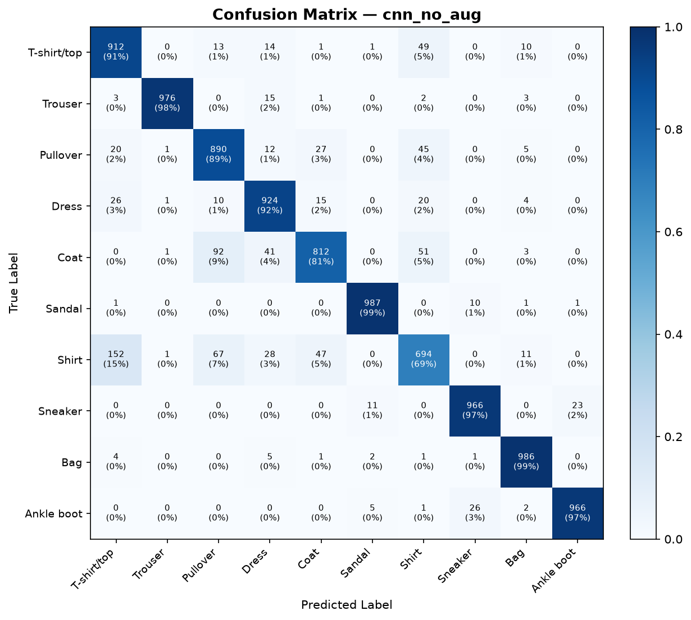 | 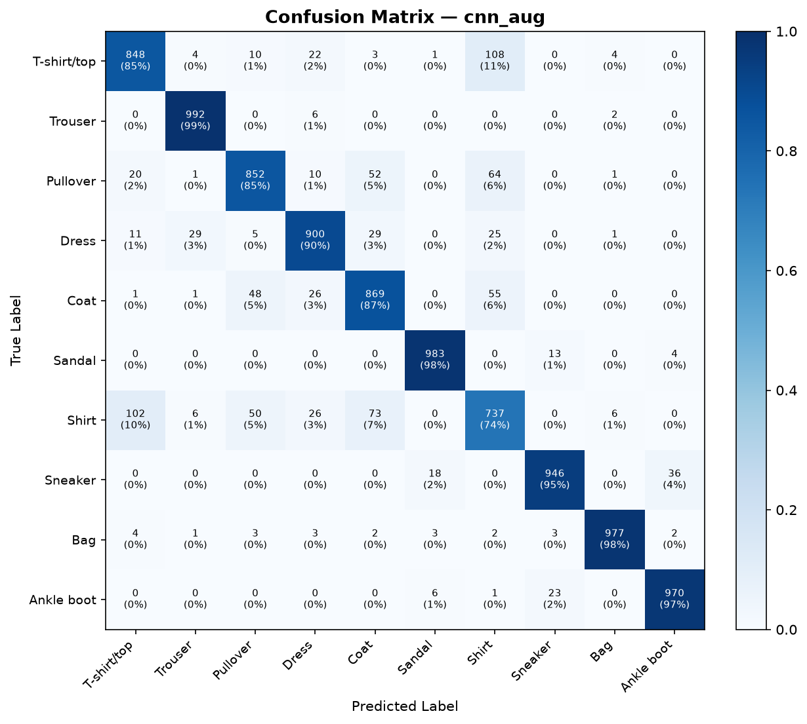 |

- **`no_aug`**: Ô `Shirt → T-shirt/top` (152 mẫu) chiếm đậm nhất ngoài đường chéo. Khối 4×4 góc trên trái (`T-shirt`, `Pullover`, `Coat`, `Shirt`) có nhiều ô ngoài chéo đáng kể, trong khi nhóm giày/phụ kiện gần như trắng hoàn toàn.
- **`aug`**: `Shirt → T-shirt` giảm từ 152 xuống 102 (khoảng −33%), nhưng chiều ngược lại `T-shirt → Shirt` tăng gấp đôi (49 → 108) và trở thành cặp nhầm lớn nhất. Augmentation **đổi kiểu lỗi** (dịch biên quyết định giữa hai lớp) chứ không chỉ giảm lỗi — phù hợp với việc Shirt recall tăng (69.4% → 73.7%) trong khi T-shirt recall giảm (91.2% → 84.8%).

#### Confusion Matrix — Logistic (baseline) vs MLP

|                                          Logistic `no_aug`                                           |                                        MLP `no_aug`                                        |
| :--------------------------------------------------------------------------------------------------: | :----------------------------------------------------------------------------------------: |
| 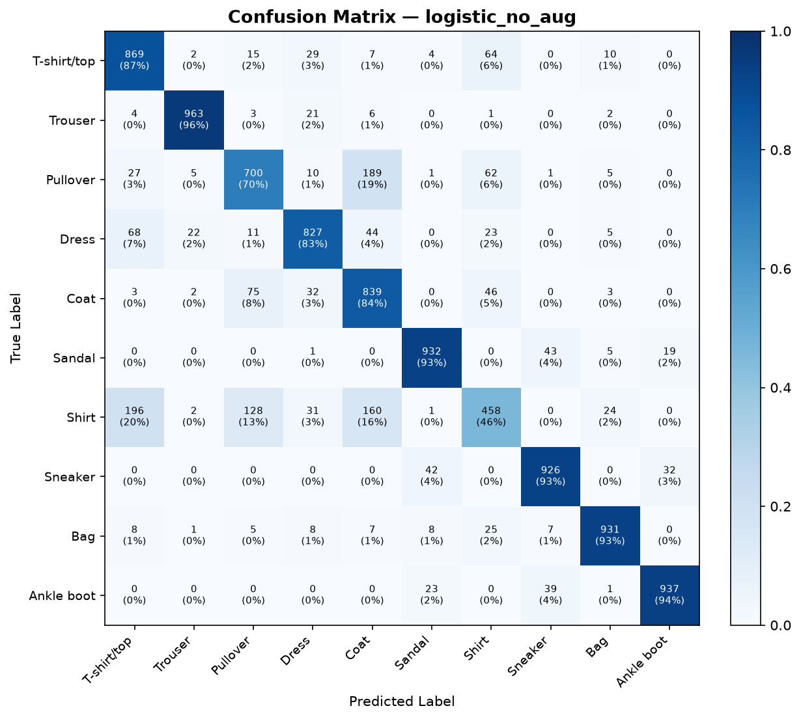 |  |

- **Logistic**: Confusion matrix "mờ" hơn — nhiều ô ngoài chéo có giá trị đáng kể, đặc biệt `Shirt` chỉ 458/1000 mẫu đúng (recall 45.8%, F1 54.6%). Mô hình tuyến tính không tách được biên quyết định phi tuyến giữa các lớp áo.
- **MLP**: Cải thiện rõ so với Logistic (đường chéo đậm hơn), nhưng vẫn nhầm mạnh ở nhóm thân trên do flatten mất tương quan 2D.

- **Top-5 cặp nhầm lẫn thực tế từ Confusion Matrix** (CNN `no_aug` — mô hình tốt nhất):

|  #  | True Class    | → Pred Class    | Số mẫu sai |
| :-: | :------------ | :-------------- | :--------: |
|  1  | `Shirt`       | → `T-shirt/top` |  **152**   |
|  2  | `Coat`        | → `Pullover`    |     92     |
|  3  | `Shirt`       | → `Pullover`    |     67     |
|  4  | `Coat`        | → `Shirt`       |     51     |
|  5  | `T-shirt/top` | → `Shirt`       |     49     |

→ 5/5 cặp nhầm lẫn lớn nhất đều thuộc nhóm thân trên (`Shirt`, `T-shirt/top`, `Pullover`, `Coat`) — xác nhận giả thuyết H3.

### Bước 2: Xem trực tiếp ảnh bị sai (Visual Inspection)

- `predictions_gallery_<exp_id>.png`: 5 mẫu đúng (viền xanh) + 5 mẫu sai có confidence cao nhất (viền đỏ, Top Confident Errors).

#### Predictions Gallery — CNN (mô hình tốt nhất)

|                                            CNN `no_aug`                                            |                                          CNN `aug`                                           |
| :------------------------------------------------------------------------------------------------: | :------------------------------------------------------------------------------------------: |
| 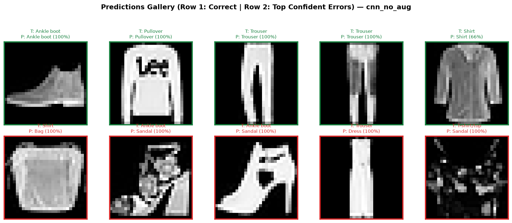 | 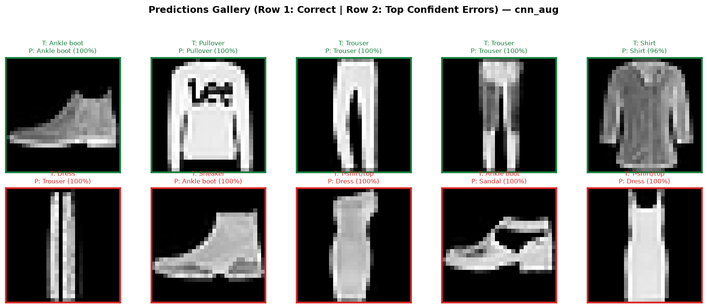 |

- **Quan sát (trong 5 mẫu sai hiển thị của mỗi ảnh — Top Confident Errors)**:
  - Cả `CNN no_aug` và `CNN aug` đều đạt **softmax 100% ở cả 5/5 mẫu sai hiển thị** (phản ánh cả cách lọc *Top Confident Errors* lẫn hiện tượng overconfidence của softmax trên mẫu dị biệt).
  - **`CNN no_aug`**: 5 lỗi tự tin nhất là `Shirt → Bag`, `Ankle boot → Sandal` (2 mẫu), `Trouser → Dress`, `T-shirt/top → Sandal` — đều là ảnh hình dáng đặc biệt hoặc rất giống lớp bị dự đoán (áo gập khối vuông như túi, bốt hở hông/mũi như sandal, quần dính hai ống như váy, ảnh tối lốm đốm). Đáng chú ý, **không có mẫu `Shirt → T-shirt/top`** trong top 5 này.
  - **`CNN aug`**: 5 lỗi tự tin nhất là `Dress → Trouser`, `Sneaker → Ankle boot`, `T-shirt/top → Dress` (2 mẫu), `Ankle boot → Sandal` — tương tự, các mẫu rất mơ hồ về hình dạng (váy có sọc đen chia giữa trông như hai ống quần, giày cổ cao giống bốt, áo dáng dài giống váy).

#### Predictions Gallery — Logistic vs MLP

|                                              Logistic `no_aug`                                               |                                            MLP `no_aug`                                            |
| :----------------------------------------------------------------------------------------------------------: | :------------------------------------------------------------------------------------------------: |
| 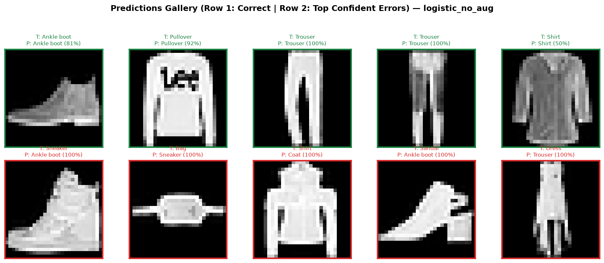 | 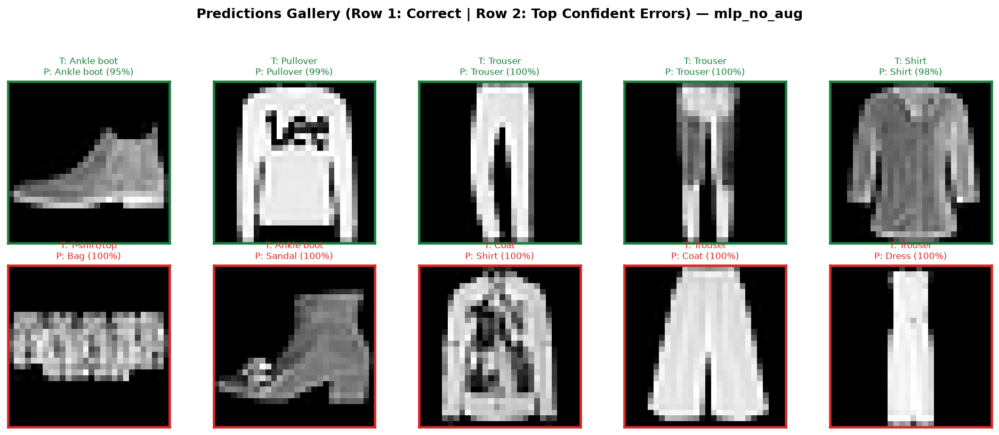 |

- **Quan sát (trong 5 mẫu sai hiển thị — Top Confident Errors)**:
  - Cả `Logistic no_aug` và `MLP no_aug` cũng đạt **softmax 100% ở cả 5/5 mẫu sai hiển thị** (riêng ở 5 mẫu đúng hàng trên, `Logistic` có confidence thấp hơn rõ ở 3 mẫu: 81%, 92%, 50%, so với `MLP` 95–100%).
  - **`Logistic no_aug`**: `Sneaker → Ankle boot`, `Bag → Sneaker` (mẫu túi đeo ngang lạ), `Shirt → Coat`, `Sandal → Ankle boot`, `Dress → Trouser` — lỗi tự tin cao rải trên nhiều nhóm.
  - **`MLP no_aug`**: `T-shirt/top → Bag`, `Ankle boot → Sandal`, `Coat → Shirt`, `Trouser → Coat` (quần ống rộng), `Trouser → Dress` (trùng mẫu quần hẹp với `CNN no_aug`) — cũng tập trung vào các ảnh dị biệt ở nhiều lớp, không chỉ riêng nhóm áo.
- **Lưu ý phạm vi**: Gallery lọc 5 *Top Confident Errors* mỗi mô hình nên chủ yếu phơi bày các mẫu outlier/mơ hồ cực đoan, chưa đại diện cho lỗi phổ biến nhất (`Shirt ↔ T-shirt/top`). Cần lấy mẫu ngẫu nhiên 20–50 ảnh sai thuộc cặp `Shirt ↔ T-shirt/top` nếu muốn kiểm chứng nguyên nhân nhầm lẫn ở nhóm áo.

### Bước 3: Từ nguyên nhân → hành động

| Quan sát                                    | Nguyên nhân                                 | Hướng sửa                                                                  |
| :------------------------------------------ | :------------------------------------------ | :------------------------------------------------------------------------- |
| Train acc cao, test thấp, sai ở class khó   | Overfit                                     | Dropout, weight decay, BatchNorm; augmentation (cần train lâu hơn để đánh giá — xem H2) |
| Cả train lẫn test đều thấp ở class áo       | Capacity không đủ (nếu train acc cũng thấp) | Tăng depth/width — chỉ khi regularization đã áp dụng mà train acc vẫn thấp |
| Ảnh 28×28 cũng khó phân biệt bằng mắt người | Có thể do label noise / giới hạn dữ liệu    | Chấp nhận trần accuracy, không ép                                          |

- **Phân tích thực tế** (so sánh tại best epoch — cùng checkpoint với test metrics):
  - Quy ước: gap acc = train − val (cùng chiều với gap loss = val − train; dương là overfit).
  - **CNN (no_aug)**: @best ep8: train_acc 94.36%, val_acc 92.04%, gap acc +2.32 điểm %. Overfit vừa phải. Từ epoch 8 val loss tăng ngược liên tục. Aug giúp val loss giảm đều đến ep16 nhưng test acc giảm 0.39 điểm %.
  - **MLP (no_aug)**: @best ep7: train_acc 90.79%, val_acc 89.54%, gap acc +1.25 điểm %. Overfit nhẹ tại best. Từ epoch 7 val loss tăng ngược. Aug ổn định val loss nhưng test acc giảm 2.68 điểm %.
  - **Logistic (no_aug)**: @best ep4: train_acc 85.06%, val_acc 85.30%, gap acc −0.24 điểm %. Hầu như không overfit. Aug làm test acc giảm 9.14 điểm %; nguyên nhân chưa kiểm chứng.
  - **Kết luận**: Augmentation giúp đường val loss ổn định hơn (không tăng ngược), nhưng trong 20 epoch không cải thiện test metrics cho bất kỳ kiến trúc nào.

## Vòng lặp cải tiến

```text
Train → Phân tích lỗi → Đặt giả thuyết → Sửa 1 thứ → Train lại → So với Baseline
```

> Chỉ sửa **một thứ mỗi lần**, nếu không không biết cái gì có tác dụng.

## Checklist phân tích lỗi

- [x] Per-class metrics (Precision/Recall/F1), không chỉ Accuracy tổng
- [x] Confusion Matrix: cặp class nào nhầm nhau nhất → Shirt ↔ T-shirt (152 mẫu)
- [x] Xem 20 mẫu sai tự tin nhất (5 mẫu × 4 gallery) bằng mắt → `predictions_gallery_*.png` *(lưu ý: chỉ là Top Confident Errors, chưa lấy mẫu ngẫu nhiên riêng cho cặp Shirt ↔ T-shirt/top)*
- [x] So train error vs val error để phân biệt overfit/underfit (learning curve riêng từng model)
- [x] Đánh giá tác động augmentation trên từng kiến trúc

## Hạn chế và kết luận

1. **Overfit tiềm ẩn ở CNN no_aug**: Nếu train tiếp quá epoch 8, val loss tăng ngược (0.22 → 0.41) trong khi train loss → 0.05 — dấu hiệu kinh điển của overfitting. Tuy nhiên, checkpoint `best.pt` được chọn theo `val_loss` thấp nhất (epoch 8, gap +0.067) — thực chất đã là **early stopping**. Hướng cải thiện nếu muốn train lâu hơn: áp dụng regularization (dropout, weight decay, BatchNorm) trước khi tăng depth/width. Tăng depth/width chỉ cân nhắc khi có bằng chứng mô hình thiếu capacity (cả train lẫn val đều thấp).
2. **Augmentation không cải thiện test metrics ở cả 3 kiến trúc**: CNN đủ capacity (train acc 98%) mà aug vẫn không giảm test loss, Logistic bị hại nặng (−9.14 điểm %). Nguyên nhân chưa kiểm chứng; các giả thuyết khả dĩ: với `MLP aug` và `CNN aug`, 20 epoch có thể chưa đủ (train loss vẫn giảm chậm đến epoch 20); với `Logistic aug`, mô hình đã hội tụ (train loss phẳng từ epoch 2) nên nghiêng về mô hình tuyến tính không tận dụng được aug hoặc distribution shift do flip/affine. Ngoài ra augmentation policy có thể chưa phù hợp, hoặc 55k mẫu đã đủ để aug không thêm thông tin mới.
3. **Giả thuyết về trần accuracy**: Ảnh 28×28 mờ, `Shirt` và `T-shirt` gần như giống nhau → một phần lỗi có thể đến từ label noise hoặc giới hạn vật lý của dữ liệu, nhưng chưa kiểm chứng (cần đánh giá inter-annotator agreement hoặc test trên ảnh phân giải cao hơn).
4. **Latency inference không đáng tin**: Cùng kiến trúc mà aug/no_aug chênh 25–46% (CNN: 1.51 vs 2.21 ms), dù augmentation chỉ áp dụng lúc training và không ảnh hưởng forward pass. Điều này cho thấy phép đo bị chi phối bởi nhiễu hệ thống (GPU warmup, system load) chứ không phản ánh sự khác biệt kiến trúc thực sự. Cột `Infer Latency` trong bảng metric chỉ mang tính tham khảo.

---

# References

1. **Official API Docs**: [PyTorch `torch.nn`](https://pytorch.org/docs/stable/nn.html), [PyTorch `DataLoader`](https://pytorch.org/docs/stable/data.html), [Torchvision `FashionMNIST` & `transforms`](https://pytorch.org/vision/stable/datasets.html#fashion-mnist).
2. **Technical Standards**: [`docs/references/ML_PIPELINE.md`](../../../../docs/references/ML_PIPELINE.md), [`docs/references/DL_PIPELINE.md`](../../../../docs/references/DL_PIPELINE.md).
3. **CV/DL Conventions**: [`.agents/rules/AI_REFERENCE.md`](../../../../.agents/rules/AI_REFERENCE.md), [`.agents/rules/TESTING_STRATEGY.md`](../../../../.agents/rules/TESTING_STRATEGY.md).
4. **Internal Architecture Links**: [`labs/lab1/vibe/config.py`](../config.py), [`labs/lab1/vibe/lab1.ipynb`](../lab1.ipynb), [`labs/lab1/vibe/docs/pipelines/README.md`](./pipelines/README.md), [`logs/errors/0001.md`](../../../../logs/errors/0001.md).

---

## Lịch sử thay đổi

| Version | Ngày       | Người sửa | Agent       | Mô tả thay đổi                                                                                                                                                               |
| :------ | :--------- | :-------- | :---------- | :--------------------------------------------------------------------------------------------------------------------------------------------------------------------------- |
| 0.11.0 | 2026-11-20 | notworLe | Antigravity | Đối chiếu trực tiếp 4 ảnh predictions_gallery (sửa mô tả sai thực tế trước đó), dẫn nguồn 44.08% từ per_class_metrics.json, thêm cột đối chiếu Recall thực tế ở Bước 1, thêm "có thể" cho Dress/Ankle boot, tách H2 khỏi căn cứ EDA |
| 0.10.0 | 2026-11-20 | notworLe | Antigravity | Sửa số liệu (Shirt recall 458/1000, CNN aug đổi kiểu lỗi 49→108), tách giả thuyết "chưa đủ epoch" theo từng mô hình, đổi quy ước gap acc = train − val, thống nhất "điểm %", ghi chú post-hoc cho H2/H3 |
| 0.9.0   | 2026-11-20 | notworLe  | Antigravity | Sửa hướng cải thiện: overfit → regularization trước (dropout, weight decay, BatchNorm, early stopping), không khuyến nghị tăng depth/width khi chưa kiểm soát overfit        |
| 0.8.0   | 2026-11-20 | notworLe  | Antigravity | Sửa gap đo sai điểm: chuyển toàn bộ metrics sang @best epoch (cùng checkpoint với test), bỏ so train_acc epoch 20 với test_acc epoch 8                                       |
| 0.7.0   | 2026-11-20 | notworLe  | Antigravity | Sửa lỗi khái niệm: gap âm là artifact (train đo trên ảnh aug khó hơn), không phải bằng chứng hết overfit; bỏ nhãn "underfit" sai; loại mâu thuẫn "chưa hội tụ" vs "underfit" |
| 0.6.0   | 2026-11-20 | notworLe  | Antigravity | Tách giả thuyết H1–H3: tuyên bố trước train (Define → Hypotheses), cơ sở từ EDA, kiểm chứng bằng bảng formal (H2 bác bỏ)                                                     |
| 0.5.0   | 2026-11-20 | notworLe  | Antigravity | Embed toàn bộ ảnh Confusion Matrix (CNN, Logistic, MLP) và Predictions Gallery vào Error Analysis với phân tích trực quan                                                    |
| 0.4.0   | 2026-11-20 | notworLe  | Antigravity | Điền toàn bộ số liệu thực nghiệm, phân tích lỗi 3 bước, kiểm tra giả thuyết H1–H3, checklist hoàn tất                                                                        |
| 0.3.0   | 2026-11-20 | notworLe  | Antigravity | Bổ sung mục Evaluate chi tiết (learning curve riêng từng model, nguyên tắc) và Error Analysis 3 bước theo DL_PIPELINE.md                                                     |
| 0.2.0   | 2026-11-18 | notworLe  | Antigravity | Làm mới REPORT.md rõ luồng 5 pipeline, tích hợp thông số EDA thật và đặt `[TBD]` cho số liệu train/eval                                                                      |
| 0.1.0   | 2026-11-17 | notworLe  | —           | Bản phác thảo khung kim chỉ nam ban đầu                                                                                                                                      |
