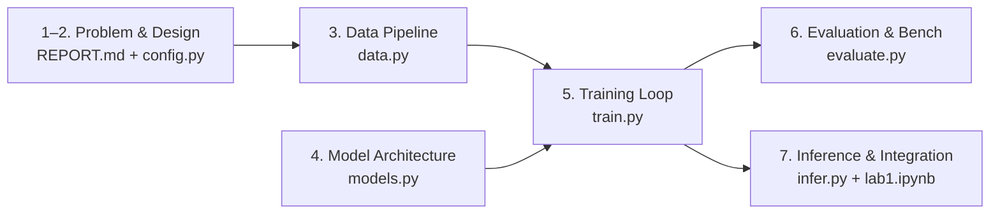

# Phân Tích Đặc Trưng Deep Learning Pipeline — Lab 1 (Fashion-MNIST)

Tài liệu phân tích đặc trưng từng giai đoạn (pipe) trong luồng Deep Learning cho bài toán phân loại **Fashion-MNIST**, tham chiếu vòng đời [`AI_FIRST_LIFECYCLE.md`](../../../../../.agents/rules/AI_FIRST_LIFECYCLE.md) và kim chỉ nam [`REPORT.md`](../REPORT.md). Toàn bộ siêu tham số override từ [`src/config.py`](../../../../../src/config.py) được quản lý tập trung tại [`labs/lab1/vibe/config.py`](../../config.py).

---

## 1. Luồng Tiến Trình Theo `AI_FIRST_LIFECYCLE.md`

---

## 2. Ma Trận Phân Tích Đặc Trưng Từng Pipe

| Pipe | Pha `AI_FIRST_LIFECYCLE.md` | Đặc trưng cốt lõi của Pipe | Bài toán đặc thù trên Fashion-MNIST | File đặc tả chi tiết |
| :---: | :--- | :--- | :--- | :--- |
| `01` | **3. Data Pipeline** | Xác thực `manifest.json`, chia tầng không rò rỉ, Z-Score fit trên Train, tách 2 nhánh transform | Nền đen chiếm `50.21%`, phân bố lệch phải; nhóm thân trên dễ lệch nếu xoay quá mạnh hoặc lật dọc | [`01_DATA_PREPARATION.md`](./01_DATA_PREPARATION.md) |
| `02` | **4. Model Architecture** | Tách rời định nghĩa kiến trúc, hợp đồng shape `[B, 1, 28, 28] → [B, 10]`, kiểm soát dung lượng tham số | Cô lập vai trò cấu trúc 2D (`CNN` `105.866` vs `MLP` `109.386`) trên nền mốc `Logistic` (`7.850`) | [`02_MODEL_ARCHITECTURE.md`](./02_MODEL_ARCHITECTURE.md) |
| `03` | **5. Training Loop** | Vòng lặp 5 bước chuẩn PyTorch, Sanity check, khóa seed tái lập, checkpoint nguyên tử | `LR=1e-3` cho `Adam` ổn định từ đầu thay vì `1e-5`; chặn rò rỉ VRAM và cách ly `test_loader` | [`03_TRAINING.md`](./03_TRAINING.md) |
| `04` | **6. Evaluation & Bench** | Đánh giá 1 lần duy nhất trên Test, kiểm chứng Save/Load, Confusion Matrix & Error Gallery | Đo mức chồng lấn ở cụm trang phục thân trên (`Shirt`, `T-shirt/top`, `Pullover`, `Coat`) | [`04_EVALUATION_BENCHMARK.md`](./04_EVALUATION_BENCHMARK.md) |
| `05` | **7. Full Integration / Infer** | Suy luận `@torch.inference_mode()`, đồng bộ `norm_stats` từ checkpoint, benchmark latency | Đảm bảo không training-serving skew khi suy luận cả ảnh Test lẫn ảnh RGB ngoài | [`05_INFERENCE_SERVING.md`](./05_INFERENCE_SERVING.md) |

---

## Lịch sử thay đổi

| Version | Ngày | Người sửa | Agent | Mô tả thay đổi |
| :--- | :--- | :--- | :--- | :--- |
| 0.3.0 | 2026-11-19 | notworLe | Antigravity | Viết lại hoàn toàn theo `AI_FIRST_LIFECYCLE.md`, bỏ khung prompt mẫu |
| 0.2.0 | 2026-11-18 | notworLe | Antigravity | Đồng bộ cấu hình override `labs/lab1/vibe/config.py` |
