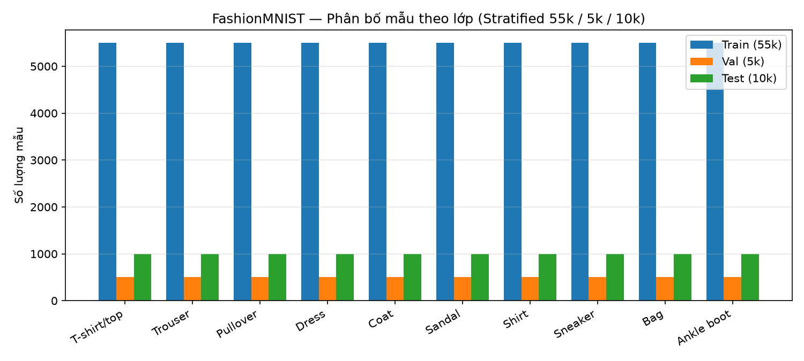
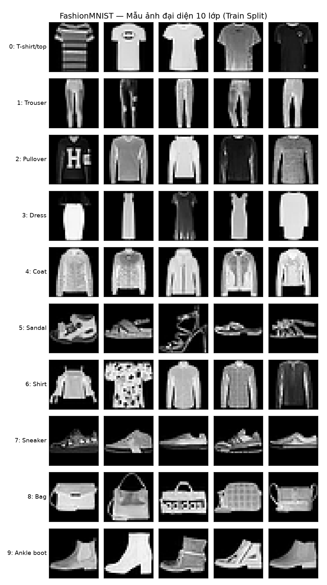
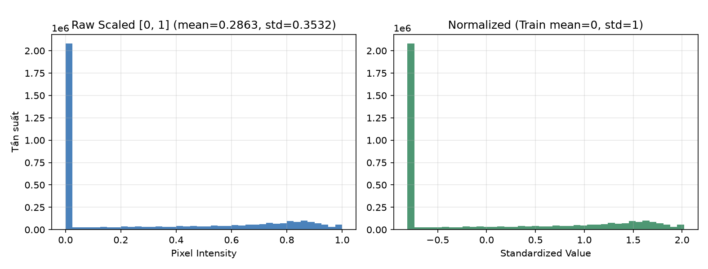
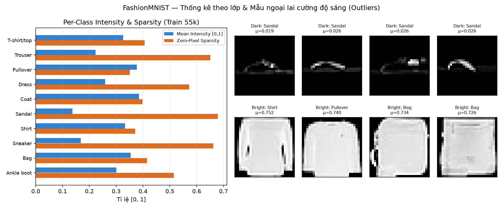
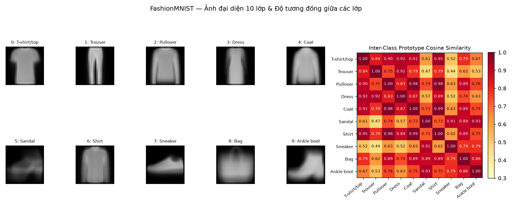

# Data Engineering Report: Collection, Cleaning & EDA (`FashionMNIST`)

> **Nguồn sinh tự động:** `python labs/lab1_v2/prepare_data.py` · **Artifacts:** `experiments/lab1_v2/eda/` · **Pipeline Spec:** [`pipelines/modeling.md`](pipelines/modeling.md)

---

## 1. Data Collection Audit (`6.1`)

- **Dataset:** `torchvision.datasets.FashionMNIST` (`source_uri`: `http://fashion-mnist.s3-website.eu-central-1.amazonaws.com/`, thu thập `2026-11-15T19:13:57+07:00`).
- **Quy mô dữ liệu thô:** `70,000` mẫu (`60,000` raw train + `10,000` raw test), tensor gốc `(N, 28, 28)` dtype `torch.uint8`.
- **Xác thực toàn vẹn `manifest.json`:** **PASS (`8/8` files khớp SHA-256, `0` mismatches)**:

| File | Kích thước (bytes) | Bản ghi | SHA-256 (12 ký tự đầu) | Trạng thái |
| :--- | :---: | :---: | :--- | :---: |
| `train-images-idx3-ubyte.gz` | 26,421,880 | 60,000 | `3aede38d6186` | PASS |
| `train-labels-idx1-ubyte.gz` | 29,515 | 60,000 | `a04f17134ac0` | PASS |
| `t10k-images-idx3-ubyte.gz` | 4,422,102 | 10,000 | `346e55b948d9` | PASS |
| `t10k-labels-idx1-ubyte.gz` | 5,148 | 10,000 | `67da17c76eaf` | PASS |
| `train-images-idx3-ubyte` | 47,040,016 | 60,000 | `c59f468a2f67` | PASS |
| `train-labels-idx1-ubyte` | 60,008 | 60,000 | `bad3541b69d9` | PASS |
| `t10k-images-idx3-ubyte` | 7,840,016 | 10,000 | `5b4141f0afba` | PASS |
| `t10k-labels-idx1-ubyte` | 10,008 | 10,000 | `0402a96d92fd` | PASS |

---

## 2. Data Cleaning Audit (`6.2`)

Quét 100% (`70,000` ảnh) sau khi chia tầng Stratified (`seed = 248`) thành `55,000` Train / `5,000` Val / `10,000` Test:

| Tiêu chí kiểm toán | Train (55k) | Val (5k) | Test (10k) | Kết luận |
| :--- | :---: | :---: | :---: | :--- |
| Hợp lệ shape `(28, 28)` & hữu hạn (`finite`) | `True` | `True` | `True` | Sạch 100% |
| Pixel ngoài `[0, 255]` / Nhãn ngoài `{0..9}` | `0 / 0` | `0 / 0` | `0 / 0` | Không có dữ liệu lỗi |
| Ảnh trống (`all-zero`) / Ảnh hằng số (`std=0`) | `0 / 0` | `0 / 0` | `0 / 0` | Không có ảnh rỗng |
| Số ảnh duy nhất (SHA-256 trên 784 bytes) | `55,000` | `5,000` | `10,000` | `0` trùng lặp nội bộ |
| Trùng lặp chéo split (`Train ↔ Val`, `Train_raw ↔ Test`) | — | `0` | `0` | Không có exact-duplicate leakage |
| Trùng ảnh nhưng mâu thuẫn nhãn | `0` nhóm | — | — | Không có exact label conflict |

- **Quyết định Cleaning:** Không cần loại bỏ mẫu nào; giữ nguyên toàn bộ tập `55,000 / 5,000 / 10,000` để bảo đảm tính tái lập và so sánh công bằng.

---

## 3. Exploratory Data Analysis (`6.3`)

### 3.1 Phân bố lớp & Cân bằng dữ liệu
- **Imbalance Ratio:** `1.00` (cân bằng tuyệt đối: đúng `5,500` Train / `500` Val / `1,000` Test cho từng lớp trong 10 lớp).
- **Hệ quả Modeling:** Không cần áp class weights hay oversampling; `CrossEntropyLoss` chuẩn cùng hai metric `Accuracy` và `Macro-F1` hoàn toàn nhất quán.

### 3.2 Thống kê Pixel & Chuẩn hóa chống Leakage (Fit chỉ trên 55k Train)
- **Thống kê toàn cục trên 55k Train (thang `[0, 1]`):** `mean = 0.2863`, `std = 0.3532`, `min = 0.0`, `max = 1.0`, **tỉ lệ pixel nền (`== 0`, sparsity) = `50.20%`**.
- **Chênh lệch mật độ giữa các nhóm lớp:**
  - Nhóm đặc & sáng nhất: `Coat` (`mean = 0.3854`, sparsity `39.80%`), `Pullover` (`0.3768`, `35.10%`), `Bag` (`0.3538`, `41.45%`).
  - Nhóm mảnh & thưa nhất: `Sandal` (`mean = 0.1366`, sparsity `67.89%`), `Sneaker` (`0.1678`, `66.22%`), `Trouser` (`0.2230`, `65.12%`).

| Lớp | Mean Intensity `[0,1]` | Std Intensity | Zero-Pixel Sparsity (%) |
| :--- | :---: | :---: | :---: |
| `0: T-shirt/top` | `0.3260` | `0.3511` | `40.61%` |
| `1: Trouser` | `0.2230` | `0.3436` | `65.12%` |
| `2: Pullover` | `0.3768` | `0.3589` | `35.10%` |
| `3: Dress` | `0.2591` | `0.3546` | `57.24%` |
| `4: Coat` | `0.3854` | `0.3763` | `39.80%` |
| `5: Sandal` | `0.1366` | `0.2630` | `67.89%` |
| `6: Shirt` | `0.3330` | `0.3399` | `37.06%` |
| `7: Sneaker` | `0.1678` | `0.2949` | `66.22%` |
| `8: Bag` | `0.3538` | `0.3655` | `41.45%` |
| `9: Ankle boot` | `0.3014` | `0.3705` | `51.52%` |

### 3.3 Phân tích Outliers (IQR trên cường độ trung bình từng ảnh)
- `Q1 = 0.1858`, `Q3 = 0.3823`, `IQR = 0.1965`, `high_fence = 0.6771`.
- **Low-intensity outliers:** `0` (`min_image_mean = 0.0194` — các mẫu `Sandal` quai mảnh).
- **High-intensity outliers:** `23` mẫu (`0.042%` của Train, `max_image_mean = 0.7522` — trang phục/túi xách chiếm diện tích khung lớn, là ảnh thật hợp lệ nên giữ lại).

### 3.4 Độ Tương Đồng Liên Lớp (Class Prototypes & Cosine Similarity)

Top 5 cặp lớp có ảnh đại diện trung bình (mean prototype) gần nhau nhất trên không gian `784` pixel phẳng:

| Hạng | Cặp lớp | Prototype Cosine Similarity | Hàm ý cho Modeling & Error Analysis |
| :---: | :--- | :---: | :--- |
| 1 | `Coat` ↔ `Shirt` | **`0.9872`** | Rất khó tách bằng siêu phẳng tuyến tính đơn lẻ |
| 2 | `Pullover` ↔ `Coat` | **`0.9842`** | Trùng lặp hình dáng thân & tay áo dài |
| 3 | `Pullover` ↔ `Shirt` | **`0.9832`** | Cụm nhầm lẫn chính `{Coat, Pullover, Shirt}` |
| 4 | `T-shirt/top` ↔ `Shirt` | **`0.9487`** | Phân biệt chủ yếu nhờ chi tiết cổ/tay áo |
| 5 | `Sandal` ↔ `Ankle boot` | **`0.9269`** | Khác biệt ở vùng cổ giày & độ đặc pixel |

### 3.5 Giả Thuyết Rút Ra Từ EDA Trước Khi Huấn Luyện
1. **Lợi thế chuẩn hóa:** Tập dữ liệu có độ thưa `50.20%` và thang pixel lệch về gần `0` (`mean = 0.2863`) → chuẩn hóa bằng `(mean=0.2863, std=0.3532)` fit từ Train giúp gradient ổn định hơn cho cả Logistic Regression lẫn MLP.
2. **Điểm nghẽn dự báo của Baseline:** Vì 4 lớp áo (`Coat`, `Pullover`, `Shirt`, `T-shirt/top`) có prototype cosine similarity từ **`0.949` đến `0.987`**, `LogisticRegressionModel` (chỉ có 1 template tuyến tính/lớp) sẽ tập trung phần lớn lỗi ở cụm này — kỳ vọng `MLPModel` tạo **gap cải thiện F1 lớn nhất** chính tại cụm áo nhờ các tầng ẩn phi tuyến.
