# Evaluation & Error Analysis Report: Model Selection (`Val 5k`), Final Test (`10k`) & Inference

> **Phạm vi tài liệu (Layer 8 → Layer 9 → Layer 10):** Tài liệu này tập trung trọn vẹn toàn bộ hoạt động **Đánh giá & Chọn mô hình trên Validation (`5,000` mẫu — Layer 8.1–8.2)**, **Đánh giá chung kết trên tập Test độc lập (`10,000` mẫu — Layer 8.3)**, **Error Analysis (Layer 9)** và **Kiểm chứng Inference (Layer 10)**.
>
> - Thiết kế chuỗi `12+1` runs, Sanity Checks và chẩn đoán quá trình huấn luyện (Training Diagnostics) nằm riêng tại **[`experiment_report.md`](experiment_report.md)**.
> - Kiểm toán dữ liệu & dự báo cụm lớp khó từ EDA xem tại **[`eda_report.md`](eda_report.md)**.
> - Đặc tả tiêu chí đánh giá & quy tắc chọn mô hình xem tại **[`pipelines/modeling.md` §8.1](pipelines/modeling.md#L220-L233)**.

---

## 1. Tóm Tắt Đánh Giá (Executive Summary)

- **Kỷ luật chống Data Leakage:** Chia Stratified cố định `55k` Train / `5k` Val / `10k` Test (`seed = 248`); `NormStats(mean = 0.2863, std = 0.3532)` fit duy nhất trên 55k Train. Toàn bộ `12` runs ablation + `1` run resume (`mlp_opt_sgd_ep40`) được so sánh và chọn winner hoàn toàn trên **Val (5k)**; **tập Test (10k) chỉ mở duy nhất 1 lần cuối** cho 2 mô hình chung kết.
- **Kết quả chọn mô hình trên Validation (`5,000` mẫu — Layer 8.2):** **`mlp_default`** thắng cuộc theo quy tắc `(val_macro_f1, val_acc, -val_loss)` với **`Val Macro-F1 = 89.62%`**, **`Val Acc = 89.74%`**, `Val Loss = 0.2955` (`best_ep = 14`).
- **Kết quả chung kết trên tập Test độc lập (`10,000` mẫu — Layer 8.3):**
  - **Baseline (`baseline_logistic`, `7,850` params):** `Test Loss = 0.4473` · `Test Acc = 84.35%` · `Macro-F1 = 84.21%`.
  - **Best MLP (`mlp_default`, `[256, 128]`, `235,146` params):** `Test Loss = 0.3362` · `Test Acc = 88.79%` · `Macro-F1 = 88.68%`.
  - **Gap cải thiện (`MLP − Baseline`):** **`+4.44 pp` Accuracy**, **`+4.47 pp` Macro-F1**, **`-0.1110` Test Loss** — cải thiện dương trên **10/10 lớp**, mạnh nhất đúng vào cụm áo khó mà EDA đã dự báo (`Shirt +9.59 pp`, `Coat +8.22 pp`, `Pullover +7.46 pp`).
  - **Kiểm chứng suy luận (`mlp_default/best.pt`, `922.2 KB`, GPU RTX 4060):** Save/Load Parity `max_abs_diff = 0.0` (`PASS`), độ trễ `0.396 ms/ảnh` (`BS=1`, p95 `0.641 ms`) và `0.012 ms/ảnh` (`BS=32`).

---

## 2. Đánh Giá Chuỗi Thí Nghiệm & Chọn Mô Hình Trên Validation (`5,000` mẫu — Layer 8.1–8.2)

### 2.1 Quy tắc đánh giá & chọn mô hình

Áp dụng đúng quy tắc 2 tầng tại [`pipelines/modeling.md` §8.1](pipelines/modeling.md#L220-L233) (cài đặt tại `src/vibe_scripts/lab1_v2/trainer.py`):

1. **Trong nội bộ 1 run (`best.pt`):** chọn epoch có `min(val_loss)` để chặn overfitting/overconfidence.
2. **Giữa các runs (`winning_mlp_run_id`):** xếp hạng trên Validation (`5,000` mẫu) theo thứ tự ưu tiên **`(val_macro_f1, val_acc, -val_loss)`** — ưu tiên `Macro-F1` để đảm bảo phân loại tốt đồng đều cả 10 lớp (không bỏ rơi lớp khó `Shirt`), kế đến `Accuracy` trên dữ liệu cân bằng (`imbalance_ratio = 1.00`), và dùng `val_loss` làm tiêu chí phá hòa (tie-breaker).

### 2.2 Bảng đánh giá toàn bộ `12` runs chính + `1` run resume trên Validation (`5,000` mẫu)

- **Artifacts đánh giá Val:** [`ablation_summary.json`](../../../experiments/lab1_v2/ablation/ablation_summary.json) · [`ablation_table.csv`](../../../experiments/lab1_v2/ablation/ablation_table.csv) · `runs/<run_id>/eval/eval_metrics.json` (`12/12` runs chính + [`mlp_opt_sgd_ep40/eval/eval_metrics.json`](../../../experiments/lab1_v2/runs/mlp_opt_sgd_ep40/eval/eval_metrics.json)).
- **Trạng thái chuỗi chính:** `completed_runs = 12/12` (`stopped_early = false`, `stop_reason = completed_all_planned_runs`).

| Run ID                        | Trục thay đổi           | Params  | Best Ep | Val Macro-F1 (%) _(Ưu tiên 1)_ | Val Acc (%) _(Ưu tiên 2)_ | Val Loss _(Ưu tiên 3)_ | Save/Load Parity |                                `eval_metrics.json`                                 |
| :---------------------------- | :---------------------- | :-----: | :-----: | :----------------------------: | :-----------------------: | :--------------------: | :--------------: | :--------------------------------------------------------------------------------: |
| `baseline_logistic`           | Baseline                |  7,850  |   11    |            `85.49`             |          `85.58`          |        `0.4241`        |   `0.0` (PASS)   | [link](../../../experiments/lab1_v2/runs/baseline_logistic/eval/eval_metrics.json) |
| **`mlp_default`**             | **Anchor `[256, 128]`** | 235,146 |   14    |          **`89.62`**           |        **`89.74`**        |        `0.2955`        |   `0.0` (PASS)   |    [link](../../../experiments/lab1_v2/runs/mlp_default/eval/eval_metrics.json)    |
| `mlp_bs256`                   | Batch 256               | 235,146 |   12    |            `89.51`             |          `89.46`          |        `0.2887`        |   `0.0` (PASS)   |     [link](../../../experiments/lab1_v2/runs/mlp_bs256/eval/eval_metrics.json)     |
| `mlp_h512_256_128`            | Hidden `[512,256,128]`  | 567,434 |   14    |            `89.35`             |          `89.40`          |        `0.3078`        |   `0.0` (PASS)   | [link](../../../experiments/lab1_v2/runs/mlp_h512_256_128/eval/eval_metrics.json)  |
| `mlp_opt_sgd_ep40` _(resume)_ | SGD(`m=0.9`), 40 ep     | 235,146 |   40    |            `89.34`             |          `89.34`          |      **`0.2862`**      |   `0.0` (PASS)   | [link](../../../experiments/lab1_v2/runs/mlp_opt_sgd_ep40/eval/eval_metrics.json)  |
| `mlp_lr1e4`                   | LR `1e-4`               | 235,146 |   18    |            `89.07`             |          `89.02`          |        `0.2866`        |   `0.0` (PASS)   |     [link](../../../experiments/lab1_v2/runs/mlp_lr1e4/eval/eval_metrics.json)     |
| `mlp_bs32`                    | Batch 32                | 235,146 |   12    |            `88.72`             |          `88.80`          |        `0.3022`        |   `0.0` (PASS)   |     [link](../../../experiments/lab1_v2/runs/mlp_bs32/eval/eval_metrics.json)      |
| `mlp_ep30`                    | Epoch 30                | 235,146 |    8    |            `88.71`             |          `88.70`          |        `0.3043`        |   `0.0` (PASS)   |     [link](../../../experiments/lab1_v2/runs/mlp_ep30/eval/eval_metrics.json)      |
| `mlp_h128`                    | Hidden `[128]`          | 101,770 |   10    |            `88.70`             |          `88.76`          |        `0.3040`        |   `0.0` (PASS)   |     [link](../../../experiments/lab1_v2/runs/mlp_h128/eval/eval_metrics.json)      |
| `mlp_opt_adamw`               | AdamW(`wd=1e-2`)        | 235,146 |    9    |            `88.68`             |          `88.76`          |        `0.2958`        |   `0.0` (PASS)   |   [link](../../../experiments/lab1_v2/runs/mlp_opt_adamw/eval/eval_metrics.json)   |
| `mlp_ep10`                    | Epoch 10                | 235,146 |   10    |            `88.60`             |          `88.54`          |        `0.3130`        |   `0.0` (PASS)   |     [link](../../../experiments/lab1_v2/runs/mlp_ep10/eval/eval_metrics.json)      |
| `mlp_opt_sgd`                 | SGD(`m=0.9`), 20 ep     | 235,146 |   20    |            `88.00`             |          `88.02`          |        `0.3204`        |   `0.0` (PASS)   |    [link](../../../experiments/lab1_v2/runs/mlp_opt_sgd/eval/eval_metrics.json)    |
| `mlp_lr1e2`                   | LR `1e-2`               | 235,146 |   19    |            `83.87`             |          `83.80`          |        `0.4687`        |   `0.0` (PASS)   |     [link](../../../experiments/lab1_v2/runs/mlp_lr1e2/eval/eval_metrics.json)     |

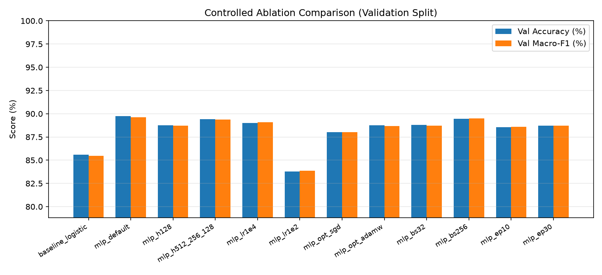

### 2.3 Quyết định chọn `mlp_default` (so sánh trực diện với `mlp_opt_sgd_ep40`)

| Cấu hình (Val `5,000` mẫu)          | Val Macro-F1 (%) | Val Acc (%) | Tổng lỗi Val |   Val Loss   | `Shirt` F1 (%) | Lỗi nội bộ 4 lớp áo / Tổng lỗi Val |
| :---------------------------------- | :--------------: | :---------: | :----------: | :----------: | :------------: | :--------------------------------: |
| **`mlp_default`** _(chốt finalist)_ |   **`89.62`**    | **`89.74`** |  **`513`**   |   `0.2955`   |    `72.26`     |       `332 / 513` (`64.7%`)        |
| `mlp_opt_sgd_ep40` _(resume 40 ep)_ |     `89.34`      |   `89.34`   |    `533`     | **`0.2862`** |  **`72.85`**   |       `337 / 533` (`63.2%`)        |
| `mlp_opt_sgd` _(gốc 20 ep)_         |     `88.00`      |   `88.02`   |    `599`     |   `0.3204`   |    `69.22`     |       `370 / 599` (`61.8%`)        |

- **Lý do giữ `mlp_default` thay vì `mlp_opt_sgd_ep40`:**
  1. Theo quy tắc xếp hạng `(val_macro_f1, val_acc, -val_loss)` ở §2.1, **`mlp_default` thắng ở cả 2 chỉ số phân loại chính** (`+0.28 pp` Val Macro-F1 và `+0.40 pp` Val Acc — đoán đúng nhiều hơn `20` mẫu trên tập Val).
  2. Mức `val_loss` thấp hơn nhẹ của `mlp_opt_sgd_ep40` (`0.2862` vs `0.2955`, `-0.0093`) phản ánh xác suất hiệu chuẩn mượt hơn chứ không cải thiện số mẫu phân loại đúng sau `argmax`, và cũng không phá vỡ được cụm lỗi 4 lớp áo (`337 / 533 = 63.2%`, 8/8 cặp nhầm lớn nhất vẫn nằm trọn trong `{Shirt, T-shirt/top, Pullover, Coat}`).
  3. Giữ nguyên `mlp_default` làm finalist duy nhất để **không mở lại tập Test (`10k`)** (chống _test-set selection bias_). Riêng `baseline_logistic` cũng không cần chạy lên 40 ep vì đã đạt đáy ở epoch 11 và overfit từ epoch `12 → 20` ([`experiment_report.md` §3.2.1](experiment_report.md#321-baseline_logistic-7850-params-adam-1e-3-bs-64-20-ep)).

---

## 3. Đánh Giá Cuối Trên Tập Test Độc Lập (`10,000` mẫu — Layer 8.3, Chấm 1 Lần Duy Nhất)

### 3.1 So sánh tổng thể (`Baseline` vs `Best MLP`)

| Model                             | Run ID              |   Params   |   Test Loss   | Test Accuracy (%) | Test Macro-F1 (%) | Save/Load Max Diff |
| :-------------------------------- | :------------------ | :--------: | :-----------: | :---------------: | :---------------: | :----------------: |
| Logistic Regression (Baseline)    | `baseline_logistic` |   7,850    |   `0.4473`    |      `84.35`      |      `84.21`      |    `0.0` (PASS)    |
| **Best MLP** _(chốt từ Val §2)_   | **`mlp_default`**   |  235,146   | **`0.3362`**  |    **`88.79`**    |    **`88.68`**    |  **`0.0` (PASS)**  |
| **Chênh lệch (`MLP − Baseline`)** | —                   | `+227,296` | **`-0.1110`** |  **`+4.44 pp`**   |  **`+4.47 pp`**   |         —          |

- **Artifacts đánh giá Test:** [`test_comparison.json`](../../../experiments/lab1_v2/evaluation/test_comparison.json) · [`test_comparison.csv`](../../../experiments/lab1_v2/evaluation/test_comparison.csv) · [`per_class_metrics.json`](../../../experiments/lab1_v2/evaluation/per_class_metrics.json) · [`baseline_logistic/test_eval`](../../../experiments/lab1_v2/runs/baseline_logistic/test_eval/eval_metrics.json) · [`mlp_default/test_eval`](../../../experiments/lab1_v2/runs/mlp_default/test_eval/eval_metrics.json)

### 3.2 So sánh F1 từng lớp trên Test (`1,000` mẫu / lớp)

| Lớp                         | Baseline F1 (%) | Best MLP F1 (%) | F1 Gain (`MLP − Baseline`) |
| :-------------------------- | :-------------: | :-------------: | :------------------------: |
| **`6: Shirt`** _(khó nhất)_ |     `59.69`     |     `69.28`     |       **`+9.59 pp`**       |
| **`4: Coat`**               |     `73.46`     |     `81.68`     |       **`+8.22 pp`**       |
| **`2: Pullover`**           |     `73.24`     |     `80.69`     |       **`+7.46 pp`**       |
| `8: Bag`                    |     `93.33`     |     `97.35`     |         `+4.01 pp`         |
| `3: Dress`                  |     `85.47`     |     `89.47`     |         `+4.00 pp`         |
| `5: Sandal`                 |     `92.63`     |     `96.18`     |         `+3.55 pp`         |
| `7: Sneaker`                |     `91.90`     |     `94.61`     |         `+2.71 pp`         |
| `0: T-shirt/top`            |     `81.50`     |     `83.85`     |         `+2.35 pp`         |
| `9: Ankle boot`             |     `94.24`     |     `95.76`     |         `+1.52 pp`         |
| `1: Trouser`                |     `96.67`     |     `97.95`     |         `+1.28 pp`         |

### 3.3 Biểu đồ đối chiếu Finalists

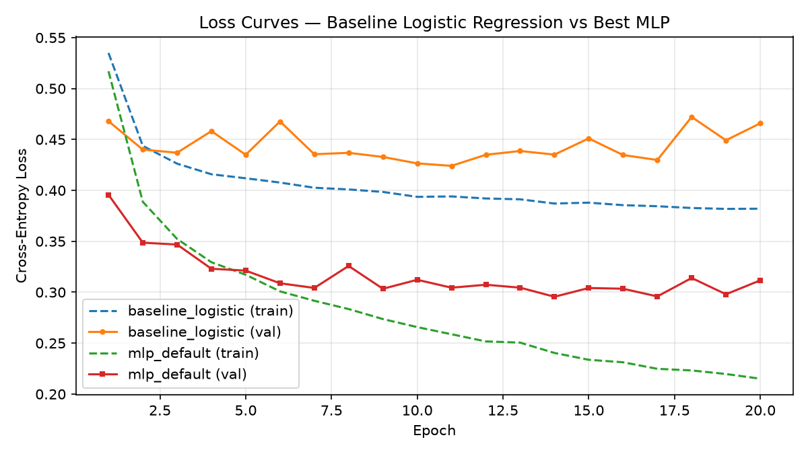

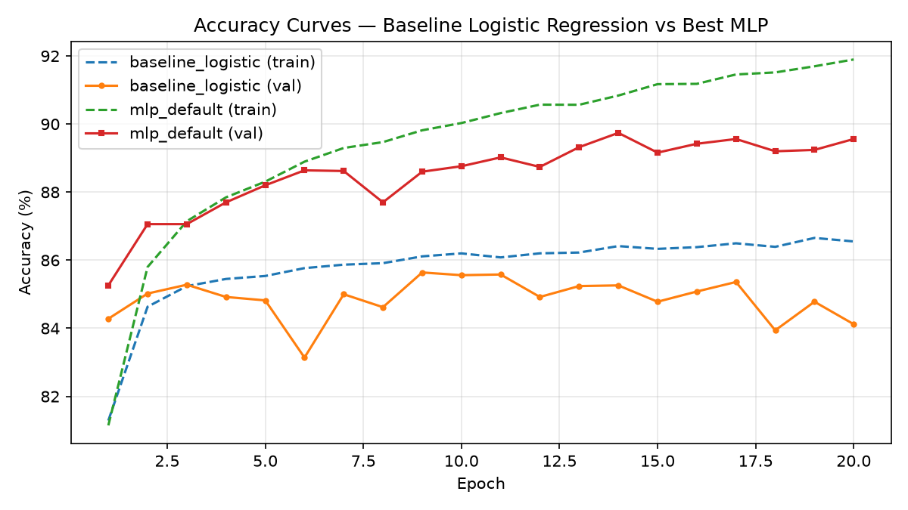

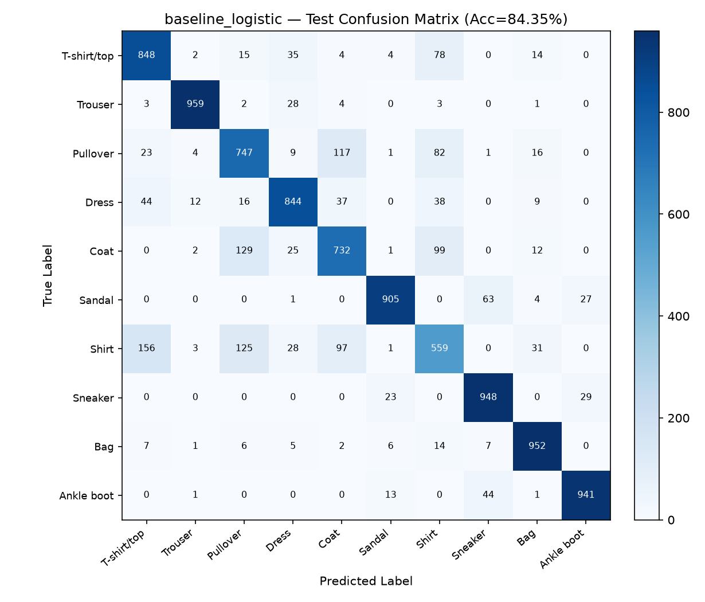

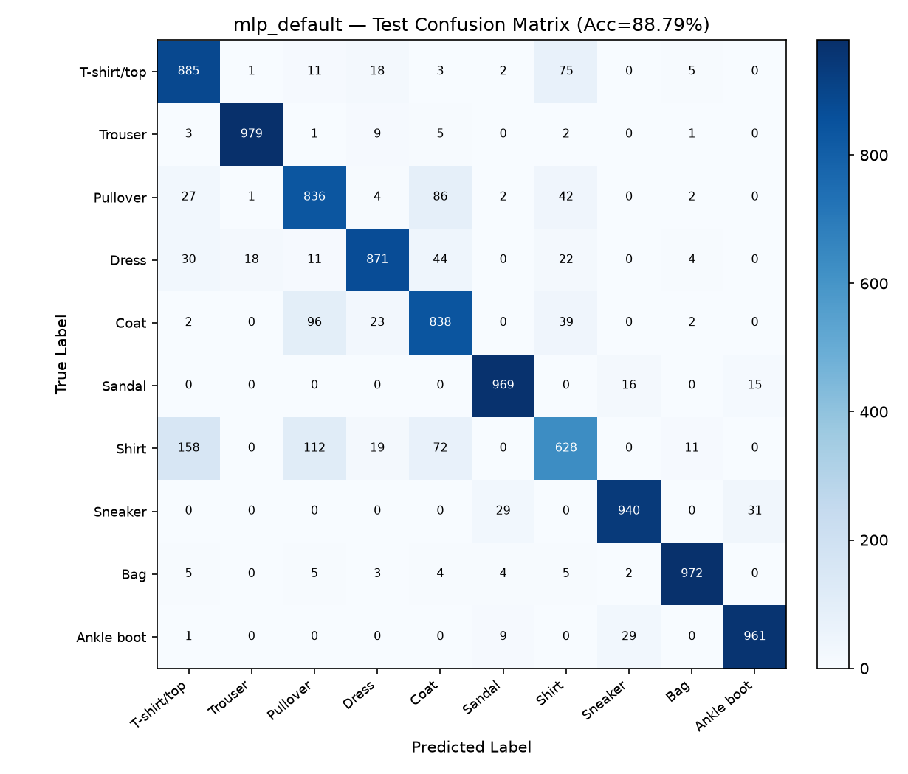

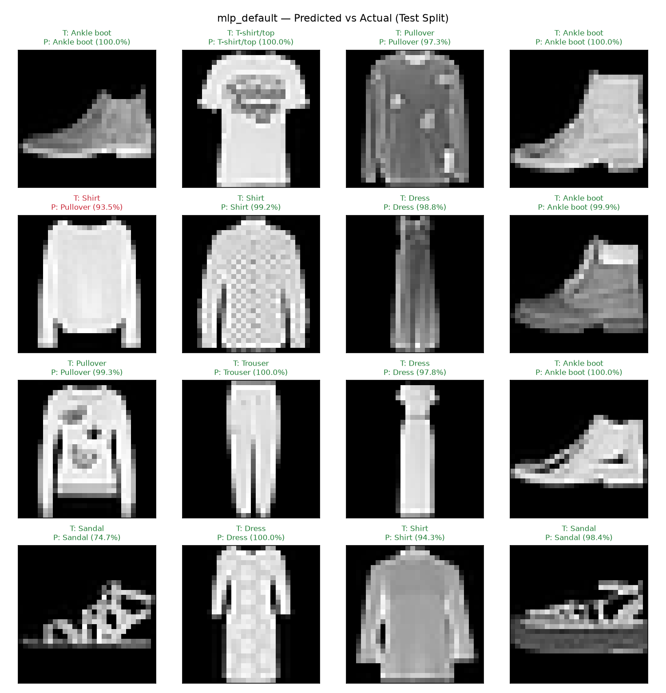

---

## 4. Error Analysis — Phân Tích Lỗi Dự Đoán (_Layer 9: Model sai ở đâu và vì sao?_)

Mục này phân tích lỗi dự đoán của `mlp_default` trên tập Test (`10,000` mẫu, tổng `1,121` lỗi) theo quy trình **4 bước định lượng** (`python labs/lab1_v2/evaluate.py --error-analysis`).

### 4.1 Bước 1 — Lỗi ở đâu? (Per-class P/R/F1, Confusion Matrix chuẩn hóa % & Top cặp nhầm)

- **4 lớp yếu nhất (`per_class_metrics.json`):** `Shirt` (`P=77.2% / R=62.8% / F1=69.28%`), `Pullover` (`P=78.0% / R=83.6% / F1=80.69%`), `Coat` (`P=79.7% / R=83.8% / F1=81.68%`), `T-shirt/top` (`P=79.7% / R=88.5% / F1=83.85%`) — khớp 100% dự báo prototype similarity `0.95–0.99` ở [`eda_report.md`](eda_report.md).
- **Top-6 cặp nhầm lẫn (bỏ đường chéo, [`error_analysis.json`](../../../experiments/lab1_v2/evaluation/error_analysis.json)):** **`Shirt → T-shirt/top` (`158` mẫu · `15.8%`)**, **`Shirt → Pullover` (`112` · `11.2%`)**, **`Coat → Pullover` (`96` · `9.6%`)**, `Pullover → Coat` (`86` · `8.6%`), `T-shirt/top → Shirt` (`75` · `7.5%`), `Shirt → Coat` (`72` · `7.2%`). Riêng **Top-3 cặp chiếm `366 / 1,121` (`32.6%`) tổng số lỗi Test**.

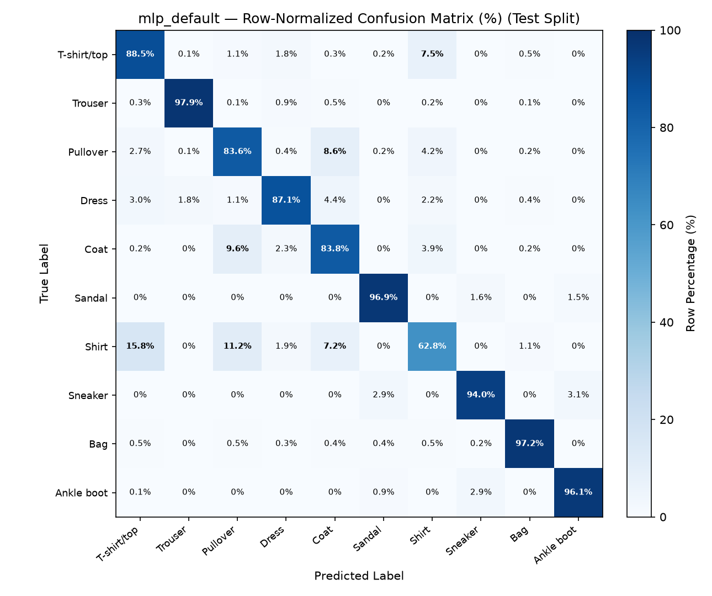

### 4.2 Bước 2 — Lỗi trông như thế nào? (Error Gallery Top-3 cặp theo Confidence)

Lọc riêng `366` mẫu sai của Top-3 cặp (`Shirt→T-shirt/top`, `Shirt→Pullover`, `Coat→Pullover`), tách 2 nhóm **16 lỗi tự tin cao (`99.2%–100%`)** và **16 lỗi lưỡng lự (`31.2%–42.6%`)**:

|                               16 Lỗi Confidence Cao (`99.2%–100%`)                               |                    16 Lỗi Confidence Thấp — Vùng Ranh Giới (`31.2%–42.6%`)                     |
| :----------------------------------------------------------------------------------------------: | :--------------------------------------------------------------------------------------------: |
| 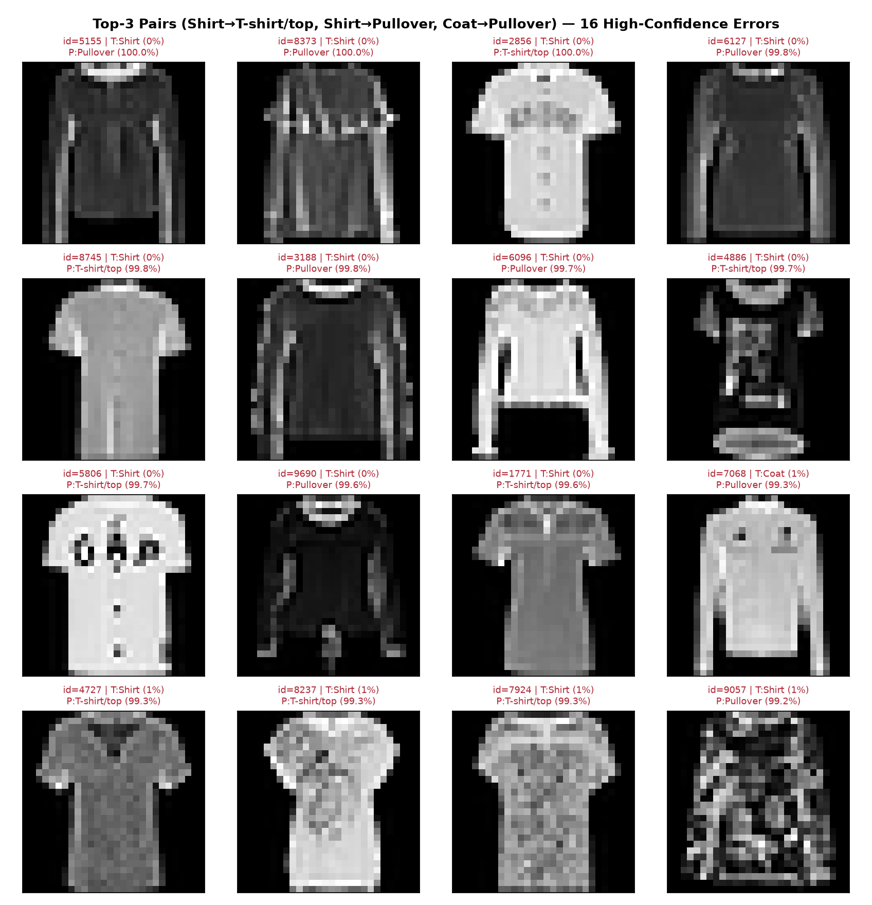 | 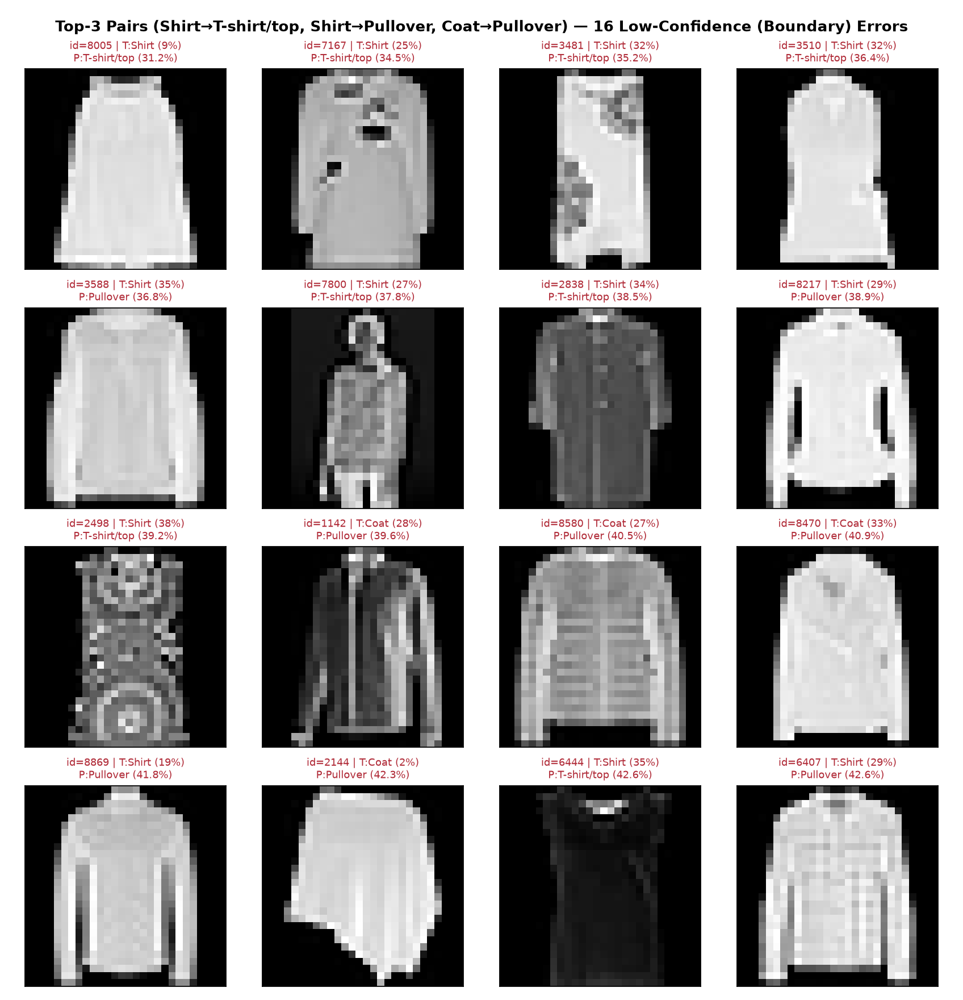 |

- **Nhóm High-Conf:** Xuất hiện rõ 2 kiểu — (a) **chồng lấn định nghĩa lớp / nhiễu nhãn gốc (`Label Noise / Class Overlap`)** do lớp `Shirt` trong Fashion-MNIST gom quá đa dạng kiểu dáng (tay ngắn, tay dài, cổ tròn, có cổ), khi nén xuống `28×28` xám mất chất liệu vải nên nhiều mẫu trùng khít `T-shirt/top` (`id=8745, 4886`) hoặc `Pullover` (`id=5155, 6127, 3188`), và (b) **lỗi do MLP mất chi tiết cục bộ 2D** (áo sơ-mi ngắn tay thấy rõ hàng khuy giữa thân `id=2856, 5806` vẫn bị đoán `T-shirt/top` ở mức `99.7%–100%`).
- **Nhóm Low-Conf (Boundary):** Gồm áo sơ-mi/áo khoác **có đặc trưng nhận diện rõ** (khóa kéo dọc `id=1142`, áo phao chần ngang `id=8580`, sơ-mi kẻ ca-rô `id=6407`, cổ đứng `id=2838, 8869`) nhưng MLP lưỡng lự `~35%–42%`, lẫn các mẫu trắng lóa / dáng hẹp không tay (`id=8005, 3481, 3510, 2144`).

### 4.3 Bước 3 — Nguyên nhân nào chiếm bao nhiêu %? (Gán nhãn định lượng `N = 60` ảnh)

Kiểm tra trực quan **`60` ảnh lỗi phân tầng** (`20` ảnh/cặp × Top-3 cặp = `10` High-Conf + `10` Low-Conf mỗi cặp; bảng chi tiết từng mẫu lưu tại [`error_taxonomy_60.csv`](../../../experiments/lab1_v2/evaluation/error_taxonomy_60.csv) và 3 bảng ảnh gốc: [`Sheet 1`](../../../experiments/lab1_v2/evaluation/audit_sheets/audit_sheet_1_shirt_t-shirt_top.png) · [`Sheet 2`](../../../experiments/lab1_v2/evaluation/audit_sheets/audit_sheet_2_shirt_pullover.png) · [`Sheet 3`](../../../experiments/lab1_v2/evaluation/audit_sheets/audit_sheet_3_coat_pullover.png)):

| Nguyên nhân gốc                                                                       |  Tổng (`N = 60`)   | High-Conf (`n = 30`) | Low-Conf (`n = 30`) | `Shirt→T-shirt` (`20`) | `Shirt→Pullover` (`20`) | `Coat→Pullover` (`20`) |
| :------------------------------------------------------------------------------------ | :----------------: | :------------------: | :-----------------: | :--------------------: | :---------------------: | :--------------------: |
| **`Model Limitation`** _(người thấy rõ, MLP sai)_                                     | **`48.3%` (`29`)** |       `43.3%`        |     **`53.3%`**     |      `7` (`35%`)       |       `8` (`40%`)       |    **`14` (`70%`)**    |
| **`Ambiguity`** _(nhập nhằng ở `28×28`)_                                              | **`38.3%` (`23`)** |       `33.3%`        |       `43.3%`       |      `10` (`50%`)      |       `7` (`35%`)       |      `6` (`30%`)       |
| **`Label Noise / Class Overlap`** _(nhãn chồng lấn do `Shirt` quá đa dạng kiểu dáng)_ | **`13.3%` (`8`)**  |     **`23.3%`**      |       `3.3%`        |      `3` (`15%`)       |       `5` (`25%`)       |       `0` (`0%`)       |

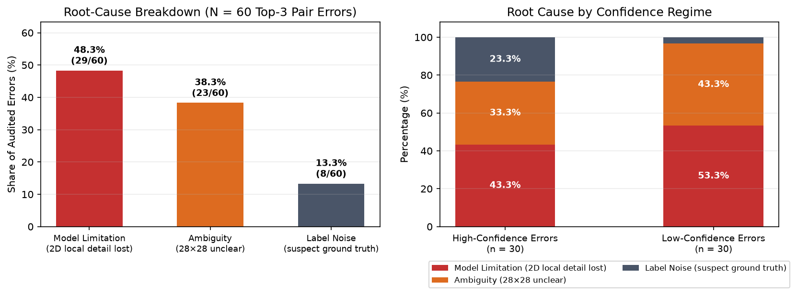

<b>Xem trực tiếp 3 bảng ảnh gốc kiểm toán 60 mẫu (#1–#60)</b>

#### Sheet 1 — `Shirt → T-shirt/top` (`#1–#20`)

#### Sheet 2 — `Shirt → Pullover` (`#21–#40`)

#### Sheet 3 — `Coat → Pullover` (`#41–#60`)

- **Insight cốt lõi:** **`Model Limitation` chiếm cao nhất (`48.3%`, đặc biệt `70%` ở cặp `Coat → Pullover` và `53.3%` ở vùng Low-Conf)** vì phép `Flatten(784)` xóa mất chi tiết 2D (hàng khuy dọc, khóa kéo, cổ bẻ, đường chần bông, áo mở vạt). Trong khi đó **`Label Noise / Class Overlap` (`13.3%`) tập trung gấp `7×` ở nhóm High-Conf (`23.3%` vs `3.3%`)** (không hẳn do đánh nhãn sai, mà do lớp `Shirt` gộp cả áo tay ngắn/dài cổ tròn không khuy nên mất chất liệu ở `28×28` là trùng hệt `T-shirt/top` hay `Pullover`), còn **`Ambiguity` (`38.3%`)** chủ yếu là ảnh trắng lóa/tối mất tương phản. _(Ghi chú: 60 nhãn được gắn trực quan từ contact sheets, có thể rà soát/điều chỉnh trực tiếp trên `error_taxonomy_60.csv`.)_

### 4.4 Bước 4 — Slice Analysis & Quyết định ưu tiên hành động

Đo tỷ lệ lỗi theo 3 thuộc tính ảnh trên toàn bộ `10,000` mẫu Test và riêng cụm `4` lớp áo khó (`4,000` mẫu, [`slice_analysis.json`](../../../experiments/lab1_v2/evaluation/slice_analysis.json)):

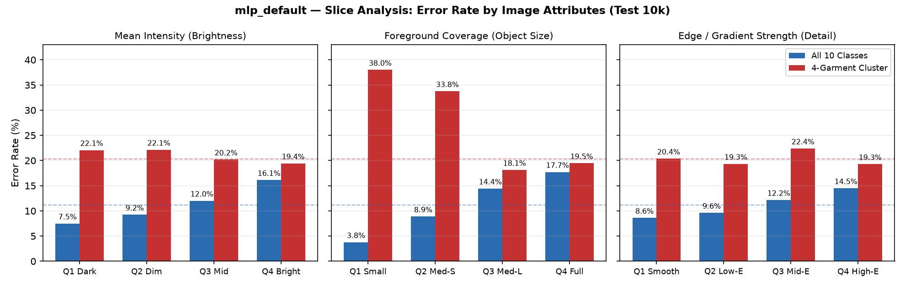

- **Kích thước vật thể (`fg_ratio`) là điểm yếu nổi bật nhất:** Trong cụm 4 lớp áo, ảnh có **vật thể nhỏ/mảnh (`Q1–Q2`, áo không tay/thân hẹp)** có tỷ lệ lỗi nhảy vọt lên **`38.0%` và `33.8%`** — gần gấp đôi áo đầy khung (`18.1%–19.5%` ở `Q3–Q4`).
- **Độ sáng (`mean_intensity`):** Áo tối (`Q1–Q2`) lỗi cao hơn áo sáng (`22.1%` vs `19.4%`) do tương phản chi tiết cổ/khuy thấp.
- **Ưu tiên bỏ công (`MODEL_PIPELINE.md` Layer 9):**
  1. **Ưu tiên số 1 (`48.3%` Model Limitation → Layer 5 / 7.1):** Nâng cấp kiến trúc lên **CNN** (`Conv2d → BatchNorm → ReLU → MaxPool`) để giữ cấu trúc không gian 2D — đánh trực diện gần nửa số lỗi Top-3.
  2. **Ưu tiên số 2 (Slice `fg_ratio` & độ sáng → Layer 6.4):** Bổ sung nhẹ augmentation (dịch chuyển/scale nhỏ, chỉnh sáng nhẹ) khi train CNN.
  3. **Không tốn công chỉnh thêm MLP (`38.3%` Ambiguity + `13.3%` Label Noise / Class Overlap):** Gần một nửa lỗi là giới hạn dữ liệu/chồng lấn nhãn `28×28` và đã kiểm chứng `12+1` runs đều kẹt trần `~89.5%` Val Acc ([`experiment_report.md`](experiment_report.md)).

---

## 5. Kiểm Chứng Suy Luận & Hiệu Năng Inference (_Layer 10 — `inference.py`_)

Thực thi lệnh kiểm chứng: `python labs/lab1_v2/inference.py --sample-idx 0 --benchmark` trên GPU `NVIDIA GeForce RTX 4060 Laptop GPU`:

- **Checkpoint nạp:** `experiments/lab1_v2/runs/mlp_default/best.pt` — kích thước **`922.2 KB`**, tự khôi phục `model_config`, `norm_stats` và `class_names`.
- **Save/Load Parity:** `max_abs_diff(logits) = 0.0 < 1e-6` (**PASS**).
- **Dự đoán mẫu `Test[0]` (`Ankle boot`):** đoán đúng `Ankle boot` (**`99.96%`**), Top-2 `Sandal` (`0.03%`), Top-3 `Sneaker` (`0.002%`), xác nhận `requires_grad = False` (`@torch.inference_mode()`).
- **Độ trễ suy luận (Latency Benchmark):**
  - `BS = 1`: **`0.396 ms/ảnh`** (`p95 = 0.641 ms`).
  - `BS = 32`: **`0.371 ms/batch`** = **`0.012 ms/ảnh`** (`p95 = 0.406 ms`).

---

## 6. Kết Luận & Hướng Cải Tiến Kiến Trúc

1. **MLP vượt trội rõ rệt so với Baseline tuyến tính:** Trên tập Test độc lập (`10,000` mẫu), `mlp_default` đạt **`88.79%` Accuracy / `88.68%` Macro-F1** — tạo gap **`+4.44 pp` Accuracy, `+4.47 pp` Macro-F1 và `-0.1110` Test Loss** so với `baseline_logistic` (`84.35% / 84.21%`), cải thiện dương trên toàn bộ **10/10 lớp**.
2. **Nút thắt nằm ở kiến trúc phẳng, không phải siêu tham số:** Kết hợp đánh giá `12+1` runs (§2) và bằng chứng Error Analysis (§4), mọi cấu hình MLP đều chạm trần `~89.5%` Val Acc với điểm nghẽn cố định ở cụm `{Shirt, T-shirt/top, Pullover, Coat}`. Bước nâng cấp hợp lý nhất tiếp theo là chuyển sang **CNN** có _inductive bias_ không gian 2D (tích chập cục bộ + chia sẻ trọng số + pooling).

---

## 7. Tài Liệu Liên Quan & Lịch Sử Thay Đổi

### Tài liệu tham chiếu (Cross-References)

- **Thiết kế thí nghiệm `12+1` runs, Sanity Checks & Training Diagnostics (Layer 4 & 7):** [`experiment_report.md`](experiment_report.md)
- **Kiểm toán dữ liệu & EDA (Layer 6.1–6.3):** [`eda_report.md`](eda_report.md)
- **Đặc tả 10 tầng Pipeline & Tiêu chí đánh giá:** [`pipelines/modeling.md`](pipelines/modeling.md)
- **Executable Report Notebook & CLI:** [`labs/lab1_v2/experiment.ipynb`](../experiment.ipynb) · [`labs/lab1_v2/README.md`](../README.md) · [`experiments/lab1_v2/README.md`](../../../experiments/lab1_v2/README.md)

### Lịch sử thay đổi

| Version | Ngày       | Người sửa | Agent       | Mô tả thay đổi                                                                                                                                                                                                                                                                                                                                         |
| :------ | :--------- | :-------- | :---------- | :----------------------------------------------------------------------------------------------------------------------------------------------------------------------------------------------------------------------------------------------------------------------------------------------------------------------------------------------------- |
| `1.2.0` | 2026-11-26 | notworLe  | Antigravity | Nâng cấp §4 Error Analysis thành quy trình **4 bước định lượng**: (1) CM chuẩn hóa %, (2) Error Gallery Top-3 cặp tách High-Conf vs Low-Conf, (3) Gán nhãn nguyên nhân trên **`N = 60` ảnh thật** (`48.3%` Model Limitation / `38.3%` Ambiguity / `13.3%` Label Noise), (4) Slice Analysis theo độ sáng, kích thước vật thể & biên                     |
| `1.1.0` | 2026-11-26 | notworLe  | Antigravity | **Gom trọn vẹn Layer 8 về 1 chỗ:** chuyển mục **§2 Đánh giá chuỗi `12+1` runs & Chọn mô hình trên Validation (`ablation_comparison`, bảng xếp hạng và lý do chọn `mlp_default` thay vì `mlp_opt_sgd_ep40`)** từ `experiment_report.md` sang đây để đảm bảo tách biệt tuyệt đối Layer 7 (`experiment_report.md`) và Layer 8–10 (`evaluation_report.md`) |
| `1.0.0` | 2026-11-26 | notworLe  | Antigravity | Tách riêng từ `experiment_report.md` (`v1.2.0`) cho Final Held-Out Test (10k), Error Analysis và Offline Inference                                                                                                                                                                                                                                     |
