# Experiment Report: Controlled Experiments & Training Diagnostics

> **Phạm vi tài liệu (Layer 4 → Layer 7):** Tài liệu này chỉ tập trung vào **thiết kế chuỗi thí nghiệm**, **Sanity Checks trước huấn luyện**, **theo dõi & chẩn đoán quá trình huấn luyện (Training Diagnostics)** của `12` runs có kiểm soát + `1` thực nghiệm resume (`mlp_opt_sgd_ep40`).
> - Toàn bộ phần **Đánh giá so sánh & chọn mô hình thắng cuộc trên Validation (Layer 8.1–8.2)**, **Đánh giá Final Held-Out Test 10k (Layer 8.3)**, **Error Analysis (Layer 9)** và **Inference Verification (Layer 10)** nằm tập trung tại **[`evaluation_report.md`](evaluation_report.md)**.
> - Kiểm toán dữ liệu & phân tích EDA (Layer 6.1–6.3) xem tại **[`eda_report.md`](eda_report.md)**.
> - **Nguồn nhật ký:** 100% trích xuất từ [`experiments/lab1_v2/runs/`](../../../experiments/lab1_v2/README.md) (`python labs/lab1_v2/train.py --run-all --no-stop-on-target` + lệnh resume `mlp_opt_sgd_ep40`, `NVIDIA GeForce RTX 4060 Laptop GPU`, `seed = 248`).

---

## 1. Thiết Kế Chuỗi Thí Nghiệm Có Kiểm Soát (Layer 7.1 — Experiment Matrix)

- **Nguyên tắc thiết kế (One-Factor-at-a-Time):** Giữ cố định hàm mất mát `CrossEntropyLoss`, `seed = 248` và bộ chuẩn hóa `NormStats(mean = 0.2863, std = 0.3532)` fit duy nhất trên `55,000` mẫu Train ([`eda_report.md`](eda_report.md)). Thay đổi đúng **1 trục siêu tham số mỗi lần** quanh cấu hình MLP Anchor `mlp_default` (`[256, 128]`, `ReLU`, `dropout = 0.2`, `Adam(1e-3)`, `BS = 64`, `20 epochs`).
- **Tập dữ liệu dùng trong quá trình train:** Chỉ dùng `Train (55k)` để cập nhật trọng số và `Val (5k)` để giám sát hội tụ / chọn `best.pt` theo `min(val_loss)` nội bộ từng run; tuyệt đối không đụng tập `Test (10k)`.

| Run ID | Nhóm / Trục thay đổi | Kiến trúc (`hidden_dims`) | Params | Optimizer | LR | BS | Epochs | Trạng thái thực thi |
| :--- | :--- | :--- | :---: | :--- | :---: | :---: | :---: | :---: |
| `baseline_logistic` | Baseline (mốc tuyến tính) | `—` (`784 → 10`) | 7,850 | Adam | `1e-3` | 64 | 20 | Hoàn tất (`best_ep = 11`) |
| `mlp_default` | MLP Anchor | `[256, 128]` | 235,146 | Adam | `1e-3` | 64 | 20 | Hoàn tất (`best_ep = 14`) |
| `mlp_h128` | Trục 1: Hidden Dims | `[128]` | 101,770 | Adam | `1e-3` | 64 | 20 | Hoàn tất (`best_ep = 10`) |
| `mlp_h512_256_128` | Trục 1: Hidden Dims | `[512, 256, 128]` | 567,434 | Adam | `1e-3` | 64 | 20 | Hoàn tất (`best_ep = 14`) |
| `mlp_lr1e4` | Trục 2: Learning Rate | `[256, 128]` | 235,146 | Adam | `1e-4` | 64 | 20 | Hoàn tất (`best_ep = 18`) |
| `mlp_lr1e2` | Trục 2: Learning Rate | `[256, 128]` | 235,146 | Adam | `1e-2` | 64 | 20 | Hoàn tất (`best_ep = 19`) |
| `mlp_opt_sgd` | Trục 3: Optimizer | `[256, 128]` | 235,146 | SGD(`m=0.9`) | `1e-3` | 64 | 20 | Hoàn tất (`best_ep = 20`) |
| `mlp_opt_adamw` | Trục 3: Optimizer | `[256, 128]` | 235,146 | AdamW(`wd=1e-2`) | `1e-3` | 64 | 20 | Hoàn tất (`best_ep = 9`) |
| `mlp_bs32` | Trục 4: Batch Size | `[256, 128]` | 235,146 | Adam | `1e-3` | 32 | 20 | Hoàn tất (`best_ep = 12`) |
| `mlp_bs256` | Trục 4: Batch Size | `[256, 128]` | 235,146 | Adam | `1e-3` | 256 | 20 | Hoàn tất (`best_ep = 12`) |
| `mlp_ep10` | Trục 5: Epochs | `[256, 128]` | 235,146 | Adam | `1e-3` | 64 | 10 | Hoàn tất (`best_ep = 10`) |
| `mlp_ep30` | Trục 5: Epochs | `[256, 128]` | 235,146 | Adam | `1e-3` | 64 | 30 | Hoàn tất (`best_ep = 8`) |
| `mlp_opt_sgd_ep40` | *Follow-up Resume* (`+20 ep`) | `[256, 128]` | 235,146 | SGD(`m=0.9`) | `1e-3` | 64 | `20 → 40` | Hoàn tất (`best_ep = 40`) |

---

## 2. Sanity Checks Trước Khi Huấn Luyện (Layer 4)

Trước khi chạy chuỗi `12+1` runs trên tập dữ liệu sạch (`70,000` mẫu, `8/8` SHA-256 pass, `0` corrupt/duplicate — xem [`eda_report.md`](eda_report.md)), toàn bộ bất biến kỹ thuật được xác minh:

| Kiểm tra | Tiêu chí đạt | Kết quả thực tế | Trạng thái |
| :--- | :--- | :--- | :---: |
| Tensor Shape Contract | `(B, 1, 28, 28) → (B, 10)`, sai shape ném `ValueError` | `13/13` pytest pass (`test_lab1_v2_*.py`) | **PASS** |
| Initial Loss (`10` lớp) | $\approx \ln(10) \approx 2.3026$ | Đạt ngưỡng trước mọi run (`run_sanity_checks` + `experiment.ipynb`) | **PASS** |
| Overfit 1 Batch (`32` mẫu) | Accuracy $\ge 95\%$ | Đạt `100%` trên 1 batch 32 mẫu (`run_sanity_checks`) | **PASS** |
| Save/Load Checkpoint Parity | `max_abs_diff(logits) < 1e-6` | `0.0` trên toàn bộ `12/12` runs chính + `mlp_opt_sgd_ep40` | **PASS** |

---

## 3. Training Diagnostics — Chẩn Đoán Quá Trình Huấn Luyện (Layer 7.2–7.3)

Mục này chỉ trả lời câu hỏi **"quá trình train của từng cấu hình diễn ra như thế nào (hội tụ, ổn định, overfitting)?"**. Bảng so sánh xếp hạng & quyết định chọn mô hình thắng cuộc nằm ở **[`evaluation_report.md` §2](evaluation_report.md#2-%C4%91%C3%A1nh-gi%C3%A1-chu%E1%BB%97i-th%C3%AD-nghi%E1%BB%87m--ch%E1%BB%8Dn-m%C3%B4-h%C3%ACnh-tr%C3%AAn-validation-5000-m%E1%BA%ABu--layer-8182)**.

### 3.1 Tổng hợp động học huấn luyện trên 5 trục
- **Hội tụ (Convergence):** `baseline_logistic` chạm trần tuyến tính sớm (đáy `val_loss = 0.4241` tại epoch 11, high bias). `mlp_default` giảm sâu xuống `0.2955` (epoch 14); giảm `lr` sang `1e-4` (`mlp_lr1e4`) cho đường hội tụ mượt hơn (`val_loss = 0.2866` tại epoch 18); `mlp_opt_sgd` hội tụ chậm ở 20 ep (`0.3204`, chưa chạm đáy) và khi resume sang epoch 40 (`mlp_opt_sgd_ep40`) tiếp tục giảm xuống `0.2862` rồi đi ngang ở giai đoạn `34 → 40`.
- **Độ ổn định (Training Stability):** `lr = 1e-2` (`mlp_lr1e2`) bước học quá lớn gây dao động mạnh (`val_loss = 0.4687`, `train_acc < val_acc`). `batch_size = 256` (`mlp_bs256`) cho gradient mượt hơn `bs = 32` và thời gian train thấp nhất (`24.2s` so với `117.1s` của `bs = 32`).
- **Overfitting & Calibration:** `mlp_ep30` minh họa rõ hiện tượng **loss-accuracy divergence**: từ epoch `15 → 30`, `train_loss` giảm về `0.1832` (`train_acc = 93.02%`) trong khi `val_loss` tăng ngược từ `0.3043` (ep 8) lên `0.3264–0.3477` (`gap = +3.08 pp`), dù `val_acc` vẫn nhích lên `89.94%` do quá tự tin vào lỗi sai. Cơ chế lưu `best.pt` theo `min(val_loss)` đã chặn hiệu quả việc lưu checkpoint quá khớp.

### 3.2 Nhật ký & chẩn đoán chi tiết `12/12` cấu hình (+ Resume `mlp_opt_sgd_ep40`)

Mỗi cấu hình đính kèm trực tiếp log monitoring (`history.csv`, `history.json`, `config.json`) và 3 biểu đồ theo dõi (`loss_curve.png`, `accuracy_curve.png`, `confusion_matrix.png`):

#### 3.2.1 `baseline_logistic` (`7,850` params, Adam `1e-3`, BS `64`, 20 ep)
- **Nhận xét Kỹ sư:** Baseline giữ cố định làm mốc (chạy 1 lần). `best_epoch` là 11 nhưng thấy mốc sớm hơn có `val_acc` nhỉnh hơn; 3 epoch đầu học tốt rồi bắt đầu overfit dần về cuối.
- **Đối chiếu log:** Chính xác — `val_acc` đỉnh ở **epoch 9 (`85.64%`, `val_loss = 0.4328`)**, trong khi **epoch 11** có `val_loss` thấp nhất (`0.4241`, `val_acc = 85.58%`, `gap = +0.50 pp`) nên `best.pt` chọn epoch 11. Từ epoch `12 → 20`, `train_loss` giảm (`0.3941 → 0.3820`) còn `val_loss` tăng lên `0.4659` (`val_acc` tụt về `84.12%`, `gap = +2.43 pp`), xác nhận mô hình tuyến tính đã hội tụ hoàn toàn từ epoch 11.
- **Logs:** [`history.csv`](../../../experiments/lab1_v2/runs/baseline_logistic/historys/history.csv) · [`history.json`](../../../experiments/lab1_v2/runs/baseline_logistic/historys/history.json) · [`config.json`](../../../experiments/lab1_v2/runs/baseline_logistic/config.json)

| Loss Curve | Accuracy Curve | Confusion Matrix (Val) |
| :---: | :---: | :---: |
| 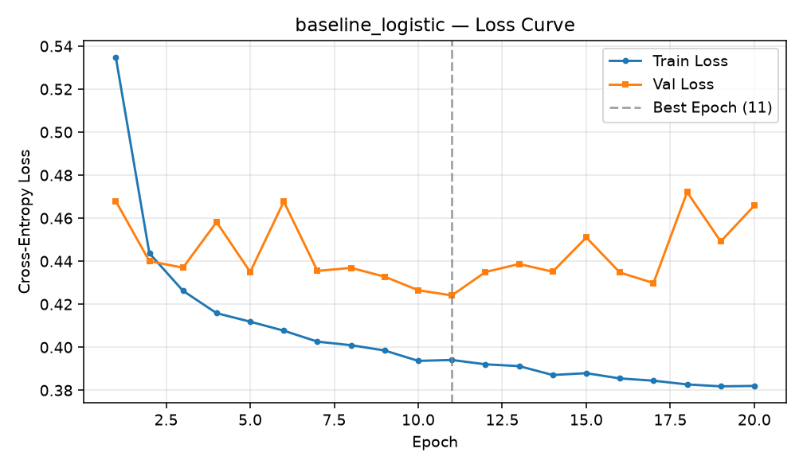 | 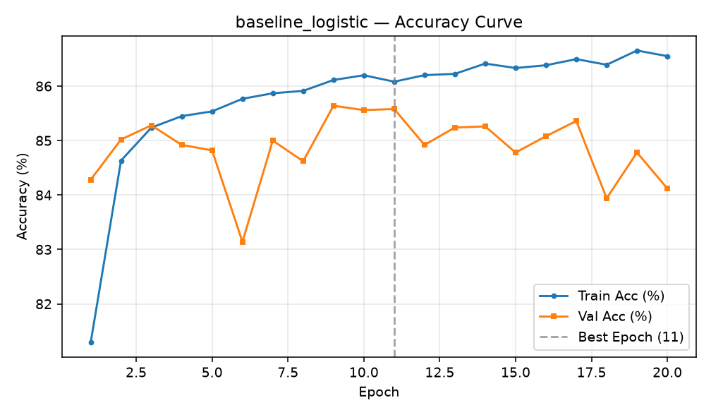 | 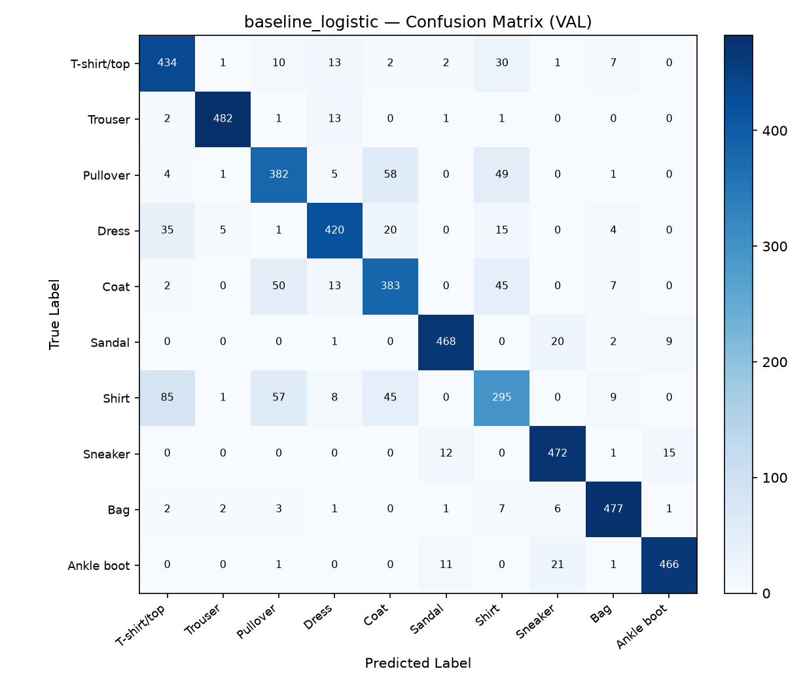 |

---

#### 3.2.2 `mlp_default` — Anchor (`[256, 128]`, `235,146` params, Adam `1e-3`, BS `64`, 20 ep)
- **Nhận xét Kỹ sư:** Bắt đầu tách đường train/val (overfit nhẹ) từ sau epoch 6; lớp `Shirt` bị `T-shirt/top`, `Pullover`, `Coat` đoán nhầm nhiều nhất do chưa học được đặc trưng cục bộ như chiều dài tay áo hay đường giữa áo.
- **Đối chiếu log:** `val_loss` vẫn cải thiện tới `best_epoch = 14` (`0.2955`, `val_acc = 89.74%`, `gap = +1.10 pp`), sau đó tăng nhẹ về `0.3117` ở epoch 20 (`gap = +2.34 pp`). Thời gian train: `52.6s`.
- **Logs:** [`history.csv`](../../../experiments/lab1_v2/runs/mlp_default/historys/history.csv) · [`history.json`](../../../experiments/lab1_v2/runs/mlp_default/historys/history.json) · [`config.json`](../../../experiments/lab1_v2/runs/mlp_default/config.json)

| Loss Curve | Accuracy Curve | Confusion Matrix (Val) |
| :---: | :---: | :---: |
| 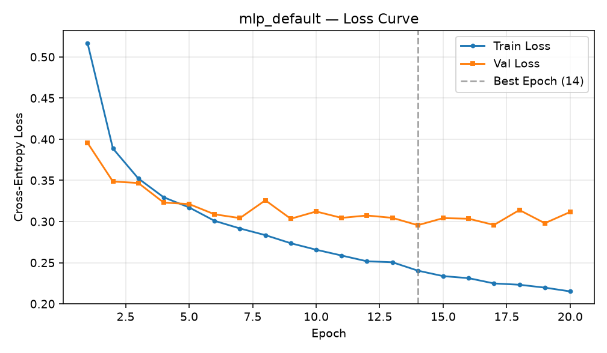 | 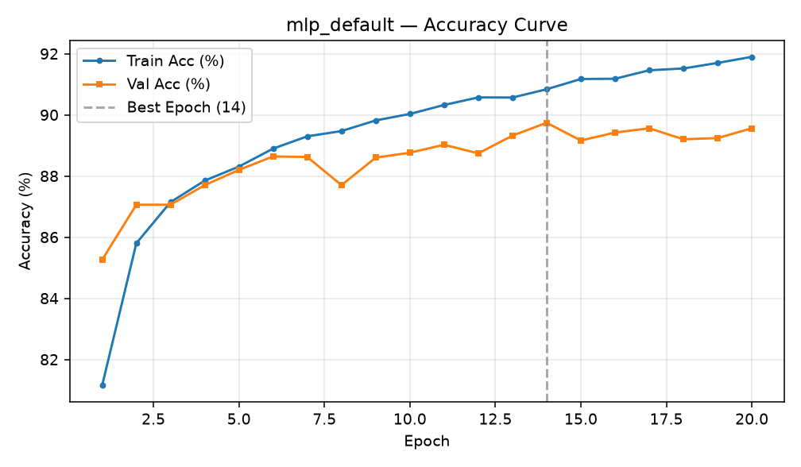 |  |

---

#### 3.2.3 `mlp_h128` (`[128]`, `101,770` params, Adam `1e-3`, BS `64`, 20 ep)
- **Nhận xét Kỹ sư:** Giảm kích thước ẩn nhằm hạn chế overfitting; vẫn tách nhẹ sau epoch 6 nhưng hơi **underfit** trên cụm 4 lớp `Shirt / T-shirt/top / Pullover / Coat`.
- **Đối chiếu log:** Khớp — `best_epoch = 10` (`val_loss = 0.3040`, `val_acc = 88.76%`), đến epoch 20 `gap` vẫn là `+2.50 pp` (`44.8s`) → giảm dung lượng không xóa được overfitting mà còn làm giảm sức biểu diễn.
- **Logs:** [`history.csv`](../../../experiments/lab1_v2/runs/mlp_h128/historys/history.csv) · [`history.json`](../../../experiments/lab1_v2/runs/mlp_h128/historys/history.json) · [`config.json`](../../../experiments/lab1_v2/runs/mlp_h128/config.json)

| Loss Curve | Accuracy Curve | Confusion Matrix (Val) |
| :---: | :---: | :---: |
| 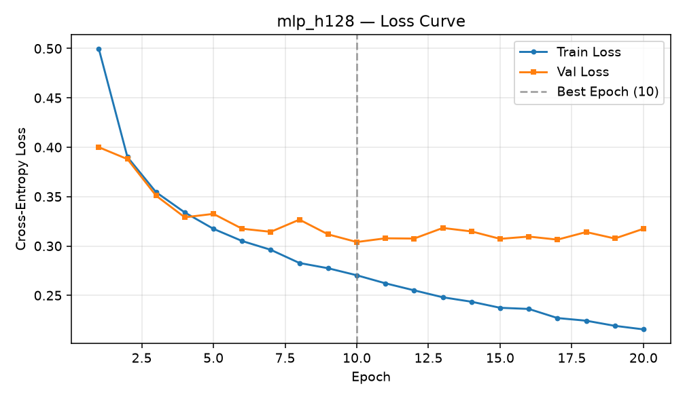 | 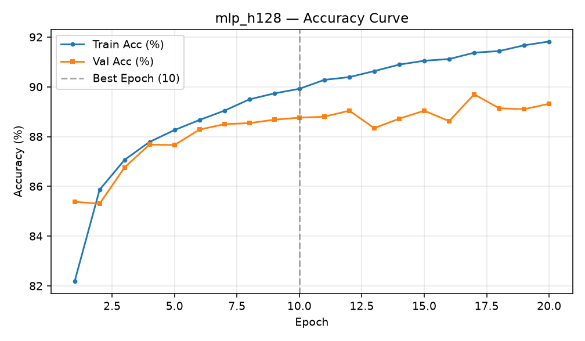 |  |

---

#### 3.2.4 `mlp_h512_256_128` (`[512, 256, 128]`, `567,434` params, Adam `1e-3`, BS `64`, 20 ep)
- **Nhận xét Kỹ sư:** Tăng số tham số (`2.4×` anchor) để học chi tiết 4 lớp áo, nhưng **overfit sớm** (tách đường train/val ngay từ các epoch đầu).
- **Đối chiếu log:** Khớp — `val_loss` tại `best_epoch = 14` là `0.3078` (`val_acc = 89.40%`), và tại epoch 20 `val_loss` vọt lên `0.3283` với `gap = +2.98 pp` (lớn nhất trong nhóm 20 epochs; `60.5s`).
- **Logs:** [`history.csv`](../../../experiments/lab1_v2/runs/mlp_h512_256_128/historys/history.csv) · [`history.json`](../../../experiments/lab1_v2/runs/mlp_h512_256_128/historys/history.json) · [`config.json`](../../../experiments/lab1_v2/runs/mlp_h512_256_128/config.json)

| Loss Curve | Accuracy Curve | Confusion Matrix (Val) |
| :---: | :---: | :---: |
| 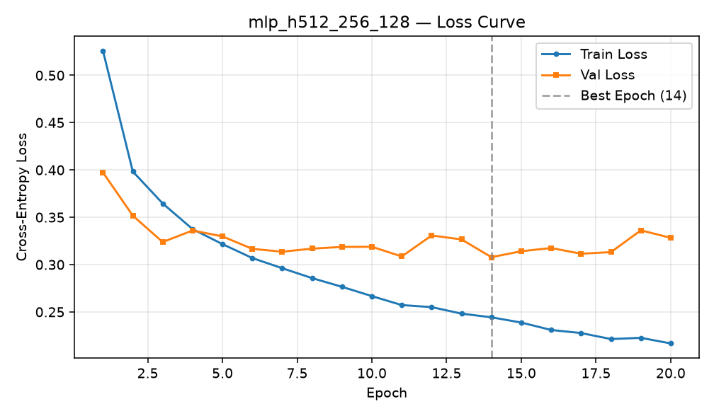 | 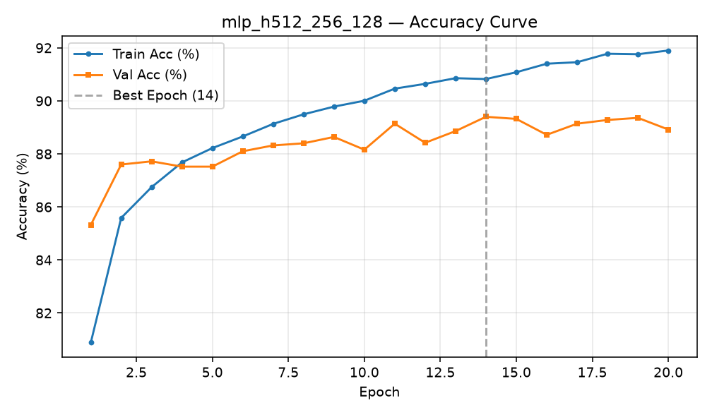 |  |

---

#### 3.2.5 `mlp_lr1e4` (Adam `lr = 1e-4`, `[256, 128]`, BS `64`, 20 ep)
- **Nhận xét Kỹ sư:** Chuyển sang chỉnh `lr` sau khi đổi kích thước ẩn không giải quyết được overfitting; `lr = 1e-4` giảm gap rõ rệt, khá ổn định, nhưng lỗi nhầm 4 lớp áo vẫn còn.
- **Đối chiếu log:** Đường học mượt và ổn định cao — `best_epoch = 18` (`val_loss = 0.2866`, `val_acc = 89.02%`), cuối epoch 20 `val_acc = 89.32%` với `gap` nhỏ (`+1.77 pp`, `53.3s`).
- **Logs:** [`history.csv`](../../../experiments/lab1_v2/runs/mlp_lr1e4/historys/history.csv) · [`history.json`](../../../experiments/lab1_v2/runs/mlp_lr1e4/historys/history.json) · [`config.json`](../../../experiments/lab1_v2/runs/mlp_lr1e4/config.json)

| Loss Curve | Accuracy Curve | Confusion Matrix (Val) |
| :---: | :---: | :---: |
| 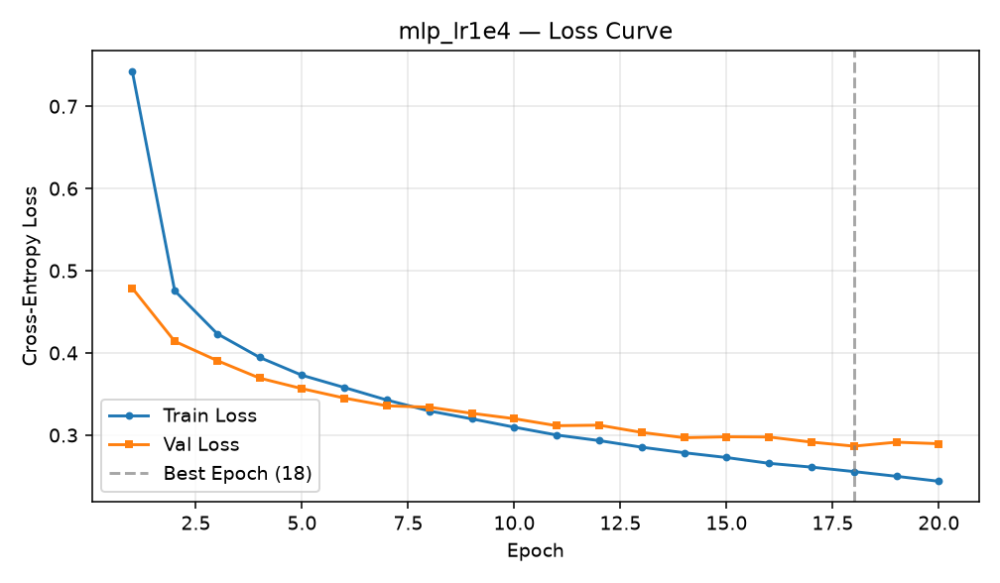 | 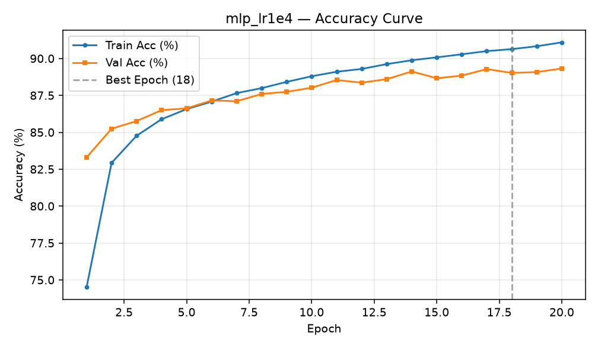 |  |

---

#### 3.2.6 `mlp_lr1e2` (Adam `lr = 1e-2`, `[256, 128]`, BS `64`, 20 ep)
- **Nhận xét Kỹ sư:** `val_acc` giảm mạnh (~`-5` đến `-6 pp` so với `lr = 1e-4`), tuy không thấy đường train vượt val nhưng độ chính xác rất thấp, ngang Baseline.
- **Đối chiếu log:** Chính xác (`val_acc = 83.80%`, `val_loss = 0.4687`). Lý do `train_acc (80.90%) < val_acc (83.80%)` (`gap = -2.90 pp`) là do **`lr = 1e-2` quá lớn gây dao động mạnh (underfitting)** kết hợp `Dropout(0.2)` bật lúc train (`52.7s`).
- **Logs:** [`history.csv`](../../../experiments/lab1_v2/runs/mlp_lr1e2/historys/history.csv) · [`history.json`](../../../experiments/lab1_v2/runs/mlp_lr1e2/historys/history.json) · [`config.json`](../../../experiments/lab1_v2/runs/mlp_lr1e2/config.json)

| Loss Curve | Accuracy Curve | Confusion Matrix (Val) |
| :---: | :---: | :---: |
| 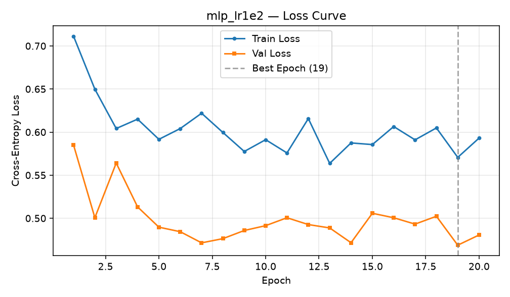 | 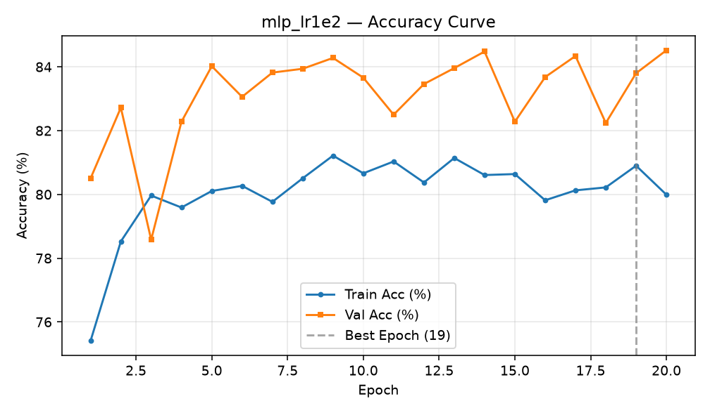 | 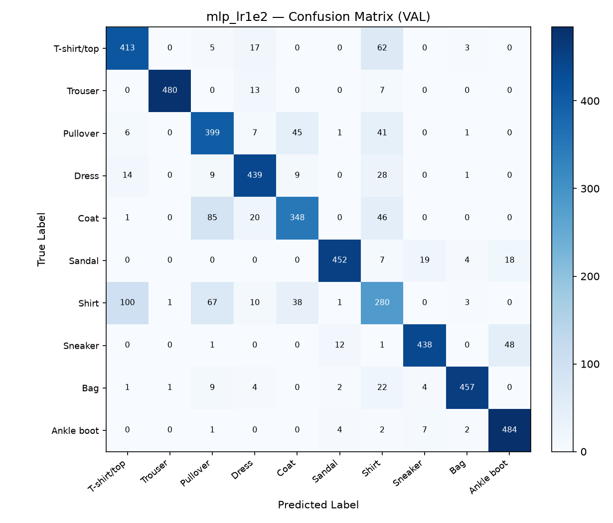 |

---

#### 3.2.7 `mlp_opt_sgd` (`SGD(lr = 1e-3, momentum = 0.9)`, `[256, 128]`, BS `64`, 20 ep → Resume 40 ep)
- **Nhận xét Kỹ sư (mốc 20 ep):** Gần như loại bỏ overfitting; đề xuất **resume chạy tiếp 20 epoch sau epoch 20** để kiểm tra khả năng hội tụ tiếp.
- **Đối chiếu log (mốc 20 ep):**
  - `mlp_opt_sgd` có `gap` nhỏ nhất nhóm 20 ep (`+1.00 pp`) và **`val_loss` vẫn giảm liên tục tới tận epoch 20 (`best_epoch = 20`, `0.3204`, `val_acc = 88.02%`)**, xác nhận mô hình **chưa hội tụ hết** → giả thuyết chạy tiếp hoàn toàn có cơ sở.
  - *Đính chính số liệu nhỏ:* ở epoch `19 → 20`, `val_acc` chỉ dao động nhẹ `-0.28 pp` (`88.30% → 88.02%`, không phải `-2%`) trong khi `val_loss` tiếp tục giảm (`0.3225 → 0.3204`).
- **Logs (20 ep):** [`history.csv`](../../../experiments/lab1_v2/runs/mlp_opt_sgd/historys/history.csv) · [`history.json`](../../../experiments/lab1_v2/runs/mlp_opt_sgd/historys/history.json) · [`config.json`](../../../experiments/lab1_v2/runs/mlp_opt_sgd/config.json)

| Loss Curve (`1 → 20 ep`) | Accuracy Curve (`1 → 20 ep`) | Confusion Matrix (Val — 20 ep) |
| :---: | :---: | :---: |
| 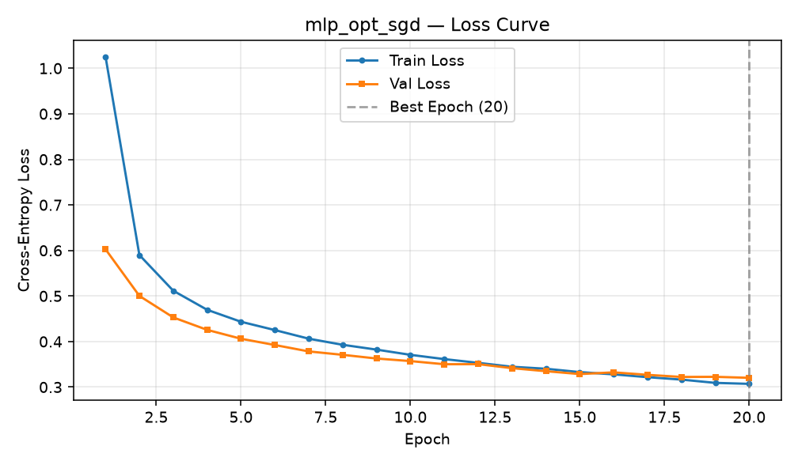 | 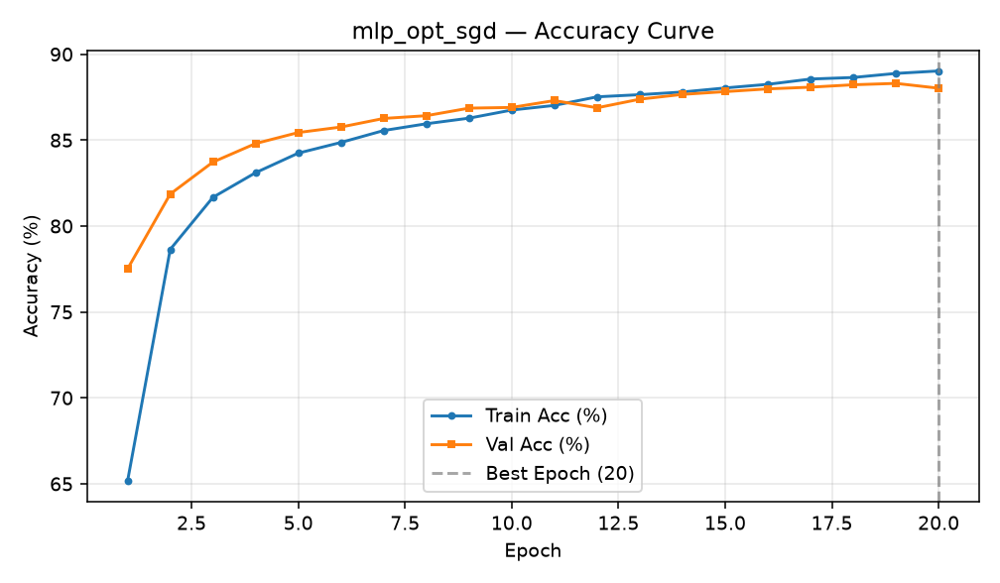 | 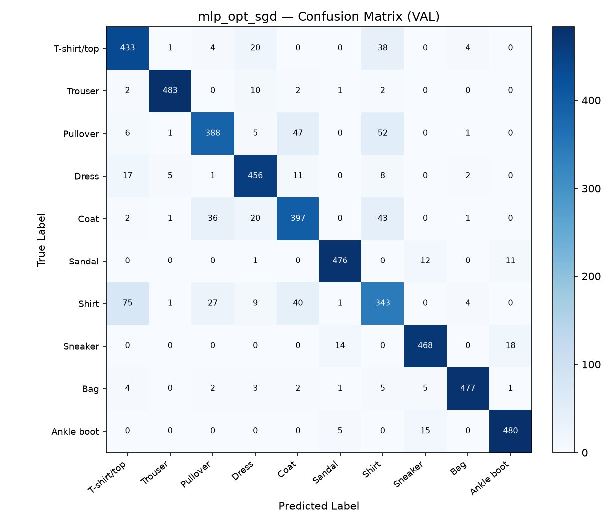 |

##### Thực nghiệm bổ sung — Resume chạy tiếp 20 epoch (`mlp_opt_sgd_ep40`, epochs `1 → 40`)
- **Lệnh thực thi (lưu tách thư mục để không ghi đè run gốc 20 ep):**
  ```powershell
  python labs/lab1_v2/train.py --run-id mlp_opt_sgd --resume experiments/lab1_v2/runs/mlp_opt_sgd/last.pt --extra-epochs 20 --output-run-id mlp_opt_sgd_ep40 --skip-sanity
  ```
  - *Ghi chú kỹ thuật minh bạch:* Checkpoint gốc `mlp_opt_sgd/last.pt` được lưu trước khi bổ sung lưu `optimizer_state_dict`, nên lần resume này khôi phục nguyên vẹn trọng số `model_state_dict` tại epoch 20 (`optimizer_state_restored = false` trong `config.json`), momentum buffer tự ấm lại mượt không giật loss (ngay epoch 21 `val_loss` giảm tiếp `0.3204 → 0.3130`, `val_acc` tăng `88.02% → 88.40%`). Hiện `trainer.py` đã lưu kèm `optimizer_state_dict` cho mọi checkpoint mới; Save/Load Parity trên `mlp_opt_sgd_ep40/best.pt` đạt `0.0` (PASS).
- **Chẩn đoán động học huấn luyện (`20 ep → 40 ep`):**
  1. **Xác nhận giả thuyết chưa hội tụ ở epoch 20:** `val_loss` giảm sâu `-0.0341` (`0.3204 → 0.2862` tại `best_ep = 40`), `val_acc` tăng `+1.32 pp` (`88.02% → 89.34%`, chạm đỉnh `89.52%` ở ep 39), `train_time = 125.4s` (`46.6s + 78.8s`).
  2. **Gap nhỏ ở epoch 20 là do chưa hội tụ, không phải miễn nhiễm overfitting:** Từ epoch `21 → 40`, `train_loss` giảm tuyến tính (`0.3071 → 0.2322`, `train_acc = 91.70%`) trong khi `val_loss` bắt đầu đi ngang mạnh ở đoạn cuối (`0.2895` ở ep 34 → `0.2862` ở ep 40, chỉ giảm thêm `-0.0033`), làm `gap(tr − va)` mở rộng từ `+1.00 pp` lên **`+2.36 pp`** (gần trùng `mlp_default` `+2.34 pp`).
  3. **Đối chiếu đánh giá & quyết định chọn mô hình giữa `mlp_opt_sgd_ep40` và `mlp_default`:** xem tại **[`evaluation_report.md` §2](evaluation_report.md#2-%C4%91%C3%A1nh-gi%C3%A1-chu%E1%BB%97i-th%C3%AD-nghi%E1%BB%87m--ch%E1%BB%8Dn-m%C3%B4-h%C3%ACnh-tr%C3%AAn-validation-5000-m%E1%BA%ABu--layer-8182)**.
- **Logs (`mlp_opt_sgd_ep40`):** [`history.csv`](../../../experiments/lab1_v2/runs/mlp_opt_sgd_ep40/historys/history.csv) · [`history.json`](../../../experiments/lab1_v2/runs/mlp_opt_sgd_ep40/historys/history.json) · [`config.json`](../../../experiments/lab1_v2/runs/mlp_opt_sgd_ep40/config.json)

| Loss Curve (`1 → 40 ep`) | Accuracy Curve (`1 → 40 ep`) | Confusion Matrix (Val — 40 ep) |
| :---: | :---: | :---: |
| 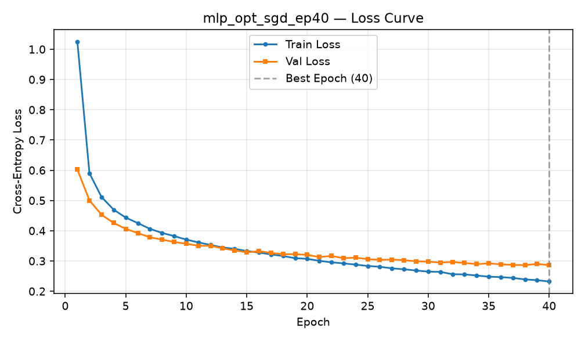 | 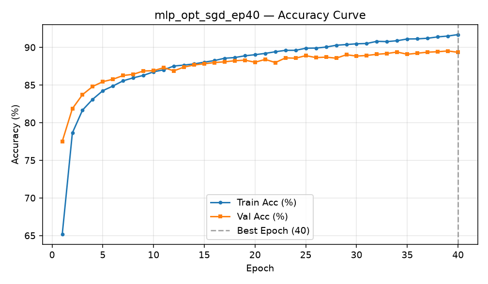 |  |

---

#### 3.2.8 `mlp_opt_adamw` (`AdamW(lr = 1e-3, weight_decay = 1e-2)`, `[256, 128]`, BS `64`, 20 ep)
- **Nhận xét Kỹ sư:** Diễn biến tương tự `mlp_default` và `mlp_h128`.
- **Đối chiếu log:** Khớp — `best_epoch = 9` (`val_loss = 0.2958`, `val_acc = 88.76%`), epoch 19 đạt `89.54%`. `weight_decay = 1e-2` giữ `val_loss` cuối epoch 20 ở `0.3016` (nhẹ hơn anchor `0.3117`, `gap = +2.80 pp`, `51.9s`).
- **Logs:** [`history.csv`](../../../experiments/lab1_v2/runs/mlp_opt_adamw/historys/history.csv) · [`history.json`](../../../experiments/lab1_v2/runs/mlp_opt_adamw/historys/history.json) · [`config.json`](../../../experiments/lab1_v2/runs/mlp_opt_adamw/config.json)

| Loss Curve | Accuracy Curve | Confusion Matrix (Val) |
| :---: | :---: | :---: |
| 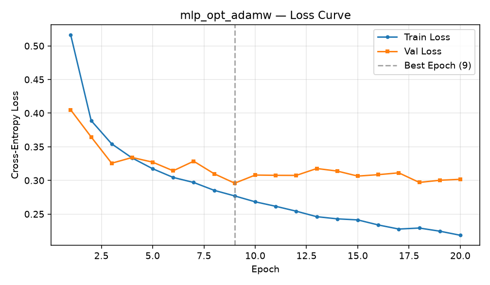 | 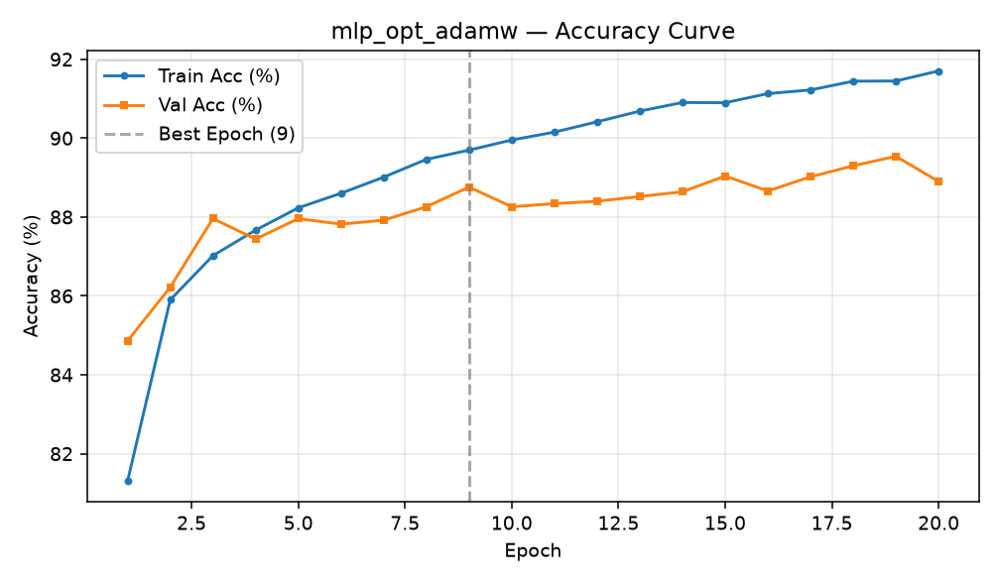 | 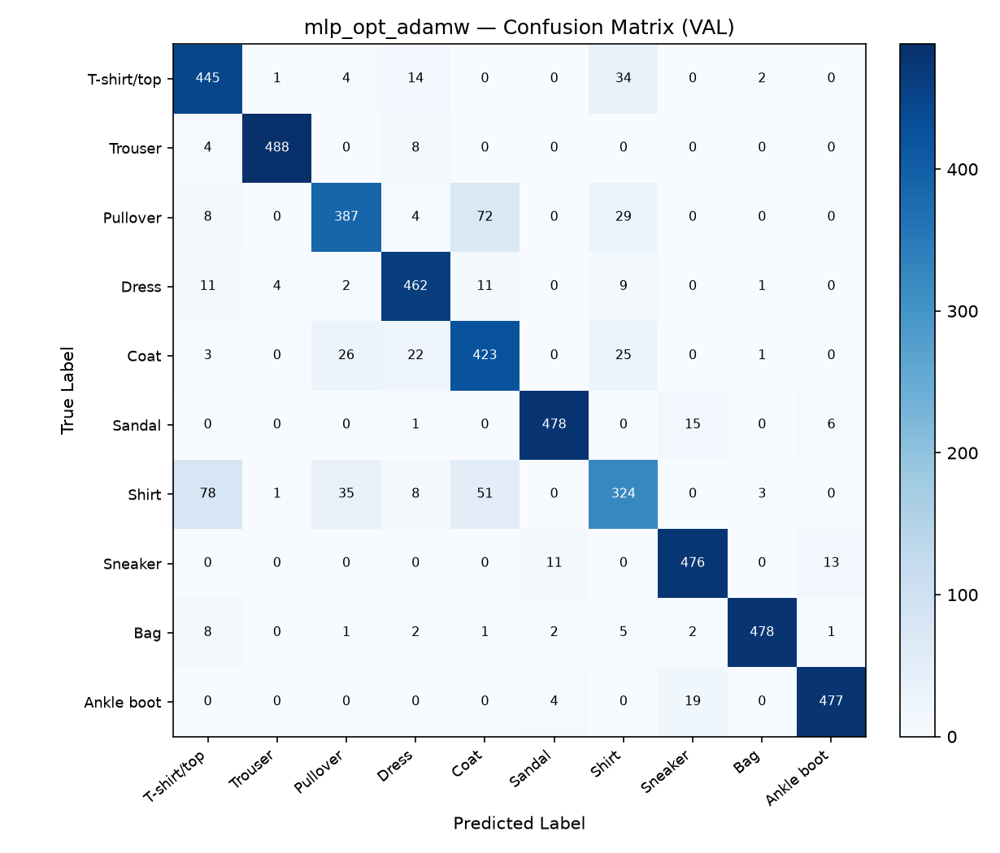 |

---

#### 3.2.9 `mlp_bs32` (`batch_size = 32`, `[256, 128]`, Adam `1e-3`, 20 ep)
- **Nhận xét Kỹ sư:** Diễn biến tương tự `mlp_opt_adamw`.
- **Đối chiếu log:** `best_ep = 12` (`val_loss = 0.3022`, `val_acc = 88.80%`, cuối ep 20 `89.26%`, `gap = +1.87 pp`), thời gian train tăng lên `117.1s` do số bước cập nhật mỗi epoch tăng gấp đôi so với `bs = 64`.
- **Logs:** [`history.csv`](../../../experiments/lab1_v2/runs/mlp_bs32/historys/history.csv) · [`history.json`](../../../experiments/lab1_v2/runs/mlp_bs32/historys/history.json) · [`config.json`](../../../experiments/lab1_v2/runs/mlp_bs32/config.json)

| Loss Curve | Accuracy Curve | Confusion Matrix (Val) |
| :---: | :---: | :---: |
| 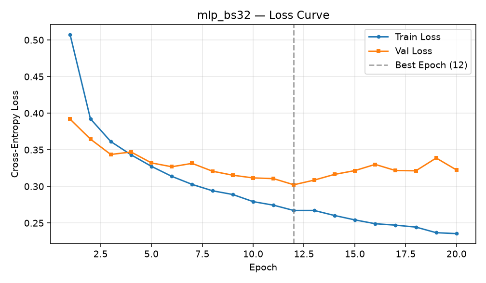 | 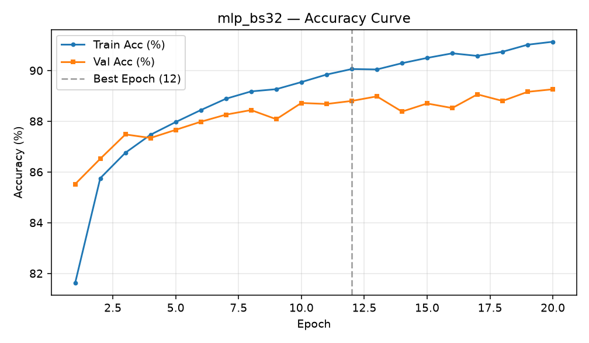 |  |

---

#### 3.2.10 `mlp_bs256` (`batch_size = 256`, `[256, 128]`, Adam `1e-3`, 20 ep)
- **Nhận xét Kỹ sư:** Không khác biệt lớn về bản chất hành vi lỗi cụm 4 lớp áo.
- **Đối chiếu log:** Gradient mượt và tốc độ nhanh nhất bảng (`24.2s`) — `best_ep = 12` (`val_loss = 0.2887`, `val_acc = 89.46%`, cuối ep 20 đạt `89.80%`, `gap = +2.58 pp`).
- **Logs:** [`history.csv`](../../../experiments/lab1_v2/runs/mlp_bs256/historys/history.csv) · [`history.json`](../../../experiments/lab1_v2/runs/mlp_bs256/historys/history.json) · [`config.json`](../../../experiments/lab1_v2/runs/mlp_bs256/config.json)

| Loss Curve | Accuracy Curve | Confusion Matrix (Val) |
| :---: | :---: | :---: |
| 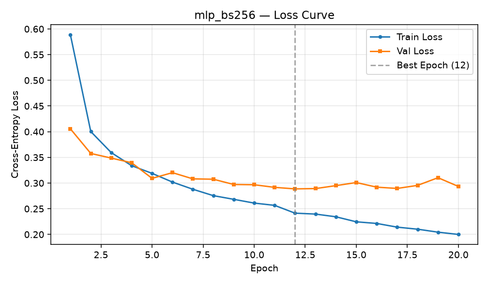 | 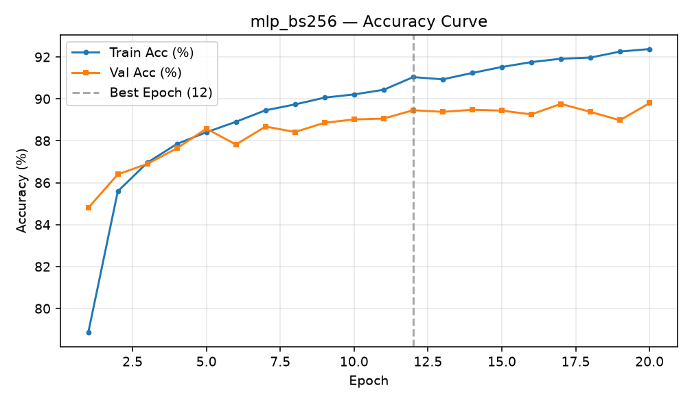 |  |

---

#### 3.2.11 `mlp_ep10` (`epochs = 10`, `[256, 128]`, Adam `1e-3`, BS `64`)
- **Đối chiếu log:** Dừng hơi sớm khi `val_loss` vẫn đang đi xuống (`best_ep = 10`, `val_loss = 0.3130`, `val_acc = 88.54%`, `gap = +1.20 pp`, `34.1s`), chưa khai thác hết vùng hội tụ epoch `12–16`.
- **Logs:** [`history.csv`](../../../experiments/lab1_v2/runs/mlp_ep10/historys/history.csv) · [`history.json`](../../../experiments/lab1_v2/runs/mlp_ep10/historys/history.json) · [`config.json`](../../../experiments/lab1_v2/runs/mlp_ep10/config.json)

| Loss Curve | Accuracy Curve | Confusion Matrix (Val) |
| :---: | :---: | :---: |
| 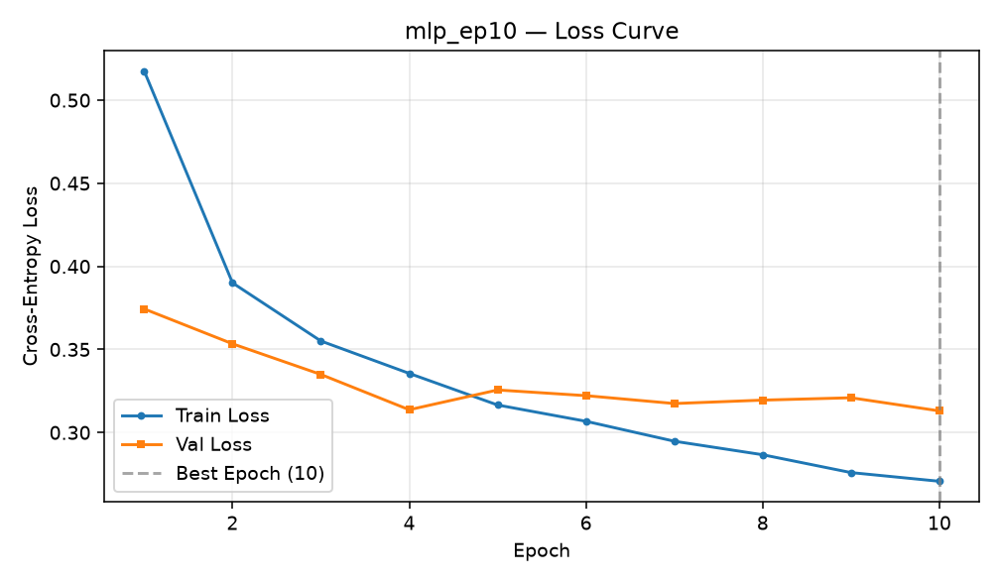 | 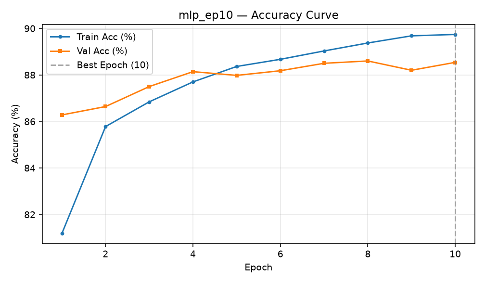 |  |

---

#### 3.2.12 `mlp_ep30` (`epochs = 30`, `[256, 128]`, Adam `1e-3`, BS `64`)
- **Nhận xét Kỹ sư:** Xác nhận giả thuyết: càng train dài càng overfitting.
- **Đối chiếu log:** Chính xác tuyệt đối — `best_val_loss = 0.3043` rơi ngay epoch 8 (`gap = +0.73 pp`); từ epoch `15 → 30` `train_loss` giảm sâu về `0.1832` (`train_acc = 93.02%`) trong khi `val_loss` tăng ngược lên `0.3264–0.3477` (`gap = +3.08 pp`, `125.8s`).
- **Logs:** [`history.csv`](../../../experiments/lab1_v2/runs/mlp_ep30/historys/history.csv) · [`history.json`](../../../experiments/lab1_v2/runs/mlp_ep30/historys/history.json) · [`config.json`](../../../experiments/lab1_v2/runs/mlp_ep30/config.json)

| Loss Curve | Accuracy Curve | Confusion Matrix (Val) |
| :---: | :---: | :---: |
| 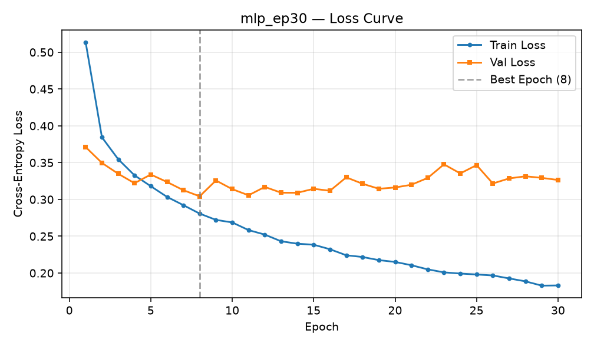 | 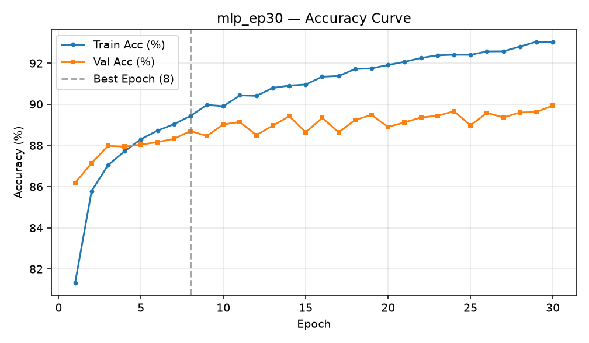 |  |

---

## 4. Tài Liệu Liên Quan & Lịch Sử Thay Đổi

### Tài liệu tham chiếu (Cross-References)
- **Đánh giá so sánh chọn mô hình (Val 5k), Final Test (10k), Error Analysis & Inference (Layer 8–10):** [`evaluation_report.md`](evaluation_report.md)
- **Kiểm toán dữ liệu & EDA (Layer 6.1–6.3):** [`eda_report.md`](eda_report.md)
- **Đặc tả 10 tầng Pipeline & Tiêu chí đánh giá:** [`pipelines/modeling.md`](pipelines/modeling.md)
- **Executable Report Notebook & CLI:** [`labs/lab1_v2/experiment.ipynb`](../experiment.ipynb) · [`labs/lab1_v2/README.md`](../README.md) · [`experiments/lab1_v2/README.md`](../../../experiments/lab1_v2/README.md)

### Lịch sử thay đổi

| Version | Ngày | Người sửa | Agent | Mô tả thay đổi |
| :--- | :--- | :--- | :--- | :--- |
| `2.1.0` | 2026-11-26 | notworLe | Antigravity | **Tách triệt để SRP theo đúng Layer:** chuyển toàn bộ phần Evaluation / Model Selection trên Val (`ablation_comparison`, bảng xếp hạng & lý do chọn `mlp_default` thay vì `mlp_opt_sgd_ep40`, tóm tắt Test) sang [`evaluation_report.md`](evaluation_report.md); giữ `experiment_report.md` thuần túy cho **Layer 4 (Sanity Checks) & Layer 7 (Experiment Matrix, Training Monitoring & Training Diagnostics)** |
| `2.0.0` | 2026-11-26 | notworLe | Antigravity | Tách phần Final Held-Out Test (10k), Error Analysis (`error_gallery.png`) và Offline Inference sang `evaluation_report.md` |
| `1.2.0` | 2026-11-26 | notworLe | Antigravity | Bổ sung thực nghiệm resume `mlp_opt_sgd_ep40` (epochs `1 → 40`) |
| `1.1.0` | 2026-11-25 | notworLe | Antigravity | Tách Error Analysis khỏi Training Diagnostics; đính kèm logs và bảng 3 biểu đồ cho đủ `12/12` cấu hình |
| `1.0.0` | 2026-11-25 | notworLe | Antigravity | Phiên bản đầu tiên điền số liệu thật từ chuỗi `12/12` runs và Final Test (10k) |
