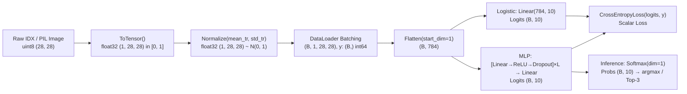

# FashionMNIST Modeling Pipeline (`lab1_v2`)

Đặc tả đầy đủ **10 tầng (Layers)** của **AI Development Pipeline** cho dự án **`lab1_v2`**, ánh xạ 1-1 theo [`MODEL_PIPELINE.md`](../../../../.agents/rules/dl-rule/MODEL_PIPELINE.md) với **Input / Output / Description** tường minh tại từng tầng.

---

## 1. Business Requirement Layer

- **Input:**
  - [`labs/lab1/QUESTION.md`](../../../lab1/QUESTION.md) — đề bài thực hành 1 môn Học Sâu (UTH)
  - [`.agents/tasks/0005_lab1v2/task.md`](../../../../.agents/tasks/0005_lab1v2/task.md) — yêu cầu chi tiết, ràng buộc và tiêu chí nghiệm thu của Kỹ sư
- **Output:**
  - Đặc tả bài toán & kế hoạch thực thi tại [`.agents/plans/0005_lab1v2_plan.md`](../../../../.agents/plans/0005_lab1v2_plan.md)
  - Mục §1–§2 trong [`modeling.md`](modeling.md)
- **Description:**
  - Mô phỏng một dự án AI hoàn chỉnh ở quy mô thu nhỏ đi qua đủ các tầng: yêu cầu → dữ liệu → thiết kế mô hình → huấn luyện → đánh giá → phân tích lỗi → báo cáo.
  - Mã nguồn phải sạch, tách cấu hình (`config-first`), tái sử dụng được cho các bài toán phân loại ảnh sau này và tái lập 100% (`seed = 248`).

---

## 2. Problem Definition Layer

- **Input:**
  - Yêu cầu từ Layer 1 (`QUESTION.md`, [`task.md`](../../../../.agents/tasks/0005_lab1v2/task.md))
- **Output:**
  - Bảng đặc tả kỹ thuật bài toán (Task, Input/Output Contract, Metrics, Acceptance Criteria) bên dưới
- **Description:**

| Hạng mục                | Đặc tả kỹ thuật                                                                                                                                                                                                                                                                      |
| :---------------------- | :----------------------------------------------------------------------------------------------------------------------------------------------------------------------------------------------------------------------------------------------------------------------------------- |
| **Task**                | Multi-class Image Classification (`10` lớp trang phục)                                                                                                                                                                                                                               |
| **Dataset**             | `torchvision.datasets.FashionMNIST` (`60,000` train gốc + `10,000` test gốc)                                                                                                                                                                                                         |
| **Input Contract**      | Ảnh xám `28×28`, 1 kênh, tensor `(1, 28, 28)` dtype `torch.float32`                                                                                                                                                                                                                  |
| **Output Contract**     | Raw logits `(B, 10)` trong train/eval; xác suất Softmax `(B, 10)` và lớp dự đoán $\hat{y} \in \{0..9\}$ khi inference                                                                                                                                                                |
| **Baseline**            | [`LogisticRegressionModel`](../models/logistic_regression.md) (`7,850` params)                                                                                                                                                                                                       |
| **Improved Model**      | [`MLPModel`](../models/mlp.md) (Multi-Layer Perceptron có cấu hình `hidden_dims` linh hoạt)                                                                                                                                                                                          |
| **Loss Function**       | `nn.CrossEntropyLoss()` (ổn định số học trực tiếp trên raw logits)                                                                                                                                                                                                                   |
| **Evaluation Metrics**  | `Loss`, `Accuracy`, `Macro-F1`, `Per-class Precision/Recall/F1`, `Confusion Matrix (10×10)`                                                                                                                                                                                          |
| **Acceptance Criteria** | Sanity checks pass (initial loss $\approx \ln 10$, overfit 1 batch $\ge 95\%$, Save/Load diff $< 10^{-6}$); Baseline hội tụ làm mốc thực nghiệm; Best MLP tạo **gap cải thiện dương rõ rệt so với Baseline** ($\Delta\text{Accuracy} > 0$, $\Delta\text{Macro-F1} > 0$, giảm `Loss`) |

---

## 3. Project Reference Layer

- **Input:**
  - Tài liệu PyTorch / Torchvision (`FashionMNIST`), mã nguồn nội bộ `src/config.py`, `src/vibe_scripts/config_override.py`
  - Kinh nghiệm từ các bài lab trước trong repo (cô lập hoàn toàn khỏi `labs/lab1/vibe/`)
- **Output:**
  - Giả thuyết kỹ thuật trước thực nghiệm (bên dưới) và quyết định thiết kế kiến trúc ở Layer 5
- **Description:**
  - FashionMNIST là benchmark kinh điển với độ khó tập trung ở cụm trang phục gần hình dạng (`Coat`, `Pullover`, `Shirt`, `T-shirt/top`).
  - **Không giả định trước con số Accuracy khi chưa chạy:** dùng kết quả đo thực tế của `baseline_logistic` (ranh giới tuyến tính) làm mốc tham chiếu (anchor) để đo **gap cải thiện** do các tầng ẩn phi tuyến của `MLPModel` mang lại.
  - Tái sử dụng tiện ích `VibeConfig` (`strict=True`) từ `src/vibe_scripts/config_override.py` để kế thừa `src/config.py` mà không sửa `src/` gốc.

---

## 4. Experiment Layer (Pre-Training Sanity & Baseline Verification)

- **Input:**
  - Batch mẫu nhỏ (`32` ảnh) từ `prepare_fashion_mnist()` và kiến trúc khởi tạo từ `build_model()`
  - Bộ unit test tại `test/test_lab1_v2_*.py`
- **Output:**
  - Kết quả kiểm chứng Sanity Checks (`run_sanity_checks()` trong `src/vibe_scripts/lab1_v2/trainer.py`): `initial_loss`, `overfit_final_acc`, `overfit_steps`
  - Kết quả Dual Testing (`pytest -m smoke` + `pytest test/test_lab1_v2_*.py`)
- **Description:**
  - Trước khi chạy huấn luyện chính thức, xác minh 3 bất biến cơ bản để loại trừ bug ngầm:
    1. **Tensor Shape Contract:** forward/backward đúng `(B, 1, 28, 28) → (B, 10)`, sai shape ném `ValueError`.
    2. **Initial Loss:** loss khởi tạo ngẫu nhiên nằm gần $\ln(10) \approx 2.3026$.
    3. **Overfit 1 Batch:** mô hình ghi nhớ được 1 batch 32 mẫu đạt Accuracy $\ge 95\%$.

---

## 5. Model Design Layer

- **Input:**
  - Đặc tả bài toán (Layer 2) và giả thuyết từ Project Reference (Layer 3)
- **Output:**
  - Đặc tả kiến trúc: [`docs/models/logistic_regression.md`](../models/logistic_regression.md), [`docs/models/mlp.md`](../models/mlp.md)
  - Mã nguồn kiến trúc: `src/vibe_scripts/lab1_v2/logistic.py`, `src/vibe_scripts/lab1_v2/mlp.py` (`build_model`, `trace_shapes`)
- **Description:**

| Giai đoạn                 | Module                   | Input Shape & Dtype                 | Output Shape & Dtype                             | Bất biến (Contract)                            |
| :------------------------ | :----------------------- | :---------------------------------- | :----------------------------------------------- | :--------------------------------------------- |
| **Raw Sample**            | `FashionMNIST`           | `uint8 (28, 28)` `[0, 255]`         | `uint8 (28, 28)`                                 | `data/FashionMNIST/raw/` bất biến              |
| **Transform**             | `transforms.py`          | `PIL / uint8 (28, 28)`              | `float32 (1, 28, 28)`                            | `mean/std` fit **chỉ trên 55k Train**          |
| **Batch**                 | `data.py` (`DataLoader`) | List of `B` samples                 | `X: (B, 1, 28, 28)` `float32`, `y: (B,)` `int64` | Không giao nhau giữa Train / Val / Test        |
| **Flatten**               | `logistic.py` / `mlp.py` | `(B, 1, 28, 28)`                    | `(B, 784)`                                       | Fail-Fast `ValueError` nếu sai shape           |
| **Hidden Layers** _(MLP)_ | `mlp.py`                 | `(B, 784)`                          | `(B, H_L)`                                       | `Linear → ReLU → Dropout(p)` mỗi tầng ẩn       |
| **Classifier Head**       | `logistic.py` / `mlp.py` | `(B, 784)` hoặc `(B, H_L)`          | Raw logits `(B, 10)`                             | **Không** đặt `Softmax` bên trong `forward()`  |
| **Loss**                  | `trainer.py`             | Logits `(B, 10)`, `y: (B,)`         | Scalar `float32`                                 | Không `NaN/Inf`, initial loss $\approx \ln 10$ |
| **Inference**             | `inference.py`           | `(1, 28, 28)` hoặc `(B, 1, 28, 28)` | Probs `(B, 10)`, Top-3                           | `@torch.inference_mode()`, `sum(probs)=1`      |

---

## 6. Data Engineering Layer

CLI thực thi độc lập: `python labs/lab1_v2/prepare_data.py` (`src/vibe_scripts/lab1_v2/data.py` & `transforms.py`).

### 6.1 Data Collection

- **Input:**
  - `data/FashionMNIST/raw/` (4 file nén `.gz` + 4 file giải nén `*-idx*-ubyte` từ `torchvision.datasets.FashionMNIST`)
  - `data/FashionMNIST/raw/manifest.json` (provenance & SHA-256 checksums)
- **Output:**
  - **Raw Dataset đã xác thực:** `data/FashionMNIST/raw/` (`70,000` mẫu, `8/8` file khớp SHA-256, giữ bất biến tuyệt đối)
  - `experiments/lab1_v2/eda/collection_report.json`
- **Description:**
  - Hàm `run_data_collection_audit()` xác thực SHA-256 toàn bộ `8/8` file raw/extracted theo `manifest.json` (`0` mismatches), xác nhận tổng quy mô `70,000` mẫu (`60,000` raw train + `10,000` raw test), tensor gốc `(N, 28, 28)` `torch.uint8`. Dữ liệu thô trong `data/FashionMNIST/raw/` được giữ bất biến tuyệt đối.

### 6.2 Data Cleaning

- **Input:**
  - `data/FashionMNIST/raw/` (đã qua xác thực ở 6.1)
  - Cấu hình chia tầng: `val_size = 5,000`, `seed = 248` (`labs/lab1_v2/config.py`)
- **Output:**
  - **Clean Dataset đã xác thực tại chỗ:** `data/FashionMNIST/raw/` (`0` ảnh corrupt/blank/nhãn lỗi, `0` exact duplicates nội bộ & chéo split → không cần ghi bản sao `processed/`)
  - `experiments/lab1_v2/eda/cleaning_report.json`
- **Description:**
  - Hàm `run_data_cleaning_audit()` quét 100% (`70,000` ảnh) sau khi chia Stratified `55k / 5k / 10k`: kiểm tra shape `(28, 28)`, `finite`, pixel `[0, 255]`, nhãn `{0..9}`, ảnh trống (`all-zero`), ảnh hằng số (`std=0`) và **exact duplicates bằng SHA-256 trên 784 bytes** (nội bộ từng split, chéo `Train ↔ Val`, `Train_raw ↔ Test`, và trùng ảnh mâu thuẫn nhãn).
  - Kết quả thực tế: **`0`** ảnh corrupt/blank/nhãn lỗi, **`0`** exact duplicates nội bộ và chéo split, **`0`** nhãn mâu thuẫn → không cần loại bỏ mẫu nào và **không tạo bản sao dư `data/FashionMNIST/processed/` trên đĩa**.

### 6.3 Exploratory Data Analysis (EDA)

- **Input:**
  - Tập dữ liệu sạch đã xác thực từ 6.2 (`data/FashionMNIST/raw/` + `cleaning_report.json` pass, sau Stratified split `55k / 5k / 10k`, `seed = 248`)
- **Output:**
  - `experiments/lab1_v2/eda/eda_summary.json`
  - `experiments/lab1_v2/eda/eda_class_distribution.png` (phân bố 10 lớp trên Train/Val/Test)
  - `experiments/lab1_v2/eda/eda_sample_grid.png` (5 ảnh mẫu/lớp × 10 lớp)
  - `experiments/lab1_v2/eda/eda_pixel_distribution.png` (phân bố cường độ pixel trước & sau chuẩn hóa)
  - `experiments/lab1_v2/eda/eda_class_prototypes_similarity.png` (10 class prototypes + ma trận cosine similarity `10×10`)
  - `experiments/lab1_v2/eda/eda_outliers_and_class_stats.png` (mean intensity, sparsity từng lớp & ảnh outlier tối/sáng nhất)
  - Báo cáo phân tích: [`labs/lab1_v2/docs/eda_report.md`](../eda_report.md)
- **Description:**
  - Cân bằng tuyệt đối (`imbalance_ratio = 1.00`: `5,500 / 500 / 1,000` mỗi lớp).
  - Thống kê pixel Train `[0, 1]`: `mean = 0.2863`, `std = 0.3532`, độ thưa pixel nền `50.20%`; `0` low-intensity outliers và `23` high-intensity outliers (`0.042%` Train — ảnh thật hợp lệ, giữ nguyên).
  - Phát hiện cụm tương đồng prototype cao nhất: `Coat ↔ Shirt` (`0.9872`), `Pullover ↔ Coat` (`0.9842`), `Pullover ↔ Shirt` (`0.9832`), `T-shirt/top ↔ Shirt` (`0.9487`) — dự báo trước vùng nhầm lẫn chính của Baseline tuyến tính.

### 6.4 Data Preprocessing

- **Input:**
  - Tập dữ liệu sạch `data/FashionMNIST/raw/` và cấu hình `batch_size`, `val_size=5000`, `seed=248` (`labs/lab1_v2/config.py`)
- **Output:**
  - In-memory `FashionMNISTBundle` (`train_loader`, `val_loader`, `test_loader`, `TensorImageDataset`, `NormStats(mean=0.2863, std=0.3532)`) từ `prepare_fashion_mnist()` và `src/vibe_scripts/lab1_v2/transforms.py`
- **Description:**
  - Tách Stratified cố định (`seed = 248`): **Train `55,000`** / **Val `5,000`** / **Test `10,000`** (không giao nhau).
  - Fit `NormStats(mean, std)` **duy nhất trên 55k Train** sau khi scale `[0, 1]`, rồi chuẩn hóa toàn bộ Train/Val/Test để loại bỏ hoàn toàn distribution leakage. Đưa sẵn tensor `(N, 1, 28, 28)` lên RAM (`num_workers=0` an toàn trên Windows).

---

## 7. Model Engineering Layer

CLI thực thi (do Kỹ sư trực tiếp chạy): `python labs/lab1_v2/train.py --run-all`.

### 7.1 Model Selection

- **Input:**
  - `labs/lab1_v2/config.py` (`EXPERIMENT_SPECS`: 12 cấu hình có kiểm soát gồm 1 Baseline + 1 MLP Anchor + 10 Ablation variants trên 5 trục `hidden_dims`, `lr`, `optimizer`, `batch_size`, `epoch`)
  - Factory `build_model()` (`logistic.py`, `mlp.py`) & `build_optimizer()` (`trainer.py`)
- **Output:**
  - `experiments/lab1_v2/runs/<run_id>/config.json` (snapshot đầy đủ cấu hình, `seed`, `device`, `norm_stats`, `num_parameters`)
- **Description:**
  - Cố định `CrossEntropyLoss` và `seed = 248`, thay đổi đúng **1 yếu tố / trục** quanh MLP Anchor (`hidden=[256, 128]`, `ReLU`, `dropout=0.2`, `Adam`, `lr=1e-3`, `bs=64`, `20 epochs`).

### 7.2 Training and experiments

- **Input:**
  - `FashionMNISTBundle` (`train_loader` 55k, `val_loader` 5k) từ Layer 6.4
  - `run_spec` & khởi tạo model/optimizer từ Layer 7.1
- **Output:**
  - `experiments/lab1_v2/runs/<run_id>/best.pt` (checkpoint có `val_loss` thấp nhất — nhúng sẵn `model_config`, `norm_stats`, `class_names`)
  - `experiments/lab1_v2/runs/<run_id>/last.pt` (checkpoint epoch cuối, kèm `optimizer_state_dict` hỗ trợ `--resume`)
  - Báo cáo chuỗi thí nghiệm & chẩn đoán huấn luyện: [`labs/lab1_v2/docs/experiment_report.md`](../experiment_report.md)
- **Description:**
  - **Constraint bắt buộc:** Kỹ sư trực tiếp chạy training qua CLI (`train.py`) — Agent không tự chạy training thật.
  - Vòng lặp 5 bước chuẩn (`zero_grad → forward → CrossEntropyLoss → backward → step`), kiểm tra Fail-Fast `NaN/Inf`, lưu nguyên tử (`atomic_torch_save` qua `.tmp → os.replace`). Tập **Test (10k)** tuyệt đối không được đụng tới trong giai đoạn này.

### 7.3 Training Monitoring

- **Input:**
  - Thống kê trực tiếp mỗi epoch từ `train_one_epoch()` & `validate_one_epoch()` và đồng hồ/VRAM CUDA
- **Output:**
  - Live `tqdm` progress bar trên terminal (`tr_loss`, `val_loss`, `tr_acc`, `val_acc`, `lr`, `sps`, `vram`)
  - `experiments/lab1_v2/runs/<run_id>/historys/history.json`
  - `experiments/lab1_v2/runs/<run_id>/historys/history.csv`
- **Description:**
  - Ghi nhận đầy đủ theo từng epoch: `train_loss`, `val_loss`, `train_acc`, `val_acc`, `lr`, `throughput_sps`, `gpu_mem_mb`, `epoch_sec`, `is_best` nhằm phát hiện sớm dấu hiệu underfit, overfit hay mất ổn định learning rate.

---

## 8. Evaluation Layer

Module lõi: `src/vibe_scripts/lab1_v2/evaluator.py` · CLI: `python labs/lab1_v2/evaluate.py`.

### 8.1 Tiêu Chí Đánh Giá & Chọn Mô Hình (Evaluation & Model Selection Criteria)

| Tiêu chí | Phạm vi áp dụng | Vai trò | Lý do lựa chọn |
| :--- | :--- | :--- | :--- |
| **`Macro-F1`** | Val / Test | **Chỉ số chính (Ưu tiên 1 chọn model)** | Tính trung bình F1 đều trên cả 10 lớp — ép mô hình phân loại tốt cả nhóm lớp khó (`Shirt`, `Coat`, `Pullover`) và cân bằng Precision/Recall thay vì chỉ ăn điểm ở lớp dễ. |
| **`Accuracy`** | Val / Test | **Chỉ số chính (Ưu tiên 2 chọn model)** | Tập FashionMNIST cân bằng tuyệt đối (`imbalance_ratio = 1.00`), nên Accuracy phản ánh trực tiếp tỷ lệ quyết định phân loại đúng (`argmax`) trên toàn bộ mẫu. |
| **`Cross-Entropy Loss`** | Trong mỗi run / Val / Test | **Chọn `best.pt` nội bộ & Tie-breaker (Ưu tiên 3)** | Hàm liên tục, nhạy với lỗi tự tin thái quá (overconfidence), giúp bắt sớm dấu hiệu overfitting khi chọn `best_epoch` trong 1 run; nhưng **không** đặt làm ưu tiên 1 khi so sánh giữa các runs vì loss thấp hơn chưa chắc cho nhiều mẫu đoán đúng hơn. |
| **`Per-class Precision / Recall / F1` & `Confusion Matrix (10×10)`** | Val / Test | **Chẩn đoán lỗi (Error Analysis)** | Chỉ ra chính xác lớp yếu nhất và cặp nhầm lẫn phổ biến (cụm `{Shirt, T-shirt/top, Pullover, Coat}`) để quyết định hướng cải tiến kiến trúc ở Layer 9. |
| **`Save/Load Parity`** (`max_abs_diff < 1e-6`) | Mọi `best.pt` | **Bất biến kiểm chứng (Guardrail)** | Xác nhận checkpoint lưu xuống đĩa và nạp lại cho ra logits khớp tuyệt đối trước khi ghi nhận điểm số hoặc mang đi suy luận. |

- **Quy tắc chọn mô hình 2 tầng (`src/vibe_scripts/lab1_v2/trainer.py`):**
  1. *Trong nội bộ 1 run (`best.pt`):* `min(val_loss)` — chọn checkpoint có xác suất hiệu chuẩn tốt nhất, chặn overfitting ở các epoch cuối.
  2. *Giữa các runs (`winning_mlp_run_id`):* `max(val_macro_f1, val_acc, -val_loss)` trên **Validation (`5,000` mẫu)** — tuyệt đối không dùng tập Test để chọn mô hình (chống *test-set leakage*).

### 8.2 Per-Run Validation Evaluation & Model Selection

- **Input:**
  - `experiments/lab1_v2/runs/<run_id>/best.pt` + `historys/history.json` (từ Layer 7)
  - `bundle.val_loader` (`5,000` mẫu Validation)
- **Output:**
  - `experiments/lab1_v2/runs/<run_id>/eval/eval_metrics.json` (Val Loss, Acc, Macro-F1, Per-class, CM `10×10`, Save/Load parity `< 1e-6`)
  - `experiments/lab1_v2/runs/<run_id>/eval/{loss_curve.png, accuracy_curve.png, confusion_matrix.png, predicted_vs_actual.png}`
  - `experiments/lab1_v2/ablation/{ablation_summary.json, ablation_table.csv}`
  - Báo cáo đánh giá `12+1` runs trên Val & quyết định chọn mô hình: [`labs/lab1_v2/docs/evaluation_report.md`](../evaluation_report.md) (§2)
- **Description:**
  - Chạy tự động ngay sau khi mỗi run train xong (dưới `@torch.inference_mode()`). Sau khi hoàn tất `baseline_logistic`, nếu một run MLP đạt ngưỡng evaluation mục tiêu trong `config.py` (`val_acc >= TARGET_MLP_VAL_ACC` và `val_f1 >= TARGET_MLP_VAL_F1`, chỉnh qua `--target-acc/--target-f1` hoặc tắt bằng `--no-stop-on-target`), chuỗi thí nghiệm kết thúc sớm và chốt `winning_mlp_run_id` theo quy tắc ở §8.1.

### 8.3 Final Held-Out Test Evaluation (1 lần duy nhất)

- **Input:**
  - Đúng 2 checkpoint chung kết: `runs/baseline_logistic/best.pt` & `runs/<winning_mlp_run_id>/best.pt`
  - `bundle.test_loader` (`10,000` mẫu Test khóa kín)
- **Output:**
  - `experiments/lab1_v2/runs/<finalist>/test_eval/{eval_metrics.json, confusion_matrix.png, predicted_vs_actual.png}` _(không vẽ lặp learning curves)_
  - `experiments/lab1_v2/evaluation/{test_comparison.json, test_comparison.csv, per_class_metrics.json}`
  - `experiments/lab1_v2/figures/{ablation_comparison.png, loss_curves.png, accuracy_curves.png, confusion_matrix_baseline.png, confusion_matrix_mlp.png, predicted_vs_actual.png}`
  - Báo cáo đánh giá chung kết trên Test (10k): [`labs/lab1_v2/docs/evaluation_report.md`](../evaluation_report.md) (§3)
- **Description:**
  - Đo lường công bằng khả năng tổng quát thật và **gap cải thiện (`MLP − Baseline`)** mà không gây Test-set Leakage, đồng thời xác nhận Save/Load Parity (`max_abs_diff < 1e-6`).

---

## 9. Continuous Improvement Layer (Error Analysis)

- **Input:**
  - Kết quả đánh giá từ Layer 8 (`test_comparison.json`, `per_class_metrics.json`, `confusion_matrix`, `historys/history.json`)
- **Output:**
  - `experiments/lab1_v2/evaluation/{error_analysis.json, error_taxonomy_60.{csv,json}, slice_analysis.json}` và `audit_sheets/audit_sheet_{1..3}_*.png`
  - `experiments/lab1_v2/figures/{confusion_matrix_mlp_normalized.png, error_gallery_top3_high_conf.png, error_gallery_top3_low_conf.png, error_taxonomy_breakdown.png, error_slice_analysis.png}`
  - Phân tích lỗi 4 bước định lượng & hướng cải tiến kiến trúc tại [`labs/lab1_v2/docs/evaluation_report.md`](../evaluation_report.md) (§4 — *phần Training Diagnostics tách riêng tại [`experiment_report.md`](../experiment_report.md)*)
- **Description:**
  - Đối chiếu lỗi thực tế với dự báo từ EDA (cụm `{Coat, Pullover, Shirt, T-shirt/top}`) và quy gốc nguyên nhân về đúng tầng quay lại:
    - _Hyperparameter issue_ (hội tụ chậm / dao động) → quay lại **Layer 7.2 Training** (tinh chỉnh `lr`, `optimizer`, `batch_size`, `epoch`).
    - _Model representation issue_ (`Flatten` mất cấu trúc không gian 2D) → quay lại **Layer 7.1 Model Selection** (nâng cấp sang kiến trúc CNN có trọng số cục bộ).
    - _Data issue_ (thiếu đa dạng góc/vị trí) → quay lại **Layer 6.4 Data Preprocessing** (bổ sung augmentation hợp lý cho trang phục).

---

## 10. Deployment Layer (Offline Inference & Production Handoff)

- **Input:**
  - Checkpoint đã xác thực `experiments/lab1_v2/runs/<winning_mlp_run_id>/best.pt`
  - Ảnh đơn từ tập Test (`--sample-idx`) hoặc ảnh ngoài (`--image PNG/JPG`)
- **Output:**
  - JSON dự đoán chuẩn hóa (`predicted_id`, `predicted_class`, `confidence`, `top_k` Softmax, `requires_grad=False`) và số liệu độ trễ (`mean_ms`, `p95_ms`, `ms_per_sample`, `checkpoint_size_kb`) từ CLI `python labs/lab1_v2/inference.py --benchmark`
  - Kết quả kiểm chứng suy luận & latency ghi nhận tại [`labs/lab1_v2/docs/evaluation_report.md`](../evaluation_report.md) (§5)
- **Description:**
  - `FashionPredictor` (`src/vibe_scripts/lab1_v2/inference.py`) tự tái dựng kiến trúc & `norm_stats` nhúng trong checkpoint, tiền xử lý nhất quán với training (`preprocess_image`) và suy luận dưới `@torch.inference_mode()`.
  - Các bước đưa lên production (ONNX/TensorRT export, quantization, container Docker, FastAPI serving, production drift monitoring) nằm ngoài phạm vi bài thực hành này và bàn giao sang quy trình [`DEPLOY_MODEL.md`](../../../../.agents/rules/dl-rule/DEPLOY_MODEL.md).

---

## Tài Liệu Liên Quan

- Mục lục tài liệu: [`docs/README.md`](../README.md)
- Báo cáo Collection / Cleaning / EDA (Layer 6.1–6.3): [`docs/eda_report.md`](../eda_report.md)
- Đặc tả Models (Layer 5): [`logistic_regression.md`](../models/logistic_regression.md) · [`mlp.md`](../models/mlp.md)
- Báo cáo Thí nghiệm & Training Diagnostics (Layer 4, 7): [`experiment_report.md`](../experiment_report.md)
- Báo cáo Đánh giá Val/Model Selection, Final Test, Error Analysis & Inference (Layer 8, 9, 10): [`evaluation_report.md`](../evaluation_report.md)
- Cấu trúc Artifacts: [`experiments/lab1_v2/README.md`](../../../../experiments/lab1_v2/README.md)

---

## Lịch Sử Thay Đổi

| Version | Ngày | Người sửa | Agent | Mô tả thay đổi |
| :--- | :--- | :--- | :--- | :--- |
| `2.2.0` | 2026-11-26 | notworLe | Antigravity | Chuyển Output của **Layer 8.2 (Per-Run Val Evaluation & Model Selection)** sang `evaluation_report.md` (§2) để đồng bộ SRP tuyệt đối: Layer 4 & 7 → `experiment_report.md`; Layer 8–10 → `evaluation_report.md` |
| `2.1.0` | 2026-11-26 | notworLe | Antigravity | Bổ sung mục §8.1 *Tiêu Chí Đánh Giá & Chọn Mô Hình*; bổ sung Output rõ ràng cho Layer 6.1–6.2 (Raw/Clean Dataset), Layer 7.2 & 8.2 (`experiment_report.md`), Layer 8.3, 9 & 10 (`evaluation_report.md`); dọn lỗi YAML frontmatter |
| `2.0.0` | 2026-11-25 | notworLe | Antigravity | Đồng bộ 1-1 đủ 10 tầng theo `MODEL_PIPELINE.md` với cấu trúc `Input / Output / Description` tường minh từng tầng |
