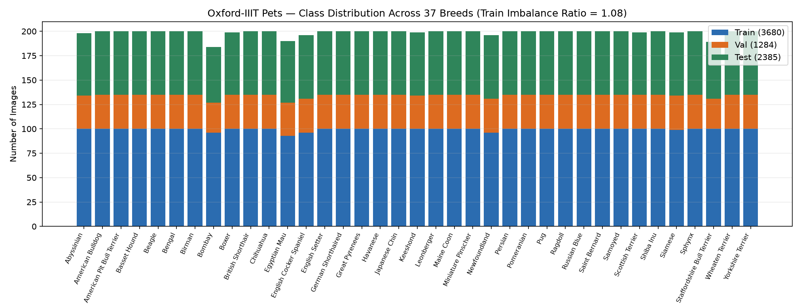
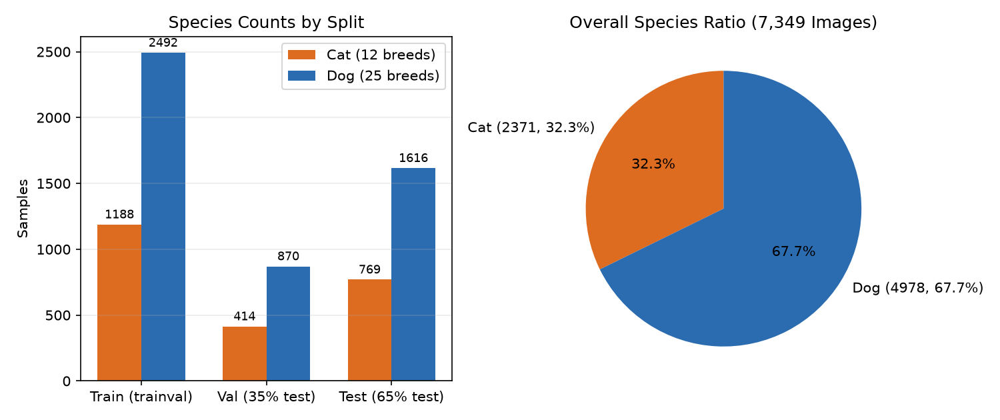
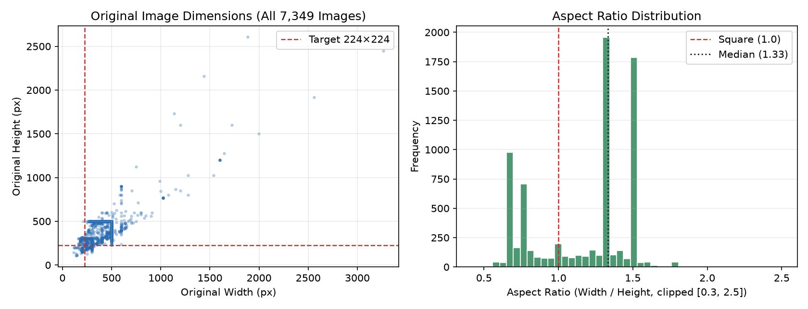
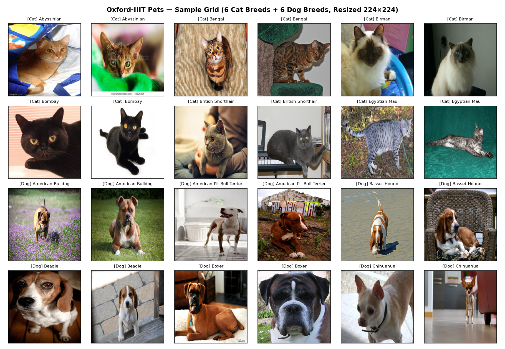
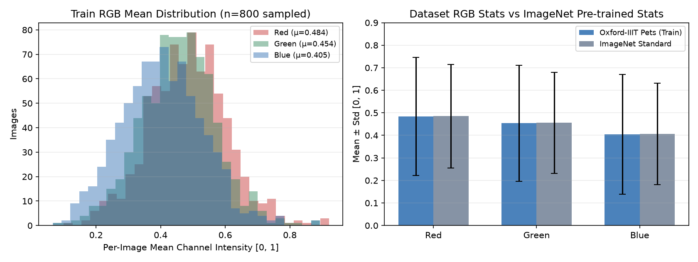

# Data Engineering Report: Collection, Cleaning & EDA (`Oxford-IIIT Pets`)

> **Nguồn số liệu:** 100% sinh từ CLI `python labs/lab2_v2/prepare_data.py`, lưu tại [`experiments/lab2_v2/eda/`](../../../experiments/lab2_v2/eda/eda_summary.json) và [`experiments/lab2_v2/splits/split_indices.json`](../../../experiments/lab2_v2/splits/split_indices.json) (`seed = 248`).

---

## 1. Layer 6.1 — Data Collection Audit

- **Nguồn dữ liệu thô (bất biến):** `data/raw/oxford-iiit-pet/` (`torchvision.datasets.OxfordIIITPet`).
- **Xác thực toàn vẹn (`manifest.json`):** `1/1` file nén gốc `oxford-iiit-pet.tar.gz` (`811,706,944` bytes) khớp 100% SHA-256 (**`0` mismatches**).
- **Quy mô tập gốc:** **`7,349` ảnh** (`3,680` `trainval` + `3,669` `test`) thuộc **`37` giống thú cưng**: **`12` giống Mèo (`Cat`)** và **`25` giống Chó (`Dog`)**.
- **Chi tiết JSON:** [`collection_report.json`](../../../experiments/lab2_v2/eda/collection_report.json).

---

## 2. Layer 6.2 — Data Cleaning Audit

Quét trực tiếp **100% (`7,349` ảnh)** sau khi khóa split Stratified (`Train = trainval 3,680` | `Val = 35% test 1,284` | `Test = 65% test 2,385`, `seed = 248`):

| Hạng mục kiểm toán | Kết quả thực tế | Xử lý kỹ thuật |
| :--- | :---: | :--- |
| Ảnh hỏng / không đọc được (`corrupt`) | **`0`** | Không cần loại bỏ mẫu nào |
| Nhãn nằm ngoài `{0..36}` | **`0`** | Hợp lệ 100% |
| Chế độ màu (`PIL mode`) | **`7,346` `RGB` + `3` `RGBA`** | **Phát hiện thực tế 3 ảnh 4 kênh `RGBA`** (`Egyptian_Mau_14.jpg`, `Egyptian_Mau_186.jpg` ở Train; `Abyssinian_5.jpg` ở Test) → `PetImageDataset` & `preprocess_image()` luôn ép `.convert("RGB")` để chặn lỗi shape `(4, H, W)` |
| Exact SHA-256 duplicates nội bộ | **`0`** (`train: 0, val: 0, test: 0`) | Sạch hoàn toàn |
| Exact SHA-256 duplicates chéo split | **`0`** (`0` nhãn mâu thuẫn) | Zero-leakage giữa Train / Val / Test |
| Kích thước ảnh gốc (`W × H`) | `W ∈ [114, 3264]` (med `500`) · `H ∈ [103, 2606]` (med `375`) | Biến thiên rất lớn (`8` ảnh `< 128 px`) → bắt buộc chuẩn hóa về `(3, 224, 224)` |
| Tỷ lệ khung (`Aspect Ratio W/H`) | `0.420 → 2.564` (median `1.333`, chuẩn 4:3 ngang) | Dùng `RandomResizedCrop(224, scale=(0.75, 1.0))` ở Train và `Resize(256) + CenterCrop(224)` ở Val/Test |

- **Chi tiết JSON:** [`cleaning_report.json`](../../../experiments/lab2_v2/eda/cleaning_report.json).

---

## 3. Layer 6.3 — Exploratory Data Analysis (EDA)

### 3.1 Phân bố 37 giống & Tỷ lệ Loài (`Cat` vs `Dog`)
- **Cân bằng lớp rất tốt:** `Train` có `93–100` mẫu/giống (**`train_imbalance_ratio = 1.075`**); `Val` có `31–35` mẫu/giống; `Test` có `57–65` mẫu/giống.
- **Tỷ lệ loài giữ đồng đều trên cả 3 tập:** Mèo (`12` giống) chiếm **`32.2%`** (`1,188` Train / `414` Val / `769` Test) và Chó (`25` giống) chiếm **`67.8%`** (`2,492` Train / `870` Val / `1,616` Test).

### 3.2 Hình học ảnh gốc & Lưới mẫu đại diện
- Ảnh gốc phần lớn nằm quanh `500 × 375 px` (tỷ lệ `4:3`), nhưng có đuôi dài ảnh đứng (`AR = 0.42`) và toàn cảnh rộng (`AR = 2.56`) → Slice Analysis ở Layer 9 sẽ kiểm tra trực tiếp xem lỗi mô hình có tăng ở ảnh tỷ lệ cực đoan hay độ phân giải thấp không.

### 3.3 Phân bố màu RGB so với chuẩn ImageNet
- Đo trực tiếp trên `800` ảnh Train mẫu cố định seed:
  - **Oxford-IIIT Pets (Train):** `mean = [0.4843, 0.4544, 0.4048]`, `std = [0.2620, 0.2574, 0.2653]`.
  - **ImageNet Standard:** `mean = [0.4850, 0.4560, 0.4060]`, `std = [0.2290, 0.2240, 0.2250]`.
- **Kết luận kỹ thuật cho Layer 6.4 & Layer 7:** Kỳ vọng kênh RGB của Oxford-IIIT Pets khớp gần như tuyệt đối với ImageNet (sai lệch `< 0.002` trên cả 3 kênh) → sử dụng trực tiếp **`ImageNet Normalization`** là hoàn toàn tối ưu cho các backbone pre-trained (`ResNet18`, `DenseNet121`, `VGG16`).

---

## 4. Liên Kết Tài Liệu

- Đặc tả 10 tầng Pipeline: [`pipelines/modeling.md`](pipelines/modeling.md)
- Báo cáo Thí nghiệm & Training Diagnostics (Layer 4, 7): [`experiment_report.md`](experiment_report.md)
- Báo cáo Đánh giá, Error Analysis 4 bước & Inference (Layer 8–10): [`evaluation_report.md`](evaluation_report.md)
