# Evaluation & Error Analysis Report: Model Selection (`Val 1,284`), Final Test (`2,385`) & Inference (`Oxford-IIIT Pets`)

> **Phạm vi tài liệu (Layer 8 → Layer 9 → Layer 10):** Tài liệu này tập trung trọn vẹn toàn bộ hoạt động **Đánh giá & Chọn mô hình trên Validation (`1,284` mẫu — Layer 8.1–8.2)**, **Đánh giá chung kết trên tập Test độc lập (`2,385` mẫu — Layer 8.3)**, **Error Analysis 4 bước định lượng (Layer 9)** và **Kiểm chứng Inference đa kiến trúc (Layer 10)**.
> - Thiết kế chuỗi `9` runs, Sanity Checks và chẩn đoán động học huấn luyện (Training Diagnostics) nằm riêng tại **[`experiment_report.md`](experiment_report.md)**.
> - Kiểm toán dữ liệu `7,349` ảnh & EDA (Layer 6.1–6.3) xem tại **[`eda_report.md`](eda_report.md)**.
> - Đặc tả 10 tầng Pipeline & quy tắc chọn mô hình xem tại **[`pipelines/modeling.md`](pipelines/modeling.md)**.

---

## 1. Tóm Tắt Đánh Giá (Executive Summary)

- **Kỷ luật chống Data Leakage:** Chia Stratified cố định `3,680` Train (`100% trainval`) / `1,284` Val (`35% test`) / `2,385` Test (`65% test`, `seed = 248`, khóa tại [`split_indices.json`](../../../experiments/lab2_v2/splits/split_indices.json)); chuẩn hóa ImageNet nhất quán (khớp thống kê RGB thực tế của Train trong `< 0.002` — [`eda_report.md`](eda_report.md)). Toàn bộ `9/9` runs được xếp hạng và chọn winner hoàn toàn trên **Val (`1,284` mẫu)**; **tập Test (`2,385` mẫu) chỉ mở duy nhất 1 lần cuối** cho đúng `2` mô hình chung kết (`resnet18_scratch` vs `densenet121_transfer`).
- **Kết quả chọn mô hình trên Validation (`1,284` mẫu — Layer 8.2):** **`densenet121_transfer`** thắng thuyết phục trên **mọi chỉ số** theo quy tắc `max(val_acc, val_macro_f1, -val_loss)` với **`Val Acc = 93.22%`**, **`Val Macro-F1 = 93.18%`**, **`Val Loss = 0.2409`**, **`Species Acc = 99.61%`** (`best_ep = 14`), vượt xa cả `resnet18_finetune` (`90.97%`) lẫn `vgg16_transfer` (`89.72%`).
- **Kết quả chung kết trên tập Test độc lập (`2,385` mẫu — Layer 8.3):**
  - **Baseline (`resnet18_scratch`, `11.20M` trainable, 20 ep):** `Test Loss = 1.7643` · `Test Acc = 47.09%` · `Macro-F1 = 46.26%` · `Species Acc = 88.34%`.
  - **Best Pre-trained (`densenet121_transfer`, chỉ `37,925` trainable = `0.54%` trong `6.99M`, 15 ep):** **`Test Loss = 0.2678`** · **`Test Acc = 91.91%`** · **`Macro-F1 = 91.76%`** · **`Species Acc = 99.71%`**.
  - **Gap cải thiện (`Best − Baseline`):** **`+44.82 pp` Test Accuracy**, **`+45.49 pp` Test Macro-F1**, **`-1.4965` Test Loss** — cải thiện F1 dương trên **100% (`37/37`) giống** (`+27.19 pp` đến `+77.85 pp`), và giảm lỗi nhầm khác loài (`Cat ↔ Dog`) tới **`39.7×`** (`278` lỗi → chỉ còn `7` lỗi).
- **Kiểm chứng suy luận (`densenet121_transfer/best.pt`, `27.55 MB`, RTX 4060):** Save/Load Parity `max_abs_diff = 0.0 < 1e-6` (**PASS**), độ trễ `19.29–20.13 ms/ảnh` (`BS = 1`) và `1.86–1.88 ms/ảnh` (`BS = 32` — nhanh gấp `2×` so với `VGG16`).

---

## 2. Đánh Giá Chuỗi 9 Runs & Chọn Mô Hình Trên Validation (`1,284` mẫu — Layer 8.1–8.2)

### 2.1 Quy tắc đánh giá & chọn mô hình

Áp dụng đúng quy tắc 2 tầng đã phê duyệt tại [`pipelines/modeling.md`](pipelines/modeling.md) (cài đặt tại `src/vibe_scripts/lab2_v2/trainer.py`):

1. **Trong nội bộ 1 run (`best.pt`):** chọn epoch có **`min(val_loss)`** để chặn overfitting/overconfidence.
2. **Giữa các runs (`winning_model_run_id`):** xếp hạng các ứng viên pre-trained trên Validation (`1,284` mẫu) theo thứ tự ưu tiên **`(val_acc, val_macro_f1, -val_loss)`** — ưu tiên `Accuracy` trên tập gần cân bằng (`imbalance_ratio = 1.075`), dùng `Macro-F1` đảm bảo đồng đều cả `37` giống (12 mèo + 25 chó) và `-val_loss` phá hòa.

### 2.2 Bảng xếp hạng toàn bộ `9/9` runs trên Validation (`1,284` mẫu)

- **Artifacts đánh giá Val:** [`ablation_summary.json`](../../../experiments/lab2_v2/ablation/ablation_summary.json) · [`ablation_table.csv`](../../../experiments/lab2_v2/ablation/ablation_table.csv) · `runs/<run_id>/eval/eval_metrics.json` (`9/9` runs hoàn tất).

| Hạng | Run ID | Nhóm / Trục | Trainable Params | Best Ep | Val Acc (%) _(Ưu tiên 1)_ | Val Macro-F1 (%) _(Ưu tiên 2)_ | Val Loss _(Ưu tiên 3)_ | Species Acc (%) | Save/Load Parity | `eval_metrics.json` |
| :-: | :--- | :--- | :---: | :-: | :---: | :---: | :---: | :---: | :---: | :-: |
| **#1** | **`densenet121_transfer`** | **Kiến trúc (WINNER)** | `37.9K (0.54%)` | 14 | **`93.22`** | **`93.18`** | **`0.2409`** | **`99.61`** | `0.0` (PASS) | [link](../../../experiments/lab2_v2/runs/densenet121_transfer/eval/eval_metrics.json) |
| #2 | `resnet18_finetune` | Fine-Tune (`layer4`) | `8.41M (75.14%)` | 10 | `90.97` | `90.88` | `0.2989` | `99.61` | `0.0` (PASS) | [link](../../../experiments/lab2_v2/runs/resnet18_finetune/eval/eval_metrics.json) |
| #3 | `resnet18_transfer` | Transfer Anchor | `19.0K (0.17%)` | 15 | `90.03` | `89.93` | `0.3125` | `99.14` | `0.0` (PASS) | [link](../../../experiments/lab2_v2/runs/resnet18_transfer/eval/eval_metrics.json) |
| #4 | `resnet18_transfer_bs64` | Ablation: `BS = 64` | `19.0K (0.17%)` | 15 | `90.03` | `89.91` | `0.3311` | `99.22` | `0.0` (PASS) | [link](../../../experiments/lab2_v2/runs/resnet18_transfer_bs64/eval/eval_metrics.json) |
| #5 | `resnet18_transfer_bs16` | Ablation: `BS = 16` | `19.0K (0.17%)` | 15 | `89.72` | `89.62` | `0.3097` | `99.07` | `0.0` (PASS) | [link](../../../experiments/lab2_v2/runs/resnet18_transfer_bs16/eval/eval_metrics.json) |
| #6 | `vgg16_transfer` | Kiến trúc (`VGG16`) | `151.6K (0.11%)` | 13 | `89.72` | `89.59` | `0.2770` | `99.53` | `0.0` (PASS) | [link](../../../experiments/lab2_v2/runs/vgg16_transfer/eval/eval_metrics.json) |
| #7 | `resnet18_transfer_lr5e3` | Ablation: `LR = 5e-3` | `19.0K (0.17%)` | 15 | `89.02` | `88.94` | `0.3629` | `99.38` | `0.0` (PASS) | [link](../../../experiments/lab2_v2/runs/resnet18_transfer_lr5e3/eval/eval_metrics.json) |
| #8 | `resnet18_transfer_lr1e4` | Ablation: `LR = 1e-4` | `19.0K (0.17%)` | 15 | `87.07` | `86.84` | `0.8219` | `98.83` | `0.0` (PASS) | [link](../../../experiments/lab2_v2/runs/resnet18_transfer_lr1e4/eval/eval_metrics.json) |
| *Base* | `resnet18_scratch` | Baseline (Train từ đầu) | `11.20M (100%)` | 19 | `46.26` | `45.66` | `1.8102` | `86.68` | `0.0` (PASS) | [link](../../../experiments/lab2_v2/runs/resnet18_scratch/eval/eval_metrics.json) |

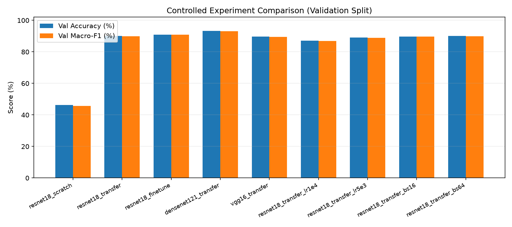

### 2.3 Phân tích so sánh 3 Kiến trúc & Lý do chốt `densenet121_transfer`

| Tiêu chí so sánh (Val `1,284` mẫu) | `resnet18_transfer` | `resnet18_finetune` | **`densenet121_transfer`** _(WINNER)_ | `vgg16_transfer` |
| :--- | :---: | :---: | :---: | :---: |
| Tổng tham số / Trainable | `11.20M` / `19.0K` | `11.20M` / `8.41M` | **`6.99M` / `37.9K`** | `134.41M` / `151.6K` |
| **Val Accuracy (%)** | `90.03%` | `90.97%` | **`93.22%`** (`+2.25 pp` vs #2) | `89.72%` |
| **Val Macro-F1 (%)** | `89.93%` | `90.88%` | **`93.18%`** (`+2.30 pp` vs #2) | `89.59%` |
| **Val Loss** | `0.3125` | `0.2989` | **`0.2409`** (`-0.0580` vs #2) | `0.2770` |
| Peak Training VRAM / Train Time | `183 MB` / `457.0s` | `279 MB` / `484.9s` | **`200 MB` / `423.6s`** | `1,318 MB` / `624.2s` |
| Kích thước Checkpoint (`best.pt`) | `42.93 MB` | `106.98 MB` | **`27.55 MB`** | `513.91 MB` |

- **Tại sao `densenet121_transfer` áp đảo toàn diện cả về độ chính xác lẫn hiệu suất?**
  1. **Cơ chế Dense Feature Reuse phù hợp lý tưởng với bài toán Fine-Grained:** Trong `DenseNet121`, mỗi tầng nhận trực tiếp feature maps ghép nối (concatenation) từ toàn bộ các tầng trước trong khối, giúp vector đặc trưng cuối `1,024-d` bảo toàn đồng thời **chi tiết cục bộ tầm thấp** (họa tiết đốm/vằn lông, màu mắt, độ dài lông) và **ngữ nghĩa hình khối tầm cao** (tỷ lệ hộp sọ, dáng tai) — vượt trội vector `512-d` của `ResNet18` (dù `DenseNet121` ít tổng tham số hơn `37.6%`, chỉ `6.99M`).
  2. **Tránh overfitting tốt hơn `resnet18_finetune` trên tập vừa (`3,680` ảnh):** Mở khóa `layer4` giúp `ResNet18` tăng `+0.94 pp` Val Acc (`90.03% → 90.97%`), nhưng phải trả giá bằng `8.41M` tham số trainable (`train_acc = 100%`, `gap = +9.01 pp`). Trong khi đó `densenet121_transfer` chỉ train duy nhất đầu tuyến tính `37,925` tham số (`0.54%`), giữ gap nhỏ (`+5.58 pp`) mà vẫn vượt `resnet18_finetune` tới **`+2.25 pp` Val Acc** và `-0.0580` Val Loss.
  3. **Khác biệt thế hệ so với `VGG16`:** Dù `VGG16` có `134.41M` tham số (`19.2×` DenseNet121, VRAM `6.6×`, checkpoint `18.7×`), kiến trúc xếp chồng thuần `3×3` không có `BatchNorm` hay kết nối tắt cho chất lượng đặc trưng yếu nhất trong 3 kiến trúc (`89.72%` Val Acc, chỉ tương đương `resnet18_transfer` `90.03%`).
  4. **Tác động của siêu tham số (`LR` & `BS`):** Trên `ResNet18` transfer, `lr = 1e-3` thắng cả `1e-4` (`-2.96 pp`, underfit) lẫn `5e-3` (`-1.01 pp`, dao động & overfit gap lớn nhất `+10.52 pp`); `BS = 32` (`90.03%`, `0.3125`) cân bằng tốt nhất giữa `BS = 16` (`89.72%`, `0.3097`) và `BS = 64` (`90.03%`, `0.3311`).

---

## 3. Đánh Giá Cuối Trên Tập Test Độc Lập (`2,385` mẫu — Layer 8.3, Chấm 1 Lần Duy Nhất)

### 3.1 So sánh tổng thể (`Baseline Scratch` vs `Winning Pre-trained Model`)

| Model | Run ID | Total / Trainable Params | Test Loss | Test Accuracy (%) | Test Macro-F1 (%) | Species Acc (%) | Save/Load Parity |
| :--- | :--- | :---: | :---: | :---: | :---: | :---: | :---: |
| Baseline (Scratch, 20 ep) | `resnet18_scratch` | `11.20M` / `11.20M` (`100%`) | `1.7643` | `47.09` | `46.26` | `88.34` | `0.0` (PASS) |
| **Best Model** _(chốt từ Val §2)_ | **`densenet121_transfer`** | **`6.99M` / `37.9K` (`0.54%`)** | **`0.2678`** | **`91.91`** | **`91.76`** | **`99.71`** | **`0.0` (PASS)** |
| **Chênh lệch (`Best − Baseline`)** | — | **`-4.20M` tổng / `-99.66%` trainable** | **`-1.4965`** | **`+44.82 pp`** | **`+45.49 pp`** | **`+11.36 pp`** | — |

- **Khả năng tổng quát hóa Val → Test:** `densenet121_transfer` đạt `93.22%` (Val) → **`91.91%` (Test)** (`chênh -1.31 pp`), còn `resnet18_scratch` đạt `46.26%` (Val) → `47.09%` (Test) — xác nhận không có hiện tượng rò rỉ hay thiên lệch chọn mô hình.
- **Artifacts đánh giá Test:** [`test_comparison.json`](../../../experiments/lab2_v2/evaluation/test_comparison.json) · [`test_comparison.csv`](../../../experiments/lab2_v2/evaluation/test_comparison.csv) · [`per_class_metrics.json`](../../../experiments/lab2_v2/evaluation/per_class_metrics.json) · [`species_analysis.json`](../../../experiments/lab2_v2/evaluation/species_analysis.json) · [`resnet18_scratch/test_eval`](../../../experiments/lab2_v2/runs/resnet18_scratch/test_eval/eval_metrics.json) · [`densenet121_transfer/test_eval`](../../../experiments/lab2_v2/runs/densenet121_transfer/test_eval/eval_metrics.json).

### 3.2 Phân tích theo Loài (`Cat` 12 giống vs `Dog` 25 giống — `species_analysis.json`)

| Chỉ số trên tập Test (`2,385` mẫu = `769` Cat + `1,616` Dog) | `resnet18_scratch` | **`densenet121_transfer`** | Chênh lệch / Giảm lỗi |
| :--- | :---: | :---: | :---: |
| **Species Accuracy (`Cat vs Dog`)** | `88.34%` | **`99.71%`** | **`+11.36 pp`** |
| **Cat Breed Accuracy (`12` giống, `769` mẫu)** | `49.67%` | **`88.17%`** | **`+38.49 pp`** |
| **Dog Breed Accuracy (`25` giống, `1,616` mẫu)** | `45.85%` | **`93.69%`** | **`+47.83 pp`** |
| **Tổng số mẫu dự đoán sai** | `1,262` (`52.91%`) | **`193` (`8.09%`)** | Giảm **`6.5×`** |
| Lỗi nội loài Mèo (`Cat → Cat`) | `276` | `87` (`45.1%` tổng lỗi) | Giảm `3.2×` |
| Lỗi nội loài Chó (`Dog → Dog`) | `708` | `99` (`51.3%` tổng lỗi) | Giảm `7.2×` |
| **Lỗi khác loài (`Cat ↔ Dog`)** | `278` (`22.0%` tổng lỗi) | **`7` (`3.6%` tổng lỗi)** | **Giảm `39.7×`** |

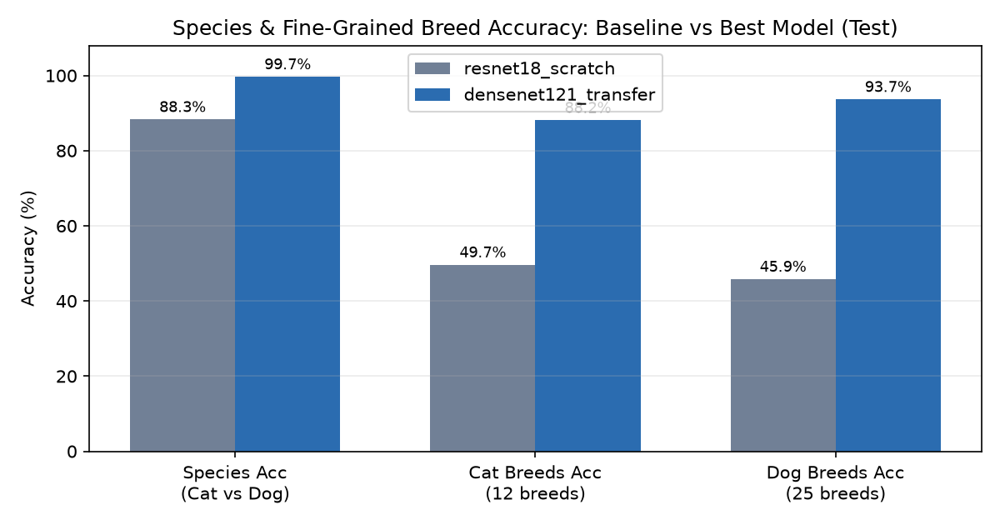

- **Nhận xét quan trọng:** Ở mức phân biệt loài thô (`Cat vs Dog`), `densenet121_transfer` đạt gần tuyệt đối (**`99.71%`**, chỉ `7/2,385` lỗi). Tuy nhiên ở mức **phân loại giống tinh (fine-grained)**, tỷ lệ sai của nhóm **Mèo (`11.83%`, `87` lỗi nội mèo + `4` lỗi Cat→Dog trên `769` mẫu)** cao gần gấp đôi nhóm **Chó (`6.31%`, `99` lỗi nội chó + `3` lỗi Dog→Cat trên `1,616` mẫu)** — do các giống mèo trong bộ dữ liệu có kích thước/hình thể tương đồng mạnh hơn nhiều so với sự đa dạng hình thể giữa các giống chó (ví dụ `Pug` vs `Great Pyrenees` vs `Newfoundland`), đồng thời ImageNet-1k có tới `~120` lớp giống chó nhưng chỉ `~5` lớp mèo nhà (`tabby`, `tiger cat`, `Persian`, `Siamese`, `Egyptian cat`)!

### 3.3 Hiệu năng Per-Class trên Test (`37/37` giống cải thiện dương)

`densenet121_transfer` vượt `resnet18_scratch` trên **toàn bộ `37/37` giống** (mức tăng F1 thấp nhất là `+27.19 pp` ở `Bombay` và cao nhất là **`+77.85 pp`** ở `English Cocker Spaniel`: `19.82% → 97.67%`):

| Nhóm giống | Giống (`Species`) | Baseline F1 (%) | Best Model P / R (%) | **Best Model F1 (%)** | F1 Gain |
| :--- | :--- | :---: | :---: | :---: | :---: |
| **Top-5 Tốt nhất** | `Newfoundland` (Dog) | `53.12` | `100.0 / 100.0` | **`100.00`** | `+46.88 pp` |
| | `Keeshond` (Dog) | `59.15` | `100.0 / 100.0` | **`100.00`** | `+40.85 pp` |
| | `Japanese Chin` (Dog) | `61.02` | `98.5 / 100.0` | **`99.24`** | `+38.22 pp` |
| | `Pug` (Dog) | `60.66` | `100.0 / 98.5` | **`99.22`** | `+38.57 pp` |
| | `Leonberger` (Dog) _(đồng hạng `Great Pyrenees`)_ | `58.16` | `100.0 / 98.5` | **`99.22`** | `+41.07 pp` |
| **Top-5 Khó nhất** | **`Staffordshire Bull Terrier` (Dog)** | `18.56` | `65.4 / 58.6` | **`61.82`** | `+43.26 pp` |
| | **`American Pit Bull Terrier` (Dog)** | `9.43` | `75.0 / 60.0` | **`66.67`** | `+57.23 pp` |
| | **`Ragdoll` (Cat)** | `37.33` | `77.4 / 73.8` | **`75.59`** | `+38.26 pp` |
| | **`American Bulldog` (Dog)** | `36.22` | `69.9 / 89.2` | **`78.38`** | `+42.16 pp` |
| | **`Maine Coon` (Cat)** | `43.70` | `88.1 / 80.0` | **`83.87`** | `+40.17 pp` |

*(Chi tiết đủ 37 lớp xem tại [`per_class_metrics.json`](../../../experiments/lab2_v2/evaluation/per_class_metrics.json).)*

### 3.4 Biểu đồ đối chiếu Finalists

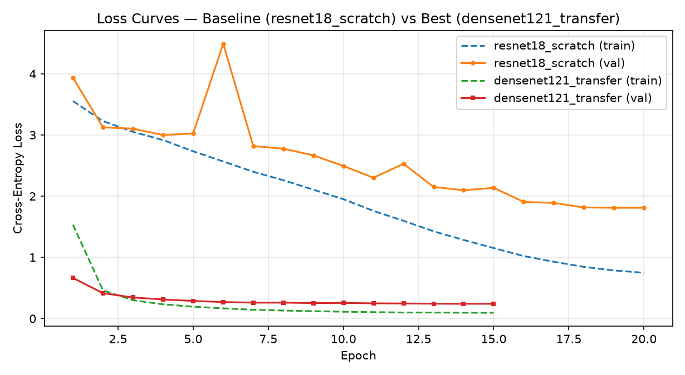

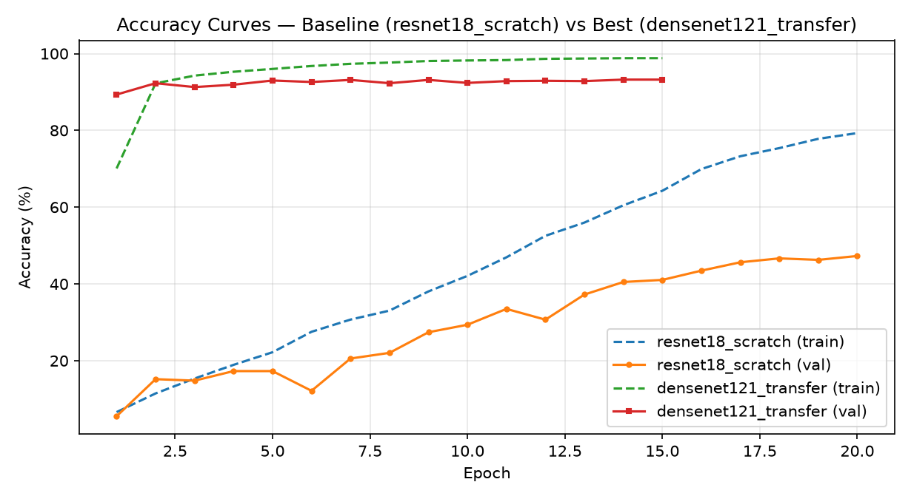

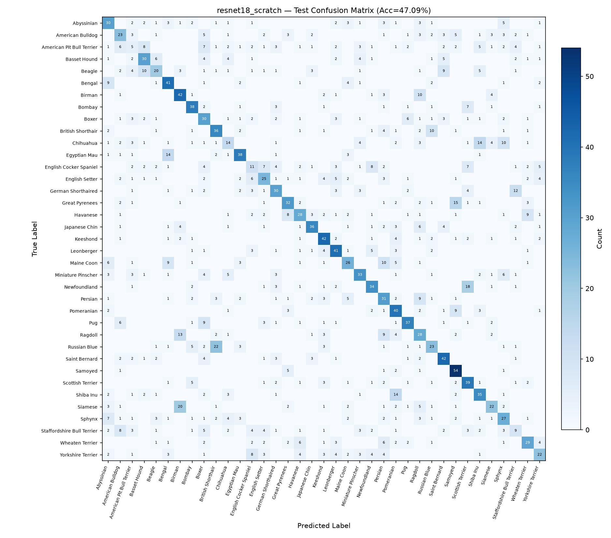

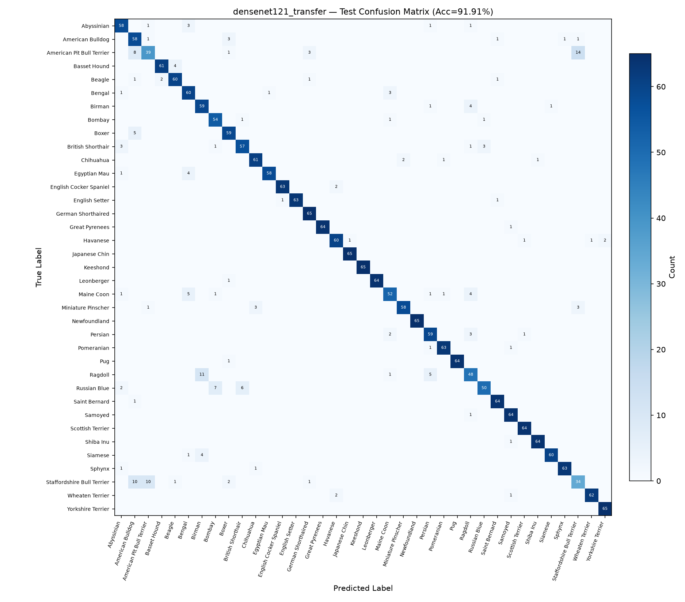

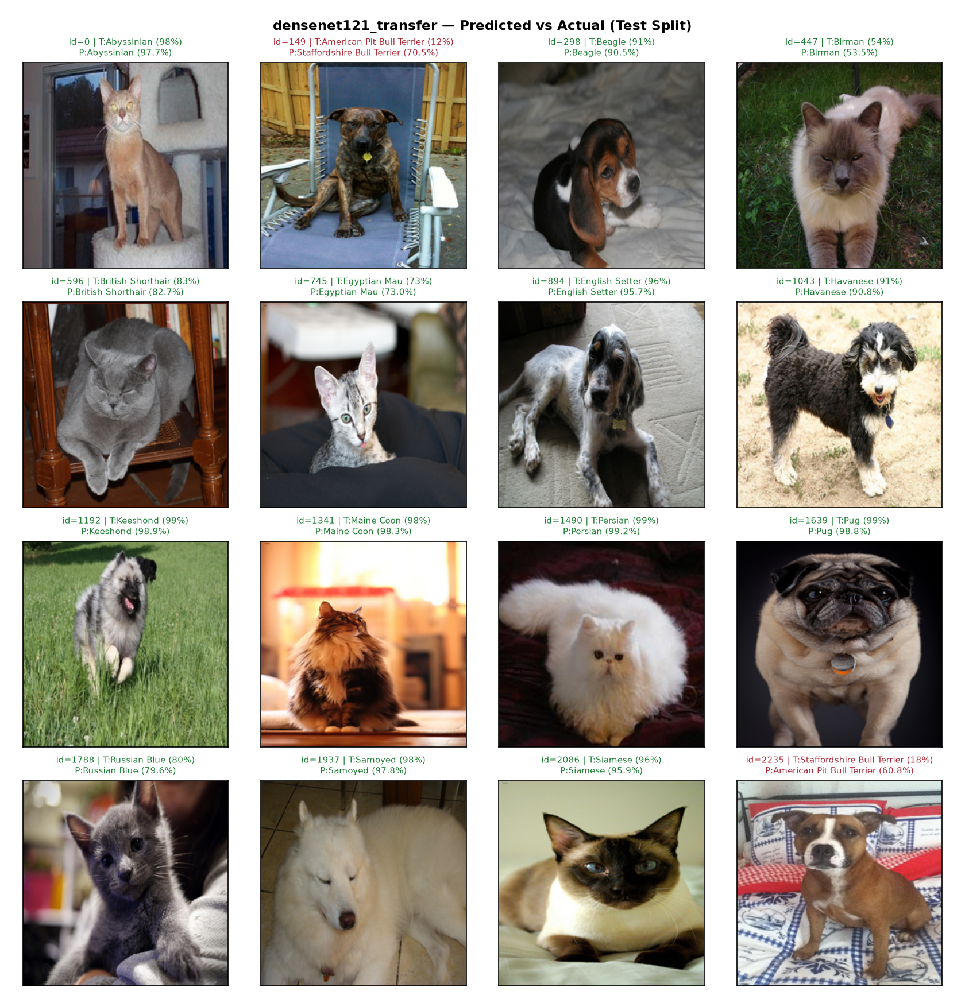

---

## 4. Error Analysis — Phân Tích Lỗi 4 Bước Định Lượng (_Layer 9: Model sai ở đâu và vì sao?_)

Mục này phân tích toàn bộ **`193` mẫu dự đoán sai** (trên `2,385` mẫu Test) của `densenet121_transfer` theo quy trình **4 bước định lượng** (`python labs/lab2_v2/evaluate.py --error-analysis`).

### 4.1 Bước 1 — Lỗi ở đâu? (Row-Normalized CM `37×37` & Top cặp nhầm lẫn)

- **Top-7 cặp nhầm lẫn lớn nhất ([`error_analysis.json`](../../../experiments/lab2_v2/evaluation/error_analysis.json), `100%` đều là lỗi nội loài):**
  1. **`American Pit Bull Terrier → Staffordshire Bull Terrier`**: **`14`** mẫu (`21.54%` hàng)
  2. **`Ragdoll → Birman`**: **`11`** mẫu (`16.92%` hàng)
  3. **`Staffordshire Bull Terrier → American Bulldog`**: **`10`** mẫu (`17.24%` hàng)
  4. **`Staffordshire Bull Terrier → American Pit Bull Terrier`**: **`10`** mẫu (`17.24%` hàng)
  5. **`American Pit Bull Terrier → American Bulldog`**: **`8`** mẫu (`12.31%` hàng)
  6. `Russian Blue → Bombay`: `7` mẫu (`10.77%` hàng) · `Russian Blue → British Shorthair`: `6` mẫu (`9.23%` hàng)
- **Độ tập trung cực cao vào 2 cụm giống tinh:**
  - Riêng **Top-3 cặp** chiếm **`35 / 193` (`18.1%`)** tổng lỗi Test.
  - Riêng **cụm chó Bully (`{APBT, Staffordshire Bull Terrier, American Bulldog}` + `Boxer → American Bulldog`)** chiếm tới **`47 / 193` (`24.4%`)** tổng số lỗi trên toàn bộ `37` giống!
  - Ở nhóm Mèo, lỗi tập trung vào 3 cặp gần ngoại hình nhất: **mèo màu điểm lông dài** (`Ragdoll ↔ Birman` `15`, `Ragdoll → Persian` `5`, `Siamese → Birman` `4`), **mèo lông xám/đen ngắn** (`Russian Blue → Bombay/British Shorthair` `13`), và **mèo vằn/đốm** (`Maine Coon → Bengal` `5`, `Egyptian Mau → Bengal` `4`).
- **Toàn bộ `7` lỗi khác loài hiếm hoi (`0.29%` tập Test):** `Abyssinian → APBT` (`1`), `American Bulldog → Sphynx` (`1`), `Maine Coon → Pomeranian` (`1`), `Persian → Scottish Terrier` (`1`), `Pomeranian → Persian` (`1`), `Samoyed → Ragdoll` (`1`), `Sphynx → Chihuahua` (`1`) — hầu hết xảy ra giữa các giống có ngoại hình đặc biệt trùng khớp về độ dài/trụi lông (vd. `Sphynx ↔ Chihuahua`, `Pomeranian ↔ Persian/Maine Coon`, `Samoyed ↔ Ragdoll`).

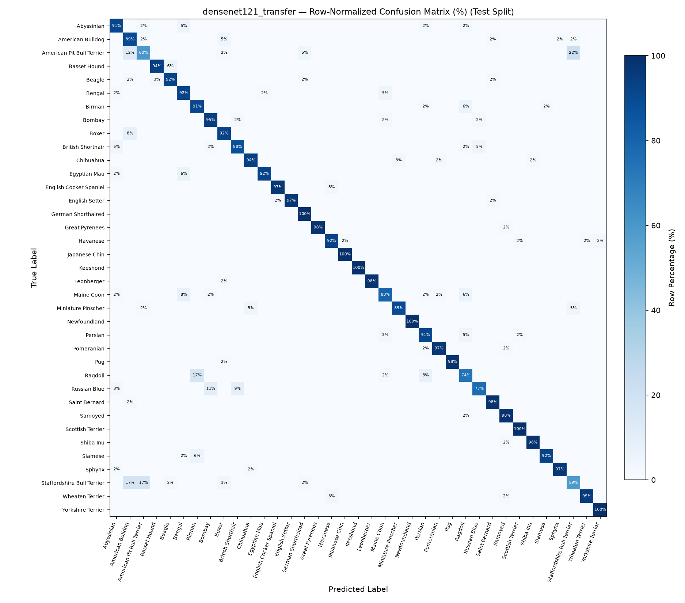

### 4.2 Bước 2 — Lỗi trông như thế nào? (Error Gallery Top-3 cặp theo Confidence)

Lọc riêng **`35` mẫu lỗi thuộc Top-3 cặp** (`APBT → Staffy`, `Ragdoll → Birman`, `Staffy → American Bulldog`), tách 2 nhóm **16 lỗi tự tin cao (`70.7%–95.5%`)** và **16 lỗi lưỡng lự vùng ranh giới (`40.9%–64.2%`)**:

| 16 Lỗi Confidence Cao (`70.7%–95.5%`) | 16 Lỗi Confidence Thấp — Vùng Ranh Giới (`40.9%–64.2%`) |
| :---: | :---: |
| 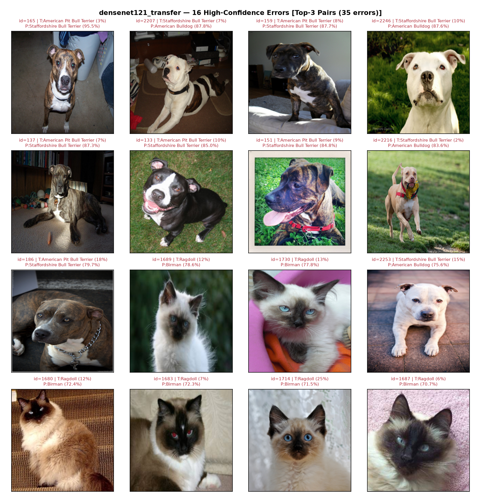 | 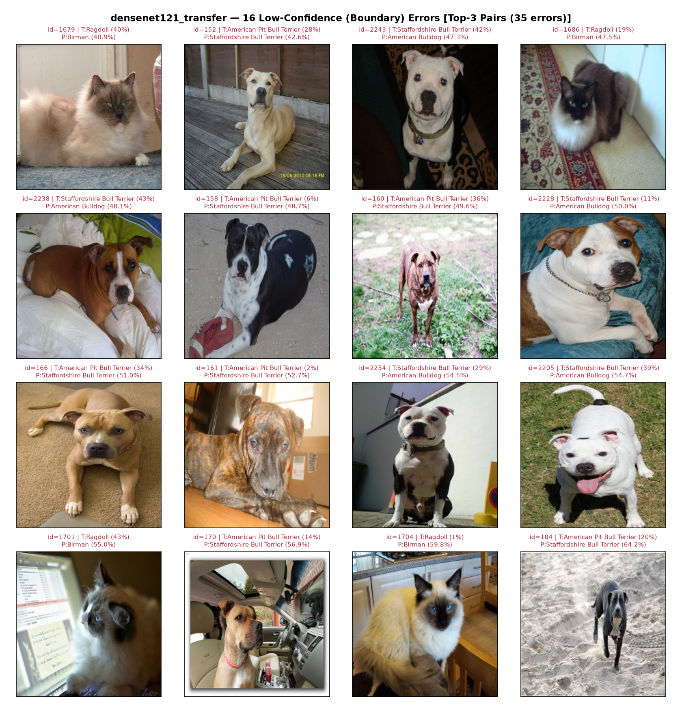 |

- **Nhóm High-Conf (`70.7%–95.5%`):** Các ảnh đều sắc nét, rõ chủ thể, nhưng đầu tuyến tính trên backbone đóng băng dựa mạnh vào **màu lông shortcut**: chó Staffy/APBT bộ lông trắng hoặc khoang trắng-nâu bị kéo mạnh sang `American Bulldog` (`id=2207, 2246, 2216, 2253`), APBT lông vện hoặc đen-trắng bị đoán sang `Staffy` (`id=165, 159, 137, 133`), còn mèo `Ragdoll` màu điểm (seal-point mặt tối, mắt xanh) chụp cận che mất thân/bàn chân bị nhầm sang `Birman` (`id=1689, 1730, 1680, 1683`).
- **Nhóm Low-Conf (`40.9%–64.2%`):** Mô hình thể hiện độ hiệu chuẩn xác suất tốt — ở những mẫu biên rất gần (`id=1679 Ragdoll 40.3% vs Birman 40.9%`, `id=2243 Staffy 42% vs American Bulldog 47.3%`, `id=2238 43% vs 48.1%`, `id=1701 43% vs 55.0%`), nhãn đúng luôn nằm ngay **Top-2** với xác suất sát nút.

### 4.3 Bước 3 — Nguyên nhân nào chiếm bao nhiêu %? (Gán nhãn định lượng `N = 60` ảnh thật)

Kiểm tra trực quan **`60` ảnh lỗi phân tầng** lấy từ toàn bộ `193` lỗi Test (**`30` mẫu High-Conf nhất `[85.0%–99.6%]` + `30` mẫu Low-Conf nhất `[21.1%–43.0%]`**; bảng gán nhãn chi tiết từng mẫu cùng ghi chú trực quan lưu tại [`error_taxonomy_60.csv`](../../../experiments/lab2_v2/evaluation/error_taxonomy_60.csv) và [`error_taxonomy_60.json`](../../../experiments/lab2_v2/evaluation/error_taxonomy_60.json)):

| Nguyên nhân gốc | Tổng (`N = 60`) | High-Conf (`n = 30`, `85.0%–99.6%`) | Low-Conf (`n = 30`, `21.1%–43.0%`) | Ví dụ tiêu biểu trên Audit Sheets |
| :--- | :---: | :---: | :---: | :--- |
| **`Model Limitation`** _(ảnh rõ, mô hình đóng băng hụt đặc trưng tinh)_ | **`50.0%` (`30`)** | **`60.0%` (`18`)** | `40.0%` (`12`) | `#5, #7 (Sphynx→Chihuahua), #8, #10, #15, #17, #21, #49, #52, #53, #59` |
| **`Ambiguity / Framing`** _(cắt cận, che khuất, tối/mờ, ảnh trắng-đen, chó/mèo con)_ | **`41.7%` (`25`)** | `26.7%` (`8`) | **`56.7%` (`17`)** | `#1, #3 (cánh tiên), #12, #19 (ám sắc), #31, #36, #37 (quay lưng bơi), #40, #44 (ảnh trắng-đen), #55` |
| **`Label Noise / Overlap`** _(ảnh rõ nhưng ngoại hình trái ngược nhãn gốc)_ | **`8.3%` (`5`)** | **`13.3%` (`4`)** | `3.3%` (`1`) | `#2 (Boxer gán nhãn Pug), #11, #27 (Maine Coon gán nhãn Persian), #28, #39` |

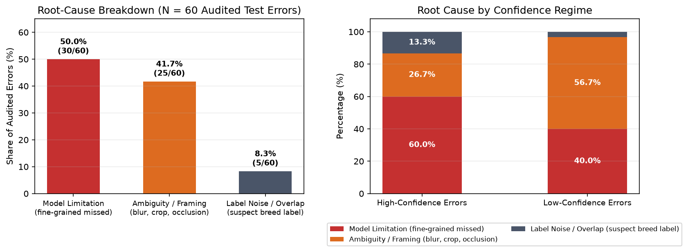

<b>Xem trực tiếp 3 bảng ảnh gốc kiểm toán 60 mẫu (#1–#60)</b>

#### Sheet 1 — Errors `#1–#20` (`High-Conf`: `88.2%–99.6%`)

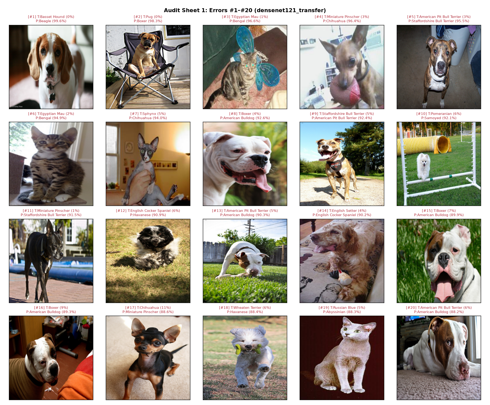

#### Sheet 2 — Errors `#21–#40` (`#21–#30` High-Conf `85.0%–87.8%` · `#31–#40` Low-Conf `21.1%–36.8%`)

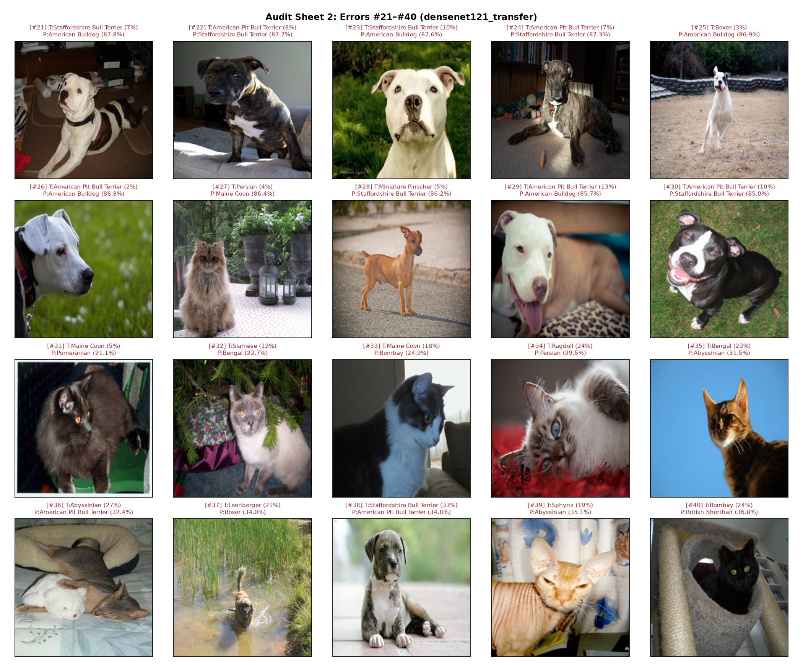

#### Sheet 3 — Errors `#41–#60` (`Low-Conf`: `37.0%–43.0%`)

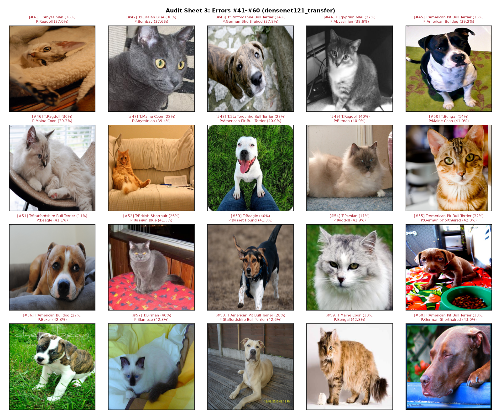

- **3 Insight cốt lõi rút ra từ kiểm toán trực quan `60` ảnh:**
  1. **`Model Limitation` chiếm tròn nửa số lỗi (`50.0%`, trội hẳn `60.0%` ở nhóm High-Conf):** Vì `densenet121_transfer` đóng băng toàn bộ backbone ImageNet và chỉ học 1 lớp tuyến tính `1,024 → 37`, mô hình hay dựa vào màu lông (trắng → `American Bulldog`, đen-vàng → `Miniature Pinscher`, trắng xù → `Samoyed`) thay vì tỷ lệ xương hàm/thân để tách các giống cực gần (`APBT/Staffy/American Bulldog`, `Ragdoll/Birman/Siamese`, `British Shorthair/Russian Blue`) — thậm chí dính `1` ca lỗi khác loài tự tin cao trên ảnh rõ (`#7 Sphynx → Chihuahua 94.0%`).
  2. **`Ambiguity / Framing` thống trị nhóm Low-Conf (`56.7%` so với `26.7%` ở High-Conf):** Khi gặp ảnh khó thật sự (ảnh trắng-đen `#44`, quay lưng bơi giữa đầm `#37`, đeo cánh tiên `#3`, chui trong hốc/chăn `#40, #41`, chó/mèo con sơ sinh `#6, #38, #55, #56`, ảnh tối mờ độ phân giải `< 67k px` `#31, #32, #33, #36`), độ tự tin của mô hình giảm mạnh xuống `21%–43%` — chứng minh khả năng **hiệu chuẩn xác suất (calibration)** của `densenet121_transfer` rất lành mạnh.
  3. **`Label Noise / Overlap` (`8.3%`) tập trung gấp `4×` ở nhóm High-Conf (`13.3%` vs `3.3%`):** Đúng bản chất của tập Oxford-IIIT Pets thu thập từ web/Flickr — một số ảnh rõ bị gán nhãn gốc đáng ngờ (`#2` chó dáng Boxer ngồi ghế gấp nhưng gán `Pug`, `#27` mèo mặt tam giác kiểu Maine Coon nhưng gán `Persian`, `#11, #28` chó khác xa `Miniature Pinscher`, `#39` mèo lông sọc cam gán `Sphynx`). _(Ghi chú minh bạch: 60 nhãn nguyên nhân được kiểm toán trực quan trực tiếp từ 3 Audit Sheets trên theo 3 tiêu chí rạch ròi; Kỹ sư có thể rà soát hoặc hiệu chỉnh trực tiếp từng dòng trong [`error_taxonomy_60.csv`](../../../experiments/lab2_v2/evaluation/error_taxonomy_60.csv).)_

### 4.4 Bước 4 — Slice Analysis & Quyết định ưu tiên hành động

Đo tỷ lệ lỗi của `densenet121_transfer` theo **3 thuộc tính ảnh** và **2 loài (`Cat` vs `Dog`)** trên toàn bộ `2,385` mẫu Test ([`slice_analysis.json`](../../../experiments/lab2_v2/evaluation/slice_analysis.json)):

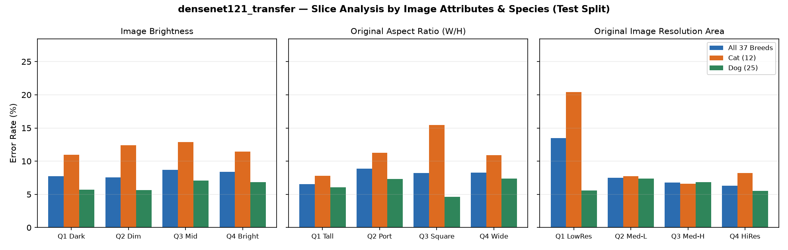

| Trục phân lát (Slice) | Phân vị nổi bật nhất | Tỷ lệ lỗi toàn bộ (`37` giống) | Tỷ lệ lỗi Mèo (`12` giống) | Tỷ lệ lỗi Chó (`25` giống) | Diễn giải kỹ thuật |
| :--- | :--- | :---: | :---: | :---: | :--- |
| **Độ phân giải gốc (`orig_area`)** _(Nổi bật nhất!)_ | **`Q1 LowRes` (`17.4k–166.5k` px)** vs `Q4 HiRes` (`187.5k–3.11M` px) | **`13.45%`** vs `6.33%` (**gấp `2.1×`**) | **`20.41%`** vs `8.19%` (**gấp `2.5×`**) | `5.56%` vs `5.51%` _(ổn định)_ | Ảnh mèo độ phân giải thấp (`< 400×400` px) mất sắc nét chi tiết lông/mắt/tai khi phóng & cắt về `224×224`, đẩy lỗi mèo vọt lên **`20.41%`**! |
| **Tỷ lệ khung gốc (`aspect_ratio`)** | `Q3 Square` (`1.33–1.50`) vs `Q1 Tall` (`0.42–0.75`) | `8.24%` vs `6.54%` | **`15.42%`** vs `7.81%` | `4.64%` vs `6.04%` | Khung `4:3` ở nhóm mèo tập trung nhiều ảnh trong nhà cỡ nhỏ/cận cảnh (`CenterCrop` cắt bớt thân/bàn chân). |
| **Độ sáng (`brightness`)** | `Q1 Dark` (`0.06–0.37`) vs `Q4 Bright` (`0.52–0.92`) | `7.72%` vs `8.38%` | `10.96%` vs `11.44%` | `5.71%` vs `6.82%` | Khá phẳng — chứng tỏ backbone ImageNet bất biến tốt với độ sáng tổng thể. |

- **Quyết định ưu tiên hành động (`MODEL_PIPELINE.md` Layer 9):**
  1. **Ưu tiên số 1 (`50.0%` Model Limitation → Layer 5 / 7.1):** **Fine-tune chọn lọc `DenseNet121`** (mở khóa `denseblock4 + norm5` với differential LR `5e-5 / 1e-3`, kết hợp `Label Smoothing = 0.1` và `Dropout` nhẹ trước `classifier`) để điều chỉnh đặc trưng tầng cao chuyên biệt cho cụm chó bully (`APBT/Staffy/American Bulldog`) và cụm mèo gần (`Ragdoll/Birman`, `Russian Blue/British Shorthair`) mà không overfit như unfreeze diện rộng.
  2. **Ưu tiên số 2 (`41.7%` Ambiguity + phát hiện Slice `Q1 LowRes` Cat `20.41%` → Layer 6.4):** Tăng độ phân giải đầu vào (`288×288` hoặc `384×384`), bổ sung augmentation chống cắt/che khuất (`RandomResizedCrop(scale=(0.75, 1.0))`, `ColorJitter` nhẹ, `RandomErasing`) và dùng **Test-Time Augmentation (Multi-Crop / Flip)** hoặc giữ nguyên tỷ lệ khung hình (letterbox pad) thay vì `CenterCrop` cứng làm mất thân/chân thú cưng.
  3. **Không đuổi theo `8.3%` Label Noise:** Không mở rộng mô hình quá lớn để cố ép đúng các nhãn nhiễu gốc của Oxford-IIIT Pets; ưu tiên `Label Smoothing` để tăng sức chống nhiễu nhãn.

---

## 5. Kiểm Chứng Suy Luận & Hiệu Năng Inference (_Layer 10 — `inference.py`_)

### 5.1 Kiểm chứng dự đoán mẫu thật (`Test[0]`)

Thực thi: `python labs/lab2_v2/inference.py --checkpoint experiments/lab2_v2/runs/densenet121_transfer/best.pt --sample-idx 0 --benchmark` trên `NVIDIA GeForce RTX 4060 Laptop GPU`:

- **Ảnh kiểm chứng:** `test[0]` (`Abyssinian_202.jpg`, Ground Truth: **`Abyssinian` (`Cat`)**).
- **Dự đoán Top-5 Softmax (`requires_grad = False`, `@torch.inference_mode()`):**
  1. **`Abyssinian` (`Cat`):** **`97.66%`** *(Chính xác)*
  2. `Bengal` (`Cat`): `1.00%`
  3. `Sphynx` (`Cat`): `0.37%`
  4. `Chihuahua` (`Dog`): `0.26%`
  5. `Egyptian Mau` (`Cat`): `0.18%`
- **Tự khôi phục độc lập:** `PetPredictor` tự đọc `model_config`, `norm_stats` và `class_names` nhúng trong checkpoint `best.pt`, ép `.convert("RGB")` an toàn với ảnh `RGBA/Grayscale`, và vượt qua kiểm tra Save/Load Parity **`max_abs_diff = 0.0 < 1e-6` (PASS)**.

### 5.2 So sánh hiệu năng suy luận & kích thước Checkpoint đa kiến trúc (`inference_benchmark.json`)

| Run ID | Kiến trúc & Mode | Checkpoint `.pt` (MB) | Latency `BS = 1` Mean / p95 (`ms`) | Latency `BS = 32` Mean (`ms/batch`) | Throughput `BS = 32` (`ms/ảnh`) | Val Acc / Test Acc (%) |
| :--- | :--- | :---: | :---: | :---: | :---: | :---: |
| `resnet18_transfer` | `ResNet18` (transfer) | `42.93 MB` | **`3.17` / `3.37`** | **`17.72`** | **`0.554`** | `90.03` / — |
| `resnet18_finetune` | `ResNet18` (finetune) | `106.98 MB` | `3.20` / `3.68` | `18.01` | `0.563` | `90.97` / — |
| `resnet18_scratch` | `ResNet18` (scratch) | `128.25 MB` | `3.33` / `3.96` | `17.84` | `0.557` | `46.26` / `47.09` |
| **`densenet121_transfer`** | **`DenseNet121` (transfer)** | **`27.55 MB`** | `20.13` / `21.61` | `60.15` | `1.880` | **`93.22` / `91.91`** |
| `vgg16_transfer` | `VGG16` (transfer) | `513.91 MB` | `5.94` / `6.08` | `120.66` | `3.771` | `89.72` / — |

*(Số liệu đầy đủ lưu tại [`inference_benchmark.json`](../../../experiments/lab2_v2/evaluation/inference_benchmark.json).)*

- **2 nhận xét kỹ thuật quan trọng cho triển khai thực tế:**
  1. **Đánh đổi Độ chính xác vs Độ trễ (`DenseNet121` vs `ResNet18` vs `VGG16`):** `densenet121_transfer` có checkpoint nhỏ gọn nhất (**`27.55 MB`**, nhỏ hơn `VGG16` tới `18.7×`) và độ chính xác cao nhất (`91.91%` Test), nhưng ở **`BS = 1`** lại chậm hơn `ResNet18` (`20.13 ms` vs `3.17 ms`) do kiến trúc `121` tầng sâu với nhiều phép `torch.cat` tuần tự bị giới hạn bởi *kernel-launch overhead* trên GPU. Khi xử lý theo lô **`BS = 32`**, GPU bão hòa tính toán nên `DenseNet121` đạt `1.88 ms/ảnh` — **nhanh gấp `2×` `VGG16`** (`3.77 ms/ảnh`, nghẽn bởi `15.5 GFLOPs` dày đặc). Vì vậy: dùng **`DenseNet121`** khi ưu tiên độ chính xác & dung lượng lưu trữ (`batch inference`), hoặc **`ResNet18`** nếu hệ thống yêu cầu độ trễ đơn ảnh cực thấp (`~3 ms/ảnh` realtime).
  2. **Vì sao `resnet18_scratch` (`128.25 MB`) & `resnet18_finetune` (`106.98 MB`) nặng gấp `2.5–3×` `resnet18_transfer` (`42.93 MB`)?** Do `best.pt` lưu kèm **`optimizer_state_dict`** phục vụ `--resume`: `AdamW` lưu thêm `2` tensor trạng thái FP32 (`exp_avg`, `exp_avg_sq`) cho mỗi tham số trainable (`+85 MB` cho `11.20M` tham số của `scratch`, `+64 MB` cho `8.41M` tham số của `finetune`, so với chỉ `+0.15 MB` cho `19K` tham số của `transfer`). Khi đóng gói triển khai production, chỉ cần strip `optimizer_state_dict` (hoặc xuất FP16/ONNX) để giữ file weights thuần `~27–43 MB`.

---

## 6. Kết Luận & Hướng Phát Triển

1. **Khẳng định định lượng giá trị vượt trội của Transfer Learning trên tập ảnh tự nhiên cỡ vừa:** Trên `Oxford-IIIT Pets` (`3,680` Train / `2,385` Test), `densenet121_transfer` chỉ huấn luyện **`0.54%` tham số (`37,925`)** trong `15` epochs đã đạt **`91.91%` Test Accuracy / `91.76%` Macro-F1 / `99.71%` Species Accuracy** — tạo khoảng cách khổng lồ **`+44.82 pp` Acc, `+45.49 pp` Macro-F1 và `-1.4965` Loss** so với `resnet18_scratch` (`47.09% / 46.26%`, `11.20M` trainable, `20` epochs), cải thiện dương trên **37/37 giống** và giảm lỗi nhầm khác loài gần `40×`.
2. **Xếp hạng 3 kiến trúc rõ ràng về hiệu quả đa mục tiêu:** **`DenseNet121` (`93.22%` Val, `27.55 MB`, `200 MB` VRAM) > `ResNet18` (`90.03%` Transfer / `90.97%` Fine-tune, suy luận đơn ảnh nhanh nhất `3.17 ms`) > `VGG16` (`89.72%` Val, nặng `513.91 MB`, VRAM `1,318 MB`, chậm nhất ở `BS = 32`)**.
3. **Lộ trình cải tiến kế tiếp (từ bằng chứng Error Analysis §4):** Bước nâng cấp hiệu quả nhất để vượt mốc `94%–95%` Test Acc là **Fine-tune khối cuối `denseblock4 + norm5` của `DenseNet121` ở độ phân giải `288–384 px` kết hợp `Label Smoothing = 0.1` và `RandomResizedCrop`**, đánh thẳng vào **`50.0%` Model Limitation** (cụm chó Bully & mèo màu điểm) và điểm yếu **`20.41%` lỗi Mèo độ phân giải thấp (`Q1 LowRes`)**.

---

## 7. Tài Liệu Liên Quan & Lịch Sử Thay Đổi

### Tài liệu tham chiếu (Cross-References)
- **Thiết kế `9` runs, Sanity Checks & Training Diagnostics (Layer 4 & 7):** [`experiment_report.md`](experiment_report.md)
- **Kiểm toán dữ liệu `7,349` ảnh & EDA (Layer 6.1–6.3):** [`eda_report.md`](eda_report.md)
- **Đặc tả 10 tầng Pipeline & 3 kiến trúc:** [`pipelines/modeling.md`](pipelines/modeling.md) · [`resnet18.md`](models/resnet18.md) · [`densenet121.md`](models/densenet121.md) · [`vgg16.md`](models/vgg16.md)
- **Executable Report Notebook & CLI:** [`labs/lab2_v2/experiment.ipynb`](../experiment.ipynb) · [`labs/lab2_v2/README.md`](../README.md) · [`experiments/lab2_v2/README.md`](../../../experiments/lab2_v2/README.md)

### Lịch sử thay đổi

| Version | Ngày | Người sửa | Agent | Mô tả thay đổi |
| :--- | :--- | :--- | :--- | :--- |
| `1.0.0` | 2026-11-27 | notworLe | Antigravity | Hoàn thiện báo cáo Layer 8–10 với 100% số liệu thật: xếp hạng `9/9` runs trên Val (`densenet121_transfer` `93.22%`), Final Held-Out Test `2,385` mẫu (`+44.82 pp` Acc / `+45.49 pp` Macro-F1 / `99.71%` Species Acc), Error Analysis 4 bước (kiểm toán trực quan `60` ảnh thật + 3 Audit Sheets `
` + Slice Analysis `Q1 LowRes` Cat `20.41%`) và Benchmark Inference đa kiến trúc |
| `0.1.0` | 2026-11-27 | notworLe | Antigravity | Khởi tạo khung báo cáo trước Step 6 |
