# Experiment Report: Controlled Experiments & Training Diagnostics (`Oxford-IIIT Pets`)

> **Phạm vi tài liệu (Layer 4 → Layer 7):** Tài liệu này chỉ tập trung vào **thiết kế chuỗi `9` thí nghiệm có kiểm soát**, **Sanity Checks trước huấn luyện**, và **giám sát & chẩn đoán quá trình huấn luyện (Training Diagnostics)** trên tập `Train (3,680)` / `Val (1,284)`.
> - Toàn bộ phần **Đánh giá xếp hạng & chọn mô hình thắng cuộc trên Validation (Layer 8.1–8.2)**, **Đánh giá chung kết trên tập Test độc lập (`2,385` mẫu — Layer 8.3)**, **Error Analysis 4 bước (Layer 9)** và **Kiểm chứng Inference (Layer 10)** nằm tập trung tại **[`evaluation_report.md`](evaluation_report.md)**.
> - Kiểm toán dữ liệu `7,349` ảnh & EDA (Layer 6.1–6.3) xem tại **[`eda_report.md`](eda_report.md)**.
> - **Nguồn nhật ký:** 100% trích xuất từ [`experiments/lab2_v2/runs/`](../../../experiments/lab2_v2/README.md) và TensorBoard logs [`experiments/lab2_v2/tb_logs/`](../../../experiments/lab2_v2/README.md) (Kỹ sư thực thi trọn bộ `9/9` runs bằng `labs/lab2_v2/train.py --amp` trên `NVIDIA GeForce RTX 4060 Laptop GPU`, `seed = 248`, `PyTorch 2.15.0+cu132`).

---

## 1. Thiết Kế Chuỗi 9 Thí Nghiệm Có Kiểm Soát (Layer 7.1 — Experiment Matrix)

- **Nguyên tắc thiết kế (One-Factor-at-a-Time):** Cố định hàm mất mát `CrossEntropyLoss`, `seed = 248`, chuẩn hóa ImageNet (`mean = [0.485, 0.456, 0.406]`, `std = [0.229, 0.224, 0.225]`), bộ tối ưu `AdamW(weight_decay = 1e-4)` kết hợp lịch `CosineAnnealingLR`, bật Mixed Precision `--amp` (FP16) và lưu `best.pt` theo `min(val_loss)` kèm `optimizer_state_dict`.
- **Kỷ luật phân tách dữ liệu:** Huấn luyện duy nhất trên `Train = 3,680` ảnh (`100% trainval`), giám sát hội tụ & lưu `best.pt` trên `Val = 1,284` ảnh (`35%` stratified của `test` gốc, khóa tại [`split_indices.json`](../../../experiments/lab2_v2/splits/split_indices.json)); tuyệt đối không đụng tập `Test (2,385)` trong suốt quá trình train.
- **Khóa BatchNorm trong chế độ Transfer:** Khi đóng băng backbone (`mode = transfer`), toàn bộ lớp `BatchNorm2d` trong backbone được giữ ở trạng thái `.eval()` (`models.py`) để bảo toàn `running_mean / running_var` đã học từ ImageNet, tránh làm trôi phân phối đặc trưng trên tập nhỏ `3,680` ảnh.

| # | Run ID | Nhóm / Trục thay đổi | Kiến trúc & Chế độ | Trainable / Total Params | LR | BS | Epochs | Best Ep | Time (s) | Peak VRAM | TensorBoard |
| :-: | :--- | :--- | :--- | :---: | :---: | :-: | :-: | :-: | :---: | :---: | :-: |
| 1 | `resnet18_scratch` | Baseline (Train từ đầu) | `ResNet18` (`weights=None`) | `11.20M / 11.20M (100%)` | `1e-3` | 32 | 20 | 19 | `589.2` | `556 MB` | Active |
| 2 | `resnet18_transfer` | Transfer Anchor | `ResNet18` (freeze backbone, train `fc`) | `19.0K / 11.20M (0.17%)` | `1e-3` | 32 | 15 | 15 | `457.0` | `183 MB` | Active |
| 3 | `resnet18_finetune` | Fine-Tune (`layer4`) | `ResNet18` (unfreeze `layer4 + fc`) | `8.41M / 11.20M (75.14%)` | `1e-4 / 1e-3` | 32 | 15 | 10 | `484.9` | `279 MB` | Active |
| 4 | `densenet121_transfer` | Trục 1: Kiến trúc | `DenseNet121` (freeze backbone, train `classifier`) | `37.9K / 6.99M (0.54%)` | `1e-3` | 32 | 15 | 14 | `423.6` | `200 MB` | Active |
| 5 | `vgg16_transfer` | Trục 1: Kiến trúc | `VGG16` (freeze `features+cls[0..5]`, train `cls[6]`) | `151.6K / 134.41M (0.11%)` | `1e-3` | 32 | 15 | 13 | `624.2` | `1,318 MB` | Active |
| 6 | `resnet18_transfer_lr1e4` | Trục 2: Learning Rate | `ResNet18` transfer (`lr = 1e-4`) | `19.0K / 11.20M (0.17%)` | `1e-4` | 32 | 15 | 15 | `542.5` | `183 MB` | Active |
| 7 | `resnet18_transfer_lr5e3` | Trục 2: Learning Rate | `ResNet18` transfer (`lr = 5e-3`) | `19.0K / 11.20M (0.17%)` | `5e-3` | 32 | 15 | 15 | `460.6` | `183 MB` | Active |
| 8 | `resnet18_transfer_bs16` | Trục 3: Batch Size | `ResNet18` transfer (`BS = 16`) | `19.0K / 11.20M (0.17%)` | `1e-3` | 16 | 15 | 15 | `347.9` | `112 MB` | Active |
| 9 | `resnet18_transfer_bs64` | Trục 3: Batch Size | `ResNet18` transfer (`BS = 64`) | `19.0K / 11.20M (0.17%)` | `1e-3` | 64 | 15 | 15 | `333.2` | `319 MB` | Active |

---

## 2. Sanity Checks Trước Khi Huấn Luyện (Layer 4)

Trước và song hành quá trình chạy chuỗi `9/9` runs trên tập dữ liệu đã kiểm toán (`7,349` ảnh, `0` corrupt/duplicate, ép `3` ảnh `RGBA` sang `RGB` — xem [`eda_report.md`](eda_report.md)), toàn bộ bất biến kỹ thuật được xác minh (`sanity_checks.json`):

| Kiểm tra | Tiêu chí đạt | Kết quả thực tế | Trạng thái |
| :--- | :--- | :--- | :---: |
| Tensor Shape & Freeze Contract | `(B, 3, 224, 224) → (B, 37)`, chính xác số `trainable_params` cả 3 kiến trúc | `14/14` pytest pass (`test/test_lab2_v2_*.py`) | **PASS** |
| Initial Loss (`37` lớp, `ResNet18` scratch) | Trong dải kỳ vọng quanh $\ln(37) \approx 3.6109$ (`[1.81, 7.22]`) | `actual_init_loss = 4.6785` ([`sanity_checks.json`](../../../experiments/lab2_v2/ablation/sanity_checks.json)) | **PASS** |
| Overfit 1 Batch (`16` mẫu thật) | Accuracy $\ge 95\%$ | Đạt **`100.0%`** sau chỉ `5` bước (`final_loss = 0.1357`) | **PASS** |
| Save/Load Checkpoint Parity | `max_abs_diff(logits) < 1e-6` | **`0.0`** trên toàn bộ **`9/9`** checkpoints `best.pt` | **PASS** |
| TensorBoard Monitoring Logs | Ghi đầy đủ event files cho toàn bộ runs | `9/9` thư mục event tại `experiments/lab2_v2/tb_logs/` | **PASS** |

---

## 3. Training Diagnostics — Chẩn Đoán Động Học Huấn Luyện (Layer 7.2–7.3)

Mục này chỉ trả lời câu hỏi **"quá trình huấn luyện của từng cấu hình diễn ra như thế nào (tốc độ hội tụ, độ ổn định, overfitting, tài nguyên GPU)?"**. Bảng so sánh xếp hạng trên Validation và quyết định chọn mô hình thắng cuộc nằm riêng tại **[`evaluation_report.md` §2](evaluation_report.md#2-%C4%91%C3%A1nh-gi%C3%A1-chu%E1%BB%97i-9-runs--ch%E1%BB%8Dn-m%C3%B4-h%C3%ACnh-tr%C3%AAn-validation-1284-m%E1%BA%ABu--layer-8182)**.

### 3.1 Tổng hợp động học huấn luyện trên 4 trục khảo sát

1. **Tốc độ hội tụ & Overfitting — Scratch vs Transfer vs Fine-Tune:**
   - **Train từ đầu (`resnet18_scratch`) cực kỳ chậm và overfit nặng:** Do phải học `11.20M` tham số từ khởi tạo ngẫu nhiên chỉ trên `3,680` ảnh (`~99` ảnh/giống), epoch 1 chỉ ở mức đoán ngẫu nhiên (`val_loss = 3.9339`, `val_acc = 5.53%`), xuất hiện cú giật mất ổn định tại epoch 6 (`val_loss` vọt lên `4.4912`), và đến epoch 20 vẫn kẹt với `train_acc = 79.29%` so với `val_acc = 47.27%` (**`gap = +32.02 pp`**, `val_loss = 1.8101`).
   - **Transfer Learning hội tụ nhanh gấp `> 15×`:** Nhờ tái sử dụng bộ lọc không gian từ ImageNet (`1.28M` ảnh tự nhiên đã chứa hàng trăm giống chó/mèo), mọi cấu hình Transfer đều vượt ngưỡng **`85%–89%` Val Acc ngay sau Epoch 1** (`densenet121_transfer: 89.33%`, `vgg16_transfer: 89.33%`, `resnet18_transfer: 86.21%`) và dùng VRAM thấp hơn `3×` (`183–200 MB` vs `556 MB`).
   - **Fine-Tuning `layer4` (`resnet18_finetune`) học rất nhanh nhưng bão hòa tập train sớm:** Mở khóa `8.41M` tham số (`75.14%`) giúp `val_loss` giảm ngay xuống `0.4320` ở epoch 1 và chạm đáy sớm ở **`best_epoch = 10` (`val_loss = 0.2989`)**, nhưng `train_acc` tăng tốc lên **`99.97%` ở ep 10 và `100.00%` ở ep 13–15** (`train_loss = 0.0059`, `val_loss` nhích tăng về `0.3042`, `gap = +8.80 pp`). Cơ chế chọn `best.pt` theo `min(val_loss)` đã khóa đúng checkpoint tối ưu ở epoch 10 trước khi overconfidence tăng lên.
2. **Động học 3 Kiến trúc Pre-trained (`ResNet18` vs `DenseNet121` vs `VGG16`):**
   - `densenet121_transfer` có đường học mượt và ít overfit nhất trong nhóm hội tụ đầy đủ: `val_loss` giảm đều từ `0.6635` (ep 1) xuống đáy `0.2409` (ep 14–15), `gap(tr − va)` chỉ **`+5.58 pp`**, đỉnh VRAM gọn nhẹ (`200 MB`) và thời gian train nhanh nhất trong 3 kiến trúc (`423.6s`).
   - `vgg16_transfer` bật vọt nhanh nhất ngay epoch 1 (`val_loss = 0.3249`, `val_acc = 89.33%`) nhờ không gian đặc trưng `4,096-d` ở `classifier[6]`, nhưng nhanh chóng đi ngang từ epoch 2 (`0.2948`) đến `best_ep = 13` (`0.2770`) rồi bắt đầu tách nhẹ (`ep 15: val_loss = 0.2782`, `gap = +7.87 pp`), đồng thời tiêu tốn VRAM gấp **`6.6×` DenseNet121** (`1,318 MB`) và thời gian lâu nhất chuỗi (`624.2s`).
3. **Độ nhạy Learning Rate (`1e-4` vs `1e-3` vs `5e-3` trên `ResNet18` Transfer):**
   - `lr = 1e-4` (**underfit rõ ở 15 ep**): tốc độ cập nhật quá chậm khiến `train_loss = 0.7677` và `val_loss = 0.8219` ở cuối ep 15 (cao hơn gấp `2.6×` so với `lr = 1e-3`).
   - `lr = 1e-3` (**điểm ngọt ổn định**): `val_loss` hạ liên tục về `0.3126` (`best_ep = 15`) với `gap = +7.57 pp`.
   - `lr = 5e-3` (**dao động giữa chu kỳ + gap lớn nhất nhóm pre-trained, nhưng không phân kỳ nhờ CosineAnnealingLR**): phân tích chi tiết kèm đối chiếu nhận xét Kỹ sư tại §3.2.7 bên dưới.
4. **Độ nhạy Batch Size (`16` vs `32` vs `64`) & Giám sát TensorBoard:**
   - `BS = 16` tiêu tốn VRAM thấp nhất toàn chuỗi (`112 MB`), nhiều bước cập nhật mỗi epoch (`230` steps/ep) nên `train_acc` lên cao hơn (`98.48%`, `gap = +8.76 pp`) và `val_loss` xuống sát `0.3097` tại ep 15 (`347.9s`).
   - `BS = 64` nhanh nhất chuỗi (`333.2s`, `58` steps/ep, VRAM `319 MB`), gradient ổn định với `gap` nhỏ hơn (`+6.44 pp`, `train_acc = 96.55%`), nhưng do số bước cập nhật ít hơn nên `val_loss` cuối ep 15 hơi cao hơn nhẹ (`0.3312` vs `0.3126`).
   - **TensorBoard (`9/9` runs Active):** Toàn bộ đồ thị động (`Loss/train`, `Loss/val`, `Acc/train`, `Acc/val`, `LR`, `System/gpu_mem_mb`) có thể mở trực tiếp bằng lệnh `tensorboard --logdir experiments/lab2_v2/tb_logs`.
5. **Chẩn đoán chuyên sâu hiện tượng tách đường Train–Val (_Nhận xét Kỹ sư: đa số cấu hình tách đường, riêng `resnet18_transfer` ít bị fit hơn nhưng acc hơi thấp_):**
   - **Phân biệt Overfitting thật vs Generalization Gap ổn định:** Chỉ có `resnet18_scratch` (`gap = +32.02 pp`), đoạn cuối `resnet18_finetune` (`ep 10 → 15`, `train_acc = 100%`, `val_loss` nhích tăng `0.2989 → 0.3042`) và đoạn giữa `resnet18_transfer_lr5e3` (`gap = +10.52 pp`, `val_loss` rung `0.40 → 0.49 → 0.44`) có dấu hiệu overfitting rõ rệt; các cấu hình Transfer chuẩn (`densenet121_transfer`, `resnet18_transfer`, `bs16/64`) duy trì `val_loss` giảm/phẳng tới tận ep `14–15` (không suy giảm chất lượng Val).
   - **4 nguyên nhân trực tiếp khiến `train_acc` lên `96.5%–99.5%` tạo gap `+5.6 pp → +10.5 pp`:** (i) tập Train cỡ vừa (`3,680` ảnh / `37` giống $\approx 99$ ảnh/giống) trong khi chiều đầu vào head rộng (`512–4,096`); (ii) đầu tuyến tính `nn.Linear` trong `models.py` chưa có `Dropout(0.3–0.5)` và `weight_decay = 1e-4` nhẹ; (iii) `CrossEntropyLoss` tiêu chuẩn chưa bật `label_smoothing` nên ép xác suất Train sát `1.0` trong khi Val chịu phạt log-loss lớn ở cụm giống chồng lấn & nhãn nhiễu; (iv) augmentation hiện tại mới ở mức nhẹ (`RandomResizedCrop(0.75, 1.0)` + `HFlip`, chưa có `ColorJitter` / `RandomErasing`).
   - **Lý giải `resnet18_transfer` ít tách đường nhưng acc thấp hơn:** Ở `resnet18_transfer_lr1e4` (`gap = +3.50 pp`, `va_a = 87.07%`), hai đường bám khít là do **underfitting** (`tr_l = 0.7677`, `va_l = 0.8219` còn cao gấp `2.6×` anchor do LR tắt sớm). Ở `resnet18_transfer` anchor (`va_a = 90.03%`, `gap = +7.57 pp`), việc khóa cứng backbone `512-d` chặn tốt overfitting nhưng tạo giới hạn sức biểu diễn so với `densenet121_transfer` (`1,024-d` Dense feature reuse giúp tăng độ chính xác đồng thời thu hẹp gap về `+5.58 pp`).

### 3.2 Nhật ký & chẩn đoán chi tiết `9/9` cấu hình

> *Ghi chú kỹ thuật nhỏ về AMP FP16:* Trong từng epoch huấn luyện (`history.json`), bước đánh giá Val chạy dưới `torch.amp.autocast("cuda", dtype=float16)`, còn bước `evaluate_run_dir` cuối run (`eval_metrics.json`) nạp lại `best.pt` ở FP32 thuần dưới `@torch.inference_mode()`. Do đó ở 2 run (`resnet18_transfer`, `resnet18_transfer_bs64`) có độ lệch làm tròn biên đúng `1/1,284` mẫu (`0.08 pp`) giữa log epoch cuối và `eval_metrics.json` — hoàn toàn bình thường và Save/Load Parity trên FP32 đều đạt `0.0`.

#### 3.2.1 `resnet18_scratch` — Baseline Train từ đầu (`11.20M` trainable `100%`, LR `1e-3`, BS `32`, 20 ep)
- **Chẩn đoán động học:** Khởi điểm ở mức đoán ngẫu nhiên (`ep 1: tr_l = 3.5544, va_l = 3.9339, va_a = 5.53%`), dao động mạnh đầu chu kỳ (`ep 6: va_l` vọt lên `4.4912` khi `va_a` tụt về `12.15%`). Từ ep `7 → 19`, `CosineAnnealingLR` kéo dần `val_loss` xuống đáy **`1.8101` (`best_ep = 19`, `tr_a = 77.80%`, `va_a = 46.26%`, `gap = +31.54 pp`)**; đến ep 20 `train_acc = 79.29%` trong khi `val_loss` chững lại ở `1.8101` (`va_a = 47.27%`, **`gap = +32.02 pp`**). Xác nhận train CNN sâu từ đầu trên `3,680` ảnh bị **overfitting trầm trọng** dù có data augmentation. Thời gian: `589.2s` · Peak VRAM: `556 MB`.
- **Logs:** [`history.csv`](../../../experiments/lab2_v2/runs/resnet18_scratch/historys/history.csv) · [`history.json`](../../../experiments/lab2_v2/runs/resnet18_scratch/historys/history.json) · [`config.json`](../../../experiments/lab2_v2/runs/resnet18_scratch/config.json)

| Loss Curve | Accuracy Curve | Confusion Matrix (Val) |
| :---: | :---: | :---: |
| 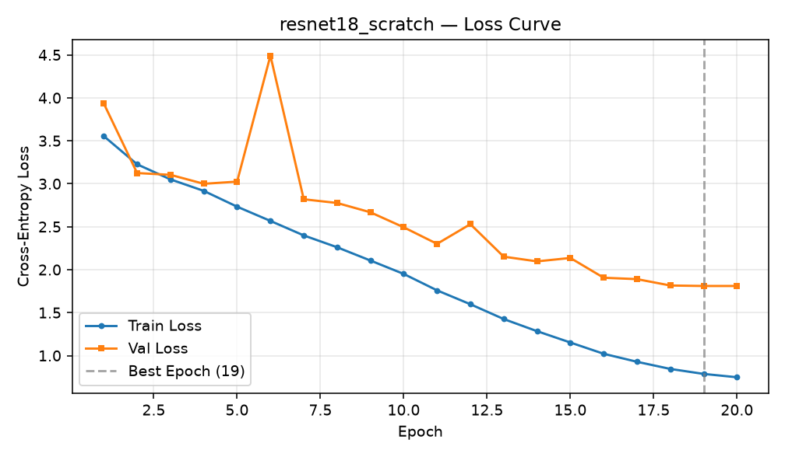 | 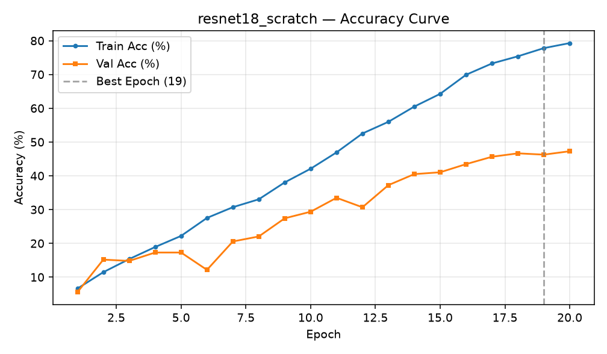 | 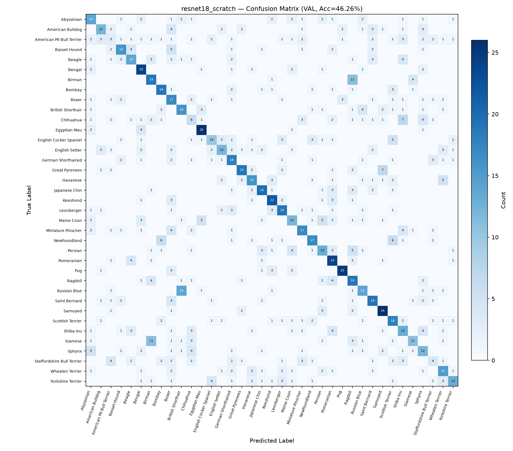 |

---

#### 3.2.2 `resnet18_transfer` — Transfer Anchor (`18,981` trainable `0.17%`, LR `1e-3`, BS `32`, 15 ep)
- **Chẩn đoán động học:** Nhảy vọt ngay **epoch 1** (`tr_l = 1.5775 → va_l = 0.7301`, `va_a = 86.21%`) — cao hơn `resnet18_scratch` ở epoch 20 tới gần `+39 pp`! Đến epoch 3 `va_a` đã đạt `90.11%` (chạm đỉnh cục bộ `90.26%` ở ep 6), và `val_loss` tiếp tục hạ mượt về đáy **`0.3126` tại `best_ep = 15`** (`tr_a = 97.53%`, `va_a = 89.95%` [FP32: `90.03%`], `gap = +7.57 pp`). Thời gian: `457.0s` · Peak VRAM: `183 MB` (`3×` nhẹ hơn scratch).
- **Logs:** [`history.csv`](../../../experiments/lab2_v2/runs/resnet18_transfer/historys/history.csv) · [`history.json`](../../../experiments/lab2_v2/runs/resnet18_transfer/historys/history.json) · [`config.json`](../../../experiments/lab2_v2/runs/resnet18_transfer/config.json)

| Loss Curve | Accuracy Curve | Confusion Matrix (Val) |
| :---: | :---: | :---: |
| 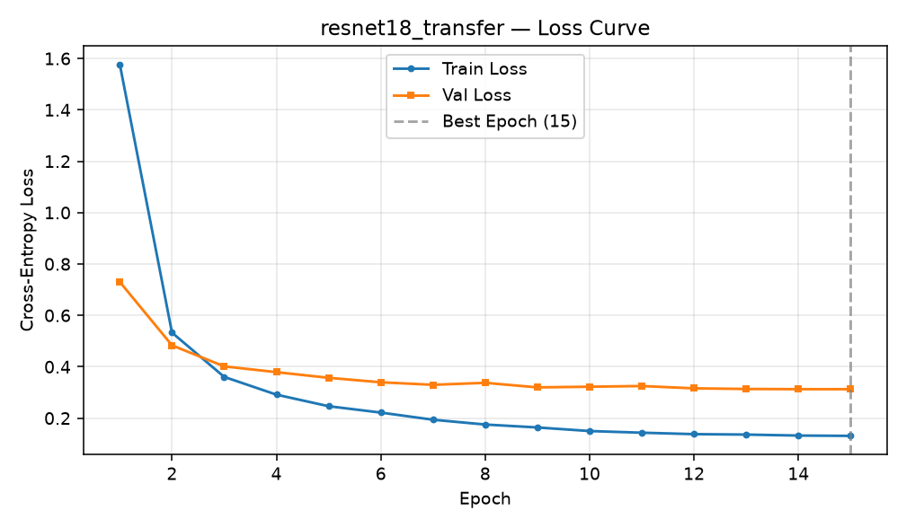 | 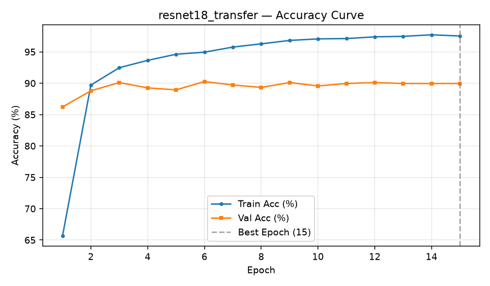 |  |

---

#### 3.2.3 `resnet18_finetune` — Fine-Tune `layer4 + fc` (`8.41M` trainable `75.14%`, LR `1e-4 / 1e-3`, BS `32`, 15 ep)
- **Chẩn đoán động học:** Differential LR (`1e-4` cho `layer4`, `1e-3` cho `fc`) kéo `val_loss` xuống rất nhanh ở 3 epoch đầu (`0.4320 → 0.3566 → 0.3273`), chạm đáy **`val_loss = 0.2989` tại `best_ep = 10`** (`tr_a = 99.97%`, `va_a = 90.97%`, `gap = +9.01 pp`; `va_a` đạt đỉnh `91.43%` ở ep 8). Từ ep `11 → 15`, `train_loss` lao về `0.0059` (`tr_a = 100.00%`) còn `val_loss` nhích tăng lên `0.3042–0.3092` — minh họa rõ dấu hiệu bão hòa/quá khớp nhẹ khi unfreeze `8.41M` tham số trên `3,680` ảnh. Thời gian: `484.9s` · Peak VRAM: `279 MB`.
- **Logs:** [`history.csv`](../../../experiments/lab2_v2/runs/resnet18_finetune/historys/history.csv) · [`history.json`](../../../experiments/lab2_v2/runs/resnet18_finetune/historys/history.json) · [`config.json`](../../../experiments/lab2_v2/runs/resnet18_finetune/config.json)

| Loss Curve | Accuracy Curve | Confusion Matrix (Val) |
| :---: | :---: | :---: |
| 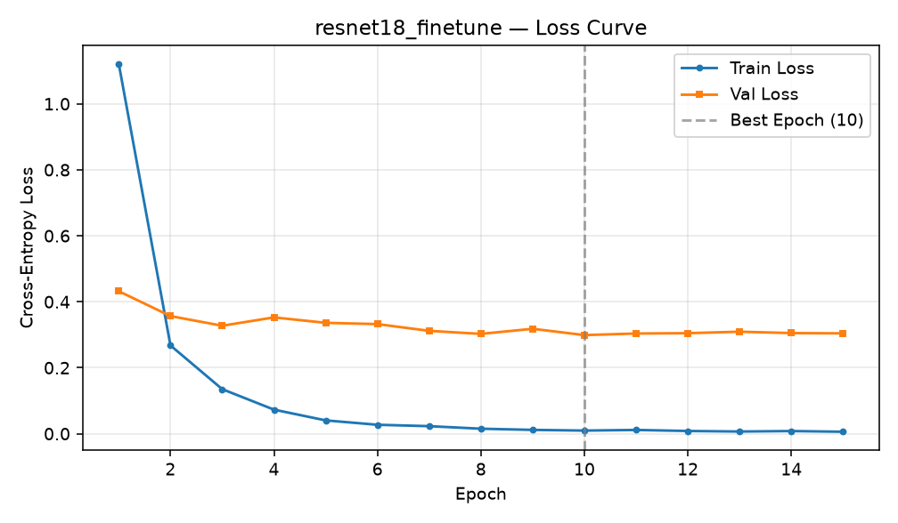 | 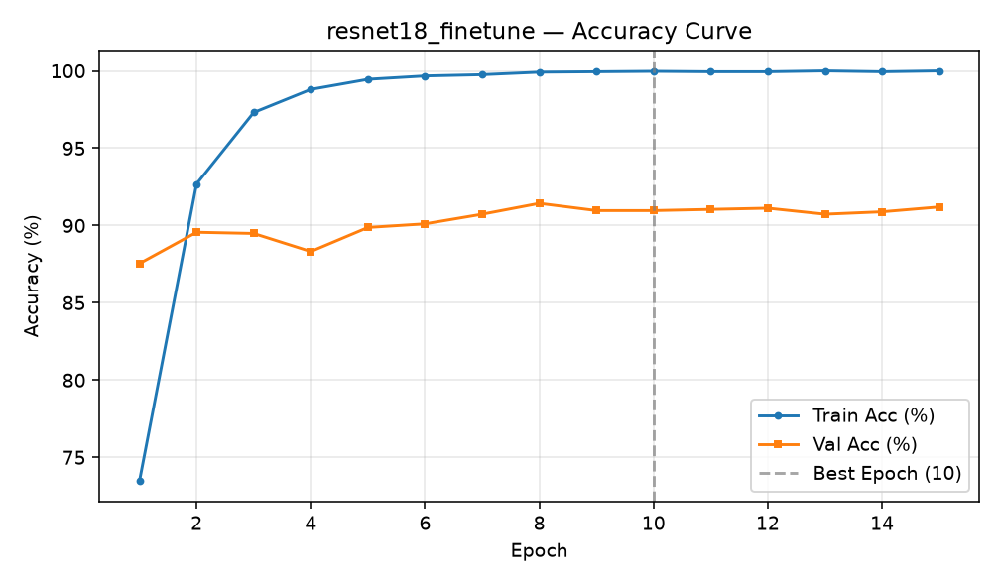 | 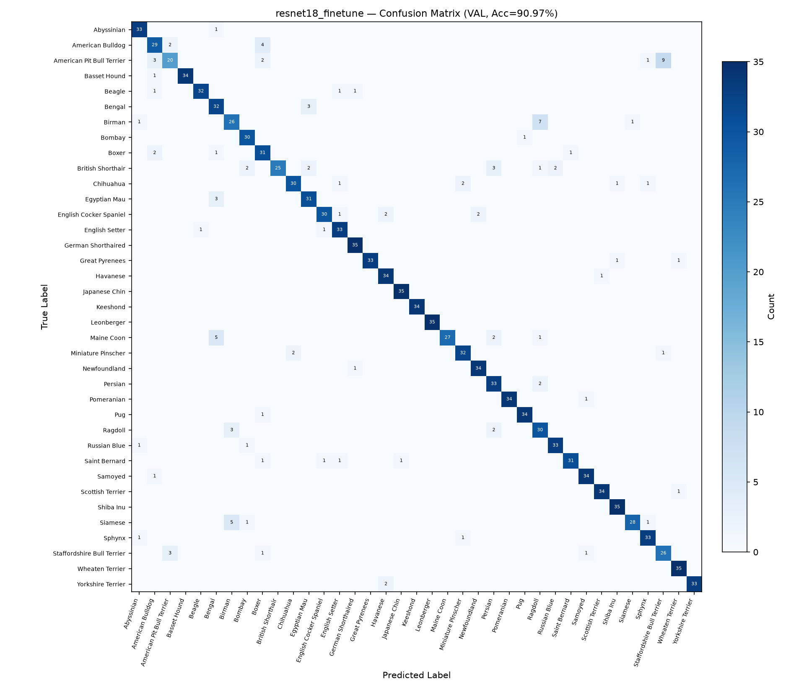 |

---

#### 3.2.4 `densenet121_transfer` — Kiến trúc `DenseNet121` (`37,925` trainable `0.54%`, LR `1e-3`, BS `32`, 15 ep)
- **Chẩn đoán động học:** Đường hội tụ sạch và mượt bậc nhất toàn chuỗi — ngay **epoch 1** đạt `va_l = 0.6635`, `va_a = 89.33%`; sang **epoch 2** đã bứt phá lên `va_a = 92.29%` (`gap = -0.03 pp`). Từ ep `3 → 14`, `val_loss` hạ đều đặn xuống **`0.2409` tại `best_ep = 14`** (`tr_a = 98.80%`, `va_a = 93.22%`, **`gap = +5.58 pp`** — nhỏ nhất trong mọi cấu hình hội tụ đầy đủ) và giữ nguyên ổn định tuyệt đối ở ep 15 (`va_l = 0.2409`, `va_a = 93.22%`, không hề bật tăng). Thời gian: `423.6s` · Peak VRAM: `200 MB`.
- **Logs:** [`history.csv`](../../../experiments/lab2_v2/runs/densenet121_transfer/historys/history.csv) · [`history.json`](../../../experiments/lab2_v2/runs/densenet121_transfer/historys/history.json) · [`config.json`](../../../experiments/lab2_v2/runs/densenet121_transfer/config.json)

| Loss Curve | Accuracy Curve | Confusion Matrix (Val) |
| :---: | :---: | :---: |
| 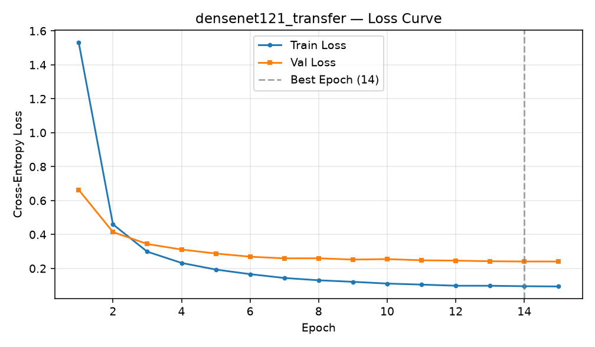 | 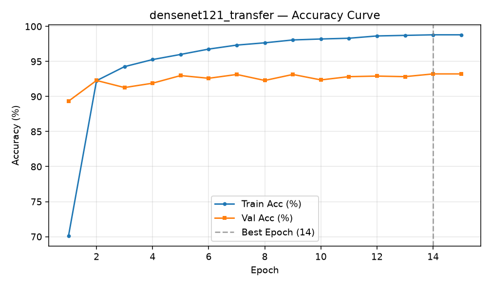 |  |

---

#### 3.2.5 `vgg16_transfer` — Kiến trúc `VGG16` (`151,589` trainable `0.11%` / `134.41M` tổng, LR `1e-3`, BS `32`, 15 ep)
- **Chẩn đoán động học:** Do đầu tuyến tính rộng (`4,096 → 37`) nối sau 2 lớp FC đóng băng, `vgg16_transfer` hội tụ ngay **epoch 1** (`va_l = 0.3249`, `va_a = 89.33%`), nhưng từ epoch 2 trở đi đường Val gần như đi ngang quanh `0.28–0.30` (đỉnh `va_a = 90.50%` ở ep 7; đáy **`va_l = 0.2770` tại `best_ep = 13`** với `tr_a = 96.93%`, `va_a = 89.72%`, `gap = +7.21 pp`), sau đó nhích overfit nhẹ ở ep 14–15 (`va_l = 0.2782`, `va_a = 89.41%`, `gap = +7.87 pp`). Gánh nặng tài nguyên lớn nhất: `624.2s` · Peak VRAM **`1,318 MB`**.
- **Logs:** [`history.csv`](../../../experiments/lab2_v2/runs/vgg16_transfer/historys/history.csv) · [`history.json`](../../../experiments/lab2_v2/runs/vgg16_transfer/historys/history.json) · [`config.json`](../../../experiments/lab2_v2/runs/vgg16_transfer/config.json)

| Loss Curve | Accuracy Curve | Confusion Matrix (Val) |
| :---: | :---: | :---: |
| 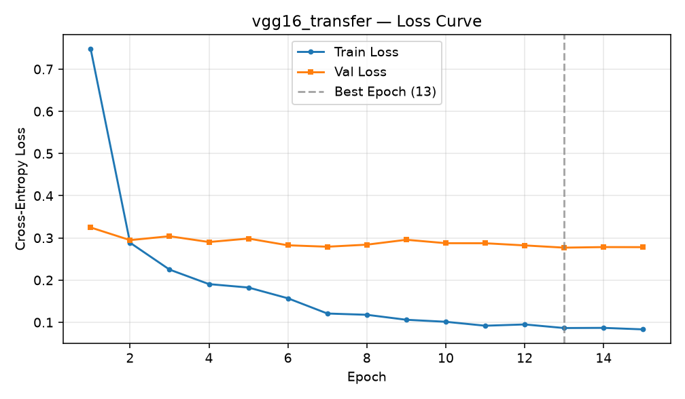 | 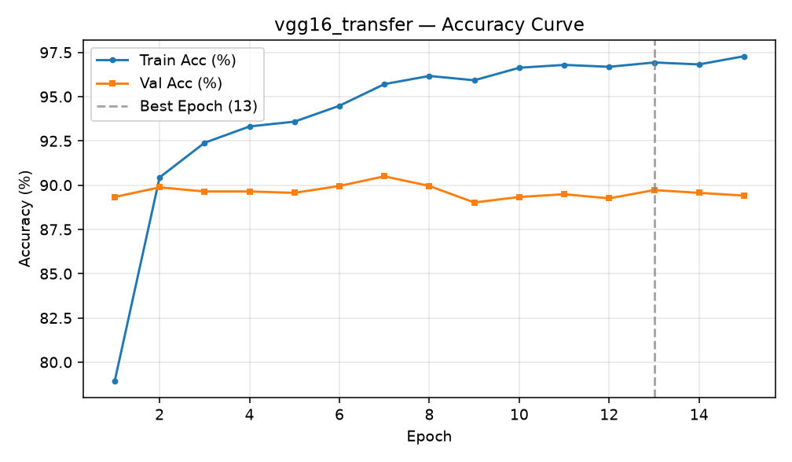 | 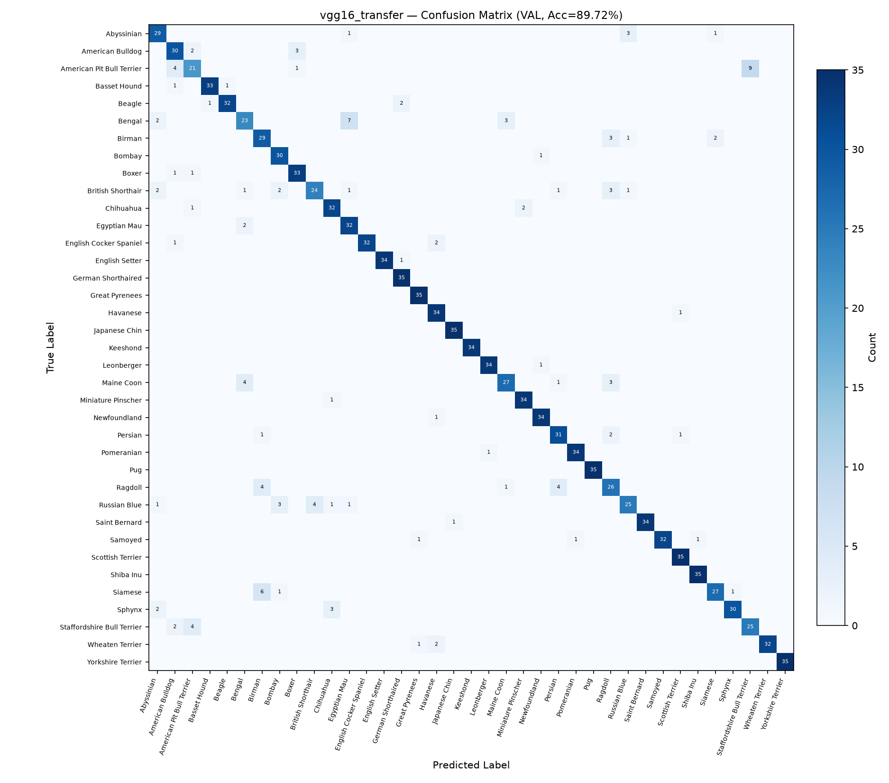 |

---

#### 3.2.6 `resnet18_transfer_lr1e4` — Ablation LR thấp (`lr = 1e-4`, BS `32`, 15 ep)
- **Chẩn đoán động học:** Minh họa điển hình của **underfitting do LR quá nhỏ trong ngân sách 15 epochs** kết hợp `CosineAnnealingLR`: epoch 1 chỉ đạt `va_l = 2.7703` (`va_a = 36.68%`), giảm chậm đều tới `best_ep = 15` (`tr_l = 0.7677`, **`va_l = 0.8219`**, `tr_a = 90.57%`, `va_a = 87.07%`). Dù `gap(tr − va) = +3.50 pp` nhỏ nhất toàn bảng, đây là hệ quả của việc mô hình **chưa học đủ sâu** (cả `train_loss` lẫn `val_loss` còn rất cao, LR đã tắt về `1.09e-6` ở ep 15 nên ngưng tiến triển từ ep 11). Thời gian: `542.5s` · Peak VRAM: `183 MB`.
- **Logs:** [`history.csv`](../../../experiments/lab2_v2/runs/resnet18_transfer_lr1e4/historys/history.csv) · [`history.json`](../../../experiments/lab2_v2/runs/resnet18_transfer_lr1e4/historys/history.json) · [`config.json`](../../../experiments/lab2_v2/runs/resnet18_transfer_lr1e4/config.json)

| Loss Curve | Accuracy Curve | Confusion Matrix (Val) |
| :---: | :---: | :---: |
| 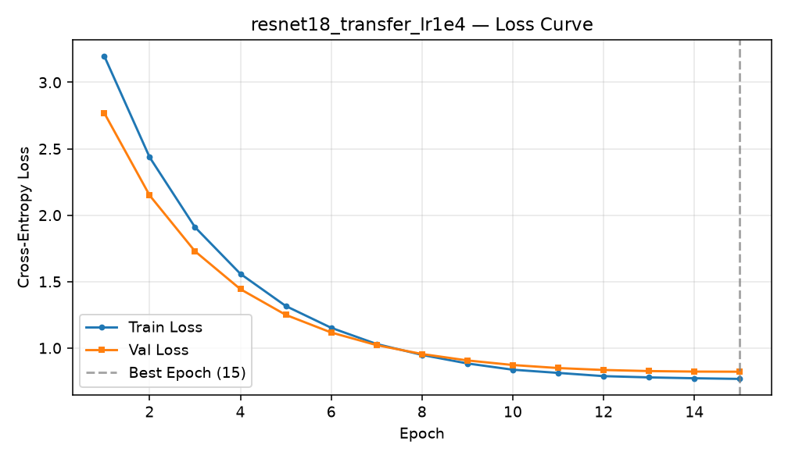 | 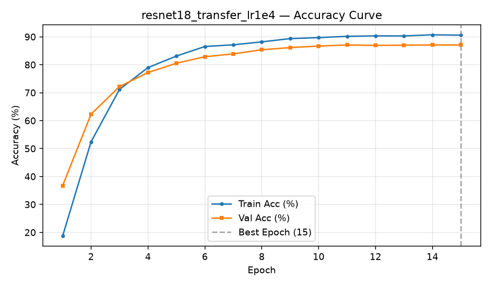 | 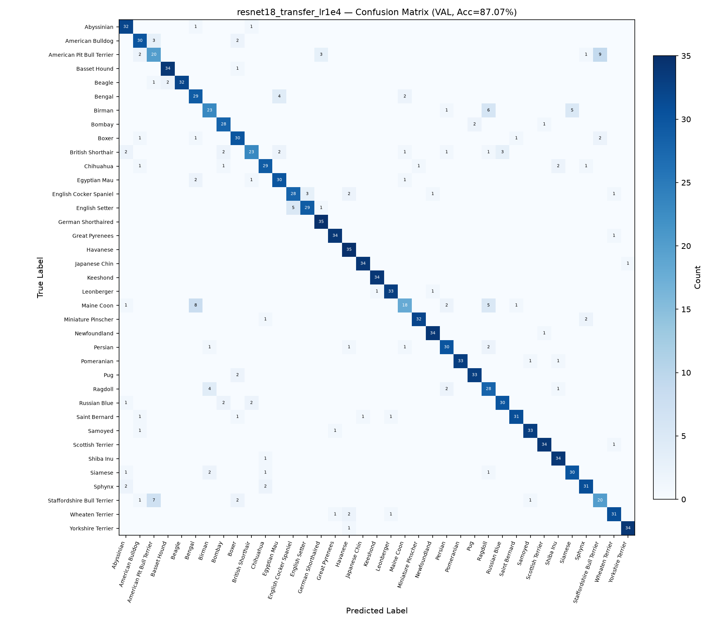 |

---

#### 3.2.7 `resnet18_transfer_lr5e3` — Ablation LR cao (`lr = 5e-3`, BS `32`, 15 ep)
- **Nhận xét Kỹ sư:** `resnet18_transfer_lr5e3` nhìn biểu đồ **không bị overfitting quá nặng (không bung phân kỳ ở cuối)**, nhưng `val_acc` chỉ ở **mức tương đối**.
- **Đối chiếu log khách quan (`history.json`):**
  - **Điểm khớp với quan sát trực quan của Kỹ sư:** Đúng là đường `val_loss` **không bị bùng nổ phân kỳ tăng vọt** về cuối như các ca overfitting cổ điển — nhờ lịch `CosineAnnealingLR` tự hạ `lr` từ `5.00e-3` xuống `8.27e-4 → 5.46e-5` ở giai đoạn ep `12 → 15`, `val_loss` lắng dần về đáy **`0.3630` tại `best_ep = 15`** và `val_acc` giữ ổn định quanh mức "tương đối" **`89.02%`** (đỉnh `89.25%` ở ep 12 — thấp hơn anchor `lr = 1e-3` đúng `-1.01 pp`).
  - **Điểm cần bổ sung từ số liệu nội bộ từng epoch:** Tuy không phân kỳ ở cuối, `lr = 5e-3` vẫn bộc lộ rõ **2 dấu hiệu của bước học quá lớn cho đầu tuyến tính**:
    1. *Dao động bất ổn ở giữa chu kỳ (`ep 2 → 8`):* Khi `lr` còn cao (`4.95e-3 → 2.76e-3`), `val_loss` nảy lên xuống mạnh (`0.4030 → 0.4948 → 0.4863 → 0.4213 → 0.4537 → 0.3904 → 0.4400`) và `val_acc` tụt về `85.83%–86.84%`.
    2. *Overfitting gap cao nhất nhóm pre-trained & xác suất quá tự tin:* `train_loss` bị ép xuống cực thấp **`0.0299`** (`train_acc = 99.54%`, chạm `99.84%` ở ep 14), đẩy **`gap(tr − va) = +10.52 pp`** — **cao nhất trong cả 8 runs pre-trained** (so với `+7.57 pp` của `lr = 1e-3` và `+9.01 pp` của `resnet18_finetune`), đồng thời kéo `val_loss` cuối (`0.3630`) xấu hơn anchor (`0.3126`, `+0.0504`) do biên độ trọng số `fc` lớn làm logits quá tự tin trên các mẫu lỗi ranh giới.
  - **Kết luận chẩn đoán:** `CosineAnnealingLR` đã cứu `lr = 5e-3` khỏi sụp đổ ở cuối chu kỳ, nhưng `lr = 1e-3` vẫn tối ưu hơn rõ rệt về cả độ mượt, hiệu chuẩn xác suất (`val_loss`) lẫn độ chính xác. Thời gian: `460.6s` · Peak VRAM: `183 MB`.
- **Logs:** [`history.csv`](../../../experiments/lab2_v2/runs/resnet18_transfer_lr5e3/historys/history.csv) · [`history.json`](../../../experiments/lab2_v2/runs/resnet18_transfer_lr5e3/historys/history.json) · [`config.json`](../../../experiments/lab2_v2/runs/resnet18_transfer_lr5e3/config.json)

| Loss Curve | Accuracy Curve | Confusion Matrix (Val) |
| :---: | :---: | :---: |
| 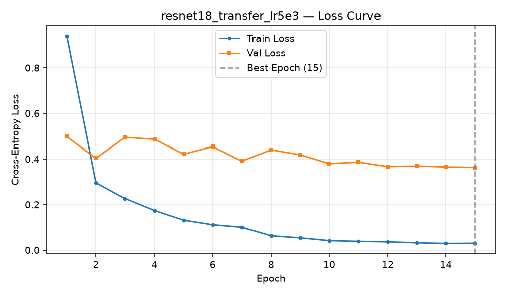 | 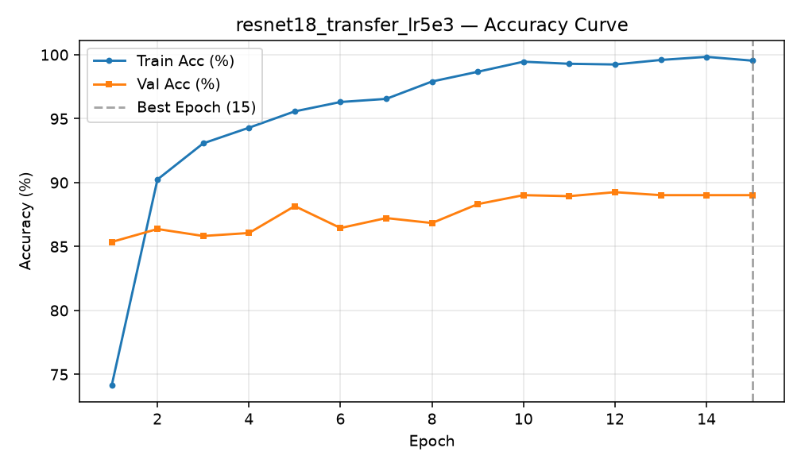 | 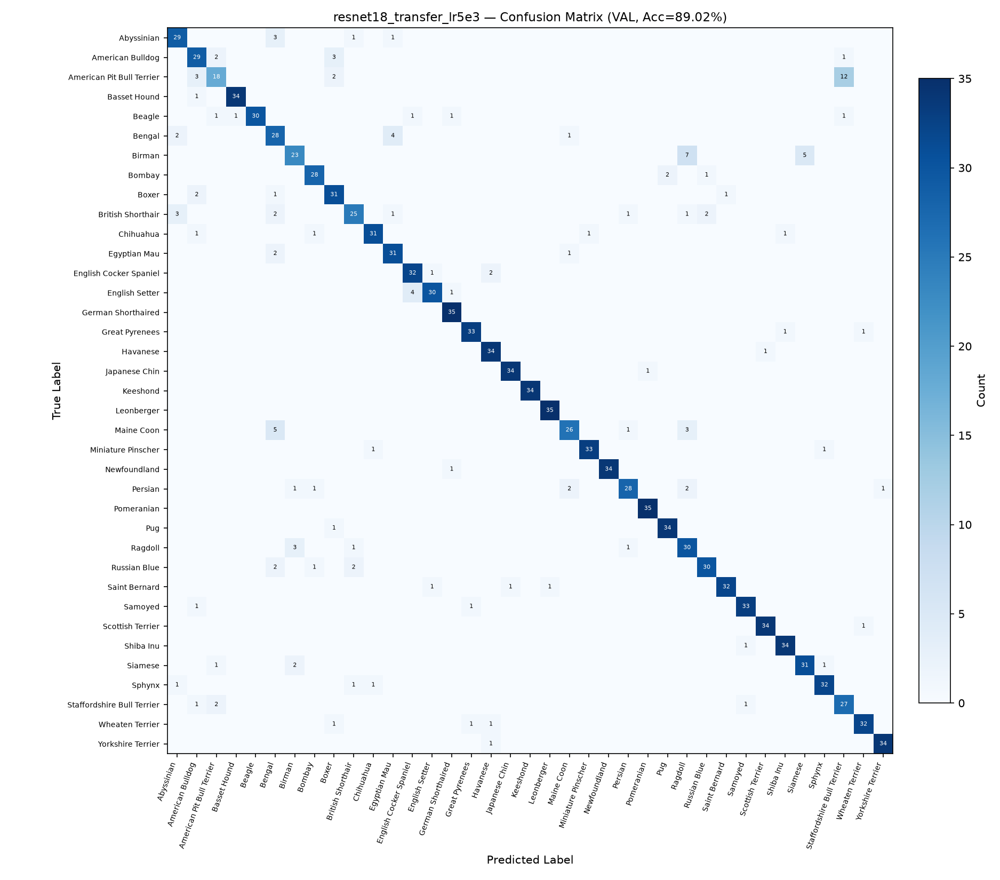 |

---

#### 3.2.8 `resnet18_transfer_bs16` — Ablation Batch Size nhỏ (`BS = 16`, LR `1e-3`, 15 ep)
- **Chẩn đoán động học:** Nhiều bước cập nhật hơn mỗi epoch (`230` steps vs `115` steps ở `BS = 32`) giúp học nhanh hơn ở đầu (`ep 1: va_l = 0.6150`, `ep 3: va_a = 89.88%`) và đạt **`val_loss = 0.3097` tại `best_ep = 15`** (nhích tốt hơn nhẹ so với anchor `0.3126`). Tuy nhiên độ nhiễu gradient cao hơn gây một nhịp nảy nhẹ ở ep 8 (`va_l = 0.3437`) và đẩy `train_acc` lên `98.48%` (`gap = +8.76 pp`). Đỉnh VRAM thấp nhất chuỗi (`112 MB`) · Thời gian: `347.9s`.
- **Logs:** [`history.csv`](../../../experiments/lab2_v2/runs/resnet18_transfer_bs16/historys/history.csv) · [`history.json`](../../../experiments/lab2_v2/runs/resnet18_transfer_bs16/historys/history.json) · [`config.json`](../../../experiments/lab2_v2/runs/resnet18_transfer_bs16/config.json)

| Loss Curve | Accuracy Curve | Confusion Matrix (Val) |
| :---: | :---: | :---: |
| 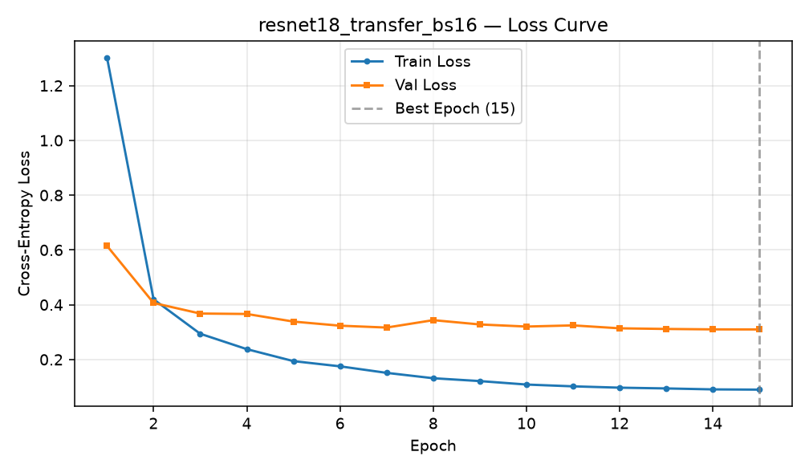 | 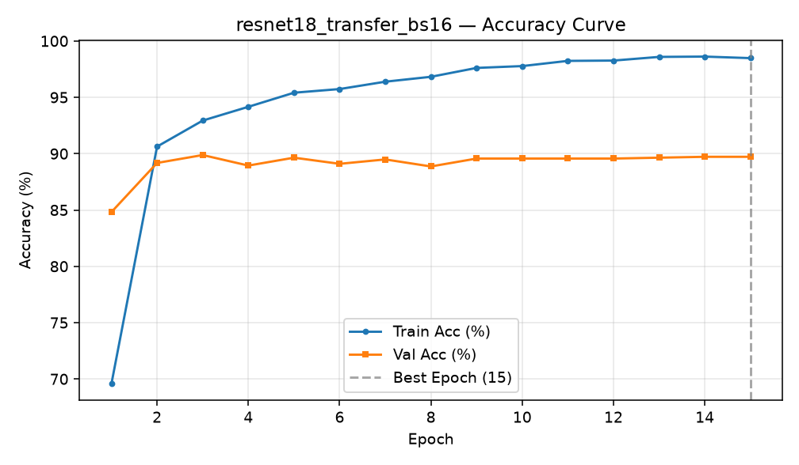 |  |

---

#### 3.2.9 `resnet18_transfer_bs64` — Ablation Batch Size lớn (`BS = 64`, LR `1e-3`, 15 ep)
- **Chẩn đoán động học:** Gradient mượt và tốc độ chạy nhanh nhất chuỗi (`333.2s` trên RTX 4060, Peak VRAM `319 MB`), `val_loss` giảm đơn điệu suốt `15/15` epoch (`is_best = True` liên tục từ ep 1 đến ep 15!) về **`0.3312`** (`tr_a = 96.55%`, `va_a = 90.11%` [FP32: `90.03%`], đỉnh `90.65%` tại ep 11, **`gap = +6.44 pp`**). Do số bước cập nhật giảm một nửa (`58` steps/ep), tốc độ hạ loss đầu chu kỳ chậm hơn `BS = 32` (`ep 1: va_l = 0.9913` vs `0.7301`), cho thấy nếu giữ `BS = 64` có thể tăng nhẹ LR (`~1.5e-3`) hoặc thêm vài epoch.
- **Logs:** [`history.csv`](../../../experiments/lab2_v2/runs/resnet18_transfer_bs64/historys/history.csv) · [`history.json`](../../../experiments/lab2_v2/runs/resnet18_transfer_bs64/historys/history.json) · [`config.json`](../../../experiments/lab2_v2/runs/resnet18_transfer_bs64/config.json)

| Loss Curve | Accuracy Curve | Confusion Matrix (Val) |
| :---: | :---: | :---: |
| 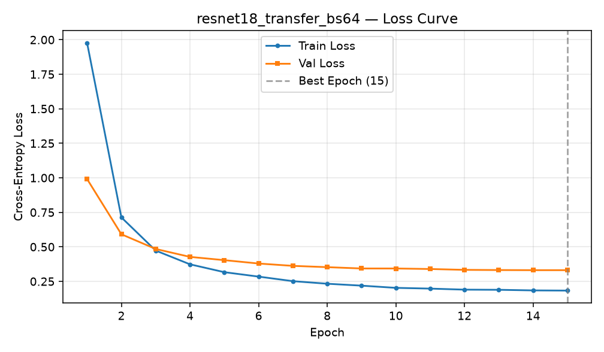 | 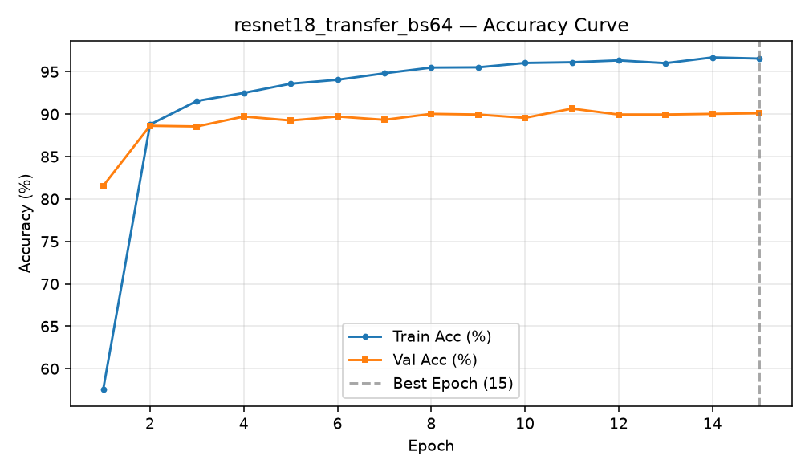 |  |

---

## 4. Tài Liệu Liên Quan & Lịch Sử Thay Đổi

### Tài liệu tham chiếu (Cross-References)
- **Đánh giá xếp hạng `9` runs trên Val (`1,284`), Final Test (`2,385`), Error Analysis 4 bước & Inference (Layer 8–10):** [`evaluation_report.md`](evaluation_report.md)
- **Kiểm toán dữ liệu `7,349` ảnh & EDA (Layer 6.1–6.3):** [`eda_report.md`](eda_report.md)
- **Đặc tả 10 tầng Pipeline & 3 kiến trúc:** [`pipelines/modeling.md`](pipelines/modeling.md) · [`resnet18.md`](models/resnet18.md) · [`densenet121.md`](models/densenet121.md) · [`vgg16.md`](models/vgg16.md)
- **Executable Report Notebook & CLI:** [`labs/lab2_v2/experiment.ipynb`](../experiment.ipynb) · [`labs/lab2_v2/README.md`](../README.md) · [`experiments/lab2_v2/README.md`](../../../experiments/lab2_v2/README.md)

### Lịch sử thay đổi

| Version | Ngày | Người sửa | Agent | Mô tả thay đổi |
| :--- | :--- | :--- | :--- | :--- |
| `1.1.0` | 2026-11-28 | notworLe | Antigravity | Bổ sung §3.1 mục 5 ghi nhận nhận xét Kỹ sư về hiện tượng tách đường Train–Val ở đa số cấu hình (phân biệt Overfitting thật vs Benign Generalization Gap vs Underfitting của `lr1e4`, 4 nguyên nhân kỹ thuật từ cấu hình hiện tại và hướng regularization tương lai) |
| `1.0.0` | 2026-11-27 | notworLe | Antigravity | Hoàn thiện báo cáo Layer 4 & Layer 7 với 100% số liệu thật từ `9/9` runs (kèm TensorBoard active, Sanity Checks Layer 4, chẩn đoán chi tiết 4 trục, nhật ký 9 cấu hình với bảng 3 biểu đồ và đối chiếu nhận xét Kỹ sư trên `resnet18_transfer_lr5e3`) |
| `0.1.0` | 2026-11-27 | notworLe | Antigravity | Khởi tạo khung báo cáo trước Step 6 |
