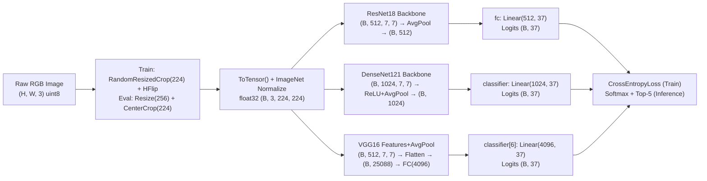

# Oxford-IIIT Pets Modeling Pipeline (`lab2_v2`)

Đặc tả đầy đủ **10 tầng (Layers)** của **AI Development Pipeline** cho dự án **`lab2_v2`** (phân loại **37 giống chó & mèo** sử dụng các mô hình pre-trained `ResNet18`, `DenseNet121`, `VGG16`), ánh xạ 1-1 theo [`MODEL_PIPELINE.md`](../../../../.agents/rules/dl-rule/MODEL_PIPELINE.md) với **Input / Output / Description** tường minh tại từng tầng.

---

## 1. Business Requirement Layer

- **Input:**
  - [`labs/lab2/QUESTION.md`](../../../lab2/QUESTION.md) — đề bài thực hành 2 môn Học Sâu (UTH)
  - [`.agents/tasks/0006_lab2_v2/task.md`](../../../../.agents/tasks/0006_lab2_v2/task.md) — yêu cầu kỹ thuật, ràng buộc và giả định của Kỹ sư
- **Output:**
  - Kế hoạch thực thi đã duyệt: [`.agents/tasks/0006_lab2_v2/plan.md`](../../../../.agents/tasks/0006_lab2_v2/plan.md)
  - Đặc tả §1–§2 trong [`modeling.md`](modeling.md)
- **Description:**
  - Trả lời câu hỏi kỹ thuật: **Transfer Learning (freeze backbone)** và **Fine-Tuning (unfreeze `layer4`)** có thực sự vượt trội so với **huấn luyện từ đầu (`ResNet18` scratch)** trên bài toán fine-grained 37 giống thú cưng với tập train nhỏ (`3,680` ảnh) không, và kiến trúc pre-trained nào (`ResNet18`, `DenseNet121`, `VGG16`) cân bằng tốt nhất giữa độ chính xác, số tham số và tốc độ?
  - Cô lập hoàn toàn khỏi `labs/lab2/vibe/`, `src/vibe_scripts/lab2/` và `experiments/lab2/`; tái lập 100% với `seed = 248`.

---

## 2. Problem Definition Layer

- **Input:**
  - Yêu cầu từ Layer 1 (`QUESTION.md`, `task.md`)
- **Output:**
  - Bảng đặc tả kỹ thuật bài toán bên dưới
- **Description:**

| Hạng mục | Đặc tả kỹ thuật |
| :--- | :--- |
| **Task** | Fine-Grained Multi-Class Image Classification (**`37` giống thú cưng**: `12` giống mèo + `25` giống chó) |
| **Dataset** | `torchvision.datasets.OxfordIIITPet` (`data/raw/oxford-iiit-pet/`, `7,349` ảnh: `3,680` `trainval` + `3,669` `test`) |
| **Data Split** | **Train:** 100% `trainval` (`3,680`) · **Validation:** Stratified `35%` của `test` (`~1,284`, `seed = 248`) · **Test:** `65%` còn lại của `test` (`~2,385`, khóa kín, đánh giá duy nhất 1 lần) |
| **Input Contract** | Ảnh RGB chuẩn hóa ImageNet `(3, 224, 224)` dtype `torch.float32`, batch `(B, 3, 224, 224)` |
| **Output Contract** | Raw logits `(B, 37)` trong train/eval; xác suất Softmax `(B, 37)` và Top-5 giống dự đoán khi inference |
| **Baseline** | [`ResNet18`](../models/resnet18.md) huấn luyện từ đầu (`weights=None`, `11.20M` params) |
| **Compared Models** | `ResNet18` transfer (freeze backbone), `ResNet18` fine-tune (unfreeze `layer4 + fc`), [`DenseNet121`](../models/densenet121.md) transfer, [`VGG16`](../models/vgg16.md) transfer |
| **Loss Function** | `nn.CrossEntropyLoss()` trực tiếp trên raw logits |
| **Evaluation Metrics** | `Accuracy`, `Macro-F1`, `Loss`, `Per-class P/R/F1`, `Cat vs Dog Species Accuracy`, `Confusion Matrix (37×37)` |
| **Acceptance Criteria** | Sanity checks pass (`initial_loss ≈ ln 37 ≈ 3.6109`, overfit 1 batch `≥ 95%`, Save/Load diff `< 1e-6`); `resnet18_scratch` hội tụ làm mốc Baseline; mô hình Transfer/Fine-tune tạo **gap cải thiện dương rõ rệt so với Baseline** ($\Delta\text{Acc} > 0$, $\Delta\text{Macro-F1} > 0$, giảm `Loss`) |

---

## 3. Project Reference Layer

- **Input:**
  - Tài liệu `torchvision.models` (`ResNet18_Weights.DEFAULT`, `DenseNet121_Weights.DEFAULT`, `VGG16_Weights.DEFAULT`)
  - Bài học kỹ thuật tái sử dụng từ [`0005_lab1v2_knowledge.md`](../../../../.agents/knowledge_extraction/0005_lab1v2_knowledge.md) (headless Agg guard, 2-tier model selection, `historys/eval/test_eval` anti-leakage layout, 4-step Error Analysis, 3-file SRP reports, `--resume` + `optimizer_state_dict`)
  - `src/config.py` & `src/vibe_scripts/config_override.py` (`VibeConfig`)
- **Output:**
  - Giả thuyết kỹ thuật trước thực nghiệm và quyết định thiết kế kiến trúc ở Layer 5
- **Description:**
  - Với chỉ `~100` ảnh/giống trong tập `trainval`, huấn luyện mạng CNN sâu từ đầu (`ResNet18` scratch) dễ bị underfit/overfit mạnh; ngược lại, đặc trưng thị giác tổng quát học sẵn trên ImageNet-1K (vốn chứa sẵn hàng trăm giống chó/mèo) giúp Transfer Learning & Fine-Tuning hội tụ nhanh và tổng quát hơn hẳn.
  - **Không giả định trước con số Accuracy khi chưa chạy:** đo trực tiếp `resnet18_scratch` làm mốc thực nghiệm để tính gap cải thiện của từng kiến trúc pre-trained.

---

## 4. Experiment Layer (Pre-Training Sanity & Contract Verification)

- **Input:**
  - Batch mẫu nhỏ (`16–32` ảnh `(B, 3, 224, 224)`) và kiến trúc khởi tạo từ `build_model()`
  - Bộ unit test offline tại `test/test_lab2_v2_*.py` (`weights=None`)
- **Output:**
  - Kết quả `run_sanity_checks()` trong `src/vibe_scripts/lab2_v2/trainer.py` (`initial_loss`, `overfit_final_acc`, `overfit_steps`)
  - Kết quả Dual Testing (`pytest -m smoke` + `pytest test/test_lab2_v2_*.py`)
- **Description:**
  - Xác minh 3 bất biến trước khi chạy training: (1) Tensor Shape `(B, 3, 224, 224) → (B, 37)` & Fail-Fast `ValueError` khi sai shape, (2) `initial_loss ≈ ln(37) ≈ 3.6109`, (3) Overfit 1 batch đạt Accuracy `≥ 95%`.

---

## 5. Model Design Layer

- **Input:**
  - Đặc tả bài toán (Layer 2) và giả thuyết từ Project Reference (Layer 3)
- **Output:**
  - Đặc tả 3 kiến trúc: [`models/resnet18.md`](../models/resnet18.md) · [`models/densenet121.md`](../models/densenet121.md) · [`models/vgg16.md`](../models/vgg16.md)
  - Mã nguồn: `src/vibe_scripts/lab2_v2/models.py` (`build_model`, `get_param_groups`, `count_parameters`, `trace_shapes`)
- **Description:**

| Kiến trúc | Chế độ | Feature Tensor trước Head | Classification Head mới | Trainable / Total Params |
| :--- | :--- | :--- | :--- | :---: |
| **`ResNet18`** | `scratch` | `(B, 512)` | `model.fc = Linear(512, 37)` | `11,195,493 / 11,195,493 (100%)` |
| **`ResNet18`** | `transfer` | `(B, 512)` | Freeze backbone; chỉ train `model.fc` | `18,981 / 11,195,493 (0.17%)` |
| **`ResNet18`** | `finetune` | `(B, 512)` | Unfreeze `layer4 + fc` (diff LR `1e-4 / 1e-3`) | `8,412,709 / 11,195,493 (75.14%)` |
| **`DenseNet121`** | `transfer` | `(B, 1024)` | Freeze `features`; chỉ train `model.classifier` | `37,925 / 6,991,781 (0.54%)` |
| **`VGG16`** | `transfer` | `(B, 4096)` | Freeze `features + classifier[0..5]`; train `classifier[6]` | `151,589 / 134,412,133 (0.11%)` |

---

## 6. Data Engineering Layer

CLI thực thi độc lập: `python labs/lab2_v2/prepare_data.py` (`src/vibe_scripts/lab2_v2/data.py` & `transforms.py`).

### 6.1 Data Collection
- **Input:** `data/raw/oxford-iiit-pet/` (`oxford-iiit-pet.tar.gz`, `images/`, `annotations/`, `manifest.json`)
- **Output:**
  - **Raw Dataset đã xác thực:** `data/raw/oxford-iiit-pet/` (`7,349` mẫu, giữ bất biến tuyệt đối)
  - `experiments/lab2_v2/eda/collection_report.json`
- **Description:** Xác thực SHA-256 của `oxford-iiit-pet.tar.gz` theo `manifest.json`, kiểm đếm số lượng mẫu `trainval` (`3,680`) và `test` (`3,669`) cùng danh sách `37` lớp (`12` mèo + `25` chó).

### 6.2 Data Cleaning
- **Input:** `data/raw/oxford-iiit-pet/` + cấu hình chia tầng (`val_ratio_of_test = 0.35`, `seed = 248`)
- **Output:**
  - **Clean Dataset đã xác thực tại chỗ** (ép chuẩn `.convert("RGB")` khi nạp; ghi nhận mọi ảnh non-RGB/corrupt/duplicate)
  - `experiments/lab2_v2/eda/cleaning_report.json`
- **Description:** Quét 100% (`7,349` ảnh): kiểm tra đọc ảnh PIL, phát hiện ảnh hỏng, thống kê color mode (`RGB`, `RGBA`, `L`, `P`), phát hiện kích thước bất thường và **exact file SHA-256 duplicates** nội bộ & chéo split (`Train ↔ Val ↔ Test`).

### 6.3 Exploratory Data Analysis (EDA)
- **Input:** Tập dữ liệu đã xác thực từ 6.2 và split cố định `split_indices.json`
- **Output:**
  - `experiments/lab2_v2/eda/eda_summary.json`
  - `experiments/lab2_v2/eda/eda_class_distribution.png` (phân bố 37 giống trên Train/Val/Test)
  - `experiments/lab2_v2/eda/eda_species_ratio.png` (tỷ lệ 12 giống Mèo vs 25 giống Chó)
  - `experiments/lab2_v2/eda/eda_size_aspect_ratio.png` (phân bố Width/Height & Aspect Ratio ảnh gốc)
  - `experiments/lab2_v2/eda/eda_sample_grid.png` (ảnh mẫu đại diện các giống mèo & chó)
  - `experiments/lab2_v2/eda/eda_rgb_stats.png` (phân bố kênh màu RGB Train so với chuẩn ImageNet)
  - Báo cáo phân tích: [`labs/lab2_v2/docs/eda_report.md`](../eda_report.md)
- **Description:** Phân tích mất cân bằng lớp, đặc trưng fine-grained giữa các giống cùng loài (Cat vs Dog) và độ biến thiên kích thước/tỷ lệ khung ảnh gốc để chọn chiến lược crop/augmentation phù hợp.

### 6.4 Data Preprocessing
- **Input:** `data/raw/oxford-iiit-pet/` và `experiments/lab2_v2/splits/split_indices.json`
- **Output:**
  - `experiments/lab2_v2/splits/split_indices.json` (chỉ số Train / Val / Test cố định, không giao nhau)
  - In-memory `OxfordPetsBundle` (`train_loader`, `val_loader`, `test_loader`, `class_names`, `species_map`)
- **Description:**
  - Train: `RandomResizedCrop(224, scale=(0.75, 1.0)) → RandomHorizontalFlip(0.5) → ToTensor() → Normalize(ImageNet)`.
  - Val / Test: `Resize(256) → CenterCrop(224) → ToTensor() → Normalize(ImageNet)`.
  - Đảm bảo zero-leakage (augmentation chỉ áp dụng trên Train; mọi ảnh ép `.convert("RGB")` trước transform).

---

## 7. Model Engineering Layer

CLI thực thi (do Kỹ sư trực tiếp chạy): `python labs/lab2_v2/train.py --run-all --amp`.

### 7.1 Model Selection & Configuration
- **Input:** `labs/lab2_v2/config.py` (`EXPERIMENT_SPECS`: `9` cấu hình có kiểm soát gồm `1` scratch baseline + `4` transfer/finetune kiến trúc + `4` ablation `lr`/`batch_size`), `models.py`
- **Output:** `experiments/lab2_v2/runs/<run_id>/config.json` (snapshot cấu hình, `seed`, `device`, `total_params`, `trainable_params`, `amp`)
- **Description:** Cố định `CrossEntropyLoss`, `AdamW(weight_decay=1e-4)`, `CosineAnnealingLR`, `seed = 248`; chỉ thay đổi 1 yếu tố / trục (kiến trúc, chế độ freeze/unfreeze, `lr`, `batch_size`).

### 7.2 Training and Experiments
- **Input:** `OxfordPetsBundle` (`train_loader`, `val_loader`) từ Layer 6.4 và model/optimizer từ Layer 7.1
- **Output:**
  - `experiments/lab2_v2/runs/<run_id>/best.pt` (checkpoint có `min(val_loss)` — nhúng sẵn `model_config`, `class_names`, `norm_stats`, `optimizer_state_dict`)
  - `experiments/lab2_v2/runs/<run_id>/last.pt` (checkpoint epoch cuối hỗ trợ `--resume`)
  - Báo cáo chuỗi thí nghiệm & chẩn đoán huấn luyện: [`labs/lab2_v2/docs/experiment_report.md`](../experiment_report.md)
- **Description:**
  - **Constraint bắt buộc:** Kỹ sư trực tiếp chạy training qua CLI (`train.py`) — Agent không tự chạy full training.
  - Hỗ trợ Mixed Precision (`--amp` FP16 + `GradScaler`), Fail-Fast `NaN/Inf`, lưu nguyên tử (`atomic_torch_save`), và `--resume` sang `--output-run-id` riêng. Tập Test tuyệt đối không được chạm tới trong giai đoạn này.

### 7.3 Training Monitoring
- **Input:** Thống kê trực tiếp mỗi epoch (`train_loss`, `val_loss`, `train_acc`, `val_acc`, `lr`, `throughput_sps`, `gpu_mem_mb`, `epoch_sec`)
- **Output:**
  - Live `tqdm` progress bar trên terminal
  - `experiments/lab2_v2/runs/<run_id>/historys/history.{json,csv}`
  - TensorBoard event logs tại `experiments/lab2_v2/tb_logs/<run_id>/` *(tự ghi khi `tensorboard` được cài, graceful fallback nếu chưa cài)*
- **Description:** Theo dõi song song đường hội tụ, tốc độ ảnh/giây và đỉnh VRAM trên GPU cho từng kiến trúc (`ResNet18` vs `DenseNet121` vs `VGG16`).

---

## 8. Evaluation Layer

Module lõi: `src/vibe_scripts/lab2_v2/evaluator.py` · CLI: `python labs/lab2_v2/evaluate.py`.

### 8.1 Tiêu Chí Đánh Giá & Chọn Mô Hình (Evaluation & Model Selection Criteria)

| Tiêu chí | Phạm vi | Vai trò | Lý do lựa chọn |
| :--- | :--- | :--- | :--- |
| **`Accuracy`** | Val / Test | **Chỉ số chính (Ưu tiên 1 chọn model)** | Khớp yêu cầu `task.md` (`"Best model is selected by validation accuracy"`) trên bài toán 37 giống gần cân bằng; phản ánh trực tiếp tỷ lệ nhận diện đúng giống. |
| **`Macro-F1`** | Val / Test | **Chỉ số chính bổ trợ (Ưu tiên 2)** | Tính trung bình đều F1 trên cả 37 giống — đảm bảo mô hình không bỏ rơi các giống chó/mèo khó phân biệt cục bộ. |
| **`Cross-Entropy Loss`** | Trong 1 run / Val / Test | **Chọn `best.pt` nội bộ & Tie-breaker (Ưu tiên 3)** | Hàm liên tục, phát hiện sớm overfitting / overconfidence khi chọn `best_epoch` nội bộ 1 run; dùng phá hòa giữa các runs. |
| **`Species Accuracy (Cat vs Dog)` & `Per-class P/R/F1` & `CM (37×37)`** | Val / Test | **Chẩn đoán lỗi fine-grained** | Tách lỗi **nội loài** (mèo nhầm mèo, chó nhầm chó) khỏi lỗi **khác loài** (mèo nhầm chó) và chỉ ra cặp giống nhầm nhiều nhất. |
| **`Save/Load Parity`** (`max_abs_diff < 1e-6`) | Mọi `best.pt` | **Bất biến kiểm chứng (Guardrail)** | Đảm bảo checkpoint lưu/nạp khớp tuyệt đối trước khi ghi nhận điểm số hoặc suy luận. |

- **Quy tắc chọn mô hình 2 tầng (`src/vibe_scripts/lab2_v2/trainer.py`):**
  1. *Trong nội bộ 1 run (`best.pt`):* `min(val_loss)`.
  2. *Giữa các runs (`winning_model_run_id`):* `max(val_acc, val_macro_f1, -val_loss)` trên **Validation (`35%` của `test`)** — tuyệt đối không dùng tập Test để chọn model.

### 8.2 Per-Run Validation Evaluation & Model Selection
- **Input:** `runs/<run_id>/best.pt` + `historys/history.json` + `bundle.val_loader`
- **Output:**
  - `experiments/lab2_v2/runs/<run_id>/eval/{eval_metrics.json, loss_curve.png, accuracy_curve.png, confusion_matrix.png, predicted_vs_actual.png}`
  - `experiments/lab2_v2/ablation/{ablation_summary.json, ablation_table.csv}`
  - Báo cáo đánh giá `9` runs trên Val & quyết định chọn mô hình: [`labs/lab2_v2/docs/evaluation_report.md`](../evaluation_report.md) (§2)
- **Description:** Chạy tự động ngay sau khi mỗi run train xong dưới `@torch.inference_mode()` để xếp hạng 9 runs và chốt `winning_model_run_id`.

### 8.3 Final Held-Out Test Evaluation (1 lần duy nhất)
- **Input:** Đúng 2 checkpoint chung kết: `runs/resnet18_scratch/best.pt` (Baseline) & `runs/<winning_model_run_id>/best.pt` + `bundle.test_loader` (`65%` của `test`)
- **Output:**
  - `experiments/lab2_v2/runs/<finalist>/test_eval/{eval_metrics.json, confusion_matrix.png, predicted_vs_actual.png}` *(không vẽ lặp learning curves)*
  - `experiments/lab2_v2/evaluation/{test_comparison.json, test_comparison.csv, per_class_metrics.json, species_analysis.json}`
  - `experiments/lab2_v2/figures/{ablation_comparison.png, loss_curves.png, accuracy_curves.png, confusion_matrix_baseline.png, confusion_matrix_best.png, predicted_vs_actual.png}`
  - Báo cáo đánh giá chung kết trên Test: [`labs/lab2_v2/docs/evaluation_report.md`](../evaluation_report.md) (§3)
- **Description:** Đo lường công bằng **gap cải thiện (`Best Pre-trained − Baseline Scratch`)** và kiểm tra Save/Load Parity trên tập Test khóa kín duy nhất 1 lần.

---

## 9. Continuous Improvement Layer (4-Step Quantitative Error Analysis)

CLI thực thi: `python labs/lab2_v2/evaluate.py --error-analysis`.

- **Input:** `runs/<winning_model_run_id>/best.pt`, `bundle.test_loader`, kết quả Layer 8
- **Output:**
  - `experiments/lab2_v2/evaluation/{error_analysis.json, error_audit_60_candidates.json, error_taxonomy_60.{csv,json}, slice_analysis.json}` và `audit_sheets/audit_sheet_{1..3}_*.png`
  - `experiments/lab2_v2/figures/{confusion_matrix_best_normalized.png, error_gallery_top3_high_conf.png, error_gallery_top3_low_conf.png, error_taxonomy_breakdown.png, error_slice_analysis.png, cat_vs_dog_error_breakdown.png}`
  - Báo cáo phân tích lỗi 4 bước & hướng cải tiến tại [`labs/lab2_v2/docs/evaluation_report.md`](../evaluation_report.md) (§4)
- **Description:** Áp dụng quy trình 4 bước định lượng: (1) Per-class P/R/F1, CM chuẩn hóa % & phân tích nội loài/khác loài `Cat vs Dog`; (2) Error Gallery Top-3 cặp nhầm lẫn tách High-Conf vs Low-Conf; (3) Kiểm toán trực quan `N = 60` ảnh (`Model Limitation` / `Ambiguity` / `Label Noise & Framing`); (4) Slice Analysis theo độ sáng, aspect ratio, diện tích ảnh gốc & loài (`Cat` vs `Dog`).

---

## 10. Deployment Layer (Offline Inference & Production Handoff)

- **Input:** Checkpoint đã xác thực `experiments/lab2_v2/runs/<winning_model_run_id>/best.pt`, ảnh mẫu Test (`--sample-idx`) hoặc ảnh ngoài (`--image PNG/JPG`)
- **Output:** JSON dự đoán Top-5 Softmax (`predicted_id`, `predicted_class`, `species`, `confidence`, `top_k`, `requires_grad=False`) & số liệu độ trễ (`BS=1`, `BS=32`, kích thước checkpoint) từ `python labs/lab2_v2/inference.py --benchmark`, ghi nhận tại [`labs/lab2_v2/docs/evaluation_report.md`](../evaluation_report.md) (§5).
- **Description:** `PetPredictor` tự tái dựng kiến trúc + `class_names` + ImageNet normalization nhúng trong checkpoint, ép ảnh vào `RGB` và suy luận dưới `@torch.inference_mode()`. Phần export ONNX/TensorRT/serving bàn giao sang [`DEPLOY_MODEL.md`](../../../../.agents/rules/dl-rule/DEPLOY_MODEL.md).

---

## Tài Liệu Liên Quan

- Mục lục tài liệu: [`docs/README.md`](../README.md)
- Đặc tả 3 kiến trúc: [`resnet18.md`](../models/resnet18.md) · [`densenet121.md`](../models/densenet121.md) · [`vgg16.md`](../models/vgg16.md)
- Báo cáo EDA (Layer 6): [`eda_report.md`](../eda_report.md)
- Báo cáo Thí nghiệm & Training Diagnostics (Layer 4, 7): [`experiment_report.md`](../experiment_report.md)
- Báo cáo Đánh giá, Error Analysis & Inference (Layer 8–10): [`evaluation_report.md`](../evaluation_report.md)
- Cấu trúc Artifacts: [`experiments/lab2_v2/README.md`](../../../../experiments/lab2_v2/README.md)
