# PRESENTATION 01 — Kịch Bản Thuyết Trình & Biểu Diễn Tensor Notebook 1 (`01_ex1_sentiment_analysis.ipynb`)

Tài liệu hướng dẫn thuyết trình, giải thích luồng biểu diễn dữ liệu/tensor và bộ câu hỏi phản biện chuyên sâu cho **Exercise 1: Sentiment Analysis with Hugging Face Pre-trained Models** ([`labs/lab3/main/01_ex1_sentiment_analysis.ipynb`](../main/01_ex1_sentiment_analysis.ipynb) & [`labs/lab3/main/main.ipynb`](../main/main.ipynb)).

---

## 1. Sơ Đồ Luồng Biểu Diễn Dữ Liệu & Tensor (Workflow & Tensor Representation)

```mermaid
flowchart LR
    subgraph Input["1. Input Layer"]
        A["Raw Sentences<br/>List[str] (B=3)"]
    end

    subgraph Tokenization["2. WordPiece Tokenizer"]
        B["Subword Tokens<br/>['[CLS]', 'just', ..., '[SEP]']"]
        C["input_ids: LongTensor [3, 14]<br/>attention_mask: LongTensor [3, 14]"]
    end

    subgraph Encoder["3. DistilBERT Backbone (6 Layers)"]
        D["Embeddings + Positional<br/>FloatTensor [3, 14, 768]"]
        E["Multi-Head Self-Attention<br/>Masking [PAD] -> -inf"]
        F["[CLS] Hidden State<br/>FloatTensor [3, 768]"]
    end

    subgraph Head["4. Classification Head & Post-processing"]
        G["Pre-Classifier (768->768) + ReLU<br/>Classifier Linear (768->2)"]
        H["Raw Logits<br/>FloatTensor [3, 2]"]
        I["Softmax Probabilities [3, 2]<br/>Argmax -> NEGATIVE / POSITIVE"]
    end

    A --> B --> C --> D --> E --> F --> G --> H --> I
```

---

## 2. Bảng Ánh Xạ Từng Cell — Biểu Diễn Tensor — Hành Động Thuyết Trình

| Cell | Bước kỹ thuật | Biểu diễn Đầu vào $\rightarrow$ Đầu ra | Hành động khi thuyết trình |
| :---: | :--- | :--- | :--- |
| **Cell 0–1** | Header & Roadmap 4 cột | Đặc tả mục tiêu Exercise 1 & bảng ánh xạ 6 bước | Mở đầu: Giới thiệu mục tiêu đối chiếu High-level Pipeline và Low-level PyTorch Tensor. |
| **Cell 2–3** | **Step 1**: Environment & Seed Setup | `seed=42` $\rightarrow$ `device = cuda` (`RTX 4060 Laptop GPU`) | Chỉ vào hàm `set_seed(42)` và `HF_HUB_DISABLE_SYMLINKS_WARNING` đảm bảo tính tái lập. |
| **Cell 4–5** | **Step 2**: High-Level `pipeline` | `List[str]` (3 câu) $\rightarrow$ `List[Dict['label', 'score']]` | Trình bày kết quả 3 câu mẫu qua API đóng gói `pipeline("sentiment-analysis")`. |
| **Cell 6–7** | **Step 3**: Tokenizer Deep-Dive | `str` $\rightarrow$ `tokens` (11 subwords) $\rightarrow$ `input_ids` (13 IDs kèm `101`, `102`) | Giải thích cách WordPiece tách `"don't"` và gắn `[CLS]=101`, `[SEP]=102`. |
| **Cell 8–9** | **Step 4**: Low-Level PyTorch Forward | `input_ids [3, 14]` $\rightarrow$ `logits [3, 2]` $\rightarrow$ `probs [3, 2]` | Đối chiếu xác suất Softmax thủ công (`96.95%`, `99.99%`, `99.97%`) khớp tuyệt đối với Step 2. |
| **Cell 10–11** | **Step 5**: Batch Padding & `attention_mask` | `attention_mask [3, 14]` $\in \{0, 1\}$ | Chỉ vào các số `0` ở cuối câu 1 (1 pad) và câu 3 (4 pads) ngăn Self-Attention đọc nhiễu. |
| **Cell 12–13** | **Step 6**: Linguistic Stress-Testing | 4 câu phủ định/mỉa mai $\rightarrow$ Dự đoán nhãn & độ tin cậy | Nhấn mạnh câu `"It is not bad at all."` đạt `POSITIVE (99.96%)` nhờ cơ chế Self-Attention. |

---

## 3. Kịch Bản Lời Thuyết Trình Chi Tiết Từng Bước (Step-by-Step Script)

### Mở đầu (Cell 0 & Cell 1 — 45 giây)
> *"Kính thưa Thầy/Cô, ở Notebook đầu tiên [`01_ex1_sentiment_analysis.ipynb`](../main/01_ex1_sentiment_analysis.ipynb) (đồng bộ với [`main.ipynb`](../main/main.ipynb)), nhóm giải quyết **Exercise 1** của Lab 03: Khai thác mô hình tiền huấn luyện [`distilbert-base-uncased-finetuned-sst-2-english`](https://huggingface.co/distilbert-base-uncased-finetuned-sst-2-english) từ Hugging Face Hub.*
> *Mục tiêu cốt lõi của notebook này không chỉ là gọi hàm `pipeline` có sẵn, mà là bóc tách toàn bộ luồng biến đổi bên dưới bằng PyTorch thuần: từ chuỗi ký tự $\rightarrow$ subword tokens $\rightarrow$ tensor `input_ids` & `attention_mask` $\rightarrow$ ma trận `logits` $\rightarrow$ phân phối xác suất `Softmax`, và kiểm chứng hai cách cho ra kết quả khớp nhau 100%."*

### Step 1: Thiết lập Môi trường & Tính Tái lập (Cell 2 & Cell 3 — 30 giây)
> *"Tại Step 1 (Cell 3), tuân thủ quy chuẩn tái lập thí nghiệm tại [`AI_REFERENCE.md`](../../../.agents/rules/AI_REFERENCE.md), nhóm khóa toàn bộ hạt giống ngẫu nhiên `set_seed(42)` cho `random`, `numpy`, `torch` và `cudnn.deterministic`, đồng thời tự động nhận diện thiết bị phần cứng `cuda`."*

### Step 2: Suy luận Cấp cao với `transformers.pipeline` (Cell 4 & Cell 5 — 1 phút)
> *"Tại Step 2 (Cell 5), nhóm khởi tạo `pipeline('sentiment-analysis')` làm mốc tham chiếu (reference baseline). Khi truyền 3 câu mẫu:*
> 1. `'Just have trying, don't end up like me'` $\rightarrow$ `NEGATIVE` (độ tin cậy `0.9695`).
> 2. `'I love this movie, the plot is brilliant and moving!'` $\rightarrow$ `POSITIVE` (độ tin cậy `0.9999`).
> 3. `'A complete waste of time and money.'` $\rightarrow$ `NEGATIVE` (độ tin cậy `0.9997`).
> *Tiếp theo ở Step 3 và Step 4, nhóm chứng minh cách mô hình tính ra chính xác các con số này ở tầng tensor."*

### Step 3: Mổ xẻ WordPiece Tokenizer & Special Tokens (Cell 6 & Cell 7 — 1.5 phút)
> *"Tại Step 3 (Cell 7), nhóm kiểm tra cơ chế `AutoTokenizer` của DistilBERT (từ điển 30,522 subwords):*
> - *Câu gốc 11 từ/dấu câu được tách thành 11 subword tokens: từ viết tắt `don't` được tách thành `['don', \"'\", 't']` với ID `[2123, 1005, 1056]`, giúp mô hình xử lý linh hoạt mọi biến thể từ vựng mà không gặp lỗi Out-Of-Vocabulary.*
> - *Khi gọi `tokenizer(test_sentence)`, chuỗi ID được bọc thêm 2 token đặc biệt: `[CLS]` (ID `101`) ở đầu câu để tổng hợp ngữ cảnh phân loại, và `[SEP]` (ID `102`) ở cuối câu để đánh dấu ranh giới chuỗi, nâng tổng chiều dài lên 13 tokens."*

### Step 4: Suy luận Tường minh Cấp thấp với PyTorch (Cell 8 & Cell 9 — 1.5 phút)
> *"Tại Step 4 (Cell 9), nhóm truyền cả batch 3 câu vào `tokenizer(..., padding=True, truncation=True, max_length=64, return_tensors='pt')`:*
> - *Hai tensor đầu vào `input_ids` và `attention_mask` đều có kích thước `torch.Size([3, 14])` (3 câu trong batch, câu dài nhất có 14 tokens).*
> - *Chạy mô hình ở chế độ `model.eval()` trong ngữ cảnh `with torch.no_grad():`, đầu ra `outputs.logits` là ma trận `[3, 2]` chứa điểm số thô chưa chuẩn hóa. Ví dụ câu 1 có logits `[1.8357, -1.6238]`.*
> - *Áp dụng hàm `F.softmax(logits, dim=1)`, tổng xác suất mỗi hàng bằng `1.0`, trả về độ tin cậy lần lượt là `96.95% NEGATIVE`, `99.99% POSITIVE` và `99.97% NEGATIVE` — khớp tuyệt đối đến từng chữ số thập phân với `pipeline()` ở Step 2."*

### Step 5: Vai trò của `attention_mask` trong Batch Processing (Cell 10 & Cell 11 — 1 phút)
> *"Tại Step 5 (Cell 11), nhóm in trực tiếp ma trận `attention_mask` kích thước `[3, 14]` để giải thích cách Transformer xử lý các câu khác độ dài trong cùng một batch:*
> - *Câu 2 dài nhất (14 real tokens, 0 pad tokens) có mask toàn số `1`.*
> - *Câu 1 (13 real tokens) có 1 số `0` ở cuối; Câu 3 (10 real tokens) có 4 số `0` ở cuối.*
> - *Các vị trí có `attention_mask = 0` sẽ được cộng một giá trị âm vô cùng ($-10^9$) trước bước Softmax của Self-Attention, biến trọng số chú ý tại các token `[PAD]` thành `0.0`, đảm bảo số lượng token đệm không làm sai lệch kết quả dự đoán."*

### Step 6: Kiểm thử Cấu trúc Ngôn ngữ Phức hợp (Cell 12 & Cell 13 — 1 phút)
> *"Cuối cùng ở Step 6 (Cell 13), nhóm thực hiện Stress-Testing với 4 câu phức chứa phủ định kép, đảo chiều cảm xúc và châm biếm:*
> - *Câu phủ định đảo nghĩa `'It is not bad at all.'`: mô hình dự đoán chuẩn xác là `POSITIVE` với độ tin cậy `99.96%`.*
> - *Câu châm biếm `'A masterpiece of sheer boredom and predictable cliches.'`: dù mở đầu bằng từ tích cực `'masterpiece'`, cơ chế Self-Attention vẫn liên kết với `'boredom'` và `'cliches'` để kết luận chính xác là `NEGATIVE (99.87%)`."*

---

## 4. Kịch Bản Trình Diễn Trực Tiếp (Live Demo Guide)

1. **Chạy toàn bộ Notebook**: Mở [`labs/lab3/main/01_ex1_sentiment_analysis.ipynb`](../main/01_ex1_sentiment_analysis.ipynb), chọn `Run All` (thời gian chạy toàn bộ 6 bước dưới 3 giây trên GPU).
2. **Điểm nhấn đối chiếu**: Chỉ trực tiếp vào output Cell 5 (`0.9695`, `0.9999`, `0.9997`) và output Cell 9 (`96.95%`, `99.99%`, `99.97%`) để chứng minh sự tương đương giữa High-level Pipeline và Low-level PyTorch Forward Pass.
3. **Tương tác tại chỗ**: Tại Cell 13 (`edge_cases`), thêm bất kỳ câu tiếng Anh nào do Giảng viên yêu cầu và bấm `Shift + Enter` để hiển thị ngay nhãn dự đoán cùng xác suất Softmax.

---

## 5. Bộ Câu Hỏi & Trả Lời Phản Biện (Q&A Defense — Notebook 1)

### Câu 1: *"Tại sao kết quả của `pipeline('sentiment-analysis')` ở Cell 5 và kết quả tính bằng `F.softmax(outputs.logits, dim=1)` ở Cell 9 lại giống hệt nhau?"*
- **Trả lời**:
  > *"Vì bên trong `TextClassificationPipeline` của Hugging Face thực chất thực hiện đúng 3 bước: gọi `tokenizer()` trong `preprocess()`, gọi `model(**model_inputs)` dưới `torch.no_grad()` trong `_forward()`, và áp dụng hàm `softmax` lên `logits` trong `postprocess()`. Cell 9 tái hiện tường minh 3 bước này bằng PyTorch tensor nên kết quả toán học trùng khớp 100%."*

### Câu 2: *"Nếu không truyền `attention_mask` vào `model(**inputs)` khi chạy theo batch ở Cell 9 thì điều gì xảy ra?"*
- **Trả lời**:
  > *"Nếu bỏ `attention_mask`, các tầng Multi-Head Self-Attention sẽ coi các token `[PAD]` (ID `0`) ở cuối câu ngắn như những từ thật sự trong câu. Vector biểu diễn của `[CLS]` sẽ bị pha loãng bởi các vector trạng thái của `[PAD]`, làm thay đổi giá trị `logits` của câu khi chạy theo batch so với khi chạy đơn lẻ."*

### Câu 3: *"Tại sao phải gọi cả `model.eval()` lẫn `with torch.no_grad():` ở Cell 9?"*
- **Trả lời**:
  > *"Hai lệnh này có hai nhiệm vụ hoàn toàn khác nhau:*
  > - `model.eval()` *tắt chế độ ngẫu nhiên của các lớp `Dropout` (trong DistilBERT có `dropout=0.1` và `seq_classif_dropout=0.2`), giúp đầu ra cố định (deterministic) giữa các lần chạy.*
  > - `with torch.no_grad():` *tắt engine Autograd của PyTorch, không lưu các tensor kích hoạt trung gian để tính đạo hàm ngược, giúp giảm ~50% VRAM và tăng tốc độ suy luận."*

---

## 6. Tài Liệu Tham Khảo (References & Technical Documentation)

### 1. Thư viện Cốt lõi & Tài liệu API Chính thức (Official Library Documentation)
- Hugging Face Transformers `pipeline` API: [https://huggingface.co/docs/transformers/main_classes/pipelines](https://huggingface.co/docs/transformers/main_classes/pipelines)
- Hugging Face `AutoTokenizer` & `AutoModelForSequenceClassification`: [https://huggingface.co/docs/transformers/model_doc/auto](https://huggingface.co/docs/transformers/model_doc/auto)
- PyTorch `torch.nn.functional.softmax` & `torch.no_grad`: [https://pytorch.org/docs/stable/nn.functional.html](https://pytorch.org/docs/stable/nn.functional.html)

### 2. Tiêu chuẩn Kỹ thuật & Bài báo Nền tảng (Technical Standards & Specifications)
- Sanh, V., Debut, L., Chaumond, J., & Wolf, T. (2019). *DistilBERT, a distilled version of BERT: smaller, faster, cheaper and lighter*. NeurIPS EMC2 Workshop.
- Model Card `distilbert-base-uncased-finetuned-sst-2-english`: [https://huggingface.co/distilbert-base-uncased-finetuned-sst-2-english](https://huggingface.co/distilbert-base-uncased-finetuned-sst-2-english)

### 3. Quy ước Tensor & Định dạng Dữ liệu (NLP/DL Conventions & Formats)
- Input Tensor Shapes: `input_ids` và `attention_mask` có định dạng `(B, L)` với kiểu `torch.int64` (`LongTensor`), trong đó `B` là batch size và `L` là chiều dài chuỗi sau padding.
- Output Tensor Shapes: `logits` và `probabilities` có định dạng `(B, C)` với kiểu `torch.float32` (`C = 2`: `0 -> NEGATIVE`, `1 -> POSITIVE`), thỏa mãn bất biến $\sum_{c=0}^{1} P(y=c|x) = 1.0$.

### 4. Mã Nguồn & Tài Liệu Nội Bộ Dự Án (Internal Project Architecture)
- Notebook Exercise 1 (Bản chính): [`labs/lab3/main/01_ex1_sentiment_analysis.ipynb`](../main/01_ex1_sentiment_analysis.ipynb)
- Notebook Exercise 1 (Bản đồng bộ): [`labs/lab3/main/main.ipynb`](../main/main.ipynb)
- Script Suy luận CLI: [`labs/lab3/main/main.py`](../main/main.py)
- Kịch bản Thuyết trình Notebook 2: [`labs/lab3/docs/PRESENTATION_02_EX2_FINETUNE_SENTIMENT.md`](PRESENTATION_02_EX2_FINETUNE_SENTIMENT.md)
- Quy chuẩn Tham chiếu AI Agent: [`.agents/rules/AI_REFERENCE.md`](../../../.agents/rules/AI_REFERENCE.md)
