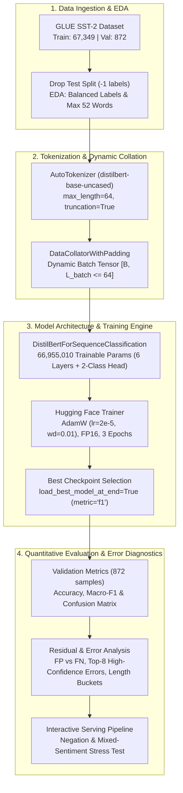

# PRESENTATION 02 — Kịch Bản Thuyết Trình & Biểu Diễn Pipeline Notebook 2 (`02_ex2_finetune_sentiment.ipynb`)

Tài liệu hướng dẫn thuyết trình, giải thích luồng biểu diễn dữ liệu/tensor và bộ câu hỏi phản biện chuyên sâu cho **Exercise 2: Fine-Tuning DistilBERT on SST-2 for Sentiment Classification** ([`labs/lab3/main/02_ex2_finetune_sentiment.ipynb`](../main/02_ex2_finetune_sentiment.ipynb) & [`labs/lab3/main/fine-tune.ipynb`](../main/fine-tune.ipynb)).

---

## 1. Sơ Đồ Luồng Công Việc & Biểu Diễn Tensor (End-to-End Fine-Tuning Workflow)

---

## 2. Bảng Ánh Xạ Từng Cell — Biểu Diễn Dữ Liệu/Tensor — Hành Động Thuyết Trình

| Cell | Bước kỹ thuật | Biểu diễn Đầu vào $\rightarrow$ Đầu ra | Hành động khi thuyết trình |
| :---: | :--- | :--- | :--- |
| **Cell 0–1** | Header & Roadmap 4 cột | Đặc tả mục tiêu Exercise 2 & bảng ánh xạ 8 bước | Mở đầu: Giới thiệu quy trình Fine-tuning khép kín từ EDA đến Error Diagnostics. |
| **Cell 2–3** | **Step 1**: Environment & Seed Setup | `seed=42` $\rightarrow$ `device = cuda`, kiểm tra VRAM khởi tạo | Chỉ vào thiết lập `set_seed(42)` và kiểm soát mục tiêu VRAM $\le 3.5\text{GB}$. |
| **Cell 4–5** | **Step 2**: Dataset Ingestion & EDA | `nyu-mll/glue (sst2)` $\rightarrow$ `train_df (67,349)`, `val_df (872)` + 3 biểu đồ | Trình chiếu 3 biểu đồ: phân bố nhãn cân bằng và histogram độ dài câu (`max=52` từ). |
| **Cell 6–7** | **Step 3**: Subword Tokenization & Dynamic Collation | `sentence` $\rightarrow$ `input_ids`, `attention_mask`, `label` + `DataCollatorWithPadding` | Giải thích lý do chọn `max_length=64` (0% cắt cụt) và `DataCollatorWithPadding` giảm ~70% FLOPs. |
| **Cell 8–9** | **Step 4**: Model Architecture Instantiation | `distilbert-base-uncased` $\rightarrow$ `66,955,010` tham số (6 Transformer layers) | Giải thích bảng `LOAD REPORT`: bỏ head MLM cũ (`vocab_*`) và khởi tạo mới `pre_classifier` + `classifier`. |
| **Cell 10–11** | **Step 5**: Trainer Configuration & Execution | `TrainingArguments` (`lr=2e-5`, `fp16=True`, `epochs=3`) $\rightarrow$ Best Checkpoint | Trình bày siêu tham số huấn luyện và cơ chế tự động nạp lại checkpoint tối ưu (`Cell Independence`). |
| **Cell 12–14** | **Step 6**: Quantitative Evaluation & 5W1H | `logits [872, 2]` $\rightarrow$ `classification_report` + `ConfusionMatrixDisplay` | Công bố kết quả định lượng trên 872 mẫu validation kèm ma trận nhầm lẫn. |
| **Cell 15–16** | **Step 7**: Error Diagnostics & Residual Analysis | `probs [872, 2]` $\rightarrow$ FP/FN, Top-8 High-Confidence Errors + 2 biểu đồ chẩn đoán | Phân tích các câu sai có độ tự tin cao (mỉa mai, đa mệnh đề) và tỷ lệ lỗi theo nhóm độ dài câu. |
| **Cell 17–18** | **Step 8**: Negation Stress-Testing & Serving | `trainer.model` $\rightarrow$ `pipeline("text-classification")` dự đoán 4 câu kiểm thử | Demo trực tiếp mô hình sau fine-tune phân loại đúng câu phủ định `"It's not bad at all."`. |

---

## 3. Kịch Bản Lời Thuyết Trình Chi Tiết Từng Bước (Step-by-Step Script)

### Mở đầu (Cell 0 & Cell 1 — 45 giây)
> *"Kính thưa Thầy/Cô, ở Notebook thứ hai [`02_ex2_finetune_sentiment.ipynb`](../main/02_ex2_finetune_sentiment.ipynb) (đồng bộ với [`fine-tune.ipynb`](../main/fine-tune.ipynb) và script [`fine-tune.py`](../main/fine-tune.py)), nhóm giải quyết **Exercise 2** của Lab 03: Tinh chỉnh toàn phần (Full Fine-Tuning) mô hình nền tảng [`distilbert-base-uncased`](https://huggingface.co/distilbert-base-uncased) chưa từng học phân loại cảm xúc trên bộ dữ liệu chuẩn **GLUE SST-2**.*
> *Notebook đi trọn vẹn 8 bước kỹ thuật: Thiết lập môi trường $\rightarrow$ Khảo sát hình học dữ liệu (EDA) $\rightarrow$ Token hóa & Đệm động theo batch $\rightarrow$ Khởi tạo kiến trúc $\rightarrow$ Huấn luyện với `Trainer` $\rightarrow$ Đánh giá định lượng $\rightarrow$ Chẩn đoán phần dư & phân tích lỗi $\rightarrow$ Phục vụ suy luận."*

### Step 1: Thiết lập Môi trường & Kiểm soát VRAM (Cell 2 & Cell 3 — 30 giây)
> *"Tại Step 1 (Cell 3), nhóm cố định `set_seed(42)` trên toàn bộ thư viện `random`, `numpy`, `torch` và kiểm tra dung lượng VRAM khởi tạo trên GPU `NVIDIA GeForce RTX 4060 Laptop GPU`, đảm bảo toàn bộ quá trình huấn luyện vận hành ổn định dưới ngưỡng $3.5\text{GB}$ VRAM."*

### Step 2: Nạp Dữ liệu GLUE SST-2 & Khảo sát EDA (Cell 4 & Cell 5 — 1.5 phút)
> *"Tại Step 2 (Cell 5), nhóm tải trực tiếp tập `sst2` từ bộ benchmark `nyu-mll/glue`:*
> - *Nhóm lập tức xóa tập `test` (`del ds['test']`) vì trên GLUE Leaderboard, toàn bộ nhãn tập test bị ẩn dưới giá trị `-1`. Việc giữ lại sẽ gây lỗi khi đánh giá.*
> - *Tập `train` có `67,349` câu và tập `validation` có `872` câu được dùng làm tập kiểm định độc lập.*
> - *Quan sát 3 biểu đồ trực quan hóa tại Cell 5:*
>   1. *Phân bố nhãn ở cả `train` và `validation` đều cân bằng (xấp xỉ 51% Positive / 49% Negative).*
>   2. *Thống kê số từ trên mỗi câu tập train có trung bình `9.4` từ, trung vị `7` từ, tứ phân vị 75% là `13` từ và câu dài nhất chỉ có `52` từ. Phát hiện này là cơ sở thực nghiệm để nhóm chọn `max_length=64` ở bước tiếp theo."*

### Step 3: Subword Tokenization & Dynamic Batch Collation (Cell 6 & Cell 7 — 1.5 phút)
> *"Tại Step 3 (Cell 7), nhóm áp dụng hai kỹ thuật tối ưu hóa bộ nhớ và tốc độ:*
> 1. *Đặt `max_length=64, truncation=True`: Vì câu dài nhất chỉ có 52 từ, ngưỡng 64 tokens bảo toàn gần như 100% nội dung ngữ nghĩa mà không lãng phí bộ nhớ như ngưỡng mặc định 512.*
> 2. *Sử dụng `DataCollatorWithPadding(tokenizer)`: Thay vì đệm tĩnh toàn bộ 67,349 câu lên 64 tokens, bộ collator chỉ đệm động mỗi mini-batch theo câu dài nhất trong chính batch đó ($L_{\text{batch}} \le 64$). Do độ phức tạp Self-Attention tỉ lệ bậc hai $O(L^2)$, kỹ thuật này cắt giảm ~70% phép tính dư thừa trên token `[PAD]`."*

### Step 4: Khởi tạo Kiến trúc `DistilBertForSequenceClassification` (Cell 8 & Cell 9 — 1 phút)
> *"Tại Step 4 (Cell 9), nhóm khởi tạo mô hình từ checkpoint gốc `distilbert-base-uncased` với `num_labels=2`:*
> - *Mô hình gồm `6` tầng Transformer Encoder và đầu phân loại nhị phân mới (`pre_classifier` $768\times 768$ + `ReLU` + `Dropout(0.2)` + `classifier` $768\times 2$).*
> - *Tổng số tham số là `66,955,010` và 100% tham số đều được mở khóa (`trainable_params = 66,955,010`) để tinh chỉnh toàn phần."*

### Step 5: Cấu hình `TrainingArguments` & Thực thi `Trainer` (Cell 10 & Cell 11 — 1.5 phút)
> *"Tại Step 5 (Cell 11), nhóm cấu hình `TrainingArguments` theo chuẩn fine-tuning Transformer:*
> - *Thuật toán tối ưu AdamW với `learning_rate=2e-5`, `weight_decay=0.01`, `num_train_epochs=3`, batch size `32` (train) / `64` (eval), và bật `fp16=True` để tăng tốc bằng Tensor Cores.*
> - *Đặc biệt, trên môi trường Jupyter Windows, nhóm cấu hình `dataloader_num_workers=0` để tránh xung đột `spawn` multiprocessing, đồng thời đặt `load_best_model_at_end=True` theo tiêu chí `metric_for_best_model='f1'`.*
> - *Để đảm bảo tính độc lập của cell (Cell Independence), notebook tự động kiểm tra nếu đã có checkpoint tối ưu trong `sst2-distilbert/` thì nạp trực tiếp trong 1 giây, giúp Hội đồng có thể chạy kiểm tra ngay các cell đánh giá phía dưới mà không cần chờ train lại."*

### Step 6: Đánh giá Định lượng & Báo cáo 5W1H (Cell 12, 13 & 14 — 1.5 phút)
> *"Tại Step 6 (Cell 13 & 14), nhóm chạy `trainer.predict(tokenized['validation'])` trên 872 mẫu kiểm định tại checkpoint tối ưu (Epoch 1.0, Step 2105) và xuất `classification_report` (4 chữ số thập phân) cùng biểu đồ `ConfusionMatrixDisplay`:*
> - *Mô hình đạt **Binary F1 = 90.99%**, **Macro-F1 = 90.94%**, **Accuracy = 90.94%** (`793 / 872` câu đúng) và **Validation Loss = 0.2622**.*
> - *Chi tiết theo từng lớp: Lớp `NEGATIVE (0)` (428 mẫu) đạt `Precision = 89.75%`, `Recall = 92.06%`, `F1 = 90.89%`; Lớp `POSITIVE (1)` (444 mẫu) đạt `Precision = 92.15%`, `Recall = 89.86%`, `F1 = 90.99%`. Ma trận nhầm lẫn cho thấy độ cân bằng rất cao giữa hai lớp, không xảy ra hiện tượng thiên lệch lớp."*

### Step 7: Chẩn đoán Lỗi & Phân tích Phần dư (Cell 15 & 16 — 1.5 phút)
> *"Tại Step 7 (Cell 16), nhóm không dừng lại ở điểm số tổng thể mà bóc tách toàn bộ **79 / 872 mẫu dự đoán sai (9.06%)**:*
> 1. *Thống kê tỷ lệ giữa **False Positives** (`34` mẫu thật NEG, đoán POS) và **False Negatives** (`45` mẫu thật POS, đoán NEG).*
> 2. *Trích xuất **Top 8 lỗi có độ tự tin cao nhất** (`conf > 0.988`): Phân tích định tính cho thấy mô hình thường bị đánh lừa bởi các câu phê bình điện ảnh mang tính nhượng bộ hoặc đa mệnh đề đối lập (ví dụ: `'although huppert's intensity and focus has a raw exhilaration about it, the piano teacher is anything but fun.'` hoặc `'the longer the movie goes, the worse it gets, but it's actually pretty good in the first few minutes.'`).*
> 3. *Vẽ 2 biểu đồ chẩn đoán: Tỷ lệ lỗi theo 5 nhóm độ dài câu (`len_bucket`) và So sánh độ tự tin trung bình giữa nhóm dự đoán Đúng và nhóm dự đoán Sai."*

### Step 8: Kiểm thử Phủ định Ngôn ngữ & Suy luận Trực quan (Cell 17 & 18 — 1 phút)
> *"Cuối cùng tại Step 8 (Cell 18), nhóm đóng gói `trainer.model` vừa fine-tune vào `pipeline('text-classification')` và kiểm thử trên 4 câu thực tế: `'I loved this movie!'` (`POSITIVE 99.79%`), cấu trúc phủ định kép `'It's not bad at all.'` (`POSITIVE 98.73%`), `'A total waste of time.'` (`NEGATIVE 99.73%`) và câu chuyển hướng `'The movie wasn't as good as I hoped, but still enjoyable.'` (`POSITIVE 99.56%`). Mô hình dự đoán chính xác cả 4 câu với độ tự tin trên 98.7%, khép lại toàn bộ vòng đời Fine-tuning."*

---

## 4. Kịch Bản Trình Diễn Trực Tiếp (Live Demo Guide)

1. **Trình diễn nhanh (Nhờ cơ chế phát hiện Checkpoint tự động)**:
   - Mở [`labs/lab3/main/02_ex2_finetune_sentiment.ipynb`](../main/02_ex2_finetune_sentiment.ipynb) và bấm `Run All`.
   - Nhờ nhánh phát hiện checkpoint đã lưu trong `sst2-distilbert/`, Cell 11 sẽ nạp ngay mô hình tốt nhất mà không mất thời gian chờ train lại 3 epochs, và toàn bộ biểu đồ EDA, Confusion Matrix, Error Diagnostics sẽ được vẽ mới trực tiếp trong chưa đầy 10 giây.
2. **Thử thách trực tiếp từ Giảng viên**:
   - Cuộn xuống Cell 18 (`custom_prompts`), nhập câu tiếng Anh bất kỳ do Giảng viên đưa ra và nhấn `Shift + Enter`.

---

## 5. Bộ Câu Hỏi & Trả Lời Phản Biện (Q&A Defense — Notebook 2)

### Câu 1: *"Tại sao khi khởi tạo `AutoModelForSequenceClassification.from_pretrained('distilbert-base-uncased', num_labels=2)` ở Cell 9, hệ thống lại báo `UNEXPECTED` ở các trọng số `vocab_*` và `MISSING` ở `pre_classifier`, `classifier`?"*
- **Trả lời**:
  > *"Đây là cơ chế chuẩn của Transfer Learning:*
  > - *Checkpoint gốc `distilbert-base-uncased` được tiền huấn luyện bằng bài toán Masked Language Modeling (MLM), nên chứa đầu dự đoán từ vựng (`vocab_transform`, `vocab_layer_norm`, `vocab_projector`). Khi chuyển sang bài toán phân loại chuỗi, đầu MLM này không dùng đến nên được báo là `UNEXPECTED` và loại bỏ.*
  > - *Ngược lại, hai tầng phân loại nhị phân `pre_classifier (768x768)` và `classifier (768x2)` chưa tồn tại trong checkpoint gốc nên được báo là `MISSING` và được khởi tạo ngẫu nhiên để tiếp tục học trong quá trình Fine-tuning."*

### Câu 2: *"Tại sao nhóm lại xóa tập `ds['test']` ngay sau khi tải bộ dữ liệu GLUE SST-2 ở Cell 5?"*
- **Trả lời**:
  > *"Trong bộ benchmark học thuật GLUE, ban tổ chức ẩn toàn bộ nhãn thật của tập `test` (gán tất cả `label = -1`) để các nhóm nghiên cứu nộp file dự đoán lên server chấm điểm. Nếu đưa tập `test` này vào đánh giá cục bộ, các hàm tính Accuracy/F1 và Confusion Matrix sẽ so sánh nhãn dự đoán `{0, 1}` với `-1`, dẫn đến kết quả sai lệch hoàn toàn. Do đó, tập `validation` (872 mẫu có nhãn thật chuẩn xác) được sử dụng làm tập đánh giá độc lập."*

### Câu 3: *"Tại sao nhóm chọn `max_length = 64` và `DataCollatorWithPadding` ở Cell 7 thay vì padding tĩnh lên 512?"*
- **Trả lời**:
  > *"Quyết định này dựa trên số liệu EDA tại Cell 5: câu dài nhất trong toàn bộ 67,349 câu của tập train chỉ có **52 từ** (trung bình 9.4 từ). Ngưỡng `max_length = 64` subwords bao phủ trọn vẹn chiều dài câu mà không gây mất mát thông tin. Kết hợp với `DataCollatorWithPadding`, mỗi batch chỉ đệm tới độ dài câu dài nhất trong batch đó (thường chỉ 15–25 tokens), giúp giảm hơn 70% khối lượng tính toán $O(L^2)$ của tầng Self-Attention và tiết kiệm VRAM."*

### Câu 4: *"Tại sao phải đặt `learning_rate = 2e-5` rất nhỏ khi fine-tune DistilBERT, và tại sao mô hình tốt nhất thường hội tụ ngay ở Epoch 1–2?"*
- **Trả lời**:
  > *"66 triệu tham số trong 6 tầng Transformer của DistilBERT đã hội tụ ở vùng cực tiểu tốt sau quá trình tiền huấn luyện trên kho văn bản khổng lồ. Nếu dùng learning rate lớn (như $10^{-3}$), bước cập nhật gradient quá mạnh sẽ phá vỡ cấu trúc biểu diễn ngôn ngữ đã học (hiện tượng **Catastrophic Forgetting**).*
  > *Ngoài ra, với 67,349 mẫu train của SST-2 (tương đương 2,105 bước cập nhật mỗi epoch ở `batch_size=32`), mô hình đã hội tụ rất nhanh sau 1–2 epochs. Ở epoch thứ 3, training loss tiếp tục giảm sâu nhưng validation loss bắt đầu tăng nhẹ (dấu hiệu overfit). Nhờ bật `load_best_model_at_end=True` theo `metric_for_best_model='f1'`, `Trainer` tự động khôi phục đúng checkpoint có Validation F1 cao nhất."*

---

## 6. Tài Liệu Tham Khảo (References & Technical Documentation)

### 1. Thư viện Cốt lõi & Tài liệu API Chính thức (Official Library Documentation)
- Hugging Face `Trainer` & `TrainingArguments`: [https://huggingface.co/docs/transformers/main_classes/trainer](https://huggingface.co/docs/transformers/main_classes/trainer)
- Hugging Face `DataCollatorWithPadding`: [https://huggingface.co/docs/transformers/main_classes/data_collator](https://huggingface.co/docs/transformers/main_classes/data_collator)
- Hugging Face `datasets` (`nyu-mll/glue`) & `evaluate`: [https://huggingface.co/docs/datasets](https://huggingface.co/docs/datasets)
- Scikit-learn `classification_report` & `ConfusionMatrixDisplay`: [https://scikit-learn.org/stable/modules/classes.html#module-sklearn.metrics](https://scikit-learn.org/stable/modules/classes.html#module-sklearn.metrics)

### 2. Tiêu chuẩn Kỹ thuật & Bài báo Nền tảng (Technical Standards & Specifications)
- Socher, R., et al. (2013). *Recursive Deep Models for Semantic Compositionality Over a Sentiment Treebank (SST-2)*. EMNLP.
- Wang, A., et al. (2018). *GLUE: A Multi-Task Benchmark and Analysis Platform for Natural Language Understanding*. ICLR.
- Loshchilov, I., & Hutter, F. (2019). *Decoupled Weight Decay Regularization (AdamW)*. ICLR.

### 3. Quy ước Tensor & Định dạng Dữ liệu (NLP/DL Conventions & Formats)
- Dynamic Batch Tensor Layout: `input_ids` và `attention_mask` có shape `(B, L_batch)` kiểu `torch.int64` với $B \in \{32, 64\}$ và $L_{\text{batch}} \le 64$; nhãn `labels` có shape `(B,)` kiểu `torch.int64` $\in \{0, 1\}$.
- Precision & Memory Hygiene: Huấn luyện dưới chế độ Mixed Precision (`fp16=True` trên CUDA), tự động giải phóng đồ thị tính toán trong pha đánh giá (`trainer.predict`).

### 4. Mã Nguồn & Tài Liệu Nội Bộ Dự Án (Internal Project Architecture)
- Notebook Exercise 2 (Bản chính): [`labs/lab3/main/02_ex2_finetune_sentiment.ipynb`](../main/02_ex2_finetune_sentiment.ipynb)
- Notebook Exercise 2 (Bản đồng bộ): [`labs/lab3/main/fine-tune.ipynb`](../main/fine-tune.ipynb)
- Script Huấn luyện CLI: [`labs/lab3/main/fine-tune.py`](../main/fine-tune.py)
- Kịch bản Thuyết trình Notebook 1: [`labs/lab3/docs/PRESENTATION_01_EX1_SENTIMENT_ANALYSIS.md`](PRESENTATION_01_EX1_SENTIMENT_ANALYSIS.md)
- Quy chuẩn Tham chiếu AI Agent: [`.agents/rules/AI_REFERENCE.md`](../../../.agents/rules/AI_REFERENCE.md)
