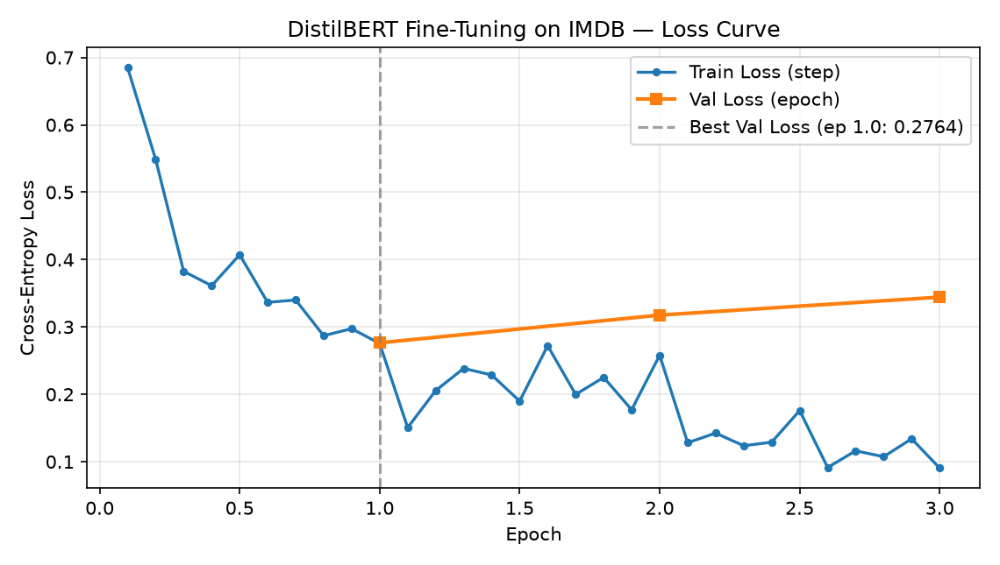
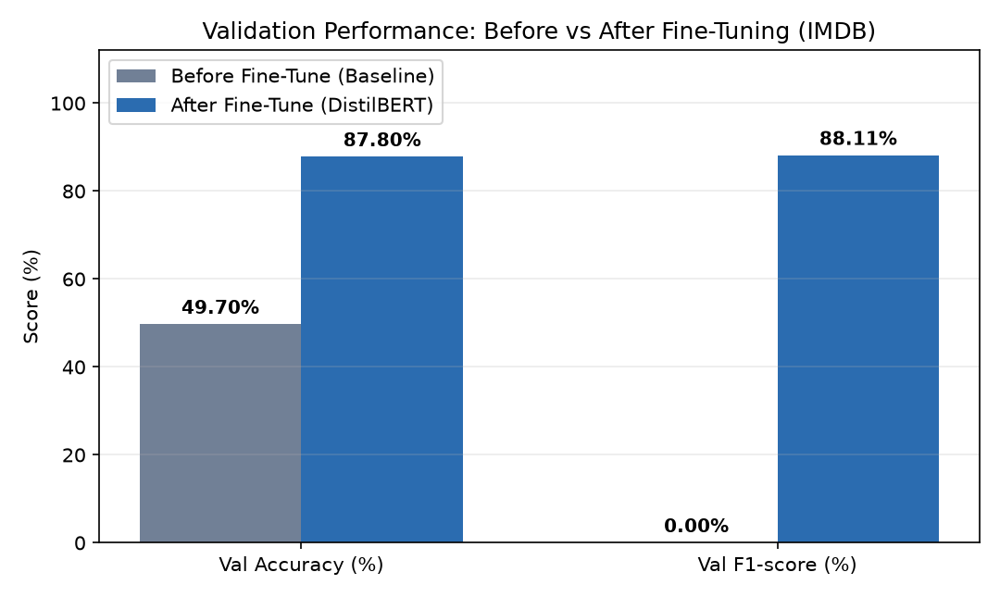
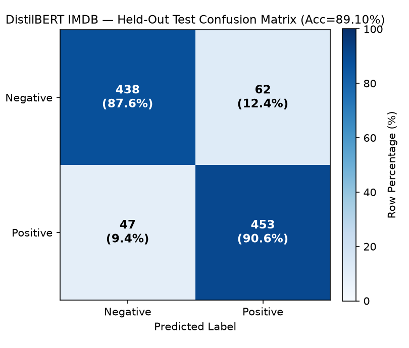

# Lab 3 v2 Report: Get Started with Hugging Face (`Ex1 Sentiment` & `Ex2 DistilBERT IMDB`)

> **Trạng thái:** Hoàn tất 100% số liệu thực nghiệm từ `experiments/lab3_v2/` (`NVIDIA GeForce RTX 4060 Laptop GPU`, `transformers 5.23.0`, `datasets 5.2.0`, `evaluate 0.4.6`, `seed = 248`).
>
> **Bộ 3 báo cáo chi tiết theo chuẩn SRP (`MODEL_PIPELINE.md v1.4.0`):**
> - **Layer 6 (Data Audit, Cleaning & EDA trên IMDB `4,000 / 1,000 / 1,000`):** [`docs/eda_report.md`](docs/eda_report.md)
> - **Layer 4 & Layer 7 (Ex1 Tokenizer & Sentiment Pipeline + Ex2 `Trainer` Diagnostics):** [`docs/experiment_report.md`](docs/experiment_report.md)
> - **Layer 8–10 (Val Trước vs Sau Fine-Tune, Final Test 1 lần, Error Analysis & Inference):** [`docs/evaluation_report.md`](docs/evaluation_report.md)

---

## 1. Tóm Tắt Kết Quả Thực Nghiệm (Executive Summary)

### Exercise 1 — WordPiece Tokenizer & Pretrained Sentiment Pipeline (`distilbert-sst2`)
- **Giải phẫu Tokenizer:** Biến câu mẫu thành `14` tokens (`[CLS] = 101`, `[SEP] = 102`, `fine-tuning → ['fine', '-', 'tuning']`), minh họa batch padding `(2, 11)` với `attention_mask = 0` che `6` vị trí `[PAD]` của câu ngắn ([`ex1_results.json`](../../experiments/lab3_v2/ex1/ex1_results.json)).
- **Đánh giá 8 câu mẫu (`5/8` khớp kỳ vọng):** Đúng tuyệt đối `5/5` câu rõ ràng & phủ định kép (`99.92%–99.99%`), nhưng bị đánh lừa ở `2/2` câu mỉa mai (`62.46%` và `99.47%` `POSITIVE`) và `1` câu cảm xúc pha trộn (`99.68%`) — xem phân tích chi tiết tại [`docs/experiment_report.md` §1](docs/experiment_report.md).

### Exercise 2 — Fine-Tuning `distilbert-base-uncased` trên IMDB (`4,000 / 1,000 / 1,000`)

| Mốc đánh giá | Tập dữ liệu | Loss | Accuracy (%) | Binary F1 (%) | Macro-F1 (%) |
| :--- | :---: | :---: | :---: | :---: | :---: |
| **Trước fine-tune (Baseline — random head)** | Validation (`1,000`) | `0.6957` | `49.70` | `0.00` | `33.20` |
| **Sau fine-tune (`checkpoint-250`, min `eval_loss`)** | Validation (`1,000`) | **`0.2764`** | **`87.80`** | **`88.11`** | **`87.79`** |
| **Chênh lệch trên Validation (`After − Before`)** | Validation (`1,000`) | **`-0.4193`** | **`+38.10 pp`** | **`+88.11 pp`** | **`+54.59 pp`** |
| **Held-Out Test (Chấm đúng 1 lần cuối)** | **Test (`1,000`)** | **`0.2518`** | **`89.10`** | **`89.26`** | **`89.10`** |

- **3 bài học kỹ thuật cốt lõi:**
  1. **Fine-tune `DistilBERT` cực nhanh và mạnh:** Chỉ trong **`91.41s`** (`3 epochs`, `fp16` trên RTX 4060), Val Accuracy tăng vọt **`+38.10 pp`** và Test đạt **`89.10%`**. `load_best_model_at_end=True` (`min eval_loss`) tự chọn đúng **Epoch 1 (`0.2764`)**, tránh overconfidence khi `eval_loss` tăng lên `0.3176 → 0.3442` ở Epoch 2–3.
  2. **Nguyên nhân lỗi hàng đầu được chứng minh định lượng — Cắt cụt tại `256` tokens:** Review dài `> 256` tokens (`40.8%` tập Test) có tỷ lệ lỗi **`14.46%` (`59/408`) — gấp `1.71×`** review `≤ 256` tokens (`8.45%`, `50/592`), vì câu kết luận & điểm số nằm ở phần đuôi bị cắt (vd. `test_idx=745`, `231`, `269`, `498`).
  3. **Suy luận trực tiếp trên câu mới (`eval_ex2.py --predict`):** Đạt `3/3` chính xác (`96.19%` Positive, `96.73%` Negative, và đoán đúng `87.51%` Negative trên câu tương phản *"stunning visuals, though incoherent story"*).

---

## 2. Biểu Đồ Chính & Deliverables

| Loss Curve (`Trainer` — 3 Epochs) | Validation Before vs After | Held-Out Test Confusion Matrix |
| :---: | :---: | :---: |
|  |  |  |

- **Executable Notebooks:** [`ex1_sentiment.ipynb`](ex1_sentiment.ipynb) · [`ex2_finetune.ipynb`](ex2_finetune.ipynb)
- **Pipeline & Model Specs:** [`docs/pipelines/modeling.md`](docs/pipelines/modeling.md) · [`docs/models/distilbert.md`](docs/models/distilbert.md)
- **Báo cáo SRP đầy đủ:** [`docs/eda_report.md`](docs/eda_report.md) · [`docs/experiment_report.md`](docs/experiment_report.md) · [`docs/evaluation_report.md`](docs/evaluation_report.md)
