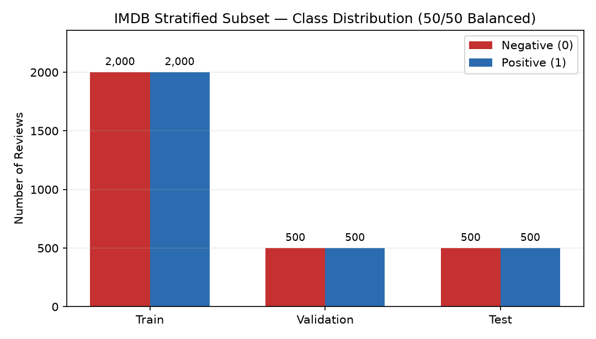
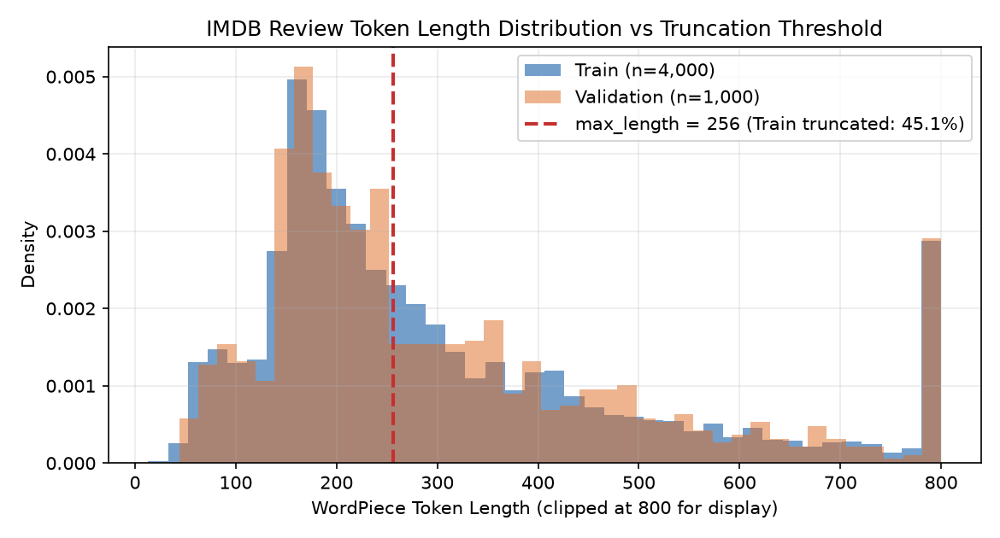

# Data Engineering & EDA Report: IMDB Stratified Subset (`4,000 / 1,000 / 1,000`)

> **Phạm vi tài liệu (Layer 6.1–6.4):** Kiểm toán thu thập dữ liệu IMDB, làm sạch/phát hiện nhiễu, phân tích phân bố nhãn & độ dài WordPiece token tại ngưỡng cắt `max_length = 256`, và chiến lược chia tập chống Data Leakage.
> - **Nguồn dữ liệu đã xác minh:** [`collection_report.json`](../../../experiments/lab3_v2/eda/collection_report.json) · [`cleaning_report.json`](../../../experiments/lab3_v2/eda/cleaning_report.json) · [`eda_summary.json`](../../../experiments/lab3_v2/eda/eda_summary.json) · [`split_indices.json`](../../../experiments/lab3_v2/splits/split_indices.json).

---

## 1. Data Collection & Anti-Leakage Split (Layer 6.1 & 6.4)

- **Nguồn:** `datasets.load_dataset("stanfordnlp/imdb")` (repo ID chính thức có namespace trên Hugging Face Hub tương thích `datasets 5.2.0`; bộ gốc gồm `25,000` review train + `25,000` review test, 2 lớp nhị phân `0 = Negative`, `1 = Positive`).
- **Chiến lược chia Stratified cố định (`seed = 248`, khóa tại [`split_indices.json`](../../../experiments/lab3_v2/splits/split_indices.json)):**

| Split | Nguồn tách | Tổng số mẫu | `Negative (0)` | `Positive (1)` | Tỷ lệ lớp | Ghi chú chống leakage |
| :--- | :--- | :---: | :---: | :---: | :---: | :--- |
| **Train** | IMDB `train` gốc | `4,000` | `2,000` | `2,000` | `50.0% / 50.0%` | Dùng cập nhật trọng số `DistilBERT` |
| **Validation** | Phần còn lại của IMDB `train` | `1,000` | `500` | `500` | `50.0% / 50.0%` | `Train ∩ Val = ∅` (theo chỉ số gốc) |
| **Test** | IMDB `test` gốc | `1,000` | `500` | `500` | `50.0% / 50.0%` | Khóa kín, chỉ chấm **1 lần cuối** ở `eval_ex2.py` |

---

## 2. Data Cleaning Audit (Layer 6.2)

Quét 100% toàn bộ `6,000` review trong 3 tập (`Train + Val + Test`) trước khi huấn luyện ([`cleaning_report.json`](../../../experiments/lab3_v2/eda/cleaning_report.json)):

| Chỉ tiêu kiểm toán | Train (`4,000`) | Val (`1,000`) | Test (`1,000`) | Nhận xét kỹ thuật |
| :--- | :---: | :---: | :---: | :--- |
| Review rỗng / chỉ khoảng trắng | `0` | `0` | `0` | **Sạch hoàn toàn**, không cần lọc bỏ mẫu hỏng |
| Review chứa thẻ HTML ` ` | `2,341` (`58.5%`) | `586` (`58.6%`) | `553` (`55.3%`) | Đặc trưng phân đoạn tự nhiên của IMDB; giữ nguyên để bảo toàn chuẩn benchmark |
| Trùng lặp nội bộ (exact text hash) | `3` | `0` | `0` | Mức rất nhỏ (`0.075%`) có sẵn trong IMDB gốc |
| Trùng lặp chéo giữa các split | `Train ∩ Val: 2` | `Val ∩ Test: 1` | **`Train ∩ Test: 0`** | **0 mẫu trùng nội dung giữa Train và Held-Out Test** (không rò rỉ Test) |

---

## 3. Exploratory Data Analysis & Tác Động Của `max_length = 256` (Layer 6.3)

Đo độ dài thực tế theo số từ (whitespace split) và số **WordPiece tokens** (`distilbert-base-uncased`, không cắt):

| Split | Số từ Median / Mean / p95 / Max | WordPiece Tokens Median / Mean / p95 / Max | **Tỷ lệ review vượt `256` tokens (bị cắt)** |
| :--- | :---: | :---: | :---: |
| **Train (`4,000`)** | `175` / `234.8` / `609` / `1,839` | `235` / `315.3` / `817` / `2,315` | **`45.07%`** (`~1,803` review) |
| **Validation (`1,000`)** | `180` / `237.7` / `611` / `1,014` | `241` / `319.9` / `819` / `1,474` | **`45.30%`** (`453` review) |
| **Test (`1,000`)** | `170` / `225.6` / `584` / `1,001` | `225` / `302.5` / `808` / `1,396` | **`40.80%`** (`408` review) |

- **Phát hiện EDA cốt lõi (dự báo trước cho Error Analysis Layer 9):**
  1. **Phân bố độ dài lệch phải mạnh (long-tail):** Trong khi trung vị nằm quanh `225–241` tokens, có tới **`40.8%–45.3%` review vượt quá ngưỡng `max_length = 256` tokens** (và 5% dài nhất vượt `808–819` tokens).
  2. **Giả thuyết rủi ro cắt cụt (`truncation`):** Nhiều người viết review IMDB thường giới thiệu bối cảnh/cốt truyện ở đầu bài rồi mới chốt đánh giá khen-chê hoặc điểm số (`8/10`, `3/10`) ở cuối bài. Việc cắt ở `256` tokens có khả năng đẩy tỷ lệ lỗi ở nhóm review dài lên cao hơn rõ rệt so với review ngắn — giả thuyết này được kiểm chứng định lượng trực tiếp tại **[`evaluation_report.md` §4](evaluation_report.md)**.
  3. **Hiệu quả của Dynamic Padding (`DataCollatorWithPadding`):** Vì 55% review ngắn hơn `256` tokens (ngắn nhất chỉ `13` tokens), padding động theo độ dài lớn nhất trong từng mini-batch giúp tiết kiệm tính toán Attention đáng kể so với pad cứng `256` toàn tập.

---

## 4. Tài Liệu Liên Quan

- Báo cáo Ex1 & Training Diagnostics (Layer 4 & 7): [`experiment_report.md`](experiment_report.md)
- Báo cáo Đánh giá Val/Test, Error Analysis & Inference (Layer 8–10): [`evaluation_report.md`](evaluation_report.md)
- Báo cáo tóm tắt điều hướng: [`../REPORT.md`](../REPORT.md) · Đặc tả Pipeline: [`pipelines/modeling.md`](pipelines/modeling.md)
