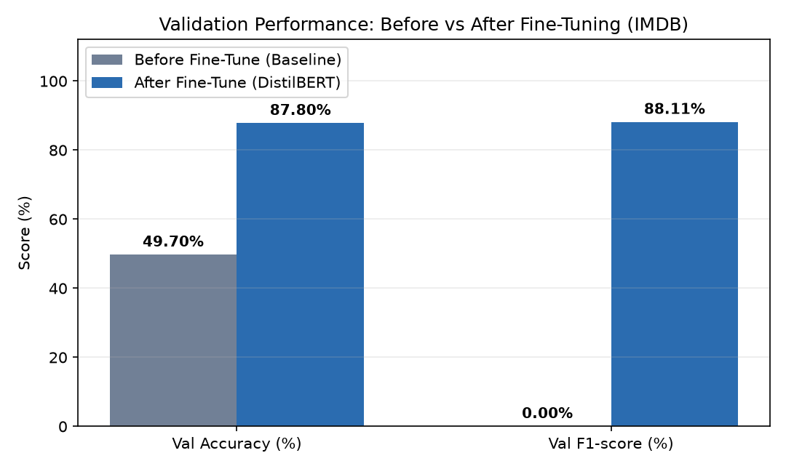
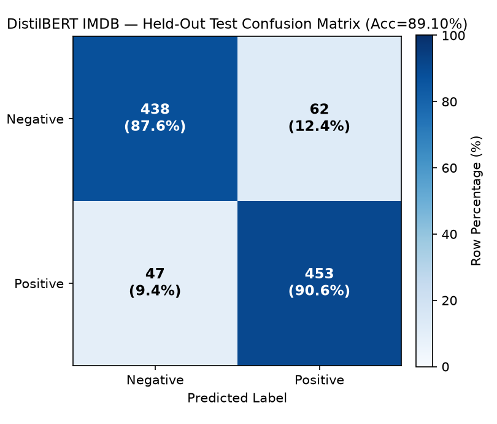

# Evaluation & Error Analysis Report: Before vs After Fine-Tune, Final Test & Inference (`IMDB`)

> **Phạm vi tài liệu (Layer 8 → Layer 10):** Đánh giá so sánh **Trước vs Sau fine-tune** trên tập Validation (`1,000` mẫu), Đánh giá cuối không thiên lệch trên tập **Held-Out Test (`1,000` mẫu, chấm 1 lần duy nhất)**, phân tích nguyên nhân dự đoán sai (Error Analysis) và kiểm chứng suy luận trực tiếp trên câu review mới.
> - Kết quả Ex1 & Training Diagnostics xem tại **[`experiment_report.md`](experiment_report.md)**; EDA xem tại **[`eda_report.md`](eda_report.md)**.

---

## 1. Tóm Tắt Đánh Giá (Executive Summary)

- **Kỷ luật chống Test Leakage:** Tách cố định `4,000` Train / `1,000` Val / `1,000` Test (`seed = 248`, `0` mẫu trùng giữa Train và Test). Toàn bộ quá trình chọn checkpoint tối ưu (`checkpoint-250`, `min eval_loss`) thực hiện trên Validation; tập **Test (`1,000` mẫu)** chỉ mở **duy nhất 1 lần cuối** qua `eval_ex2.py`.
- **Validation (`1,000` mẫu — Layer 8.1):** Fine-tune `distilbert-base-uncased` tạo bước nhảy vượt trội từ **`49.70%` → `87.80%` Accuracy (`+38.10 pp`)**, **`0.00%` → `88.11%` F1 (`+88.11 pp`)**, và giảm Val Loss từ **`0.6957` → `0.2764` (`-0.4193`)** → **PASS Acceptance Criteria**.
- **Held-Out Test (`1,000` mẫu, chấm 1 lần — Layer 8.2):** Đạt **`89.10%` Accuracy / `89.26%` Binary F1 / `89.10%` Macro-F1 / `0.2518` Test Loss** (`109` lỗi trên `1,000` review, cân bằng tốt giữa 2 lớp `Negative F1 = 88.93%` và `Positive F1 = 89.26%`).
- **Phát hiện Error Analysis nổi bật nhất (Layer 9):** Xác thực định lượng giả thuyết EDA — **review bị cắt cụt (`> 256` tokens) có tỷ lệ lỗi `14.46%` (`59/408`), cao gấp `1.71×` review không bị cắt (`8.45%`, `50/592`)**!

---

## 2. Đánh Giá Trên Validation (`1,000` mẫu): Trước vs Sau Fine-Tune (Layer 8.1)

| Giai đoạn đánh giá (`Val = 1,000` mẫu: `500` Neg / `500` Pos) | Val Loss | Val Accuracy (%) | Val Binary F1 (%) | Val Macro-F1 (%) | Artifact JSON |
| :--- | :---: | :---: | :---: | :---: | :---: |
| **Trước fine-tune (Baseline — random head)** | `0.6957` | `49.70` | `0.00` | `33.20` | [`baseline_before_finetune.json`](../../../experiments/lab3_v2/runs/distilbert_imdb/val_eval/baseline_before_finetune.json) |
| **Sau fine-tune (`best_model`, `checkpoint-250`)** | **`0.2764`** | **`87.80`** | **`88.11`** | **`87.79`** | [`after_finetune_val.json`](../../../experiments/lab3_v2/runs/distilbert_imdb/val_eval/after_finetune_val.json) |
| **Cải thiện (`After − Before`)** | **`-0.4193`** | **`+38.10 pp`** | **`+88.11 pp`** | **`+54.59 pp`** | — |

- **Giải thích vì sao `Val F1` trước fine-tune bằng `0.00%` trong khi `Val Acc = 49.70%`:** Khi khởi tạo mới `classifier: Linear(768 → 2)` chưa qua huấn luyện, độ lệch bias ngẫu nhiên khiến mô hình dự đoán gần như toàn bộ mẫu vào lớp `0 (Negative)` → đúng khoảng một nửa tập cân bằng (`49.7%` Acc, `Val Loss = 0.6957 ≈ ln 2`) nhưng `Recall(Positive) ≈ 0` nên Binary F1 bằng `0.00%`. Ngay sau 1 epoch fine-tune, toàn bộ đầu phân loại và các tầng Transformer thích nghi mạnh với ngữ nghĩa review phim, đưa F1 lên `88.11%`.

---

## 3. Đánh Giá Cuối Trên Tập Test Độc Lập (`1,000` mẫu — Layer 8.2, Chấm 1 Lần Duy Nhất)

Thực thi: `python labs/lab3_v2/eval_ex2.py` (artifact: [`final_test_metrics.json`](../../../experiments/lab3_v2/runs/distilbert_imdb/test_eval/final_test_metrics.json)):

| Lớp (`Test = 1,000` mẫu) | Precision (%) | Recall (%) | F1-score (%) | Support |
| :--- | :---: | :---: | :---: | :---: |
| **`Negative (0)`** | `90.31` | `87.60` | `88.93` | `500` |
| **`Positive (1)`** | `87.96` | `90.60` | `89.26` | `500` |
| **Tổng thể (`Accuracy` / `Macro-F1` / `Loss`)** | — | — | **`89.10%` Acc · `89.10%` Macro-F1 · `0.2518` Loss** | **`1,000`** |

- **Khả năng tổng quát hóa Val → Test:** `Val Acc = 87.80%` (`Loss 0.2764`) → **`Test Acc = 89.10%` (`Loss 0.2518`)** — không hề có dấu hiệu suy giảm hay overfitting vào tập Val.
- **Độ cân bằng lỗi 2 chiều:** `62` False Positives (`Negative → Positive`, `12.4%`) và `47` False Negatives (`Positive → Negative`, `9.4%`) — hơi nghiêng nhẹ sang đoán `Positive`, nhưng chênh lệch F1 hai lớp rất nhỏ (`0.33 pp`).

---

## 4. Error Analysis — Phân Tích Các Ca Dự Đoán Sai (`109` lỗi Test — Layer 9)

Toàn bộ danh sách lỗi tự tin cao và lỗi vùng ranh giới lưu tại [`error_examples.json`](../../../experiments/lab3_v2/runs/distilbert_imdb/test_eval/error_examples.json).

### 4.1 Slice Analysis theo Truncation (`max_length = 256` tokens)

| Nhóm độ dài review trên Test (`1,000` mẫu) | Số mẫu | Số lỗi | **Tỷ lệ lỗi (%)** | Nhận xét |
| :--- | :---: | :---: | :---: | :--- |
| **Bị cắt (`orig_token_len > 256`)** | `408` (`40.8%`) | `59` | **`14.46%`** | **Cao gấp `1.71×`** (`+6.01 pp`) so với review ngắn! |
| **Không bị cắt (`orig_token_len ≤ 256`)** | `592` (`59.2%`) | `50` | **`8.45%`** | Hiệu năng đạt tới **`91.55%` Accuracy** khi đủ ngữ cảnh |

- **Bằng chứng xác thực giả thuyết EDA:** Trong **Top-10 lỗi tự tin cao nhất (`92.6%–96.5%`)**, có tới **`6/10` mẫu bị cắt ở `256` tokens** (và `5/10` mẫu ở nhóm lỗi ranh giới Low-Conf cũng bị cắt)!

### 4.2 Phân tích định tính các ca dự đoán sai tiêu biểu

| Nguyên nhân gốc | Mẫu thật trên Test (`error_examples.json`) | Chẩn đoán vì sao mô hình sai |
| :--- | :--- | :--- |
| **1. Mất kết luận do cắt ở `256` tokens** *(Nút thắt số 1)* | • **`idx=745`** (`Pos → Neg`, `96.54%`, `987` tok) • **`idx=231`** (`Pos → Neg`, `96.46%`, `455` tok) • **`idx=269`** (`Pos → Neg`, `95.55%`, `614` tok) • **`idx=498`** (`Pos → Neg`, `92.64%`, `843` tok) | Phần đầu 256 tokens mô tả các phim dở trước đó (`"profane and obnoxious"`), dẫn lời giới phê bình chê bai (`"thin plot, weak performances"`), cảnh báo phim kinh dị nặng đô (`"shocking depravity"`), hoặc kỳ vọng ban đầu thấp — trong khi **câu chốt khen/điểm số (`"see this at least twice"`, `"8/10"`, `"3.5/5 stars"`) nằm hoàn toàn ở đoạn đuôi đã bị cắt bỏ!** |
| **2. Cảm xúc pha trộn / "Guilty Pleasure" / Hài kiểu Anh** | • **`idx=551`** (`Neg → Pos`, `95.72%`, `66` tok) • **`idx=0`** (`Pos → Neg`, `95.84%`, `218` tok) • **`idx=656`** (`Neg → Pos`, `95.00%`, `238` tok) | `idx=551` khen suốt bài (`"favorite guilty pleasures... always fun... I especially like"`) rồi bất ngờ chốt `"Give it a 3"`. `idx=0` dùng hàng loạt tính từ bề mặt tiêu cực để khen phim hài (`"puerile, adolescent, idiotic..And utterly hilarious"`). `idx=656` dành 90% review ca ngợi một nữ diễn viên phụ rồi mới kết `"silly, worthless movie"`. |
| **3. Vùng ranh giới & nhãn gốc đáng ngờ** | • **`idx=578`** (`Neg → Pos`, `51.50%`, `170` tok) • **`idx=991`** (`Pos → Neg`, `51.71%`, `300` tok) | Mô hình hiệu chuẩn tốt nên xác suất rớt xuống `~51%`. Riêng `idx=578` được gắn nhãn gốc `Negative` nhưng câu kết luận viết rõ: **`"The movie is good, that is all I can say."`** — dấu hiệu nhiễu nhãn tự nhiên của IMDB. |

### 4.3 Hướng cải tiến ưu tiên (theo bằng chứng Error Analysis)

1. **Ưu tiên số 1 (giảm lỗi cắt cụt `14.46% → ~8.5%`):** Nâng `max_length` từ `256 → 512` (giới hạn gốc của `DistilBERT`) hoặc áp dụng chiến lược **Head + Tail Truncation (`128` tokens đầu + `384` tokens cuối)** để luôn giữ nguyên câu kết luận & điểm số cuối review.
2. **Ưu tiên số 2 (kiểm soát overconfidence ở Epoch 2–3):** Bật `label_smoothing_factor = 0.05` và `warmup_ratio = 0.1` (hoặc giảm `lr` xuống `1.5e-5`) để tận dụng thêm dữ liệu mà `eval_loss` không tăng ngược sau Epoch 1.

---

## 5. Kiểm Chứng Suy Luận Trực Tiếp Trên Câu Mới (Layer 10)

Thực thi: `python labs/lab3_v2/eval_ex2.py --predict ...` bằng checkpoint `weights/best_model/` dưới `@torch.inference_mode()` (`requires_grad = False` xác nhận trên `3/3` mẫu):

| Câu review đầu vào | Dự đoán | Xác suất (`Neg / Pos`) | Số tokens | Nhận xét |
| :--- | :---: | :---: | :-: | :--- |
| *"An unforgettable masterpiece with sharp writing and extraordinary performances."* | **`Positive`** | `3.81% / 96.19%` | `15` | Chính xác, tự tin cao |
| *"A tedious, poorly acted mess that felt twice as long as its runtime."* | **`Negative`** | `96.73% / 3.27%` | `19` | Chính xác, tự tin cao |
| *"The visuals were stunning, though the incoherent story ultimately left me disappointed."* | **`Negative`** | `87.51% / 12.49%` | `19` | **Đoán đúng cảm xúc tương phản** (khắc phục điểm yếu câu tương phản ở Ex1 SST-2!) |

---

## 6. Tài Liệu Liên Quan & Lịch Sử Thay Đổi

- Báo cáo Ex1 & Training Diagnostics (Layer 4 & 7): [`experiment_report.md`](experiment_report.md)
- Báo cáo Dữ liệu & EDA (Layer 6): [`eda_report.md`](eda_report.md)
- Báo cáo tóm tắt điều hướng & Notebooks: [`../REPORT.md`](../REPORT.md) · [`ex1_sentiment.ipynb`](../ex1_sentiment.ipynb) · [`ex2_finetune.ipynb`](../ex2_finetune.ipynb)

| Version | Ngày | Người sửa | Agent | Mô tả thay đổi |
| :--- | :--- | :--- | :--- | :--- |
| `1.0.0` | 2026-11-28 | notworLe | Antigravity | Hoàn thiện báo cáo Layer 8–10 với 100% số liệu thật: Val Before vs After (`+38.10 pp` Acc), Final Test `1,000` mẫu (`89.10%` Acc / `89.26%` F1 / `0.2518` Loss), Error Analysis (`14.46%` vs `8.45%` truncation slice + phân tích chi tiết các ca lỗi) và Live Inference |
| `0.1.0` | 2026-11-28 | notworLe | Antigravity | Khởi tạo khung báo cáo trước Step 4 |
