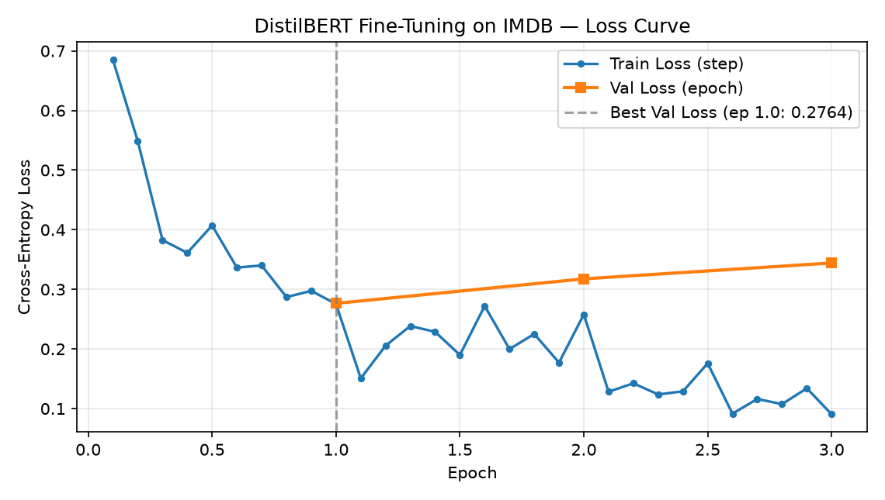

# Experiment Report: Ex1 Sentiment Pipeline & Ex2 DistilBERT Training Diagnostics

> **Phạm vi tài liệu (Layer 4 → Layer 7):** Tập trung vào **Exercise 1 (giải phẫu WordPiece Tokenizer & kết quả `pipeline` pretrained SST-2)**, **Sanity Checks & Offline Verification**, và **thiết kế + chẩn đoán quá trình huấn luyện Exercise 2 (`Trainer`, `loss_curve.png`, TensorBoard)**.
> - So sánh đánh giá Trước vs Sau fine-tune trên Validation (`1,000`), Final Held-Out Test (`1,000`, chấm 1 lần), Error Analysis & Live Inference nằm riêng tại **[`evaluation_report.md`](evaluation_report.md)**.
> - Kiểm toán dữ liệu & EDA tập con IMDB xem tại **[`eda_report.md`](eda_report.md)**.

---

## 1. Exercise 1 — Giải Phẫu WordPiece Tokenizer & Sentiment Pipeline (`distilbert-sst2`)

Thực thi lệnh: `python labs/lab3_v2/run_ex1.py` trên `NVIDIA GeForce RTX 4060 Laptop GPU` (artifact: [`ex1_results.json`](../../../experiments/lab3_v2/ex1/ex1_results.json), notebook tương tác: [`ex1_sentiment.ipynb`](../ex1_sentiment.ipynb)).

### 1.1 Giải phẫu 1 câu mẫu (`text → tokens → input_ids → attention_mask → decode`)

- **Câu đầu vào:** `"Hugging Face transformers make fine-tuning unbelievable and surprisingly enjoyable!"`
- **Chuỗi `14` tokens:** `['[CLS]', 'hugging', 'face', 'transformers', 'make', 'fine', '-', 'tuning', 'unbelievable', 'and', 'surprisingly', 'enjoyable', '!', '[SEP]']`
- **`input_ids` (`int64`):** `[101, 17662, 2227, 19081, 2191, 2986, 1011, 17372, 23653, 1998, 10889, 22249, 999, 102]`
- **`attention_mask`:** `[1, 1, 1, 1, 1, 1, 1, 1, 1, 1, 1, 1, 1, 1]`
- **Decode (`skip_special_tokens=False`):** `[CLS] hugging face transformers make fine - tuning unbelievable and surprisingly enjoyable! [SEP]`
- **Decode (`skip_special_tokens=True`):** `hugging face transformers make fine - tuning unbelievable and surprisingly enjoyable!`
- **Nhận xét cơ chế:** Tokenizer `uncased` chuyển toàn bộ về chữ thường, chèn `[CLS] (101)` ở đầu và `[SEP] (102)` ở cuối, tách dấu gạch nối `"fine-tuning"` thành 3 token `['fine', '-', 'tuning']`; toàn bộ từ trong câu mẫu đều nằm sẵn trong bộ từ điển `30,522` từ của `DistilBERT` (`subword_pieces = []`).

### 1.2 Minh họa Batch Padding (`padding=True` → Tensor `(2, 11)`)

| Câu trong Batch | Token thật (`mask = 1`) | Token đệm `[PAD]` (`mask = 0`) | Chuỗi Tokens sau Padding |
| :--- | :---: | :---: | :--- |
| `"Great movie!"` | `5` | `6` | `[CLS] great movie ! [SEP] [PAD] [PAD] [PAD] [PAD] [PAD] [PAD]` |
| `"This movie was surprisingly thoughtful and well directed."` | `11` | `0` | `[CLS] this movie was surprisingly thoughtful and well directed . [SEP]` |

- Tensor đầu ra đồng nhất shape `(2, 11)` kiểu `torch.int64`; `attention_mask = 0` chặn các lớp Self-Attention tính điểm lên 6 vị trí `[PAD]` của câu ngắn.

### 1.3 Kết quả Sentiment Pipeline trên 8 câu mẫu (`distilbert-base-uncased-finetuned-sst-2-english`)

| # | Nhóm câu | Kỳ vọng | Dự đoán | Xác suất | Khớp | Câu mẫu |
| :-: | :--- | :---: | :---: | :---: | :-: | :--- |
| 1 | `positive_clear` | `POSITIVE` | `POSITIVE` | `99.99%` | OK | *"I absolutely loved this movie! The acting was brilliant and the story kept me hooked from start to finish."* |
| 2 | `positive_clear` | `POSITIVE` | `POSITIVE` | `99.95%` | OK | *"This library makes working with pretrained transformer models surprisingly intuitive and fast."* |
| 3 | `negative_clear` | `NEGATIVE` | `NEGATIVE` | `99.98%` | OK | *"What a complete waste of two hours. The plot made zero sense and the dialogue was awful."* |
| 4 | `negative_clear` | `NEGATIVE` | `NEGATIVE` | `99.97%` | OK | *"The service was painfully slow, the staff were rude, and the food arrived completely cold."* |
| 5 | `negation_contrast` | `POSITIVE` | `POSITIVE` | `99.92%` | OK | *"I expected this film to be terrible, yet it turned out not bad at all and genuinely entertaining."* |
| 6 | `mixed_contrast` | `NEGATIVE` | `POSITIVE` | `99.68%` | **MISS** | *"The cinematography is breathtaking, although the pacing drags terribly and the ending ruins everything."* |
| 7 | `sarcasm_hard` | `NEGATIVE` | `POSITIVE` | `62.46%` | **MISS** | *"Oh great, another three-hour sequel with absolutely nothing new to say. Just what I wanted."* |
| 8 | `sarcasm_hard` | `NEGATIVE` | `POSITIVE` | `99.47%` | **MISS** | *"Yeah, waiting four hours at a delayed airport gate was definitely the highlight of my vacation."* |

- **Bài học rút ra từ Ex1 (`5/8` khớp kỳ vọng):** Model pretrained SST-2 xử lý xuất sắc cả câu rõ ràng (`4/4`, `> 99.95%`) lẫn phủ định kép/tương phản tích cực (`"not bad at all"` → `99.92%`), **nhưng dễ bị đánh lừa bởi mỉa mai (sarcasm)** (`#7` lưỡng lự `62.46%`, `#8` sai tự tin tới `99.47%` do bám vào cụm từ tích cực bề mặt *"definitely the highlight of my vacation"*) và câu mở đầu khen quá mạnh (`#6` *"breathtaking"* lấn át vế chê sau *"although"*).

---

## 2. Thiết Kế Huấn Luyện Ex2 & Sanity Verification (Layer 4 & 7.1)

| Thành phần | Cấu hình thực thi (`labs/lab3_v2/config.py`) |
| :--- | :--- |
| Pretrained Backbone | `distilbert-base-uncased` (`66,955,010` tham số — `100%` trainable khi fine-tune) |
| Dataset & Split | `stanfordnlp/imdb` — `Train = 4,000` / `Val = 1,000` (`Test = 1,000` khóa kín, `seed = 248`) |
| Preprocessing | `truncation = True`, `max_length = 256`, **Dynamic Padding** qua `DataCollatorWithPadding` |
| Optimizer & Scheduler | `AdamW` (`lr = 2e-5`, `weight_decay = 0.01`, linear decay từ `2e-5` về `0` qua `750` steps) |
| Batch / Epochs / AMP | `train_bs = 16` (`250` steps/ep), `eval_bs = 32`, `3 epochs`, `fp16 = True` trên `RTX 4060` |
| Best Checkpoint & Logging | `eval_strategy = "epoch"`, `load_best_model_at_end = True` (`min eval_loss`), `processing_class = tokenizer`, TensorBoard active |

- **Sanity & Offline Verification (Layer 4):**
  - Bộ kiểm thử offline `pytest -m smoke` (`2/2` PASS) và full `pytest` (`6/6` PASS, `0` warnings) xác minh trước khi chạy thật: Tensor Contract `(B, L) → (B, 2)` Fail-Fast, split `Train ∩ Val = ∅`, và tương thích hoàn toàn API `transformers 5.23.0` (`eval_strategy`, `processing_class`, không truyền `logging_dir`).
  - Khi nạp `distilbert-base-uncased` cho tác vụ `SequenceClassification` (`num_labels = 2`), log xác nhận 4 tensor đầu phân loại (`pre_classifier.{weight,bias}`, `classifier.{weight,bias}`) được khởi tạo mới ngẫu nhiên — khớp với Baseline Loss ban đầu `0.6957 ≈ ln(2) = 0.6931`.

---

## 3. Training Diagnostics & Loss Curve (Layer 7.2–7.4)

Thực thi lệnh: `python labs/lab3_v2/train_ex2.py` (tổng thời gian fine-tune `91.41s`, tốc độ **`132.2 samples/s`** = `8.26 steps/s`, TensorBoard logs tại `experiments/lab3_v2/runs/distilbert_imdb/monitor/tb_logs/`).

| Mốc Epoch | Global Step | Learning Rate | Train Loss (step cuối epoch) | Val Loss | Val Accuracy (%) | Val F1 (%) | Trạng thái Checkpoint |
| :---: | :---: | :---: | :---: | :---: | :---: | :---: | :--- |
| `0.0` *(Baseline)* | `0` | — | — | `0.6957` | `49.70` | `0.00` | Trước fine-tune (random head) |
| **`1.0`** | **`250`** | `1.34e-5` | `0.2755` | **`0.2764`** | `87.80` | `88.11` | **`best_model` (`checkpoint-250`, min `eval_loss`)** |
| `2.0` | `500` | `6.69e-6` | `0.2580` *(ep 2 TB ~0.21)* | `0.3176` | **`88.80`** | `88.24` | Bắt đầu tăng `eval_loss` (overconfidence) |
| `3.0` | `750` | `2.67e-8` | **`0.0905`** | `0.3442` | `88.10` | **`88.34`** | Train loss rất thấp, Val loss tiếp tục tăng |

- **Chẩn đoán động học huấn luyện ([`trainer_log_history.json`](../../../experiments/lab3_v2/runs/distilbert_imdb/monitor/trainer_log_history.json) · [`train_summary.json`](../../../experiments/lab3_v2/runs/distilbert_imdb/monitor/train_summary.json)):**
  1. **Hội tụ cực nhanh trong Epoch 1:** Nhờ trọng số tiền huấn luyện ngôn ngữ của `DistilBERT`, chỉ sau `75` steps (`0.3 epoch`) `train_loss` đã tụt từ `0.6847` xuống `0.3826`, và kết thúc **Epoch 1 (`step 250`)** `train_loss (0.2755)` và `eval_loss (0.2764)` gần như trùng khít nhau — độ hiệu chuẩn xác suất đạt tối ưu.
  2. **Hiện tượng *Loss–Accuracy Divergence* (Overconfidence) từ Epoch 2 → 3:** Với `66.96M` tham số trainable trên `4,000` mẫu, sang Epoch 2 và Epoch 3 `train_loss` lao sâu xuống `0.15 → 0.0905` (mô hình bắt đầu học thuộc tập Train) trong khi **`eval_loss` tăng ngược `0.2764 → 0.3176 → 0.3442`** dù `eval_accuracy` nhích lên đỉnh `88.80%` ở Epoch 2 rồi dịu xuống `88.10%` ở Epoch 3.
  3. **Vai trò bảo vệ của `load_best_model_at_end=True` theo `min(eval_loss)`:** `Trainer` tự động khôi phục đúng **`checkpoint-250` (Epoch 1, `eval_loss = 0.2764`)** làm `weights/best_model/` thay vì lấy checkpoint Epoch 3 quá tự tin.

---

## 4. Tài Liệu Liên Quan & Lịch Sử Thay Đổi

- Đánh giá Val/Test, Error Analysis & Inference (Layer 8–10): [`evaluation_report.md`](evaluation_report.md)
- Kiểm toán dữ liệu & EDA (Layer 6): [`eda_report.md`](eda_report.md)
- Báo cáo tóm tắt điều hướng & Notebooks: [`../REPORT.md`](../REPORT.md) · [`ex1_sentiment.ipynb`](../ex1_sentiment.ipynb) · [`ex2_finetune.ipynb`](../ex2_finetune.ipynb)

| Version | Ngày | Người sửa | Agent | Mô tả thay đổi |
| :--- | :--- | :--- | :--- | :--- |
| `1.0.0` | 2026-11-28 | notworLe | Antigravity | Hoàn thiện báo cáo Layer 4 & Layer 7 với 100% số liệu thật từ Ex1 (`ex1_results.json`) và Ex2 (`trainer_log_history.json`, `train_summary.json`, `loss_curve.png`) |
| `0.1.0` | 2026-11-28 | notworLe | Antigravity | Khởi tạo khung báo cáo trước Step 4 |
