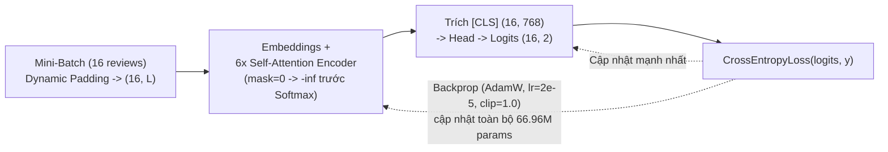

# Model Specification: `DistilBERT` (`distilbert-base-uncased`)

> **Pipeline:** [`pipelines/modeling.md`](../pipelines/modeling.md) · **References:** Sanh et al. (2019), *DistilBERT, a distilled version of BERT: smaller, faster, cheaper and lighter*.

---

## 1. Kiến Trúc Tổng Quát

`DistilBERT` là phiên bản rút gọn (Knowledge Distillation) của `BERT-base`: giữ nguyên chiều ẩn `d_model = 768` và `12` attention heads, nhưng giảm một nửa số tầng Transformer Encoder từ `12` xuống còn **`6` tầng** và lược bỏ `token_type_ids` cùng lớp `pooler`.

| Thông số kiến trúc | `distilbert-base-uncased` (Ex2) | `distilbert-base-uncased-finetuned-sst-2-english` (Ex1) |
| :--- | :---: | :---: |
| Kiến trúc lõi | `DistilBertForSequenceClassification` | `DistilBertForSequenceClassification` |
| Vocabulary (`WordPiece`, lowercase) | `30,522` tokens | `30,522` tokens |
| Max Position Embeddings | `512` (cấu hình thực nghiệm `max_length = 256`) | `512` |
| Số tầng Encoder / Attention Heads | `6` layers / `12` heads | `6` layers / `12` heads |
| Hidden Size / FFN Intermediate | `768` / `3,072` (`GELU`) | `768` / `3,072` (`GELU`) |
| Số lớp đầu ra (`num_labels`) | `2` (`0: NEGATIVE`, `1: POSITIVE`) | `2` (`0: NEGATIVE`, `1: POSITIVE`) |
| Tổng số tham số | **`~66.96M`** (`66,955,010`) | **`~66.96M`** (`66,955,010`) |
| Trạng thái đầu phân loại khi nạp | **Khởi tạo ngẫu nhiên** (cần fine-tune trên IMDB) | **Đã fine-tune sẵn** trên tập SST-2 |

---

## 2. Luồng Biến Đổi Tensor Chi Tiết

```text
Raw English Text
  │  WordPiece Tokenizer (add [CLS]=101, [SEP]=102, subwords "##...", truncation=256)
  ▼
input_ids:      (B, L)  int64     [101, 2023, 3185, ..., 102, 0, 0]
attention_mask: (B, L)  int64     [  1,    1,    1, ...,   1, 0, 0]
  │  DistilBertModel (Word + Position Embeddings + 6x TransformerBlock)
  ▼
last_hidden_state: (B, L, 768)  float32
  │  Trích vector đại diện câu tại vị trí token đầu tiên [CLS] (index 0)
  ▼
pooled_cls:        (B, 768)     float32
  │  pre_classifier: Linear(768 -> 768) -> ReLU -> Dropout(p=0.2)
  │  classifier:     Linear(768 -> 2)
  ▼
logits:            (B, 2)       float32  (dùng trực tiếp cho CrossEntropyLoss hoặc Softmax)
```

---

## 3. Cơ Chế WordPiece Tokenizer (Trọng Tâm Ex1)

1. **Lowercasing & Punctuation Split (`uncased`):** Mọi chữ hoa được đưa về chữ thường (`"Awesome!" → "awesome", "!"`).
2. **Subword Splitting (`##`):** Các từ hiếm hoặc từ ghép không nằm trong từ điển `30,522` từ được tách nhỏ thành các mảnh có tiền tố `##` (ví dụ `"unbelievable"` → `["un", "##bel", "##ie", "##vable"]`), giúp triệt tiêu hiện tượng Out-Of-Vocabulary (`[UNK]`).
3. **Special Tokens:**
   - `[CLS]` (`id = 101`): đặt đầu câu, đóng vai trò điểm tổng hợp ngữ nghĩa toàn câu cho bài toán phân loại.
   - `[SEP]` (`id = 102`): đánh dấu kết thúc câu.
   - `[PAD]` (`id = 0`): điền bù độ dài khi gom batch, được che bằng `attention_mask = 0` để cơ chế Self-Attention bỏ qua hoàn toàn.

---

## 4. Cơ Chế Fine-Tuning Transformer (`Pre-trained MLM → Sequence Classification`)

### 4.1 Bước Thay Đầu (Head Replacement) khi nạp `distilbert-base-uncased`

Trước khi fine-tune, `distilbert-base-uncased` đã được pre-train trên hàng tỷ từ bằng bài toán **Masked Language Modeling (MLM)** (che ngẫu nhiên 15% từ và đoán lại từ bị che). Khi nạp bằng `AutoModelForSequenceClassification.from_pretrained("distilbert-base-uncased", num_labels=2)`, Hugging Face thực hiện đúng 2 thao tác (thể hiện rõ trong `LOAD REPORT`):

| Thành phần trong `distilbert-base-uncased` | Trạng thái khi nạp | Vai trò sau khi chuyển tác vụ |
| :--- | :---: | :--- |
| **Word/Position Embeddings + 6 tầng Encoder** (`~66.36M` params) | **Giữ nguyên trọng số pre-train** | Bảo toàn tri thức cú pháp, từ vựng và ngữ cảnh tiếng Anh |
| **Đầu MLM cũ** (`vocab_transform`, `vocab_layer_norm`, `vocab_projector`) | **`UNEXPECTED` (bỏ đi)** | Không còn dùng cho bài toán đoán `30,522` từ |
| **Đầu phân loại mới** (`pre_classifier: 768→768`, `classifier: 768→2`, `~592K` params) | **`MISSING` (khởi tạo ngẫu nhiên)** | Học siêu phẳng tách `Negative / Positive` từ con số 0 (lý do Baseline trước fine-tune chỉ đạt `~50%`, Loss $\approx \ln 2$) |

### 4.2 Diễn biến 1 bước Fine-Tune (Forward → Loss → Backprop toàn mạng)



1. **Dynamic Padding (`DataCollatorWithPadding`):** Đệm `[PAD] (0)` theo độ dài câu dài nhất trong từng batch (`L ≤ 256`); các vị trí có `attention_mask = 0` bị cộng $-\infty$ trước Softmax trong Self-Attention để không ảnh hưởng tới biểu diễn câu.
2. **Self-Attention (12 heads × 6 tầng):** Mỗi token tương tác với toàn bộ các token khác trong câu (ví dụ liên kết phủ định `"not"` với `"bad"`, hoặc vế tương phản sau `"although"`), tổng hợp sắc thái chung vào vector **`[CLS]`** tại vị trí đầu tiên (`index 0`).
3. **Full Fine-Tuning với bước học cực nhỏ (`lr = 2e-5`, Linear Decay về `0`):** Gradient truyền ngược từ `CrossEntropyLoss` qua `classifier → pre_classifier → cả 6 tầng Encoder → Embeddings`. `lr = 2e-5` (nhỏ hơn `50×` so với `1e-3` ở CNN Transfer) kết hợp `AdamW(weight_decay = 0.01)` và Gradient Clipping (`1.0`) đủ để head mới hội tụ nhanh mà vẫn vi chỉnh nhẹ tay các tầng Attention, tránh **Catastrophic Forgetting** (quên tri thức ngôn ngữ gốc).

### 4.3 Mức độ thay đổi theo từng tầng & Vì sao chỉ cần `2–4 epochs`

- **Tầng thấp (`Layer 1–2`):** Dịch chuyển trọng số **rất ít** — giữ nguyên tri thức cú pháp và từ vựng phổ quát.
- **Tầng cao (`Layer 5–6`) & vector `[CLS]`:** Thay đổi **rõ rệt** — thích nghi với ngữ nghĩa đặc thù của review phim (khen/chê diễn xuất, kịch bản, cấu trúc tương phản).
- **Classification Head (`pre_classifier + classifier`):** Học **nhanh nhất từ khởi tạo ngẫu nhiên**.
- **Vì sao chỉ chạy `3 epochs`?** Vì toàn bộ `66.96M` tham số đều mở khóa trên `4,000` mẫu (`~16,700` tham số/mẫu), mô hình hội tụ ngay trong Epoch 1 (`eval_loss` chạm đáy tại `ep 1.0`) và bắt đầu tăng `eval_loss` (overconfidence) từ Epoch 2–3; chạy dài hơn chỉ gây overfitting nặng và làm méo tri thức pre-train.

### 4.4 So sánh 3 chiến lược Fine-Tune Transformer phổ biến

| Chiến lược | Tham số Trainable | Ưu điểm | Hạn chế | Khi nào dùng |
| :--- | :---: | :--- | :--- | :--- |
| **Full Fine-Tuning** *(Lab 3 v2)* | `100%` (`66.96M`) | Hiệu năng cao nhất, đơn giản với HF `Trainer` | Tốn VRAM hơn; dễ overfit nếu chạy quá nhiều epoch | Model nhỏ/vừa (`DistilBERT`, `BERT-base`, `RoBERTa-base`) |
| **Frozen Backbone / Linear Probing** | `< 1%` (`~592K` head) | Rất nhanh, ít overfit | Độ chính xác NLP thường thấp hơn do `[CLS]` MLM chưa tối ưu sẵn cho phân loại | Tài nguyên rất hạn chế hoặc chỉ làm baseline nhanh |
| **PEFT / LoRA** | `< 1%` (adapter `Q, K, V`) | Tiết kiệm VRAM mạnh, hiệu năng tiệm cận Full Fine-Tuning | Thêm cấu hình adapter (`rank`, `alpha`) | LLM cỡ lớn (`7B–70B+` tham số) |

---

## 5. Vì Sao Chọn `DistilBERT` Cho Lab 3 v2?

- **Ưu điểm:** Nhỏ hơn ~40% và nhanh hơn ~60% so với `BERT-base` (`110M` params) nhưng vẫn giữ phần lớn năng lực ngữ nghĩa tiếng Anh; chạy 3 epochs trên `4,000` review IMDB với `fp16` trên `RTX 4060` chỉ tốn `~91s` và dùng VRAM gọn nhẹ.
- **Hạn chế cần lưu ý trong Error Analysis:** Cửa sổ ngữ cảnh bị cắt ở `max_length = 256` tokens trong cấu hình bài lab — các review phim IMDB dài (đặc biệt khi người viết kể cốt truyện ở đầu rồi mới kết luận khen/chê ở cuối bài) có thể mất thông tin quyết định nếu vượt 256 tokens (đã kiểm chứng thực nghiệm tại [`evaluation_report.md` §4](../evaluation_report.md)).

---

## Lịch Sử Thay Đổi

| Version | Ngày | Người sửa | Agent | Mô tả thay đổi |
| :--- | :--- | :--- | :--- | :--- |
| `1.1.0` | 2026-11-28 | notworLe | Antigravity | Bổ sung **§4 Cơ Chế Fine-Tuning Transformer** (Head Replacement `MLM → SequenceClassification`, luồng Forward/Backward 1 step, mức độ thay đổi từng tầng, lý do chạy `2–4 epochs` và so sánh 3 chiến lược Full / Frozen / LoRA) |
| `1.0.0` | 2026-11-28 | notworLe | Antigravity | Khởi tạo đặc tả kiến trúc `DistilBERT` và cơ chế WordPiece Tokenizer |
