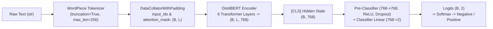

# Modeling Pipeline Specification: `lab3_v2` (Hugging Face Sentiment & IMDB Fine-Tuning)

> **Chuẩn quy trình:** [`MODEL_PIPELINE.md`](../../../../.agents/rules/dl-rule/MODEL_PIPELINE.md) (`v1.4.0`, bỏ qua Layer 3 Project Reference theo [`task.md`](../../../../.agents/tasks/0007_lab3_v2/task.md)) · **Approved Plan:** [`plan.md`](../../../../.agents/tasks/0007_lab3_v2/plan.md) (`v1.1.0`)

---

## Tổng Quan Luồng Dữ Liệu & Tensor Contract



- **Input Contract:**
  - `input_ids`: `torch.int64` (`LongTensor`) shape `(B, L)` với $1 \le L \le 256$.
  - `attention_mask`: `torch.int64` shape `(B, L)` chứa `1` ở token thật và `0` ở token `[PAD]`.
- **Output Contract:**
  - `logits`: `torch.float32` (hoặc `float16` trong AMP forward) shape `(B, 2)` tương ứng `0 = NEGATIVE`, `1 = POSITIVE`.
- **Tương thích `transformers 5.23.0`:** Dùng `TrainingArguments(eval_strategy="epoch", ...)` và `Trainer(..., processing_class=tokenizer)` (các tham số cũ `evaluation_strategy` và `tokenizer=` đã bị gỡ ở v5).

---

## 1. Business Requirement Layer

- **Bài toán học tập thực hành:** Làm chủ trọn vẹn luồng NLP hiện đại với hệ sinh thái Hugging Face (`transformers`, `datasets`, `evaluate`) qua 2 bài thực hành:
  1. **Ex1:** Chạy mô hình sentiment tiền huấn luyện (`pipeline`) và giải phẫu trực tiếp quá trình tokenize (`tokens → input_ids → attention_mask → decode`).
  2. **Ex2:** Fine-tune mô hình `distilbert-base-uncased` cho phân loại review phim nhị phân (IMDB) và kiểm chứng định lượng xem fine-tune có cải thiện rõ rệt so với trạng thái trước fine-tune hay không.

---

## 2. Problem Definition Layer

- **Task:** Binary Text Classification (Sentiment Analysis: `0 = Negative`, `1 = Positive`).
- **Input:** Chuỗi văn bản tiếng Anh → WordPiece Tokenizer → `input_ids`, `attention_mask` `(B, L)` ($L \le 256$).
- **Output:** Logits `(B, 2)` → nhãn dự đoán & xác suất Softmax.
- **Metrics:** **Accuracy** (chính), **F1-score** (nhị phân / macro), **Cross-Entropy Loss**.
- **Acceptance Criteria:**
  1. Ex1 chạy đúng, giải thích rõ `tokens`, `input_ids`, `attention_mask`, `decode` và hành vi trên câu dễ lẫn câu phủ định/mỉa mai.
  2. Ex2 fine-tune chạy hết không lỗi, `train_loss` và `eval_loss` giảm rõ rệt.
  3. **Validation Accuracy sau fine-tune > Validation Accuracy trước fine-tune** rõ rệt.
  4. Tập **Test (`1,000` mẫu)** chỉ chấm **duy nhất 1 lần cuối** sau khi Validation đạt.
  5. Báo cáo giải thích minh bạch kết quả và phân tích các ca dự đoán sai.

---

## 3–4. Project Reference (Bỏ qua) & Sanity Verification

- Bỏ qua Layer 3 (*Project Reference*) theo chỉ định tại [`task.md`](../../../../.agents/tasks/0007_lab3_v2/task.md).
- Trước khi bàn giao Kỹ sư chạy full fine-tune, toàn bộ pipeline được xác minh qua **Dual Offline Tests** (`pytest -m smoke` & full `pytest` với tiny `DistilBertConfig` + synthetic tokenizer/dataset) bảo đảm Tensor Shape Contract `(B, L) → (B, 2)`, split disjointness và khả năng giảm loss trên 1 tập nhỏ.

---

## 5. Model Design Layer

- **Ex1 Model:** `distilbert-base-uncased-finetuned-sst-2-english` (nạp qua `transformers.pipeline("sentiment-analysis")`).
- **Ex2 Model:** `distilbert-base-uncased` nạp qua `AutoModelForSequenceClassification.from_pretrained(..., num_labels=2)`.
- Đặc tả chi tiết kiến trúc, số lượng tham số và đầu phân loại xem tại **[`models/distilbert.md`](../models/distilbert.md)**.

---

## 6. Data Engineering Layer (Ex2 — IMDB Subset)

### 6.1 Data Collection
- **Input:** Hugging Face Datasets Hub — `datasets.load_dataset("imdb")` (`25,000` train + `25,000` test, 2 lớp cân bằng).
- **Output:** Cache chuẩn của `datasets` + báo cáo thống kê tại `experiments/lab3_v2/eda/collection_report.json`.

### 6.2 Data Cleaning & Audit
- **Kiểm tra trên tập con chọn lọc:** Văn bản rỗng/whitespace, thẻ HTML `<br />` đặc trưng của IMDB, mẫu trùng lặp nội bộ và chéo giữa Train / Val / Test (hash văn bản sau strip).
- **Output:** `experiments/lab3_v2/eda/cleaning_report.json`.

### 6.3 Exploratory Data Analysis (EDA)
- **Phân tích:** Cân bằng nhãn (`Negative` vs `Positive`), phân bố độ dài review theo số từ & số WordPiece tokens, tỷ lệ review vượt ngưỡng cắt `max_length = 256` tokens, và trích mẫu review thật.
- **Output:** `experiments/lab3_v2/eda/{eda_summary.json, eda_class_distribution.png, eda_token_length.png}` và báo cáo [`eda_report.md`](../eda_report.md).

### 6.4 Data Preprocessing & Anti-Leakage Split
- **Chiến lược chia tập khóa cố định (`seed = 248`, `experiments/lab3_v2/splits/split_indices.json`):**
  - **Train:** `4,000` mẫu stratified (`2,000` Neg / `2,000` Pos từ IMDB `train`).
  - **Validation:** `1,000` mẫu stratified (`500` Neg / `500` Pos từ phần còn lại của IMDB `train`, bảo đảm `Train ∩ Val = ∅`).
  - **Test:** `1,000` mẫu stratified (`500` Neg / `500` Pos từ IMDB `test` gốc, bảo đảm cách ly tuyệt đối cho tới Evaluation 8.2).
- **Tokenization:** `AutoTokenizer.from_pretrained("distilbert-base-uncased")` với `truncation=True, max_length=256` và **dynamic padding** theo từng mini-batch qua `DataCollatorWithPadding(tokenizer=tokenizer)` (tránh lãng phí tính toán trên pad cố định).

---

## 7. Model Engineering Layer

### 7.1 Model Selection & Training Config (`labs/lab3_v2/config.py`)
- **Optimizer:** `AdamW` tích hợp trong HF `Trainer` (`lr = 2e-5`, `weight_decay = 0.01`, linear LR decay).
- **Batch Size & Epochs:** `per_device_train_batch_size = 16`, `per_device_eval_batch_size = 32`, `num_train_epochs = 3`, `fp16 = True` (khi có CUDA), `seed = 248`.
- **Best Checkpoint Rule:** `eval_strategy = "epoch"`, `save_strategy = "epoch"`, `load_best_model_at_end = True`, `metric_for_best_model = "eval_loss"`, `greater_is_better = False`.

### 7.2–7.4 Training, Monitoring & Artifacts Layout (`MODEL_PIPELINE.md v1.4.0`)
> **Constraint:** Full fine-tune do **Kỹ sư trực tiếp chạy** qua `python labs/lab3_v2/train_ex2.py`.

Mọi kết quả lưu tách bạch tại `experiments/lab3_v2/runs/distilbert_imdb/`:

```text
experiments/lab3_v2/runs/distilbert_imdb/
├── monitor/      # trainer_log_history.json, loss_curve.png, tb_logs/ (TensorBoard)
├── val_eval/     # baseline_before_finetune.json, after_finetune_val.json, val_comparison.png
├── test_eval/    # final_test_metrics.json, confusion_matrix.png, error_examples.json (1 lần cuối!)
└── weights/      # HF checkpoints & best_model/ (gitignored — không commit *.safetensors/*.bin)
```

---

## 8. Evaluation Layer

### 8.1 Evaluation on Validation (`1,000` mẫu)
- **Trước fine-tune (Baseline):** Đánh giá `distilbert-base-uncased` (`num_labels = 2`, head khởi tạo mới) trên Validation bằng `Trainer.evaluate()` → lưu `val_eval/baseline_before_finetune.json`.
- **Sau fine-tune:** Đánh giá best checkpoint (`load_best_model_at_end=True` theo `min eval_loss`) trên cùng Validation → lưu `val_eval/after_finetune_val.json`.
- **Decision Gate:** Chỉ chuyển sang 8.2 khi `val_accuracy_after > val_accuracy_before` và `eval_loss` giảm ổn định.

### 8.2 Evaluation on Held-Out Test (`1,000` mẫu — Chấm 1 Lần Duy Nhất)
- Chạy qua `python labs/lab3_v2/eval_ex2.py`: nạp `weights/best_model/`, đánh giá duy nhất **1 lần** trên tập Test `1,000` mẫu, xuất `test_eval/final_test_metrics.json` (Accuracy, F1, Precision, Recall, Loss, Confusion Matrix 2×2) và `test_eval/confusion_matrix.png`.

---

## 9. Error Analysis & Continuous Improvement Layer

- Trích xuất các mẫu dự đoán sai từ tập Test (tách nhóm **High-Confidence Errors** và **Boundary / Low-Confidence Errors**) vào `test_eval/error_examples.json`.
- Phân tích định tính + định lượng theo đặc trưng văn bản: review dài bị cắt ở `256` tokens (`was_truncated`), câu phủ định/mỉa mai, và review có cảm xúc pha trộn (mixed sentiment) → ghi nhận tại [`evaluation_report.md`](../evaluation_report.md).

---

## 10. Inference & Deliverables Layer

- Kiểm chứng suy luận trực tiếp trên các câu review mới bằng `AutoTokenizer` + `AutoModelForSequenceClassification` đã fine-tune dưới `@torch.inference_mode()`.
- Trình bày tương tác tại 2 executable notebooks: [`ex1_sentiment.ipynb`](../../ex1_sentiment.ipynb) và [`ex2_finetune.ipynb`](../../ex2_finetune.ipynb).
